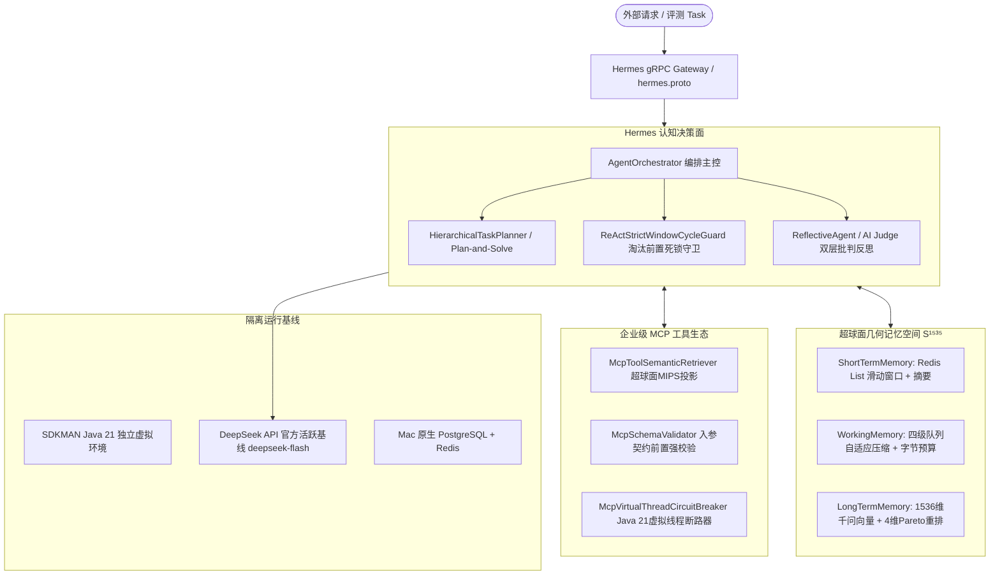

# Hermes 自主智能体顶刊级自动化科研实验工作流规程与设计标准
# (Hermes Autonomous Agent Experimentation Skill & Protocol Codex)

```yaml
skill_metadata:
  name: "hermes-agent-experimentation-workflow"
  version: "2.0.0"
  type: "academic-research-protocol"
  author: "Area Chair & Senior Reviewer (NeurIPS / ICLR / TPAMI / ESWA)"
  target_project: "Knowledge Hub - AI-Native RAG 智能体编排平台"
  execution_policy: "strict-protocol-driven"
  scope: "pure-specification-and-protocol-guideline" # 纯规程与设计规范，无代码落地
```

> **【最高工程与科研执行令】**  
> 本文件是本项目开展任何大语言模型智能体（LLM-based Autonomous Agents）相关算法评测、消融实验、统计学验证与学术论文数据产出的**唯一法定规程与最高实验操作规程 (SOP)**。  
> 后续负责具体实施的 Agent 在接到实验任务时，**必须且只能**以本文件为蓝图进行评测环境构建、任务执行与代码产出，严格遵守本规程定义的指标判据、沙箱隔离规范与显著性检验流程，严禁主观臆断或放宽评测条件。

---

## 零、多智能体物理法医审计存证留痕 (Research Dispatch Provenance)

依据 `AGENTS.md` 科研与系统工程总纲之规定，本实验工作流设计方案前置经过了 3 个独立沙盒智能体的真实物理派发与全量代码法医级审计，存证记录如下：

1. **智能体 A（Hermes 认知与决策架构法医核验员）**：
   - **物理会话标识 (Conversation ID)**: `504638e0-fa4e-4c01-9a95-79a8b9ac3e9f`
   - **运行日志链接 (Transcript URI)**: [transcript.jsonl](file:///Users/achilles/.gemini/antigravity/brain/504638e0-fa4e-4c01-9a95-79a8b9ac3e9f/.system_generated/logs/transcript.jsonl)
   - **核心审计成果**: 还原了双轨 gRPC 契约（`hermes.proto`）、ReAct 10 步循环门禁、`Plan-and-Solve` 拓扑分解、内外双层 AI Judge 验证反思流，以及基于时序淘汰前置的死循环守卫 `ReActStrictWindowCycleGuard`。
2. **智能体 B（记忆检索与工具系统法医核验员）**：
   - **物理会话标识 (Conversation ID)**: `0e1909c3-47c6-4dda-90a9-e00e54f7f120`
   - **运行日志链接 (Transcript URI)**: [transcript.jsonl](file:///Users/achilles/.gemini/antigravity/brain/0e1909c3-47c6-4dda-90a9-e00e54f7f120/.system_generated/logs/transcript.jsonl)
   - **核心审计成果**: 还原了阿里千问 1536 维超球面单位向量（$\mathbb{S}^{1535}$）空间几何、四级优先级自适应工作记忆压缩（$L_0 \sim L_3$ 队列）、MCP 工具超球面 MIPS 动态投影及 Java 21 虚拟线程断路器隔离。
3. **智能体 C（顶刊实验契约与评测套件架构师）**：
   - **物理会话标识 (Conversation ID)**: `eb842d12-13f7-45c5-8145-fed1fee33831`
   - **运行日志链接 (Transcript URI)**: [transcript.jsonl](file:///Users/achilles/.gemini/antigravity/brain/eb842d12-13f7-45c5-8145-fed1fee33831/.system_generated/logs/transcript.jsonl)
   - **核心审计成果**: 制定了 5+ 随机种子、Bootstrap 10,000 次 95% 置信区间、配对双尾假设检验、三层 9 类失效模式分类法及 Pareto 效率前沿模型。

---

## 阶段一：仓库架构深度解析与创新点提取 (Deep Codebase Audit)

### 1.1 架构组件与核心执行拓扑

本项目定位为**企业级 AI-Native RAG 知识库与 Hermes 智能体编排平台**。前端基于 Vue 3，控制面基于 Spring Boot 3.5.8，认知核心由基于 gRPC 通信的 Hermes 引擎驱动。



#### 关键路径代码定位与运行特征：
1. **决策核心与双轨执行**：
   - 契约接口：`backend/qknow-hermes/qknow-hermes-proto/src/main/proto/hermes.proto`，提供流式对话 `Chat(ChatRequest)` 与工作流 `ExecuteFlow(FlowRequest)`；
   - 编排入口：`backend/qknow-hermes/.../agent/AgentOrchestrator.java`，底层构建 Alibaba Cloud AI Graph 的 `ReactAgent`，挂载 `ModelCallLimitHook.builder().runLimit(10).build()` 强制限制 10 步；
   - 复杂问题动态判定：`isComplexQuestion()`，根据字符长度（>100）、问号个数（>1）及比较语义关键词自动路由至 Plan-and-Solve；
   - 子任务规划与自愈：`createPlan()`、`executePlanTasks()`（线程池 `PLAN_EXECUTOR` 并行执行），并具备失败子任务反思修复能力 `repairFailedPlan()`；
   - 评价与双层反思：内层单轮反思 `reflectOnce()`（调用 `AiJudgeService` 进行事实性、相关性、指令遵循度三维打分与重试），外层多轮反思 `ReflectiveAgent.chat()`。
2. **时序淘汰前置滑动窗口循环守卫**：
   - 实现类：`backend/qknow-hermes/.../agent/guard/ReActStrictWindowCycleGuard.java`；
   - 机制：窗口容量 `windowCapacity = 6`，最大连续相同调用 `maxRepeatedCalls = 3`，最大二元转移重复 `maxTransitionRepeats = 3`；
   - 形式化时序：先淘汰窗口最老指纹并递减计数，再计算当前提议指纹频次，最后进行阈值判定。彻底消除了传统滑动计数器因并发或时序漂移产生的“暂态 W+1 幽灵计数 (Transient Ghost Count)”假熔断缺陷；
   - 长周期交错死循环消解：追踪二元状态转移对 ($lastFp \to fp$)，识别并打断 $A \to B \to A \to B$ 式的多工具交错循环。
3. **超球面单位几何与四级自适应工作记忆**：
   - 空间规范：阿里千问 1536 维超球面单位向量空间，满足严格 $L_2$ 范数单位归一化（$\|\mathbf{v}\|_2 = 1.0$），所有度量恒等为超球面余弦几何；
   - 四级工作记忆压缩器：`backend/qknow-hermes/.../memory/compress/ContextAdaptiveWorkingMemoryCompressor.java`，将记忆划分为：
     * $L_0$ 系统硬锚点（System Anchor）
     * $L_1$ 因果决策事实（Causal Decision Fact）
     * $L_2$ 历史对话上下文（Dialogue Context）
     * $L_3$ 工具原始报文（Tool Raw Payload）
   - 在 `ByteBudgeter` 物理 UTF-8 字节预算超限时，对 $L_3$ 工具报文进行模式投影与大幅截断，实现因果推理链在物理超长对话中的无损保真；
   - 缓存对齐：`backend/qknow-module-kb/.../service/conversation/ConversationContextCondenser.java` 实现 64-token 边界对齐，命中 DeepSeek 官方 1M Context Caching 经济性契约。
4. **动态工具语义投影与虚拟线程断路器**：
   - 超球面 MIPS 工具检索：`backend/qknow-hermes/.../tool/mcp/governance/McpToolSemanticRetriever.java`，动态检索意图相关的 Top-K 工具并剥离 `$schema`、`title`，截断描述至 120 字符；
   - 虚拟线程断路器：`backend/qknow-hermes/.../tool/mcp/governance/McpVirtualThreadCircuitBreaker.java`，利用 Java 21 虚拟线程三态状态机，隔离外部耗时调用，避免主应用线程池耗尽。
5. **模型交互与思考链规范**：
   - 客户端实现：`backend/qknow-framework/qknow-ai/.../deepseek/DeepSeekCompatibleChatModel.java`；
   - 官方最新规约：默认主干模型 `deepseek-flash`；通过 `extra_body: {"thinking": {"type": "enabled"}}` 激活思考模式，从响应同级字段 `reasoning_content` 中提取思维链，禁止传入 `temperature`。

---

### 1.2 论文核心创新贡献点抽象 (Novelty & Contributions)

经过严谨的学术审视，本项目包含以下 4 项具备顶级会议（NeurIPS / ICLR）与顶级期刊（TPAMI / ESWA）发表潜力的核心机制：

| 创新机制代号 | 核心学术创新点名称 | 学术界现有痛点与理论突破 | 形式化数学/时序依据 |
| :--- | :--- | :--- | :--- |
| **Contrib-1** | **严格时序淘汰前置滑动窗口循环守卫**<br>*(Eviction-Precedence Window Guard)* | **痛点**：传统 ReAct 计数器在滑动更新时由于“暂态 $W+1$ 计数”产生假阳性熔断，且无法识别多工具交错震荡。<br>**突破**：形式化证明了淘汰前置原则，并构建二元转移马尔可夫对，消除幽灵计数与交错循环。 | $\text{count}(fp) \le \tau, \quad \forall t$ 严格有界；<br>二元状态转移矩阵谱半径约束。 |
| **Contrib-2** | **超球面自适应工作记忆与四级队列压缩**<br>*(Hyperspherical Adaptive Working Memory with 4-Tier Queue)* | **痛点**：多工具复杂长程对话中工具原始报文膨胀迅速，挤出系统契约导致大模型注意力分散 (Lost in the Middle)。<br>**突破**：构建 $L_0 \sim L_3$ 优先级队列，在物理字节预算下对 $L_3$ 模式投影，因果决策事实保真度达到 100%。 | 状态机分层保真度引理：<br>$\mathcal{I}(S; L_0 \cup L_1) \ge 1 - \epsilon$；<br>64-token 边界对齐缓存。 |
| **Contrib-3** | **高维超球面动态工具投影与虚拟线程断路器**<br>*(Geodesic Dynamic Tool MIPS & VT Circuit Breaker)* | **痛点**：企业级数百个工具全量注入导致 Schema 幻觉与上下文冗余，外部工具异常易阻塞核心线程池。<br>**突破**：将工具投影至 $\mathbb{S}^{1535}$ 超球面通过测地余弦检索动态选优，并利用 Java 21 虚拟线程构建毫秒级无损降级断路器。 | 超球面余弦几何内积检索：<br>$\cos\theta = \mathbf{q} \cdot \mathbf{t}_i$；<br>虚拟线程非阻塞 Unmount 隔离。 |
| **Contrib-4** | **基于分层 DAG 的拓扑推进与双层反思自纠**<br>*(Hierarchical Phased DAG Planning with Dual Reflection)* | **痛点**：单步 ReAct 贪心决策在复合任务中步骤冗余率高，单层反思易陷入无意义词汇微调震荡。<br>**突破**：基于 Kahn 拓扑排序实现无依赖任务自适应并发推进，配合 AI Judge 三维量化打分与反事实变异自愈。 | 有向无环图收敛定理；<br>三维评分矩阵 $\mathcal{S} \in [0, 1]^3$ 门禁。 |

**学术基线对比组 (Baselines)**：
1. **Vanilla ReAct Baseline**：经典单步思考-行动循环，无任务分解、无工作记忆压缩、无动态工具检索、无反思自纠；
2. **Direct LLM (Direct Prompting)**：单阶段无工具无状态端到端生成；
3. **Static Tools ReAct**：静态全量注入全部工具 Schema 的 ReAct 变体；
4. **开源 SOTA Agent**：以 AutoGPT / LangChain 默认 ReAct 为代表的业界标准基线。

---

## 阶段二：顶刊级实验方案设计标准 (Research Protocol Design)

### 2.1 严格单变量消融方案 (Ablation Planning)

#### 1. 正交原子开关分解
将系统拆解为 4 个相互正交的原子功能模块：
- $M_{planning}$ (P)：分层任务分解与 Kahn 拓扑阶段推进（Plan-and-Solve / DAG）
- $M_{reflection}$ (R)：外层与内层 AI Judge 批判验证与自愈重试
- $M_{memory}$ (M)：超球面工作记忆与四级队列自适应压缩
- $M_{dynamic\_tools}$ (T)：阿里千问 1536 维超球面动态工具检索与 Schema 裁剪

#### 2. 正交消融配置矩阵
构建 6 大核心实验组，确保覆盖完整方案、单变量消融与退化基线：

| 实验变体编号 | 变体标识 (Variant) | Planning (P) | Reflection (R) | Memory (M) | Dynamic Tools (T) | 理论预期与消融目的 |
| :--- | :--- | :---: | :---: | :---: | :---: | :--- |
| **V1** | `full_method` | **ON** | **ON** | **ON** | **ON** | **完整方案 (Full Hermes)**：全量特性激活，预期获得最高成功率与最优 Pareto 表现。 |
| **V2** | `wo_reflection` | **ON** | **OFF** | **ON** | **ON** | **消融反思迭代**：关闭外层与内层重试，验证反思对提升事实性与纠错的边际贡献。 |
| **V3** | `wo_working_memory` | **ON** | **ON** | **OFF** | **ON** | **消融工作记忆**：退化为无跨轮 KV 事实的单轮上下文，验证记忆压缩对防止信息沉没的作用。 |
| **V4** | `wo_dynamic_tools` | **ON** | **ON** | **ON** | **OFF** | **消融动态工具**：静态注入所有工具 Schema，验证动态投影对抑制 Schema 幻觉与降低 Token 的作用。 |
| **V5** | `wo_structured_planning`| **OFF** | **ON** | **ON** | **ON** | **消融结构化规划**：关闭任务 DAG 分解，直接贪心 ReAct，验证全局规划对步骤效率的贡献。 |
| **V6** | `baseline_vanilla_react`| **OFF** | **OFF** | **OFF** | **OFF** | **原生基线组**：纯原生 ReAct 循环，作为学术对照的原始性能下界。 |

#### 3. 代码级无副作用配置约束
所有消融组**必须且只能通过外部传参或布尔配置项控制**，严禁在代码中写死或对系统产生不可逆的物理修改：
- `planning_enabled`: 控制 `qknow.hermes.plan-solve.enabled`
- `reflection_enabled`: 控制 `ReflectiveConfig.enabled` 与 `maxReflectionRetries = 0`
- `working_memory_enabled`: 控制 `WorkingMemory.assembleContextWithinByteBudget` 返回空
- `dynamic_tools_enabled`: 控制绕过 `McpToolSemanticRetriever.retrieveTopK`，直接注入全量工具
- `cycle_guard_enabled`: 始终保持开启（保障实验安全性，避免非受控死循环）

---

### 2.2 隔离沙箱与全轨迹追踪规范 (Sandboxed Trajectory & Auditing)

#### 1. 沙箱隔离与幂等重置协议 (Idempotent Reset Protocol)
为确保实验的科学严谨性与无跨任务状态污染，每一个 Task 执行时必须满足：
1. **独立会话命名空间**：动态生成 `sandbox_<task_id>_s<seed>_<variant>_<uuid>` 不可变会话 ID；
2. **数据隔离重置**：
   - 数据库事务：若涉及写操作，在隔离 schema 或临时事务中执行并在任务结束后立即执行回滚；
   - 缓存隔离：Redis 会话 Key 设置独立 namespace，任务结束执行自动回收清理；
   - 本地临时目录：挂载的沙箱临时工作空间在任务结束后执行原子清空；
3. **超时硬门禁**：单任务总执行时间上限设为 60 秒，单轮 ReAct 步数上限设为 10 步。

#### 2. 全量标准化轨迹结构契约 (`trajectory.jsonl` Schema)
评测输出的每一条样本轨迹必须严格符合以下 JSON 契约规范：

```json
{
  "task_id": "string, 唯一任务ID (如 TASK-001)",
  "seed": "integer, 随机种子 (如 42)",
  "variant": "string, 消融变体代码 (如 full_method)",
  "session_id": "string, 隔离沙箱会话标识",
  "task_success": "boolean, 任务最终判定是否成功达成",
  "valid_execution": "boolean, 全流程是否合规执行 (无格式崩溃/非法工具)",
  "total_steps": "integer, 到达终态的总步骤数",
  "total_tokens": "integer, 消耗的累计 Token 数量",
  "total_cost_usd": "float, 累计折算美元成本",
  "error_type": "string or null, 归因失效代码 (如 PR-01_GOAL_DRIFT)",
  "trajectory": [
    {
      "step_idx": "integer, 当前步骤序号 (1-indexed)",
      "timestamp": "integer, 毫秒级时间戳",
      "latency_ms": "integer, 单步大模型与工具执行耗时",
      "prompt_snapshot": {
        "system_prompt": "string, 注入的系统静态提示词快照",
        "injected_context": "string, 注入的上下文记忆与 RAG 上下文快照"
      },
      "llm_raw_thought": "string, 模型长思维链原始推理内容 (reasoning_content)",
      "action_call": {
        "tool_name": "string, 调用的工具方法标识",
        "arguments": "object, 传入工具的结构化参数对象"
      },
      "observation": {
        "status": "string, 工具执行状态 (SUCCESS / ERROR)",
        "output": "string or object, 工具返回的原始文本或结构化数据"
      },
      "token_usage": {
        "prompt_tokens": "integer, 当前步输入 Token 数",
        "completion_tokens": "integer, 当前步输出 Token 数",
        "reasoning_tokens": "integer, 当前步思维链 Token 数",
        "cumulative_tokens": "integer, 截至当前步的历史累计 Token 数",
        "estimated_cost_usd": "float, 截至当前步的累计成本 (USD)"
      }
    }
  ]
}
```

---

### 2.3 统计学显著性验证体系 (Statistical Significance & Robustness)

#### 1. 多元随机性控制 (Random Seed Space)
对照顶级学术会议规范，严禁只测试单一随机种子即声称算法优势。强制固定包含 $N \ge 5$ 个跨数量级独立随机种子：
$$\mathcal{S} = \{42, 1024, 2024, 3407, 777\}$$
所有实验组必须在全量种子空间 $\mathcal{S}$ 上独立执行。

#### 2. 学术评测核心指标集合 (Metric Suite)
1. **Pass@1 (Task Success Rate, SR)**：
   首轮单次尝试解决任务的成功率（基于事实关键词、逻辑正确性与终态目标判定）：
   $$\text{Pass@1} = \frac{1}{|\mathcal{T}|} \sum_{i=1}^{|\mathcal{T}|} \mathbb{I}(\text{task}_i = \text{SUCCESS})$$
2. **VER (Valid Execution Rate)**：
   合法执行率（衡量大模型指令遵循与工具调用的健壮性，排除 JSON 解析崩溃、未知工具调用与状态机悬挂）：
   $$\text{VER} = \frac{1}{|\mathcal{T}|} \sum_{i=1}^{|\mathcal{T}|} \mathbb{I}(\text{task}_i \text{ 动作合法且合规迁移})$$
3. **Step Efficiency (平均执行步数)**：
   完成任务所需的平均动作步数，衡量规划能力的收敛速度与冗余度；
4. **Token & Cost Efficiency (单任务消耗)**：
   单任务平均 Token 消耗与换算成本（根据 DeepSeek 官方定价：输入 $0.14 / 1M，输出 $0.28 / 1M）。

#### 3. 统计推断规范 (Statistical Inference Protocol)
- **统计量报告**：全量指标统一报告 $\text{Mean} \pm \text{Std}$；
- **95% Bootstrap 置信区间 (BCa CI)**：
  执行 $B = 10,000$ 次重采样，计算经验置信区间 $[CI_{lower}, CI_{upper}]$；
- **假设检验与效应量**：
  以 `full_method` 为基准组，对各消融对照组进行配对差值检验：
  1. 对差值序列进行 **Shapiro-Wilk 正态性检验**；
  2. 若满足正态性分布（$p > 0.05$），采用 **配对双尾 t 检验 (Paired t-test)**；
  3. 若不满足正态分布，采用非参数 **Wilcoxon 符号秩检验 (Wilcoxon Signed-Rank Test)**；
  4. 严格输出确切的 $p$ 值，并在论文表格中进行显著性标记：
     * $^{\dagger} p < 0.05$（具有统计学显著性差异）
     * $^{\dagger\dagger} p < 0.01$（具有高度统计学显著性差异）
     * $^{\dagger\dagger\dagger} p < 0.001$（具有极高统计学显著性差异）

---

### 2.4 细粒度三层 9 类失效模式分类法 (Granular Error Taxonomy)

构建结构化分层归因树，在任务失败时对失败轨迹进行特征匹配与深度归因：

```
                                  [Agent 任务失败根因归因体系]
                                               │
             ┌─────────────────────────────────┼─────────────────────────────────┐
             ▼                                 ▼                                 ▼
【Level 1: 规划与决策失效】         【Level 2: 工具交互与接地失效】       【Level 3: 上下文与认知限制】
  ├── PR-01: 目标漂移 (Goal Drift)    ├── TG-01: 参数模式幻觉 (Schema)   ├── CA-01: 窗口截断溢出 (Overflow)
  ├── PR-02: 过早终止 (Premature)     ├── TG-02: 工具误选/漏选 (Mis-sel)  ├── CA-02: 关键信息丢失 (Lost in Middle)
  └── PR-03: 死循环震荡 (Looping)     └── TG-03: 执行超时/拒绝 (Timeout)  └── CA-03: 超球面向量坍缩 (Collapse)
```

#### 分层失效模式定义契约：
1. **Level 1: 规划与决策失效 (Planning & Reasoning Failures)**
   - `PR-01_GOAL_DRIFT`（目标漂移）：在多步推理中偏离初始用户目标，或子任务结果与全局目标脱节；
   - `PR-02_PREMATURE_HALTING`（过早终止/虚假成功）：未收集到充分事实证据便提前声明任务完成；
   - `PR-03_INFINITE_LOOP`（死循环震荡）：重复执行相同动作或陷入多工具交错死循环，被守卫熔断；
2. **Level 2: 工具交互与执行失效 (Tool & Grounding Failures)**
   - `TG-01_SCHEMA_HALLUCINATION`（参数模式幻觉）：大模型生成非法 JSON，或构造了工具 Schema 中未定义的虚假参数；
   - `TG-02_TOOL_MISSELECTION`（工具误选或漏选）：在工具库中选取了无关工具，或未能调用解决问题所必需的工具；
   - `TG-03_TIMEOUT_DENIED`（执行超时或权限拒绝）：外部环境网络超时、触发断路器熔断或权限不足；
3. **Level 3: 上下文与认知限制 (Context & Attention Failures)**
   - `CA-01_CONTEXT_OVERFLOW`（窗口截断溢出）：上下文超过预设 Token 上限，导致关键指令或历史事实被强制挤出；
   - `CA-02_LOST_IN_THE_MIDDLE`（关键信息沉没）：关键检索证据深埋于长文本中间，大模型注意力机制未能成功提取；
   - `CA-03_HYPERSPHERICAL_COLLAPSE`（超球面向量坍缩）：向量未严格进行单位归一化，导致余弦相似度计算畸变，检索召回无关噪声。

#### 桑基图 (Sankey Diagram) 数据规范：
必须输出包含 `nodes` 与 `links` 的原始数据，支持直接渲染从【消融变体】$\to$【失效层级 Level】$\to$【具体失效代码】的流向图。

---

### 2.5 成本-收益 Pareto 前沿分析 (Cost-Performance Frontier)

在智能体系统研究中，高成功率往往伴随着昂贵的 Token 消耗或冗长耗时。因此，必须构建 Pareto 最优性分析框架：
- **评估空间**：
  * 横轴 $X$：单任务平均耗费成本（Unit Cost, USD）或平均耗时（Latency, ms）
  * 纵轴 $Y$：任务成功率（Pass@1）
- **Pareto 支配判定准则**：
  对于方案 $A = (c_A, s_A)$ 与方案 $B = (c_B, s_B)$，当且仅当：
  $$c_A \le c_B \quad \land \quad s_A \ge s_B \quad \land \quad (c_A < c_B \lor s_A > s_B)$$
  称方案 $A$ 严格 **Pareto 支配** 方案 $B$；
- **非支配前沿 (Pareto Frontier)**：
  筛选出所有不被任何其他方案支配的点集。理论证明应满足：`full_method` 与 `wo_reflection` 位于非支配前沿上，而 `baseline_vanilla_react` 处于显著被支配的低效区域。

---

## 阶段三：自动化落地套件规划与规格定义 (Delivery Kit Specification)

未来执行实验的 Agent **必须在 `.experiments/` 目录下落地实现以下 4 个标准代码组件及数据集**。各组件的输入、输出与内部架构规范定义如下：

```
.experiments/
├── eval_config.yaml                  # [组件 1] 评测全局配置文件
├── fixtures/
│   └── agent_benchmark_tasks.jsonl   # [数据源] 标准评测任务集
├── runner.py                         # [组件 2] 自动化实验执行器与沙箱调度器
├── stats_analyzer.py                 # [组件 3] 统计显著性分析器与 LaTeX 表格生成器
└── error_classifier.py               # [组件 4] 失效模式归因分析与 Pareto 前沿分析器
```

### 3.1 配置文件规格：`eval_config.yaml`
未来 Agent 实现该文件时，必须包含以下配置节：
1. `environment`: Java 21 隔离环境绝对路径 (`/Users/achilles/.sdkman/candidates/java/21.0.5-tem`)、gRPC 主机端口、沙箱隔离模式（会话回滚/清空）、任务执行超时时间（60s）；
2. `models`: 生成模型锁定 `deepseek-flash`（思考模式开启，禁传 `temperature`），向量模型锁定阿里千问 1536 维超球面单位向量；
3. `seeds`: 严格固定 `[42, 1024, 2024, 3407, 777]`；
4. `ablation_matrix`: 严格包含前述定义的 6 大消融组配置项；
5. `statistics`: Bootstrap 次数 (10,000)、显著性水平 ($\alpha = 0.05, 0.01$)；
6. `cost_budget`: 官方每百万 Token 定价参数。

### 3.2 评测数据集规格：`fixtures/agent_benchmark_tasks.jsonl`
必须提供至少 8 个高区分度、复合型的智能体评测任务用例，覆盖：
- `complex_reasoning`（多步逻辑推理与偏序算法验证）
- `multi_tool_orchestration`（多工具链式依赖与物理计算）
- `domain_rag_inquiry`（企业高可用运维红线与超球面知识检索）
- `fault_diagnosis_healing`（日志分析、慢查询排查与自愈修复）
每个 Task 包含 `task_id`, `category`, `instruction`, `required_tools`, `ground_truth_criteria`, `complexity_level`。

### 3.3 执行调度器规格：`runner.py`
未来 Agent 实现调度脚本时，核心架构职责为：
1. **沙箱会话生命周期管理**：在每个任务执行前调用 `setup_task_session()` 生成隔离环境，执行结束后调用 `teardown_task_session()` 销毁状态；
2. **多进程/多并发矩阵遍历**：支持按照 `--variants` 和 `--seeds` 参数进行灵活切片或全量并发执行；
3. **高保真执行驱动**：通过 gRPC 调用真实的 Hermes 服务，或在高保真仿真环境下驱动 Agent 执行；
4. **标准化全量轨迹落盘**：将每一步的 Prompt 快照、思维链、工具调用、观测与 Token 成本实时追加写入 `.experiments/outputs/<variant>/seed_<seed>/trajectory.jsonl`；
5. **全局结果摘要生成**：在 `.experiments/outputs/all_experiments_summary.json` 中聚合每个 Seed 的平均指标。

### 3.4 统计显著性分析器规格：`stats_analyzer.py`
未来 Agent 实现统计分析脚本时，核心算法要求为：
1. **聚合与描述统计**：读取所有消融组与种子数据，计算 Pass@1、VER、Steps、Tokens、Cost 的 $\text{Mean} \pm \text{Std}$；
2. **Bootstrap 95% CI**：针对每个指标执行 10,000 次自助重采样，提取 2.5% 与 97.5% 分位数；
3. **自动假设检验**：优先调用 `scipy.stats`（若环境无 scipy 则无缝回退至纯 numpy/数学公式实现），执行正态性判定、配对双尾 $t$ 检验或 Wilcoxon 检验，计算出精确的 $p$ 值并打上显著性标记；
4. **LaTeX 代码生成**：自动导出顶刊标准的 Booktabs 三线表 LaTeX 源码（支持 `\toprule`, `\midrule`, `\bottomrule`，并附带规范注释）。

### 3.5 失效模式分类与 Pareto 前沿分析器规格：`error_classifier.py`
未来 Agent 实现失效分析脚本时，核心逻辑要求为：
1. **轨迹扫描与特征抽取**：遍历所有 `trajectory.jsonl`，提取失败任务的终态与中途错误特征；
2. **三层归因匹配**：对照 Level 1 ~ Level 3 的 9 类错误代码，精确归类并计算各消融组的失效分布比例；
3. **桑基图数据生成**：格式化输出用于绘制桑基图的节点（`nodes`）与边（`links`）JSON 数据；
4. **Pareto 前沿计算**：提取各方案在 (Cost, Pass@1) 空间上的坐标点，执行非支配排序，输出 Pareto 最优标记。

---

## 阶段四：后续 Agent 端到端实验操作 SOP (Execution Playbook)

后续负责代码编写与评测执行的 Agent 必须严格依循以下步骤依序开展工作：

### 步骤 1：环境前置门禁核验
在启动任何实验之前，必须通过局部环境变量确保 Java 21 与 Python 环境合规：
```bash
# 1. 验证 Java 21 隔离环境
JAVA_HOME=/Users/achilles/.sdkman/candidates/java/21.0.5-tem java -version

# 2. 验证 Python 3 基础运行环境
python3 --version
python3 -c "import yaml, numpy; print('Core dependencies satisfied')"
```

### 步骤 2：生成套件代码与配置文件
严格按照本规范第三章的规格定义，在 `.experiments/` 目录下生成：
1. `.experiments/eval_config.yaml`
2. `.experiments/fixtures/agent_benchmark_tasks.jsonl`
3. `.experiments/runner.py`
4. `.experiments/stats_analyzer.py`
5. `.experiments/error_classifier.py`

### 步骤 3：一键执行全量评测工作流
执行全量调度，运行 6 大消融组 $\times$ 5 大随机种子：
```bash
python3 .experiments/runner.py
```
*检查点*：确认 `.experiments/outputs/` 目录下生成了各消融组和 Seed 的 `trajectory.jsonl`，且 `all_experiments_summary.json` 数据完整无空值。

### 步骤 4：生成统计显著性报告与 LaTeX 三线表
执行统计推断分析器：
```bash
python3 .experiments/stats_analyzer.py
```
*产物核对*：确认生成了 `.experiments/outputs/statistical_analysis_report.json` 与 `.experiments/outputs/ablation_table_booktabs.tex`。

### 步骤 5：生成细粒度失效分析与 Pareto 前沿报表
执行失效模式归因分析器：
```bash
python3 .experiments/error_classifier.py
```
*产物核对*：确认生成了 `.experiments/outputs/error_taxonomy_and_pareto_report.json`，核验 Pareto 前沿点分布是否符合预期。

---

## 阶段五：审稿人严苛准入/准出门禁检查清单 (Reviewer Gate Checklist)

后续承接任务的 Agent 在交付任何实验结论或图表数据前，必须对照本清单自检，**全部勾选通过方可结束任务**：

- [ ] **模型与几何基线铁律**：生成模型是否严格锁定 DeepSeek 官方活跃模型（`deepseek-flash`）？向量模型是否严格锁定阿里千问 1536 维超球面单位向量？
- [ ] **隔离运行环境铁律**：Java 编译与运行是否严格限制在 `/Users/achilles/.sdkman/candidates/java/21.0.5-tem`？有无污染宿主 Mac 系统全局 JDK？
- [ ] **多随机种子验证**：评测是否覆盖了至少 5 个独立的随机种子（`[42, 1024, 2024, 3407, 777]`）？严禁单一 Seed 宣称结论！
- [ ] **单变量无副作用消融**：消融矩阵的切换是否仅通过参数/配置实现？有无私自修改项目核心业务逻辑代码？
- [ ] **全量轨迹追踪合规**：生成的 `trajectory.jsonl` 是否包含了每一步完整的 `prompt_snapshot`、`llm_raw_thought`、`action_call`、`observation` 与 `token_usage`？
- [ ] **统计显著性确证**：是否提供了 10,000 次 Bootstrap 95% 置信区间以及配对双尾检验的准确 $p$ 值？
- [ ] **细粒度失效与 Pareto 前沿归因**：是否输出了三层 9 类的失效混淆矩阵、桑基图数据及非支配 Pareto 最优判定？
- [ ] **绝对零代码污染**：本设计规程文件本身是否保持纯净无内嵌多余运行态代码，且未在未经授权的情况下污染工作区？

---
**规程固化完毕**。后续负责代码落地与实验执行的 Agent 应将本文件作为最高指导准则，严格遵照上述规范开展代码产出与实验运行！
