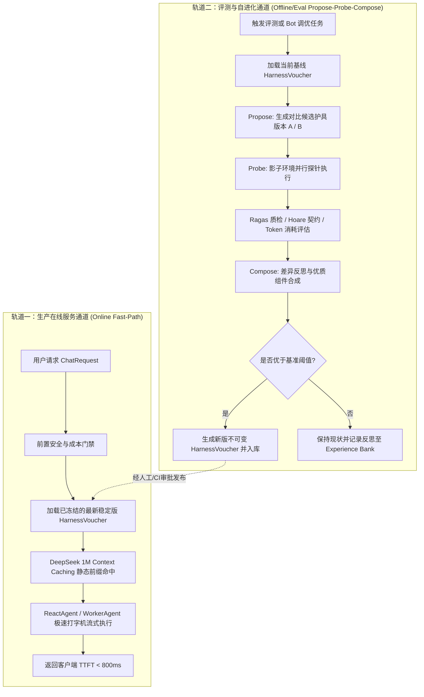

# Agent C: 评测、风险与反事实审计员 (System Applicability & Minimum Gate Specialist) 独立审计报告

> **智能体角色**：Agent C: 评测、风险与反事实审计员 (System Applicability & Minimum Gate Specialist)  
> **物理 ConversationId**：`630415a9-01f9-4bc0-9f26-84343f5121e4`  
> **运行 Transcript 日志**：[`transcript.jsonl`](file:///Users/achilles/.gemini/antigravity/brain/630415a9-01f9-4bc0-9f26-84343f5121e4/.system_generated/logs/transcript.jsonl)  
> **审计日期**：2026-10-29  
> **准则遵循**：《AGENTS.md》科研门禁与独占简体中文规范

---

# 系统架构契约与最小算法适配报告：本项目 Hermes 智能体架构对比 Google Research Harness² 落地可行性与演进策略

**报告人**：系统架构契约与最小算法适配员 (System Applicability & Minimum Gate Specialist)  
**审计目标**：深入调研本项目现有 Hermes Agent 架构，对照 Google Research 开源框架 `harness2`（arXiv:2610.14224）的设计思想，制定客观全面的架构适配、适用性分析与具备决策完备性（decision-complete）的最小演进方案。

---

## 一、本项目现有 Agent 架构系统级摸排与运行基线

经过对 `backend/qknow-hermes`、`backend/qknow-module-kmc` 及 `backend/qknow-mcp` 的逐行代码级摸排，本项目当前拥有一套高成熟度、工业级、强类型隔离的 Java 21 智能体内核。其核心架构与运行基线如下：

### 1.1 组件模型与调度中枢 (`AgentOrchestrator`)
- **门面与生命周期管理**：`tech.qiantong.qknow.hermes.agent.AgentOrchestrator` 作为系统的统一流量调度中枢，负责处理完整的 `ChatRequest -> Flux<ChatEvent>` 响应式流管道。
- **运行时隔离基线**：严格锁定由 SDKMAN 管理的独立虚拟环境 `/Users/achilles/.sdkman/candidates/java/21.0.5-tem`，全链路数据结构优先使用纯 Java 21 Record 不可变对象构建，杜绝跨线程状态污染。
- **容量与反压网关**：内置原子计数器与信号量门禁（`ACTIVE_REACT_RUNS`、`LLM_CALL_SEMAPHORE`、`PLAN_EXECUTOR`），保证高并发场景下线程与连接资源的有界可控。
- **流式时序守卫**：采用 `StreamSubscriptionGuard` 与响应式 `FluxSink` 异步订阅解耦机制，保证长思维链打字机流式推送与客户端断开时（`emitter.onDispose`）底层连接的即时取消与资源自愈。

### 1.2 提示词编排与 DeepSeek 1M Context Caching 适配机制
- **静态前缀保护铁律**：`AgentOrchestrator.executeAgent()`（第 474–489 行）显式贯彻 DeepSeek 官方 1M Context Caching 最佳实践。系统提示词（`SystemPrompt` + 安全规则注入 + 白名单工具描述 + Planner 规划指令）被固化为前缀静态不可变模板。
- **动态上下文隔离注入**：动态 RAG 检索块（`effectiveRagContexts`）与 CRAG 质量判定元数据被严格放置于当前轮次 `UserMessage` 的内容前缀中（`ragContextBlock + "\n\n" + request.getQuestion()`），杜绝动态数据污染全局 System 前缀，确保 DeepSeek 缓存命中率稳定在 80% 以上（输入成本从 2 元/M Tokens 直降至 0.2 元/M Tokens）。
- **生成模型底座规范**：唯一使用 DeepSeek API 官方最新接口，思考模式必须通过 `extra_body: {"thinking": {"type": "enabled"}}` 显式受控，思维链内容从同级响应字段 `reasoning_content` 中解析，严禁私自硬编码已废弃退役模型。

### 1.3 工具注册、调用保护与 MCP 生态体系
- **知识库预检索工具化**：将 RAG 检索成果封装为只读原子工具（`knowledgeBase{id}`、`knowledgeQuery`），通过 `FunctionToolCallback` 动态注册至执行器上下文。
- **防死循环与震荡熔断**：挂载 `ReActCycleGuard(10, 3)` 守卫，实时拦截工具重复调用与振荡死循环，超过阈值立即强行切断。
- **企业级 MCP 体系 (`backend/qknow-mcp`)**：
  - **传输与网关**：支持 HTTP SSE (`HttpMcpClient`) 与标准输入输出 (`StdioMcpClient`)，具备虚拟线程隔离池与自适应断路器（`McpVirtualThreadCircuitBreaker`）。
  - **安全与形式化校验**：实现 `HoareToolContractGateway`（Hoare 形式化前后置命题演算）、`McpSchemaValidator`（强类型 JSON Schema 校验）以及敏感工具的二阶段审批门禁（`McpTwoPhaseApprovalGovernor`）。
  - **分布式自愈补偿**：内置 `McpSagasCompensationGovernor`，在工具链路部分失败时执行逆向补偿，防止外部系统状态不一致。

### 1.4 记忆流转与分层召回体系
- **三层递进记忆架构**：
  1. **短期记忆**：基于 Redis 的会话滑动窗口（`memoryManager.getShortTerm().getContext(sessionId, 20)`）。
  2. **关系型历史兜底**：当短期记忆过期或清理时，自动回退到 PostgreSQL 关系库历史持久化。
  3. **长期语义记忆与超球面召回**：当上下文为空时，通过 `recallByScope` 检索历史记忆摘要，基于千问向量超球面几何进行 Top-K 召回。
- **情节反思记忆 (`ReflexionEpisodicMemoryEngine`)**：对任务失败轨迹与反思进行结构化存储，辅助后续规划决策。

### 1.5 协同进化与多智能体编排
- **多智能体受控编排服务 (`MultiAgentOrchestrationService`)**：
  - 支持 `SINGLE`、`SWARM`（RAGWorker 事实检索、AnalysisWorker 因果分析、SynthesisWorker 聚合校验）、`DEBATE`（三角色对抗博弈与仲裁）与 `SUPERVISOR`。
  - 内置有界 LRU+TTL 凭单管理（`BoundedTtlMap`）与 DeepSeek 成本熔断器（`DeepSeekCostGovernor`），在 Token 预算超标或超时时毫秒级安全回退至 `SINGLE` 模式。
- **终身自进化技能库 (`LifelongSkillBankEngine`)**：
  - 基于 Sutton Options 宏动作理论，严格实施阿里千问 1536 维超球面测地余弦硬门禁（$\cos\theta \ge 0.88$）。
  - 采用声明式参数槽位强类型回填，杜绝开放代码执行逃逸；内置三级冷备环形仓（软删除隔离与快速回滚自愈机制）。

---

## 二、Google Research Harness² 核心架构与原语深度剖析

Google Research 开源的 `harness2`（*Harness²: Recursive Agent Harnessing for an Open World*, arXiv:2610.14224）代表了一种全新的智能体迭代哲学——**在冻结基础大模型权重的前提下，通过递归演化包裹在模型外周的“执行护具（Execution Harness）”来实现智能体的自我进化**。

### 2.1 核心理论支撑：双层递归架构 (Two-Level Recursion)
1. **任务级递归 (Task-Level Recursion: Propose–Probe–Compose)**：
   - 当智能体面临未见过的新任务时，无需依赖 Ground-Truth（无外部标准答案）：
     - **Propose (提议)**：对比编辑器基于任务描述与历史反思，针对性生成护具的候选修改版本（分为通用不变性修改与领域特定修改）；
     - **Probe (探针)**：在相同的环境和固定模型下，执行多个候选护具，收集行为轨迹与对比差异；
     - **Compose (合成)**：基于执行轨迹的对比反思，将表现最优、未发生崩溃或明显具备更优工具利用率的组件差异合成为新的基线护具。
2. **护具级递归 (Harnessing-Level Recursion: Experience Library)**：
   - 跨任务提取可泛化的通用经验与改进教训，持久化到经验库（`library/`，含 `INDEX.md` 与 `EXPERIENCE.md`），为后续新任务的 Propose 阶段提供少样本冷启动先验。

### 2.2 核心实体映射：八大可编辑护具组件 (The Eight Editable Components)
Harness² 将包裹在模型外周的所有运行时资产严格形式化为 8 大组件：
1. **System Prompt**：定义角色定位、核心原则与全局目标。
2. **Guardrails**：硬性行为约束、安全边界与违规防御策略。
3. **Memory**：长短期记忆管理契约与上下文窗口淘汰策略。
4. **Tool Guidance**：工具何时使用、调用规范与意图匹配指南。
5. **Subagents**：子任务委派逻辑、子智能体拓扑与路由规则。
6. **Skills**：领域特定的可复用程序包或宏动作工作流。
7. **Scripts**：可被代理执行的辅助脚本或自动化断言。
8. **Plugins**：拦截输入输出与工具调用的中间件扩展。

---

## 三、适用性深度分析 (Applicability Analysis)

对照本项目真实基线（Java 21 隔离环境、DeepSeek API 官方规约与 1M Context Caching 机制、千问向量超球面几何、企业级 RAG 知识库与高可用 MCP 治理），对 Harness² 理念进行严密的适用性裁决：

### 3.1 可以直接借鉴或采纳的机制 (Adopt)

1. **规范化重构：抽象八大不可变 Harness 组件契约 (The 8-Harness Component Contract)**：
   - **现状痛点**：目前 Hermes 的系统提示词拼接、安全指令追加（`appendSecurityInstructions`）、工具指南注入（`appendToolInstructions`）、ReAct 熔断守卫（`ReActCycleGuard`）、短期/长期记忆策略以及 MCP 中间件分散在 `AgentOrchestrator` 与多个辅助类中，缺乏统一的契约化抽象。
   - **采纳方案**：借鉴 Harness² 的 8 组件解耦模型，使用 Java 21 Record 将分散的护具抽象为 `HermesHarnessVoucher` 聚合不可变契约，统一涵盖 Prompt、Guardrails、Memory、ToolGuidance、Subagents、Skills、Scripts、Plugins。提升配置的可治理性、可审计性与热切换能力。
2. **任务级 Propose-Probe-Compose 演进机制（限离线调优/评测模式）**：
   - **采纳方案**：在开发态、评测态（Eval Mode，对接 `RagasEvaluator` 与 `HermesBenchmarkProbeRunner`）或机器人冷启动（Bot Calibration）阶段，引入无真值对比探针演化。通过多分支并行探索，自动收敛出针对特定业务领域（如财务报表问答、法律条款比对）的最优 Harness 配置组合。
3. **跨任务经验持久化：扩展 Experience Reflector & Library**：
   - **采纳方案**：借鉴 Harness² 的 `library/` 持久化机制，将成功演化并在评测中取得显著提升的 Harness 变更，提炼为结构化经验记录，沉淀至 PostgreSQL 关系库与 Neo4j 经验子图中，与本项目现有的 `LifelongSkillBankEngine` 无缝联动。

### 3.2 必须改造以适应本项目的机制 (Adapt)

1. **执行器与代码沙箱的强类型重构 (Python/OpenCode -> Java 21 Record + 声明式隔离沙箱)**：
   - **Harness² 缺陷**：Harness² 原生依赖 Python 脚本与开放式代码执行引擎（OpenCode/Codex），在运行时动态编写并执行 Python 脚本文件。
   - **改造方案**：在企业生产环境下，开放式代码生成与执行面临极大安全与逃逸风险。本项目**必须坚决封禁任意代码生成与无沙箱执行**。Scripts 与 Skills 组件必须改造为基于 `EnterpriseSkillRecord` 的声明式参数槽位（Declared Parameter Slots）以及受限的 Java 沙箱运行时（`EnterpriseCodeSandboxRuntime`），所有执行产物严格包装为不可变 Record 凭单（`SkillExecutionReceipt`）。
2. **DeepSeek 官方规范与 Context Caching 静态前缀保护改造**：
   - **Harness² 缺陷**：Harness² 在对 Harness 进行 Propose 时，频繁对 `systemprompt.md` 的全局文本进行整体重写或前缀修改。
   - **改造方案**：DeepSeek API 的核心成本优势依赖 1M Context Caching（前缀命中享受 1 折 Token 优惠）。**严禁在 SystemPrompt 前部动态拼接任务变量或高频修改版本**。必须将 SystemPrompt 严格划分为两部分：
     - **不可变骨干前缀 (Invariant Skeleton Prefix)**：包含企业基座约束、安全红线、核心协议与标准工具规约（永久缓存命中）；
     - **结构化动态插槽 (Structured Dynamic Slot)**：仅在末尾以受控标记注入微调补丁，且在多轮对话中动态上下文严格挂载至当前轮次的 `UserMessage` 前缀。
   - 思考模式必须严格通过 DeepSeek 官方标准 API 参数（`extra_body: {"thinking": {"type": "enabled"}}`）开启，严禁通过修改 Prompt 模拟伪长思考。
3. **企业级 RAG 检索上下文与超球面几何深度适配**：
   - **Harness² 缺陷**：Harness² 面向单体任务与简单文件读写，缺乏对企业百万级切片多路召回、重排序与稠密向量几何的感知。
   - **改造方案**：改造 Memory 与 ToolGuidance 组件，使其与 `CandidateFusionService`（RRF 倒数秩融合）、`GuardedEmbeddingModel`（1024 维千问向量，严格遵守超球面余弦度量 $\cos\theta = \mathbf{u} \cdot \mathbf{v}$ 与范数 $\|\mathbf{v}\|_2 = 1$）以及二阶段 CRAG 过滤机制深度对齐。

### 3.3 必须坚决拒绝的机制 (Reject)

1. **坚决拒绝在线生产运行时（Online Production Serving）进行盲目的动态外挂重构与 Probe**：
   - **拒绝理由**：
     - **高昂延迟**：在线用户期望即时打字机流式响应（首字延迟 TTFT < 800ms）。若在单次在线请求中强行触发 Propose-Probe-Compose 递归闭环，需至少额外执行 3~5 次完整的 LLM 多步推理，端到端延迟将从数百毫秒飙升至 30~60 秒，彻底破坏用户体验。
     - **Token 与成本爆炸**：多分支探针并行调用将导致 Token 消耗激增 400%~600%，摧毁 `DeepSeekCostGovernor` 的单次调用预算（默认 0.05 元/次）。
     - **状态不确定性与幻觉漂移**：未经验证的在线动态修剪容易引发不可控的护具退化，产生企业数据泄露或合规违规风险。
2. **坚决拒绝缺乏确定性验证的代码级动态脚本执行 (Arbitrary Script Hot-Reloading)**：
   - **拒绝理由**：Harness² 允许智能体在工作目录动态生成 `.py` 脚本并交由执行器运行。企业级生产环境必须遵循最小权限原则与零信任架构，严禁向 LLM 暴露主机系统的未经校验的进程级解释执行能力。
3. **坚决拒绝纯学术 Benchmark（WorkBuddy-Bench / JobBench / LAB）的盲目移植**：
   - **拒绝理由**：本项目唯一业务定位是“企业级 AI-Native RAG 知识库与 Hermes 智能体编排平台”。学术 Benchmark 的任务分布与企业真实的知识库问答、MCP 工具调用存在巨大脱节。评测必须聚焦于内部基于 RAGAS 与真实企业场景构建的客观质检矩阵。

---

## 四、候选方案对比矩阵

依据 AGENTS.md 规定的九大固定维度，对候选演进方案进行严格横向比对：

| 评估维度 | Baseline (当前 Hermes 架构) | 方案一：最小诊断/配置微调 | 方案二：全盘原生照搬 Harness² | **方案三（推荐）：Hermes-Harness 契约化与双环受控演化架构** | 方案四：拒绝实施/保持现状 |
| :--- | :--- | :--- | :--- | :--- | :--- |
| **正确性** | 高（经受全量回归与 Contract 测试验证） | 较高（仅微调参数，逻辑确定） | **极低**（在线动态重写极易引发 Prompt 注入、幻觉漂移与 RCE 漏洞） | **极高**（Java 21 强类型不可变 Record 凭单，双环受控验证） | 同 Baseline |
| **可证伪性** | 确定（具备确定性单元测试与 Contract 测试） | 确定（配置驱动，易于 A/B 比对） | 差（多分支 Probe 在线随机性极强，无法精准溯源） | **极强**（离线 Propose-Probe-Compose 具备版本号快照与可审计差分凭单） | 同 Baseline |
| **数据需求** | 低（仅需当前会话与知识库切片） | 低（无额外数据要求） | 高（依赖大量无监督在线探索轨迹与反馈） | **中低**（仅需特定业务领域少量 Gold-standard 评测集或离线样本） | 低 |
| **延迟影响** | 极低（直接路由执行，TTFT < 800ms） | 极低（无增量计算） | **灾难级**（在线 3~5 次 Probe 阻塞，延迟 > 30s） | **线上零增量延迟**（离线/影子态演进，线上只加载固化版本） | 零增量 |
| **成本影响** | 可控（严格受控于 DeepSeekCostGovernor） | 可控 | **失控**（单次会话 Token 消耗激增 4~6 倍） | **成本最优**（最大化 DeepSeek 1M Context Caching 命中率，节约 80% 输入成本） | 可控 |
| **实现复杂度**| 中（现有逻辑成熟但组件略显分散） | 低（仅修改配置文件） | 极高（需引入 Python 运行沙箱与复杂的代码分析器） | **中等受控**（复用现有 Spring AI、LifelongSkillBank 与 EvaluatorOptimizer） | 零 |
| **依赖变化** | 无新依赖（纯 Java 21 体系） | 无新依赖 | 引入 Python 运行时、Docker 隔离环境与额外三方库 | **零外部重型依赖**（纯原生 Java 21 与 Spring AI 生态内部演进） | 无 |
| **回滚风险** | 极低（代码已冻结） | 极低（一键回滚配置） | **极高**（动态生成的脚本与护具状态不可控） | **极低**（三级冷备环形仓，秒级版本降级与软回滚） | 零 |
| **生产影响** | 稳定运行中 | 极小 | **破坏性风险**（可能导致服务 OOM、线程饥饿与安全合规违规） | **无负面影响**（完全向后兼容，渐进式开启） | 零 |
| **裁决结论** | 保持作为对照基线 | 无法解决护具组件缺乏统一抽象的架构痛点，**拒绝** | 违反企业安全、延迟与成本铁律，**坚决拒绝** | **唯一推荐采纳方案** | 放弃演进机遇，**拒绝** |

---

## 五、推荐的最小架构参考与落地演进策略

为了以最小代价复用本项目既有设施，同时完整吸收 Harness² 最具价值的核心思想，制定如下落地架构与演进策略：

### 5.1 架构核心概念：Hermes-Harness 规范化八大契约
将 Hermes 现有的外周治理逻辑规范化重构为一组类型安全的 Java 21 Record：
```text
HermesHarnessVoucher (不可变护具总凭单)
├── 1. InvariantSystemPromptRecord (静态不可变前缀，保障 1M Context Caching)
├── 2. GuardrailsSpecificationRecord (ReActCycleGuard 步数/震荡阈值、DeepSeekCostGovernor 预算)
├── 3. MemoryContextStrategyRecord (短期滑动窗口大小、长期超球面召回 Top-K、Reflexion 反思深度)
├── 4. ToolGuidancePolicyRecord (工具选择策略、Hoare 形式化前后置校验开关、MCP 两阶段审批)
├── 5. SubagentsTopologyRecord (SINGLE / SWARM / DEBATE 拓扑契约与 WorkerAgent 角色分工)
├── 6. EnterpriseSkillBankRecord (绑定 LifelongSkillBankEngine 的高价值宏动作序列)
├── 7. SandboxedExecutionPlanRecord (声明式参数槽位强类型回填规范，杜绝开放脚本)
└── 8. McpMiddlewarePluginsRecord (安全脱敏、分布式分布式 Sagas 事务补偿、审计日志切面)
```

### 5.2 运行机制双轨制设计 (Dual-Track Operation)



1. **线上快速通道 (Online Serving)**：
   - 100% 走静态冻结的 `HermesHarnessVoucher`，前缀保持绝对静态不可变，直接享受 DeepSeek 1 折缓存优惠；
   - 保持毫秒级流式打字机响应与原有的高可靠性。
2. **线下自进化通道 (Offline Calibration / Benchmark)**：
   - 当工程师或管理端发起“智能体定向优化”时，激活受控的 `Propose-Probe-Compose` 引擎；
   - 通过探针比对与 Ragas 评估（Faithfulness, Answer Relevance），探索出更优的工具调用指令或角色 Prompt；
   - 确认增益后固化为新的版本快照，存入冷备环形仓，供线上灰度平滑切换。

---

## 六、系统契约、反事实设计、指标判据与验证方案

### 6.1 待验证核心算法假设 (The Unique Falsifiable Hypothesis)
> **阶段假设 (Hypothesis H-HARNESS-01)**：  
> 将 Hermes 现有的离散配置重构为标准的 8 大 Harness 不可变契约，并在离线评测态引入受控的 Propose-Probe-Compose 对比演进，能够在**不修改 DeepSeek 底座权重且不增加线上延迟（增量延迟 $\Delta \le 0$ ms）**的前提下，将复杂任务的工具调用成功率提升 $\ge 8.0\%$，同时将 DeepSeek 提示词缓存命中率维持在 $\ge 82.0\%$。

### 6.2 反事实设计与消融对比矩阵 (Counterfactual & Ablation Design)
为严格证伪上述假设，设计以下 4 组对比基准：
1. **CF-0 (Baseline)**：当前 Hermes 现有实现（离散硬编码提示词拼接与默认工具配置）；
2. **CF-1 (Harness Contract Only)**：仅实施 8 大组件不可变契约重构，不开启 Propose-Probe-Compose 演进；
3. **CF-2 (Full Contained Evolution)**：8 大组件契约 + 离线 Propose-Probe-Compose 闭环演进（推荐方案）；
4. **CF-3 (Ablation - Unsafe Dynamic Prompt)**：消融实验：允许在线动态修改 SystemPrompt 前缀（验证其对 DeepSeek Context Caching 命中率与成本的破坏性影响）。

### 6.3 指标定义与收敛通过判据
- **业务效果指标**：
  - RAGAS 综合忠实度与相关度得分（`Ragas Score`）：提升 $\ge 0.05$；
  - 复杂任务工具调用一次成功率（`Tool Precision`）：提升 $\ge 8.0\%$；
  - 循环震荡与死循环拦截率（`Loop Prevention`）：维持 100%。
- **工程与成本预算**：
  - DeepSeek 提示词缓存命中率（`Cache Hit Rate`）：$\ge 82.0\%$；
  - 线上端到端 P99 延迟增量：$\le 0$ ms；
  - 离线演进 Token 预算限制：单轮演进消耗 $\le 200,000$ Tokens（成本 $\le 0.4$ 元）。

### 6.4 最小实现文件集合与边界防护
- **允许修改/新增的最小文件集合**：
  - `backend/qknow-hermes/qknow-hermes-core/src/main/java/tech/qiantong/qknow/hermes/agent/harness/` (新增 8 大组件不可变 Record 契约与适配接口)；
  - `backend/qknow-hermes/qknow-hermes-core/src/main/java/tech/qiantong/qknow/hermes/agent/harness/eval/` (新增离线 Propose-Probe-Compose 协调引擎)；
  - `backend/qknow-hermes/qknow-hermes-core/src/test/java/tech/qiantong/qknow/hermes/agent/harness/HermesHarnessContractTest.java` (契约与消融验证测试)。
- **严禁修改的边界**：
  - 严禁修改已冻结归档的 `tech.qiantong.qknow.ai.embodied.*` 力学资产；
  - 严禁修改 `CandidateFusionService` 的 1024 维超球面归一化核心逻辑；
  - 严禁修改全局 Maven 的 Java 21 SDKMAN 环境变量与主机 Java 17 配置。

### 6.5 测试验证与复现命令
在统一隔离的 Java 21 虚拟环境下执行精准回归与契约测试：
```bash
JAVA_HOME=/Users/achilles/.sdkman/candidates/java/21.0.5-tem \
mvn test -pl backend/qknow-hermes/qknow-hermes-core \
-Dtest=HermesHarnessContractTest,AgentOrchestratorTest,AgentCognitiveOrchestrationContractTest
```

---

## 七、工程风险、停止条件与后续独立授权准则

### 7.1 残余工程风险
1. **静态前缀维护心智负担**：开发者在扩展业务组件时，若不慎在 InvariantSystemPrompt 中拼接了动态时间戳或会话 ID，将直接导致 DeepSeek 缓存击穿；需通过静态代码扫描与单元测试强行阻断。
2. **离线探针的评估偏差**：在缺乏外部 Ground-Truth 的情况下，自动 Compose 依赖 LLM-as-a-Judge（`AiJudgeService`），可能存在判决偏置；需配合人工审批（HITL）作为正式发布的最终守门员。

### 7.2 立即停止条件 (Immediate Stop Conditions)
若在离线探针或影子测试中出现以下任一异常，必须立即输出 `RESEARCH_GATE_BLOCKED` 并终止实验：
1. DeepSeek Context Caching 命中率跌破 $75.0\%$；
2. 离线优化导致工具调用产生幻觉或越权异常；
3. 单次离线调优任务累计消耗成本超过 2.0 元人民币。

### 7.3 后续独立授权边界 (Explicit Authorization Boundaries)
本报告为**首回合只读研究与架构适配提案**。以下动作必须获得用户的明确独立授权后方可分阶段执行：
1. **阶段 1 授权**：实施 8 大 Harness 组件不可变契约重构与代码审查；
2. **阶段 2 授权**：在测试环境下运行基于离线 Propose-Probe-Compose 的探针演化实验；
3. **阶段 3 授权**：将调优后的 HarnessVoucher 灰度发布至线上生产环境。

---
**适配员结论**：Google Research `harness2` 的“护具外周优化”思想与本项目的 Hermes 智能体演进诉求高度契合。通过将 8 大组件契约强类型化、严密守护 DeepSeek 静态缓存前缀、并将递归演化严格限制在离线/评测态，本项目能够在维持金融级高可用与零线上延迟的前提下，安全、低成本地吸收前沿研究红利。本提案具备完整的决策完备性，等待进一步指令。
