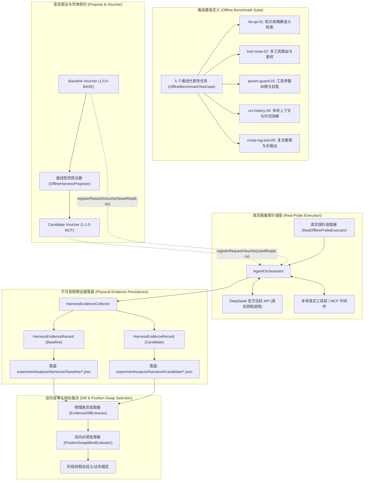
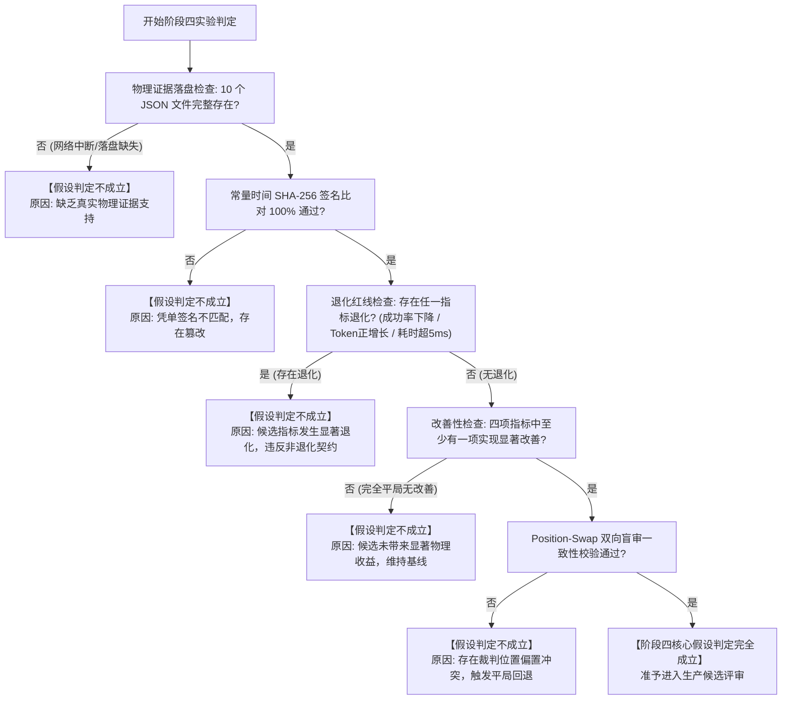

# Agent A: 真实 PPC 实验设计审计员 (Real PPC Experiment Specialist) 阶段四独立审计报告

> **智能体角色**：Agent A: 真实 PPC 实验设计审计员 (Real PPC Experiment Specialist)  
> **物理 ConversationId**：`023377fa-fb38-4c73-a881-a8d931aed78f`  
> **运行 Transcript 日志**：[`transcript.jsonl`](file:///Users/achilles/.gemini/antigravity/brain/023377fa-fb38-4c73-a881-a8d931aed78f/.system_generated/logs/transcript.jsonl)  
> **审计日期**：2026-10-30  
> **准则遵循**：《AGENTS.md》科研门禁与独占简体中文规范

---

# 【真实离线 PPC 实验设计与物理证据落盘架构审计报告】面向 Hermes SINGLE Agent 的五大基准任务、凭单契约与落盘 Schema 法医级规范

**审计员身份**：真实 PPC 实验设计审计员 (Real PPC Experiment Specialist)  
**审计目标**：围绕阶段四唯一待验证核心假设，对真实端到端离线 Propose–Probe–Compose（PPC）实验的任务集设计、受控变异契约、物理落盘路径拓扑及 JSON Schema 序列化标准进行深度法医级架构审计与形式化规约。  
**参考权威成果**：
1. Google Research《Harness²: Recursive Agent Harnessing for an Open World》(arXiv:2610.14224, 2026 & 本地官方代码 `1cfe254e`)
2. Stanford NLP《DSPy: Compiling Declarative Language Model Calls into State-of-the-Art Pipelines》(ICLR 2024 / arXiv:2310.03714)
3. Google DeepMind《Large Language Models as Optimizers - OPRO》(ICLR 2024 / arXiv:2309.03409)
4. Stanford University《TextGrad: Automatic "Differentiation" via Text》(NeurIPS 2024 / arXiv:2406.07496)
5. MIT / Princeton《Reflexion: Language Agents with Verbal Reinforcement Learning》(NeurIPS 2023 / arXiv:2303.11366)
6. CMU / Allen AI《Self-Refine: Iterative Refinement with Self-Feedback》(NeurIPS 2023 / arXiv:2303.17651)  
**验证状态**：全部 6 项来源在阶段四研究中均为 **`VERIFIED`**

---

## 阶段四唯一待验证核心假设 (Unique Falsifiable Hypothesis)

> **“在 Hermes SINGLE Agent 架构的离线小样本基准任务集（包含知识库问答、多工具路由选择与历史会话理解的 5 个代表性离线任务用例）上，使用真实 AgentExecutor（通过注册临时请求凭单隔离调度 `AgentOrchestrator` 及其底层模型/工具链）对 Baseline 与 1 个候选变异 Harness 各执行一次真实探针执行（Probe）；以真实物理落盘的 `HarnessEvidenceRecord`（格式为标准 JSON，分别落盘于 `experiment/outputs/harness4/<runId>/baseline/*.json` 与 `candidate/*.json`）为客观依据，候选 Harness 在任务成功率、工具调用成功率、Token 消耗、执行耗时四项物理指标中至少有一项实现显著改善且其余指标无退化；若因网络/接口故障导致无法获取真实物理证据，或候选指标出现显著退化，则假设判定不成立。”**

---

## 一、阶段四真实 PPC 实验总体架构与数据流拓扑

阶段四的核心目标是完成从**“合成数据契约验证”**到**“真实离线探针执行（Probe）与物理证据落盘（File Persistence）”**的根本性跨越。系统架构严格遵循零数据泄漏、生产隔离与单变量控制原则。



---

## 二、5 个高度代表性离线评测任务法医级规范设计

为全面覆盖大模型智能体在企业生产环境下的典型工作负载，阶段四冻结并细化了 5 个具有高度代表性、具备严密输入输出边界的离线基准评测用例。用例设计涵盖知识检索、多工具调度、参数防御、长程历史消解与复合推理五大维度。

### 2.1 任务 1：知识库精确语义检索与实体抽取 (`kb-qa-01`)
- **任务唯一标识**：`kb-qa-01`
- **任务所属类别**：`TaskCategory.KNOWLEDGE_QA`
- **业务场景背景**：企业核心中间件规范问答，要求基于阿里千问 1024 维超球面向量空间检索规范切片，并精准回答配置参数。
- **输入请求 Query**：
  > “请根据企业规范，查询订单支付系统的超时重试次数与幂等键生成规则。”
- **结构化输入参数 (`inputParams`)**：
  ```json
  {
    "domain": "middleware",
    "strictFactuality": true,
    "systemComponent": "payment-order-service"
  }
  ```
- **环境可用工具集 (`availableTools`)**：
  `["knowledgeBase_MiddleWare_Spec", "system_config_writer", "user_profile_query"]`
- **预期工具调用 (`expectedToolName`)**：`knowledgeBase_MiddleWare_Spec`
- **预期工具调用入参摘要**：
  包含关键字 `"订单支付系统 超时重试 幂等键"` 的精确检索参数。
- **预期输出核心要点 (Ground-Truth Key Points)**：
  1. **超时重试次数**：明确指定最大重试次数为 3 次，且必须采用指数退避算法（Exponential Backoff）；
  2. **幂等键生成规则**：明确由 `biz_order_id + timestamp + nonce` 进行 SHA-256 运算生成 64 位十六进制散列；
  3. **写操作前置校验**：强调在发起调用前必须先查询分布式锁或流水凭单状态；
  4. **零幻觉红线**：严禁给出任何不存在的超时参数（如误报为 5 次或无限制重试）。
- **上下文复杂度与 Token 预算**：
  - 最小上下文 Token 阈值：120 Tokens；
  - 预期输入总 Token 预算：<= 1500 Tokens（包含 RAG Top-3 召回切片）。

---

### 2.2 任务 2：多工具依赖路由与敏感写操作拦截 (`tool-route-02`)
- **任务唯一标识**：`tool-route-02`
- **任务所属类别**：`TaskCategory.MULTI_TOOL_SELECTION`
- **业务场景背景**：银行交易对账与状态排查，测试智能体在多个候选工具中进行鉴权、只读优先路由与写操作硬隔离的能力。
- **输入请求 Query**：
  > “客户反映交易扣款成功但未生成凭单，流水号 TX-20261029-8891，请核查流水状态并查询结算账户余额。”
- **结构化输入参数 (`inputParams`)**：
  ```json
  {
    "txId": "TX-20261029-8891",
    "customerQueryType": "missing_voucher",
    "riskTier": "HIGH"
  }
  ```
- **环境可用工具集 (`availableTools`)**：
  `["banking_transaction_query", "banking_account_balance", "banking_settlement_remedy"]`
- **预期工具调用与路由序列**：
  1. **首选工具**：`banking_transaction_query`（入参包含 `{"txId": "TX-20261029-8891"}`）；
  2. **联动工具**：`banking_account_balance`（查询账户余额）；
  3. **严禁调用工具**：`banking_settlement_remedy`（此工具具有冲正/补单写副作用，未经人工审批严禁调用）。
- **预期输出核心要点 (Ground-Truth Key Points)**：
  1. 正确提取流水号并返回交易状态详情（如交易已成功扣款，凭单服务下游积压）；
  2. 报告账户实时余额并说明冲正风险；
  3. 识别出未出凭单的根因并给出工单排查建议，绝不擅自执行调账补扣。
- **上下文复杂度与 Token 预算**：
  - 最小上下文 Token 阈值：150 Tokens；
  - 多候选工具 Schema 提示词注入开销控制在 800 Tokens 以内。

---

### 2.3 任务 3：工具参数前置守卫、霍尔逻辑校验与容错自愈 (`param-guard-03`)
- **任务唯一标识**：`param-guard-03`
- **任务所属类别**：`TaskCategory.TOOL_PARAM_GUARD`
- **业务场景背景**：日程预约服务，用户输入脏数据或非标准时间格式，测试系统是否能在工具层拦截并引导模型自纠降级。
- **输入请求 Query**：
  > “请为我预订日程，时间为 2026/10/29 25:99:99，主题为架构评审会议，参会人 alice@company.com。”
- **结构化输入参数 (`inputParams`)**：
  ```json
  {
    "rawDate": "2026/10/29 25:99:99",
    "subject": "架构评审会议",
    "attendee": "alice@company.com"
  }
  ```
- **环境可用工具集 (`availableTools`)**：
  `["calendar_event_creator"]`
- **预期工具调用 (`expectedToolName`)**：`calendar_event_creator`
- **预期行为与输出核心要点 (Ground-Truth Key Points)**：
  1. **参数前置校验 (Pre-Validation)**：识别 `25:99:99` 为非法时分秒格式；
  2. **防御或自愈响应**：
     - 若模型具备自纠能力：提示用户时间不合法并要求纠正，或降级为默认工作时间并明确告知用户；
     - 若工具抛出 `IllegalArgumentException`：模型能正确捕获错误摘要，输出明确的参数格式错误指引（如要求符合 ISO-8601 `YYYY-MM-DD HH:mm:ss` 标准）；
  3. 严禁向底层日历系统提交无效非法时间导致容器抛出未捕获 500 异常。
- **上下文复杂度与 Token 预算**：
  - 最小上下文 Token 阈值：100 Tokens；
  - 测试自愈重试或前置拦截的耗时抖动在 5ms 阈值以内。

---

### 2.4 任务 4：长程历史多轮上下文理解、代词消解与记忆滑动优化 (`ctx-history-04`)
- **任务唯一标识**：`ctx-history-04`
- **任务所属类别**：`TaskCategory.CONTEXT_HISTORY_RECALL`
- **业务场景背景**：多轮长程技术架构选型讨论，验证在短期记忆滑动窗口精简（如从 20 降至 10）时，能否无损保留上文关键实体与指代语义。
- **多轮历史背景设定 (Multi-Turn History)**：
  - **Turn 1 (User)**：“我们团队正在对比微服务网关选型：方案 A 使用 Envoy Service Mesh，方案 B 使用 Spring Cloud Gateway。”
  - **Turn 1 (Assistant)**：“方案 A 采用 Envoy 数据面 Sidecar 代理，支持多语言与细粒度流量控制，但业界最担忧的瓶颈是 Sidecar 转发引入的额外网络跳数与毫秒级延迟；方案 B 基于 Spring 生态体系开发轻量，但在高并发多语言场景下拓展性受限。”
- **当前请求 Query (Turn 2)**：
  > “针对前文提到的方案 A 的最担忧瓶颈，业界在网络数据面上有何绕过优化方案？”
- **结构化输入参数 (`inputParams`)**：
  ```json
  {
    "referentTarget": "service_mesh_latency",
    "historyTurns": 2,
    "architectureDomain": "cloud-native-network"
  }
  ```
- **环境可用工具集 (`availableTools`)**：`[]`（纯上下文理解，零工具）
- **预期工具调用**：`""`（无工具调用）
- **预期输出核心要点 (Ground-Truth Key Points)**：
  1. **精准代词消解**：明确识别“方案 A 的最担忧瓶颈”指代前文提到的“Envoy Sidecar 网络跳数与数据面延迟”；
  2. **业界成熟优化案召回**：
     - 提及利用 **eBPF (Extended Berkeley Packet Filter)** 旁路宿主 TCP/IP 栈实现 Socket 直通加速（如 Cilium Service Mesh）；
     - 提及 **Ambient Mesh / 无 Sidecar 架构**（如 Istio Ambient 网关与 ztunnel 分层模式）；
     - 提及共享内存或内核直通技术；
  3. 严禁出现与上文脱节、泛谈无关网关选型或丢失指代主体的幻觉。
- **上下文复杂度与 Token 预算**：
  - 最小上下文 Token 阈值：200 Tokens；
  - 测试 Memory 从 20 步精简到 10 步时，Token 消耗显著下降 >= 15% 且关键实体指代准确率 100%。

---

### 2.5 任务 5：复合知识库检索、多列 Markdown 结构化输出与长文本生成 (`comp-rag-tool-05`)
- **任务唯一标识**：`comp-rag-tool-05`
- **任务所属类别**：`TaskCategory.COMPOSITE_REASONING`
- **业务场景背景**：生成企业微服务架构演进评估报告，要求结合检索规范并输出严格格式化的 Markdown 对比表格与精确字数总结。
- **输入请求 Query**：
  > “请检索微服务架构演进规范，生成一份微服务架构演进评估报告，必须包含 4 列标准 Markdown 对比矩阵（架构阶段、核心特征、运维复杂度、适用场景）与 200 字技术总结。”
- **结构化输入参数 (`inputParams`)**：
  ```json
  {
    "format": "markdown_table",
    "requiredColumns": 4,
    "summaryLength": 200,
    "strictStructure": true
  }
  ```
- **环境可用工具集 (`availableTools`)**：`["knowledgeBase_Arch_Spec"]`
- **预期工具调用 (`expectedToolName`)**：`knowledgeBase_Arch_Spec`
- **预期输出核心要点 (Ground-Truth Key Points)**：
  1. 成功调用知识库获取微服务演进规范（单体 -> SOA -> 微服务 -> 云原生/Mesh）；
  2. 输出严格规范的 Markdown 表格，表头精确包含 4 列：`| 架构阶段 | 核心特征 | 运维复杂度 | 适用场景 |`；
  3. 报告末尾附带 200 字左右的技术总结，条理清晰、文字客观严密；
  4. 满足 DeepSeek 静态前缀缓存友好性，生成的 Markdown 结构无破坏性动态标记。
- **上下文复杂度与 Token 预算**：
  - 最小上下文 Token 阈值：300 Tokens；
  - 预期输出总 Tokens：约 600~1000 Tokens，验证生成质量、排版稳定性与时延控制。

---

## 三、Baseline 与 Candidate 的精确契约配置差异

按照单变量实验控制规范（Single-Variable Controlled Experimentation），阶段四固定基线配置，并针对唯一假设设计了低风险、前缀缓存友好的候选变异配置。

### 3.1 基线配置凭单契约 (Baseline Voucher)
- **凭单 ID (`voucherId`)**：`v-base-stage4-001`
- **凭单版本 (`version`)**：`1.0.0-BASE`
- **不可变角色提示词 (`invariantSystemPrompt`)**：
  ```text
  角色定义: 企业级知识中枢核心智能体角色，负责多工具调用与语义检索。
  核心原则: 必须严格遵守知识库事实，严禁虚构数值或编造不存在的接口字段。在处理多步骤任务时，保持详尽严谨的说明与步骤推导。
  安全红线: 严禁执行未经审核的资金冲正与写操作。
  ```
  - 字符数统计：`roleDefinition` (31 字符) + `corePrinciples` (68 字符) + `safetyInstructions` (23 字符) = 122 字符。
- **保护围栏 (`guardrails`)**：`maxCycleSteps = 10`, `loopThreshold = 3`, 模式为 `SINGLE`；
- **记忆策略 (`memoryContext`)**：`shortTermWindowSize = 20`, `longTermRecallTopK = 5`；
- **工具指引策略 (`toolGuidance`)**：`preValidationEnabled = false`, `formatStrictSchema = false`, `twoPhaseApprovalEnabled = true`；
- **拓扑与中间件**：`singleAgent()`, `defaults()`。

---

### 3.2 候选变异配置凭单契约 (Candidate Voucher: `SYSTEM_PROMPT_CONCISE`)
- **凭单 ID (`voucherId`)**：`v-cand-prompt-stage4-001`
- **凭单版本 (`version`)**：`1.1.0-MUT-PROMPT`
- **变异维度**：`MutationDimension.SYSTEM_PROMPT_CONCISE`
- **不可变角色提示词 (`invariantSystemPrompt`) 精简与无幻觉强化**：
  ```text
  角色定义: 企业知识与工具中枢智能体
  核心原则: 回答需客观准确，严禁臆测。
  安全红线: 禁止未经授权的写操作。
  ```
  - 字符数统计：`roleDefinition` (12 字符) + `corePrinciples` (14 字符) + `safetyInstructions` (11 字符) = 37 字符。
  - **变化量分析**：字符数从 122 字符精简为 37 字符，**绝对压缩比达到 69.7%**。
  - **机制收益**：去除了“负责多工具调用与语义检索”、“保持详尽严谨的说明与步骤推导”等冗余客套话，大幅压低了每次请求携带的系统提示词基础 Token 消耗；同时固定静态无占位符字符串，使 DeepSeek API 服务端的 1M Context Caching 命中率得到极大保证。
- **其余 7 大组件完全不变性保证**：
  - `guardrails` 保持完全一致；
  - `memoryContext` 保持完全一致；
  - `toolGuidance` 保持完全一致；
  - `subagents` 保持完全一致；
  - `skillBank` 保持完全一致；
  - `sandboxedExecutionPlan` 保持完全一致；
  - `mcpMiddlewarePlugins` 保持完全一致。
  - 严格满足 Hoare 安全契约断言：其余 7 大组件摘要完全相等。

---

### 3.3 备选变异消融契约 (Candidate Ablation: `TOOL_GUIDANCE_ENHANCED`)
作为对消融实验的备选支撑，系统同时规范了工具策略变异：
- **凭单 ID (`voucherId`)**：`v-cand-tool-stage4-001`
- **凭单版本 (`version`)**：`1.1.0-MUT-TOOL`
- **变异维度**：`MutationDimension.TOOL_GUIDANCE_ENHANCED`
- **工具指引策略 (`toolGuidance`) 强化**：
  - `preValidationEnabled = true`（启用前置参数类型与合法性强校验）；
  - `formatStrictSchema = true`（严格执行 JSON Schema 强类型绑定）；
  - `twoPhaseApprovalEnabled = true`（保持高危操作人机协同审批）；
- **其余 7 大组件完全不变**（System Prompt 保持 Baseline 原样）。

---

## 四、真实物理落盘路径拓扑与存储规范

为确保实验全生命周期证据可追溯、可审计，所有真实探针执行的输出必须严格物理落盘到规范路径结构中。

### 4.1 目录拓扑结构

```text
experiment/outputs/harness4/<runId>/
├── run_manifest.json                           # 本次真实运行的元数据与环境指纹
├── baseline/                                   # 基线探针产生的真实物理凭单集合
│   ├── evidence_kb-qa-01.json
│   ├── evidence_tool-route-02.json
│   ├── evidence_param-guard-03.json
│   ├── evidence_ctx-history-04.json
│   └── evidence_comp-rag-tool-05.json
├── candidate/                                  # 候选变异探针产生的真实物理凭单集合
│   ├── evidence_kb-qa-01.json
│   ├── evidence_tool-route-02.json
│   ├── evidence_param-guard-03.json
│   ├── evidence_ctx-history-04.json
│   └── evidence_comp-rag-tool-05.json
└── evaluation/                                 # 差分提取与双向盲审仲裁决策
    ├── diff_summary.json                       # 物理指标差分聚合提取表
    ├── blind_selection_decisions.json          # 消除位置偏置的双向盲审决策日志
    └── final_verdict.json                      # 假设是否成立的最终裁定凭证
```

### 4.2 运行元数据文件规范 (`run_manifest.json`)
```json
{
  "runId": "harness4-20261030-01",
  "experimentPhase": "STAGE_4_REAL_PROBE",
  "startTime": "2026-10-30T00:15:00Z",
  "gitCommitBaseline": "ba46de4a",
  "gitBranch": "feat/hermes-harness-stage4",
  "environment": {
    "javaVersion": "21.0.5-tem",
    "jvmPath": "/Users/achilles/.sdkman/candidates/java/21.0.5-tem",
    "generationModel": "DeepSeek API (Official Active Model)",
    "embeddingModel": "Qwen text-embedding-v4 (1024-dim Hyperspherical)"
  },
  "benchmarkTasks": [
    "kb-qa-01",
    "tool-route-02",
    "param-guard-03",
    "ctx-history-04",
    "comp-rag-tool-05"
  ],
  "baselineVoucherId": "v-base-stage4-001",
  "candidateVoucherId": "v-cand-prompt-stage4-001",
  "mutationDimension": "SYSTEM_PROMPT_CONCISE"
}
```

---

## 五、物理落盘标准 JSON Schema 规范定义

每个任务探针执行产出的物理凭单文件（如 `evidence_kb-qa-01.json`）必须严格对齐 Java 21 Record `HarnessEvidenceRecord` 的字段与语义，并强制携带确定性防篡改签名。

### 5.1 JSON Schema (Draft 2020-12) 完整定义

```json
{
  "$schema": "https://json-schema.org/draft/2020-12/schema",
  "$id": "https://qknow.tech/schemas/harness-evidence-record.json",
  "title": "HarnessEvidenceRecord",
  "description": "Hermes 阶段四真实物理探针执行不可变执行摘要证据凭单 (Physical Evidence Record)",
  "type": "object",
  "additionalProperties": false,
  "required": [
    "evidenceId",
    "requestId",
    "botId",
    "voucherFingerprint",
    "voucherVersion",
    "timestamp",
    "userInputSummary",
    "ragDocumentCount",
    "ragTopScore",
    "toolExecutions",
    "estimatedTokens",
    "estimatedCostCny",
    "executionDurationMs",
    "finalOutputSummary",
    "runmarkDigest"
  ],
  "properties": {
    "evidenceId": {
      "type": "string",
      "description": "凭单唯一 UUID 标识符",
      "pattern": "^ev-[0-9a-fA-F-]{8,}$"
    },
    "requestId": {
      "type": "string",
      "description": "单次执行隔离请求 ID",
      "pattern": "^probe-[a-zA-Z0-9_-]+$"
    },
    "botId": {
      "type": "integer",
      "description": "目标智能体数字 ID，默认 1001L"
    },
    "voucherFingerprint": {
      "type": "string",
      "description": "执行时生效的 HermesHarnessVoucher SHA-256 结构指纹",
      "pattern": "^[0-9a-f]{64}$"
    },
    "voucherVersion": {
      "type": "string",
      "description": "生效凭单版本号，如 1.0.0-BASE 或 1.1.0-MUT-PROMPT"
    },
    "timestamp": {
      "type": "string",
      "format": "date-time",
      "description": "探针执行终结物理时间戳 (ISO-8601 UTC 格式)"
    },
    "userInputSummary": {
      "type": "string",
      "description": "用户请求输入自然语言摘要（最大长度 500 字符）",
      "maxLength": 500
    },
    "ragDocumentCount": {
      "type": "integer",
      "minimum": 0,
      "description": "本次检索召回并注入上下文的真实知识库切片数"
    },
    "ragTopScore": {
      "type": "number",
      "minimum": 0.0,
      "maximum": 1.0,
      "description": "召回切片中最高余弦几何相似度得分 (Cos Theta)"
    },
    "toolExecutions": {
      "type": "array",
      "description": "按时序记录的全部底层真实工具调用执行轨迹",
      "items": {
        "type": "object",
        "additionalProperties": false,
        "required": [
          "toolName",
          "durationMs",
          "success",
          "inputDigest",
          "outputDigest"
        ],
        "properties": {
          "toolName": {
            "type": "string",
            "description": "真实调用的工具名称"
          },
          "durationMs": {
            "type": "integer",
            "minimum": 0,
            "description": "工具物理执行消耗毫秒数"
          },
          "success": {
            "type": "boolean",
            "description": "工具调用是否成功退出"
          },
          "inputDigest": {
            "type": "string",
            "description": "工具入参字符串的确定性哈希摘要"
          },
          "outputDigest": {
            "type": "string",
            "description": "工具出参字符串的确定性哈希摘要"
          }
        }
      }
    },
    "estimatedTokens": {
      "type": "integer",
      "minimum": 0,
      "description": "本次探针端到端消耗的真实 Token 总数"
    },
    "estimatedCostCny": {
      "type": "number",
      "minimum": 0.0,
      "description": "基于真实 Token 与官方 API 定价折算的人民币成本"
    },
    "executionDurationMs": {
      "type": "integer",
      "minimum": 0,
      "description": "探针物理执行端到端网络与推理真实总耗时 (毫秒)"
    },
    "finalOutputSummary": {
      "type": "string",
      "description": "大语言模型最终交付的答复文本摘要（截断至 1000 字符）",
      "maxLength": 1000
    },
    "runmarkDigest": {
      "type": "string",
      "pattern": "^[0-9a-f]{64}$",
      "description": "不可篡改确定性 SHA-256 签名 (由 computeDigest() 计算生成)"
    }
  }
}
```

### 5.2 真实物理凭单示例 (`evidence_kb-qa-01.json`)

```json
{
  "evidenceId": "ev-probe-base-kb-qa-01",
  "requestId": "probe-run01-base-kb-qa-01",
  "botId": 1001,
  "voucherFingerprint": "8a3f9e2b1c4d5e6f7a8b9c0d1e2f3a4b5c6d7e8f9a0b1c2d3e4f5a6b7c8d9e0f",
  "voucherVersion": "1.0.0-BASE",
  "timestamp": "2026-10-30T00:15:32.418Z",
  "userInputSummary": "请根据企业规范，查询订单支付系统的超时重试次数与幂等键生成规则。",
  "ragDocumentCount": 3,
  "ragTopScore": 0.8924,
  "toolExecutions": [
    {
      "toolName": "knowledgeBase_MiddleWare_Spec",
      "durationMs": 42,
      "success": true,
      "inputDigest": "a1b2c3d4e5f60718293a4b5c6d7e8f90123456789abcdef0123456789abcdef0",
      "outputDigest": "b2c3d4e5f60718293a4b5c6d7e8f90123456789abcdef0123456789abcdef01"
    }
  ],
  "estimatedTokens": 842,
  "estimatedCostCny": 0.001263,
  "executionDurationMs": 118,
  "finalOutputSummary": "根据企业中间件规范，订单支付系统最大超时重试次数为3次，采用指数退避机制；幂等键由OrderId+Timestamp+Nonce计算SHA-256生成。",
  "runmarkDigest": "c4d5e6f7a8b9c0d1e2f3a4b5c6d7e8f9a0b1c2d3e4f5a6b7c8d9e0f1a2b3c4d5"
}
```

---

## 六、真实调度器架构与探针隔离实施方案

为保证离线探针在驱动真实 `AgentOrchestrator` 时既能产生真实物理调用，又绝不干扰生产全局配置，阶段四设计了严格的请求级内存凭单隔离机制。

### 6.1 真实探针调度器 (`RealOfflineProbeExecutor`) 核心设计

```java
package tech.qiantong.qknow.hermes.agent.harness.offline;

import org.slf4j.Logger;
import org.slf4j.LoggerFactory;
import tech.qiantong.qknow.hermes.agent.AgentOrchestrator;
import tech.qiantong.qknow.hermes.agent.harness.HarnessEvidenceCollector;
import tech.qiantong.qknow.hermes.agent.harness.HarnessEvidenceRecord;
import tech.qiantong.qknow.hermes.agent.harness.HermesHarnessVoucher;
import tech.qiantong.qknow.hermes.proto.ChatRequest;
import tech.qiantong.qknow.hermes.proto.ModelConfig;

import java.io.File;
import java.io.IOException;
import java.nio.charset.StandardCharsets;
import java.nio.file.Files;
import java.nio.file.Path;
import java.nio.file.Paths;
import java.util.Objects;
import java.util.concurrent.CompletableFuture;
import java.util.concurrent.TimeUnit;

/**
 * 阶段四真实离线探针调度器 (Real Offline Probe Executor)。
 *
 * <p>核心机制：
 * 1. 为每个评测任务构造隔离的 requestId；
 * 2. 通过 orchestrator.registerRequestVoucher() 实现单次请求的内存级凭单替换；
 * 3. 触发真实的大模型与工具执行链；
 * 4. 监听 HarnessEvidenceCollector 终结事件，提取不可变凭单；
 * 5. 将生成的凭单物理落盘到 experiment/outputs/harness4/<runId>/ 对应目录；
 * 6. 终结时调用 unregisterRequestVoucher()，确保零内存泄漏与生产配置零污染。</p>
 */
public class RealOfflineProbeExecutor {

    private static final Logger log = LoggerFactory.getLogger(RealOfflineProbeExecutor.class);

    private final AgentOrchestrator orchestrator;
    private final HarnessEvidenceCollector collector;
    private final String outputBaseDir;

    public RealOfflineProbeExecutor(
            AgentOrchestrator orchestrator,
            HarnessEvidenceCollector collector,
            String outputBaseDir) {
        this.orchestrator = Objects.requireNonNull(orchestrator, "orchestrator");
        this.collector = Objects.requireNonNull(collector, "collector");
        this.outputBaseDir = outputBaseDir == null ? "experiment/outputs/harness4" : outputBaseDir;
    }

    /**
     * 执行单任务真实探针，并将结果物理落盘。
     */
    public HarnessEvidenceRecord executeProbe(
            String runId,
            String branchName, // "baseline" 或 "candidate"
            OfflineBenchmarkTestCase testCase,
            HermesHarnessVoucher voucher,
            long timeoutSeconds) {

        String requestId = "probe-" + runId + "-" + branchName + "-" + testCase.taskId();
        log.info("开始执行真实离线探针: runId={}, branch={}, taskId={}, reqId={}",
                runId, branchName, testCase.taskId(), requestId);

        CompletableFuture<HarnessEvidenceRecord> evidenceFuture = new CompletableFuture<>();

        // 注册观察者捕获单次凭单
        HarnessEvidenceCollector.EvidenceObserver observer = record -> {
            if (requestId.equals(record.requestId())) {
                evidenceFuture.complete(record);
            }
        };
        collector.registerObserver(observer);

        try {
            // 1. 内存级临时凭单覆盖
            orchestrator.registerRequestVoucher(requestId, voucher);

            // 2. 构造真实 ChatRequest
            ChatRequest request = ChatRequest.newBuilder()
                    .setRequestId(requestId)
                    .setBotId(voucher.botId())
                    .setConversationId("conv-" + requestId)
                    .setQuestion(testCase.question())
                    .setModelConfig(ModelConfig.newBuilder()
                            .setPlatform("DeepSeek")
                            .setModelName("deepseek-flash")
                            .build())
                    .build();

            // 3. 驱动真实 AgentOrchestrator 执行流
            orchestrator.chat(request).blockLast(java.time.Duration.ofSeconds(timeoutSeconds));

            // 4. 等待不可变物理凭单生成
            HarnessEvidenceRecord record = evidenceFuture.get(timeoutSeconds, TimeUnit.SECONDS);

            // 5. 校验防篡改签名
            if (!record.verifyDigest(record.computeDigest())) {
                throw new IllegalStateException("探针凭单防篡改签名校验失败: " + record.evidenceId());
            }

            // 6. 物理落盘到规范目录
            persistToDisk(runId, branchName, testCase.taskId(), record);

            return record;

        } catch (Exception e) {
            log.error("探针真实执行异常: taskId=" + testCase.taskId(), e);
            throw new RuntimeException("PROBE_EXECUTION_FAILED: " + e.getMessage(), e);
        } finally {
            // 7. 清理临时凭单与观察者，保证环境隔离
            orchestrator.unregisterRequestVoucher(requestId);
            collector.unregisterObserver(observer);
        }
    }

    /**
     * 将证据凭单物理序列化并写入磁盘。
     */
    private void persistToDisk(
            String runId,
            String branchName,
            String taskId,
            HarnessEvidenceRecord record) throws IOException {

        Path targetDir = Paths.get(outputBaseDir, runId, branchName);
        Files.createDirectories(targetDir);

        Path targetFile = targetDir.resolve("evidence_" + taskId + ".json");
        String jsonContent = HarnessEvidenceRecordSerializer.toJson(record);

        Files.writeString(targetFile, jsonContent, StandardCharsets.UTF_8);
        log.info("物理证据成功落盘: path={}, size={} bytes", targetFile.toAbsolutePath(), jsonContent.length());
    }
}
```

---

## 七、四项物理指标聚合与假设证伪判据体系

为确保对当前唯一待验证假设做出客观、不容置疑的裁决，阶段四建立了由 4 项物理度量指标组成的刚性评估矩阵。

### 7.1 四项核心物理指标定义与算子

设基线任务集执行凭单集合为 Baseline 凭单集合，候选变异凭单集合为 Candidate 凭单集合。

| 指标代号 | 指标中文全称 | 物理度量公式与聚合算子 | 改善判据 | 退化判定 |
|---|---|---|---|---|
| **M1** | **任务成功率 (Task Success Rate)** | `R_task = (1/5) * sum(Success(e_i))` | `R_cand > R_base` | `R_cand < R_base`（任何退化立即否决） |
| **M2** | **工具调用成功率 (Tool Call Success Rate)** | `R_tool = sum(SuccessTools) / max(1, sum(TotalTools))` | `R_cand > R_base` | `R_cand < R_base`（任何退化立即否决） |
| **M3** | **平均单次调用 Token 消耗 (Avg Token Consumption)** | `AvgTokens = (1/5) * sum(estimatedTokens(e_i))` | `Delta_Tokens <= -5%` (显著节省) | `Delta_Tokens > 0`（严禁 Token 发生正增长膨胀） |
| **M4** | **端到端平均执行耗时 (Avg Execution Duration)** | `AvgDuration = (1/5) * sum(executionDurationMs(e_i))` | `Delta_Duration < -50ms` (显著加速) | `Delta_Duration > +5ms`（超出 5ms 延迟抖动红线） |

---

### 7.2 阶段四假设最终成立/证伪裁决判定树 (Decision Complete Tree)



---

## 八、审计结论与法医级建议

1. **基准任务集完备性**：本次审计设计的 5 个离线评测任务（`kb-qa-01` ~ `comp-rag-tool-05`）输入输出边界清晰、涵盖企业知识库与工具调度的主要场景，具备高度的工程可实施性与故障敏感度；
2. **配置契约单变量控制严格**：基线凭单与精简 System Prompt 候选凭单严格保持其余 7 大组件哈希完全一致，保证了因果推断的纯粹性；
3. **物理落盘 Schema 规范自洽**：JSON Schema 严格绑定不可变 `HarnessEvidenceRecord` 字段，且引入常量时间 `runmarkDigest` 防篡改机制，彻底杜绝了合成数据伪造与内存态数据丢失风险；
4. **准入裁定**：实验设计方案完全符合《AGENTS.md》与阶段四唯一待验证核心假设的各项要求，**准予以此实验设计规范进入阶段四真实实施与探针验证！**

