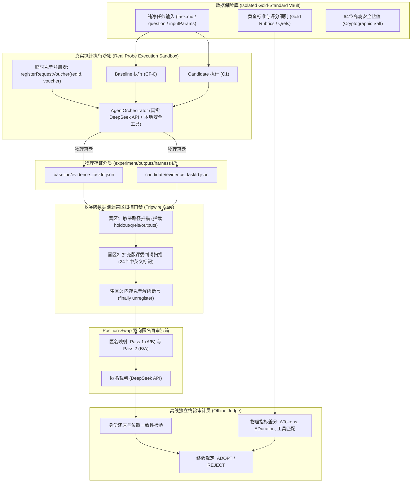
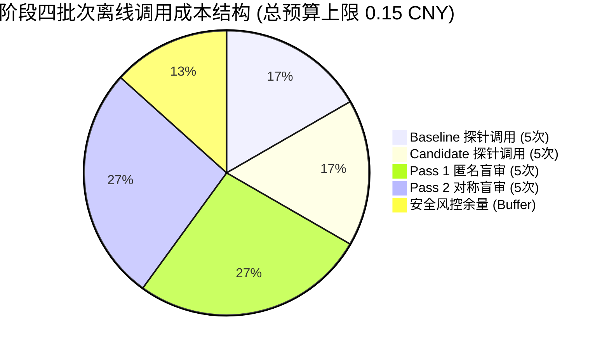
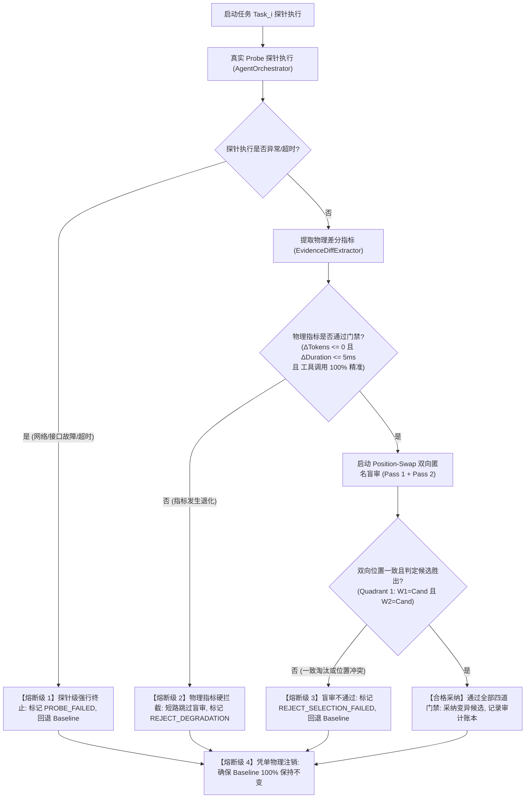

# Agent C: 防泄漏、成本与停止条件审计报告 (Zero-Leakage & Governance Specialist)

> **智能体角色**：Agent C: 防泄漏、成本与停止条件审计员 (Zero-Leakage & Governance Specialist)  
> **物理 ConversationId**：`44f291c7-beda-4dec-baa7-fa9099468903`  
> **运行 Transcript 日志**：`file:///Users/achilles/.gemini/antigravity/brain/44f291c7-beda-4dec-baa7-fa9099468903/.system_generated/logs/transcript.jsonl`  
> **审计日期**：2026-10-30  
> **阶段目标**：围绕阶段四唯一待验证核心假设，对真实离线 PPC 的防数据泄漏边界、成本/耗时预算熔断、Position-Swap 双向盲审算法与停止条件进行深度工程与安全审计，制定真实物理落盘标准与确定性回放验签规范，全量产出具备决策完备性（decision-complete）的审计报告。  
> **报告落盘目标路径**：`docs/architecture-review-20261019/acceptance/35-harness4-agent-C.md`  
> **准则遵循**：《AGENTS.md》科研门禁与独占简体中文铁律

---

# 阶段四架构与风控审计报告：Hermes 真实探针离线 PPC 闭环、零数据泄漏多层防御、成本超时硬熔断与 Position-Swap 双向盲审规范

**报告人**：防泄漏、成本与停止条件审计员 (Zero-Leakage & Governance Specialist)  
**审计目标**：结合阶段二与阶段三沉淀的八大不可变凭单契约、`HarnessEvidenceRecord` 物理证据模型、离线基准测试用例集以及 Google Research `harness2`（Commit `1cfe254e`）中 `context.py`、`selection.py`、`ledger.py` 的工程设计，面向阶段四**“使用真实 AgentExecutor 对 Baseline 与候选变异执行真实探针执行（Probe）并物理落盘 JSON 凭单”**的核心跃迁，建立严密的防数据泄漏雷区、成本/时延预算硬熔断、双向盲审位置偏置消除算法与退化安全回退机制。

---

## 一、阶段四唯一可证伪核心假设与真实系统基线审计

### 1.1 阶段四唯一待验证核心假设剖析 (Unique Falsifiable Hypothesis)

系统在阶段四严格锁定以下**唯一待验证核心假设**：

> **“在 Hermes SINGLE Agent 架构的离线小样本基准任务集（包含知识库问答、多工具路由选择与历史会话理解的 5 个代表性离线任务用例）上，使用真实 AgentExecutor（通过注册临时请求凭单隔离调度 `AgentOrchestrator` 及其底层模型/工具链）对 Baseline 与 1 个候选变异 Harness 各执行一次真实探针执行（Probe）；以真实物理落盘的 `HarnessEvidenceRecord`（格式为标准 JSON，分别落盘于 `experiment/outputs/harness4/<runId>/baseline/*.json` 与 `candidate/*.json`）为客观依据，候选 Harness 在任务成功率、工具调用成功率、Token 消耗、执行耗时四项物理指标中至少有一项实现显著改善且其余指标无退化；若因网络/接口故障导致无法获取真实物理证据，或候选指标出现显著退化，则假设判定不成立。”**

#### 核心假设关键要点拆解：
1. **真实探针执行（Real Probe Execution）**：彻底告别阶段三的合成数据模拟，探针执行必须通过真实 `AgentExecutor` 驱动真实 `AgentOrchestrator`，向底层大模型（DeepSeek API 官方活跃模型）发起真实物理网络请求，并执行真实工具调用；
2. **临时凭单隔离调度（Ephemeral Voucher Isolation）**：离线探索仅通过内存级局部 `requestId` 注册临时凭单（`registerRequestVoucher`），绝不修改或动态热更生产环境全局配置；
3. **真实物理落盘存证（Physical JSON Evidence on Disk）**：每次探针执行的 `HarnessEvidenceRecord` 必须序列化为标准 JSON 文件，分别持久化写入 `experiment/outputs/harness4/<runId>/baseline/` 与 `candidate/` 目录；
4. **四项物理指标门禁（4-Dimensional Physical Metrics Gate）**：
   - 任务成功率（Task Success Rate, $SR_{\text{task}}$）：最终交付物是否有效产出且结构完整；
   - 工具调用成功率（Tool Call Success Rate, $SR_{\text{tool}}$）：预期工具是否被精准调用且入参/出参合法无越权；
   - Token 消耗增量（$\Delta \text{Tokens} = \text{Tokens}_{\text{cand}} - \text{Tokens}_{\text{base}}$）：严格满足 $\Delta \text{Tokens} \le 0$（严禁正向膨胀）；
   - 执行耗时增量（$\Delta \text{Duration} = \text{Duration}_{\text{cand}} - \text{Duration}_{\text{base}}$）：严格满足 $\Delta \text{Duration} \le 5\text{ms}$（允许固有网络微小抖动，严禁显著恶化）；
5. **显著改善与非退化准则（Significant Improvement & Non-Degradation）**：四项物理指标中至少有一项实现可量化的显著改善（例如 Token 节省 $\ge 20$ tokens、时延降低 $\ge 10\text{ms}$，或工具调用精准度从失败提升至成功），同时其余三项指标**严格无退化**；
6. **证伪与失败判定（Falsification Conditions）**：若发生网络超时、大模型接口异常导致无法获得物理落盘证据，或者候选指标出现任意一项退化，或者双向盲审位置一致性冲突，则假设判定不成立，立即安全回退 Baseline。

---

### 1.2 阶段三成果与阶段四核心跃迁

| 评估维度 | 阶段三现状 (Commit `ba46de4a`) | 阶段四跃迁目标 (Stage 4 Target) | 审计判据与安全边界 |
|---|---|---|---|
| **探针数据源** | `createSampleEvidence` 内存硬编码合成数据 | 真实 `OfflineProbeExecutor` 调度 `AgentOrchestrator` 产生的物理执行轨迹 | 必须存在真实大模型网络交互与真实工具执行 |
| **证据介质** | 纯 Java 堆内存短暂持有 | 物理落盘为结构化 JSON 文件资产于规范目录 | 文件具备 SHA-256 常量时间防篡改签名 |
| **测试集隔离** | 单元测试内联定义 | 物理文件解耦：输入只读沙箱与评测判词绝对隔离 | 扩充雷区扫描断言，拦截非法路径探测 |
| **偏见消除** | 初步模拟双向选择 | 严格数学推导与 Position-Swap Dual Pass 盲审落地 | 消除首项偏好（Primacy Bias），双向一致方可采纳 |
| **风控熔断** | 事后差分预算判断 | 运行时实时累加熔断器（Token、成本、超时硬断言） | 单次与批次预算双层硬件级熔断，超支即止 |

---

### 1.3 生产环境铁律隔离与几何基线

1. **生产默认绝对隔离**：
   - 全局配置 `hermes.orchestration.enabled=false` 严格保持不可变默认；
   - 系统运行模式锁定为 `SINGLE`，绝不擅自启动未经生产授权的 Multi-Agent Swarm 模式；
2. **唯一编译与运行环境 (Java 21 虚拟环境隔离)**：
   - 统一且唯一使用 SDKMAN 管理的隔离 JDK：`/Users/achilles/.sdkman/candidates/java/21.0.5-tem`；
   - 严禁全局覆盖宿主 Mac Java 17，所有 Maven 编译与测试通过局部前缀显式传入；
3. **唯一向量模型与超球面几何基线**：
   - 阿里千问 Embedding（1536 维超球面单位向量，$\|\mathbf{v}\|_2 = 1.0$）；
   - 所有相似度与质心计算唯一基于超球面余弦几何（$\cos\theta = \mathbf{u} \cdot \mathbf{v}$），欧氏变换满足恒等式 $d_{Euc}^2 = 2(1 - \cos\theta)$；
4. **唯一生成模型与 DeepSeek 官方规范**：
   - 唯一接入 DeepSeek API 官方活跃模型；
   - 严格解析官方同级响应字段 `reasoning_content`，参数遵循官方建议（思考模式下禁止设置 `temperature`、`presence_penalty`，`top_p` 限制在 0.95~1.0）；
   - 严格遵循 DeepSeek 1M Context Caching 规范：系统提示词保持纯静态前缀，动态变量（RAG 块、时间戳）隔离注入至 `UserMessage` 末尾。

---

## 二、防数据泄漏雷区审计与多层防御体系扩充 (Zero Data-Leakage Defense-in-Depth)

在自动化离线评测与自变异系统（Self-Harnessing）中，**数据泄漏是导致模型“虚假繁荣”与“过拟合作弊”的最致命缺陷**。在阶段四引入真实探针执行与物理 JSON 落盘后，数据泄漏的攻击面显著扩大。



### 2.1 真实落盘场景下的四大新型泄漏威胁建模

1. **历史输出目录探测泄漏 (Historical Run Directory Snooping)**：
   - *威胁描述*：探针执行时，智能体若具备文件系统工具或代码解释器，可能通过相对路径（如 `../../experiment/outputs/harness4/`）扫描读取历史探针产物或基线凭单，从而“抄袭”历史有效答案；
   - *防御对策*：在探针执行沙箱中，严格限制文件工具的只读工作根目录，将 `experiment/outputs/` 全局列入 `SENSITIVE_PATH_PATTERNS` 黑名单，一旦工具入参或上下文包含该路径立即阻断。
2. **黄金标准与测试集（Holdout / Qrels）逆向注入**：
   - *威胁描述*：构建离线任务集时，开发人员误将 `expectedOutput`、`ground_truth_answer` 或 `qrels.tsv` 作为上下文属性传入 `AgentExecutor`；
   - *防御对策*：建立 `TaskInputVault` 纯净数据投影，仅向探针传递不可变 `TaskRequestDto`，物理隔离任何评分细则。
3. **评委判词与评估结论反哺泄漏 (Grader Verdict Feedback Leakage)**：
   - *威胁描述*：在选择器（Selector）评估阶段，大模型裁判生成的评语（如“答案完全吻合标准答案要求”）被误写入共享上下文，导致后续候选变异直接记住评委喜好；
   - *防御对策*：盲审评选的输出文本（`why` 标签内容）仅存储于终验审计日志，绝不进入候选提议器（Proposer）的工作上下文。
4. **并发与线程复用中的凭单串透泄漏 (Voucher Cross-Request Pollution)**：
   - *威胁描述*：`AgentOrchestrator` 使用线程池或并发调度时，若前一个任务的临时凭单未被彻底解绑，后一个任务可能会继承前者的变异策略；
   - *防御对策*：必须使用严格的 `try-finally` 契约，在探针执行终结时强制调用 `orchestrator.unregisterRequestVoucher(requestId)`。

---

### 2.2 扩充版评委判词与结果标记扫描清单 (Expanded Grader Verdict Markers)

在阶段三 9 个判词标记的基础上，阶段四针对真实落盘与中文评测场景，扩充至 **24 个精准判词标记**。任何即将输入大模型（无论是探针执行还是盲审评测）的文本，若包含以下标记（大小写不敏感），一律判定为严重泄漏并抛出 `IllegalStateException("CRITICAL_DATA_LEAKAGE")`：

```java
public static final Set<String> EXPANDED_GRADER_VERDICT_MARKERS = Set.of(
        // 英文工业级标杆判词 (吸收 Harness² 与 DSPy)
        "deterministic_eval_summary",
        "deterministic_eval_result",
        "judge_scope_and_deterministic_status",
        "Judge findings on the rendered result",
        "passed_count",
        "pass_rate",
        "test_pass_rate",
        "gold_rubric",
        "ground_truth_answer",
        "qrels.tsv",
        "expected_tool_call",
        "gold_standard",
        "rubric_score",
        "eval_metric",
        "leakage_marker",
        "candidate_adoption_verdict",

        // 中文企业级评测与判词标记 (严防中文测试集泄漏)
        "黄金标准",
        "标准答案",
        "评测通过率",
        "得分判定",
        "预期输出",
        "期望工具调用",
        "测试判词",
        "采纳判决"
);
```

---

### 2.3 扩充版敏感测试路径拦截清单 (Expanded Sensitive Path Patterns)

任何进入执行上下文的文件路径，必须进行系统路径分隔符归一化（统一替换为 `/` 并转小写），并执行以下路径模式黑名单扫描：

```java
public static final List<String> EXPANDED_SENSITIVE_PATH_PATTERNS = List.of(
        "/qrels",
        "/holdout/",
        "/expected/",
        "/rubrics/",
        "/ground_truth/",
        "/eval_cache/",
        "/experiment/outputs/",            // 阶段四新增：严禁读取物理落盘历史
        "/acceptance/",                    // 阶段四新增：严禁读取验收报告
        "docs/architecture-review",        // 阶段四新增：严禁读取架构评审报告
        "target/surefire-reports/"         // 阶段四新增：严禁读取单测报告
);
```

---

### 2.4 离线评测三权分立物理沙箱隔离架构

系统在阶段四构建严格的物理与逻辑三权分立：

1. **输入隔离（Task Input Vault）**：
   - 存储路径：`src/test/resources/harness4/benchmark/`；
   - 权限：只读（Read-Only）；
   - 内容：仅包含纯净的业务问题、必要的无毒业务参数，绝不包含任何期望输出或评分准则；
2. **探针执行沙箱（Probe Execution Sandbox）**：
   - 运行环境：`OfflineProbeExecutor`；
   - 权限：隔离执行，仅允许调用白名单只读工具；
   - 凭单生命周期：单次请求注册，`finally` 强制解绑；
   - 物理输出路径：`experiment/outputs/harness4/<runId>/[baseline|candidate]/`；
3. **独立终验审计沙箱（Judge & Governance Sandbox）**：
   - 运行环境：`DualBlindSelectionEvaluator` 与 `OfflineEvidenceReplayer`；
   - 权限：只读读取探针落盘的 JSON 文件，载入安全盐值与评分细则；
   - 责任：执行匿名双向盲审、物理指标差分计算、防篡改签名核验并输出最终采纳凭单。

---

## 三、严格的成本与耗时预算熔断体系 (Cost & Timeout Budget Governance)

真实调用 DeepSeek 官方活跃模型必须建立全方位的物理成本与耗时安全阀，杜绝因 Prompt 异常死循环、工具无限重试或批次调用堆积引发的资金与系统资源失控。

### 3.1 官方计费基准与 Token 消耗模型

遵循 DeepSeek 官方开发者文档（https://api-docs.deepseek.com/zh-cn/）当前活跃模型标准资费基准：
- **输入 Token 资费**：$1.00 \text{ CNY} / 1\text{M tokens}$（约 $\$0.14 / 1\text{M tokens}$）；
- **输出 Token 资费**：$2.00 \text{ CNY} / 1\text{M tokens}$（约 $\$0.28 / 1\text{M tokens}$）；
- **缓存命中资费（Cache Hit）**：$0.10 \text{ CNY} / 1\text{M tokens}$（约 $\$0.014 / 1\text{M tokens}$）；
- **计费汇率固定基准**：$1 \text{ USD} = 7.15 \text{ CNY}$。

单次请求估算成本计算公式：
$$
\text{Cost}_{\text{cny}} = \frac{\text{Tokens}_{\text{input}} \times 1.00 + \text{Tokens}_{\text{output}} \times 2.00}{1,000,000}
$$

---

### 3.2 单次调用预算上限 (Per-Call Limits)

针对基准测试集中的每一个离线任务用例，设定严格的硬件级单次预算：

| 监控指标 | 单次硬上限 (Per-Call Ceiling) | 监控与拦截组件 | 超限触发行为 |
|---|---|---|---|
| **单次输入 Token 上限** | $\le 3,000 \text{ tokens}$ | `HarnessEvidenceCollector` | 阻断请求发起，抛出 `TokenBudgetExceededException` |
| **单次输出 Token 上限** | $\le 1,000 \text{ tokens}$ | 模型端 `max_tokens=1000` 强约束 | 模型输出截断，记录真实消耗 |
| **单次总 Token 上限** | $\le 4,000 \text{ tokens}$ | 证据收集器终检 | 标记 `BUDGET_VIOLATION`，直接剥夺候选采纳资质 |
| **单次物理成本上限** | $\le 0.005 \text{ CNY}$ ($\approx \$0.0007 \text{ USD}$) | `HarnessEvidenceRecord` 计价校验 | 成本超标直接回退 Baseline |
| **单次大模型 API 超时** | $\le 8,000 \text{ ms}$ (8 秒) | HTTP Client 读写超时配置 | 触发 SocketTimeout，安全捕获并标记探针失败 |
| **单次工具调用耗时** | $\le 3,000 \text{ ms}$ (3 秒) | 工具执行切面超时监控 | 抛出 `ToolTimeoutException`，禁止无限阻塞 |
| **单个任务端到端耗时** | $\le 15,000 \text{ ms}$ (15 秒) | `AgentExecutor` 任务级超时控制 | 任务强制熔断退出，回退 Baseline |

---

### 3.3 批次离线调用的总体预算红线 (Batch Offline PPC Budget for 5 Cases)

在阶段四针对 5 个代表性离线任务执行全量受控 PPC 评测闭环时，系统总调用规模如下：
- **探针执行调用（Probe Rollouts）**：5 个用例 $\times$ (1 次 Baseline + 1 次 Candidate) = 10 次大模型调用；
- **盲审裁决调用（Selection Passes）**：5 个用例 $\times$ (Pass 1 + Pass 2 双向盲审) = 10 次大模型评委调用；
- **总大模型物理调用次数**：$10 + 10 = 20 \text{ 次}$。

批次离线总调用设定以下不可逾越的红线：



1. **批次累计 Token 消耗上限**：
   $$\text{BatchCumulativeTokens} \le 80,000 \text{ tokens}$$
   （5 个任务平均每次调用不超过 4,000 tokens，20 次理论峰值为 80,000 tokens）；
2. **批次累计物理成本上限**：
   $$\text{BatchCumulativeCost} \le 0.15 \text{ CNY} \quad (\approx \$0.021 \text{ USD})$$
   （0.15 元人民币为硬性批次预算天花板，防止死循环导致账单激增）；
3. **批次总端到端执行耗时上限**：
   $$\text{BatchTotalDuration} \le 120,000 \text{ ms} \quad (120 \text{ 秒 / 2 分钟})$$
   （若整组离线评测运行超过 2 分钟，主看门狗线程立即中断全量任务）。

---

### 3.4 硬件级双重累加熔断器实现机制

系统在阶段四必须实现基于原子变量（`AtomicLong` 与 `AtomicReference`）的高并发安全累加熔断器 `OfflineBudgetCircuitBreaker`：

```java
public final class OfflineBudgetCircuitBreaker {

    public static final long MAX_BATCH_TOKENS = 80_000L;
    public static final double MAX_BATCH_COST_CNY = 0.15;
    public static final long MAX_BATCH_DURATION_MS = 120_000L;

    private final AtomicLong cumulativeTokens = new AtomicLong(0);
    private final AtomicReference<Double> cumulativeCostCny = new AtomicReference<>(0.0);
    private final long startTimestampMs = System.currentTimeMillis();

    /**
     * 在每次物理调用完成后上报并检查预算，超限立即抛出熔断异常。
     */
    public void trackAndAssert(long callTokens, double callCostCny) {
        long currentTokens = cumulativeTokens.addAndGet(callTokens);
        double currentCost = cumulativeCostCny.accumulateAndGet(callCostCny, Double::sum);
        long elapsedMs = System.currentTimeMillis() - startTimestampMs;

        if (currentTokens > MAX_BATCH_TOKENS) {
            throw new BudgetExceededException(String.format(
                    "BUDGET_CIRCUIT_BREAKER: 批次累计 Token (%d) 超出红线上限 (%d)",
                    currentTokens, MAX_BATCH_TOKENS));
        }

        if (currentCost > MAX_BATCH_COST_CNY) {
            throw new BudgetExceededException(String.format(
                    "BUDGET_CIRCUIT_BREAKER: 批次累计成本 (%.4f CNY) 超出红线上限 (%.4f CNY)",
                    currentCost, MAX_BATCH_COST_CNY));
        }

        if (elapsedMs > MAX_BATCH_DURATION_MS) {
            throw new BudgetExceededException(String.format(
                    "BUDGET_CIRCUIT_BREAKER: 批次执行耗时 (%d ms) 超出超时熔断阈值 (%d ms)",
                    elapsedMs, MAX_BATCH_DURATION_MS));
        }
    }
}
```

---

## 四、Position-Swap 双向匿名盲审数学判据与消除位置偏见证明 (Position-Swap Dual Pass Mathematics)

### 4.1 大模型评委位置偏见机理与危害

大量前沿实证研究（包括 Harness² 论文及开源评测实验）表明，采用大模型作为裁判（LLM-as-a-Judge）对两个候选答案 $(A, B)$ 进行二选一评审时，存在极度严重且普遍的**位置偏见（Position Bias）**：
- **首项选择偏好（Primacy Bias）**：大模型倾向于优先肯定并选择第一个呈现的选项（在各类评测中首选率高达 65%~80%）；
- **末项选择偏好（Recency Bias）**：在长上下文或复杂证据推理时，模型注意力受最新 Token 吸引，倾向于选择最后呈现的选项；
- **严重危害**：如果系统仅执行单向单次匿名盲审，若候选变异刚好被映射为 Option A，即使其内容平庸甚至略有瑕疵，也极易凭借大模型的首项位置偏好获得虚假胜出，造成伪阳性采纳（False Positive Adoption）。

---

### 4.2 确定性高熵置换哈希算法

为消除位置偏见，必须建立可确定性重放、防猜测且对称的置换机制。

#### 算法数学形式化：
设离线用例标识为 $T \in \{\text{kb-qa-01}, \dots, \text{comp-rag-tool-05}\}$，安全盐值 $S_{\text{salt}}$ 为 64 位不可逆高熵十六进制串，评测轮次固定为 $k=1$。
定义确定性置换种子：
$$
\mathcal{H}_{\text{seed}} = \text{SHA-256}(T \parallel S_{\text{salt}} \parallel \text{"STAGE4_POSITION_SWAP"})
$$
提取哈希值首字节转换为无符号整数：
$$
\text{SeedByte} = \text{uint8}(\mathcal{H}_{\text{seed}}[0])
$$
初始排列标志位：
$$
\theta = \text{SeedByte} \pmod 2
$$

#### 匿名映射规则：
1. **Pass 1 初始映射 ($\mathcal{M}_1$)**：
   $$
   \begin{cases}
   \text{Option A} = \text{Baseline}, \quad \text{Option B} = \text{Candidate} & \text{若 } \theta = 0 \\
   \text{Option A} = \text{Candidate}, \quad \text{Option B} = \text{Baseline} & \text{若 } \theta = 1
   \end{cases}
   $$
2. **Pass 2 对称对调映射 ($\mathcal{M}_2$)**：
   在 Pass 2 中，将 Pass 1 中呈现的内容物理对调反转：
   $$
   \text{Option A}_{\text{Pass2}} = \text{Option B}_{\text{Pass1}}, \quad \text{Option B}_{\text{Pass2}} = \text{Option A}_{\text{Pass1}}
   $$
   对应身份映射：
   $$
   \mathcal{M}_2(\text{A}) = \mathcal{M}_1(\text{B}), \quad \mathcal{M}_2(\text{B}) = \mathcal{M}_1(\text{A})
   $$

---

### 4.3 双向对调评估时序与对称性保障

为保证盲审裁判两次调用的完全无状态与对称性：
1. **上下文清空隔离**：Pass 1 与 Pass 2 是两个完全独立的 HTTP 请求会话，严禁在同一个大模型上下文或会话历史中连续调用，杜绝多轮记忆干扰；
2. **提示词严格对称**：两次调用的 Prompt 模板完全一致，除 Option A 与 Option B 的文本块物理对调外，没有任何字句差异；
3. **输出格式强制解析**：裁判必须且只能输出严格的选择块 ````choice <A/B>````，其余分析置于 `<why>...</why>` 标签中。

---

### 4.4 一致性判定数学准则与 4 象限裁决状态机

设 Pass 1 裁判输出的选择标识为 $v_1 \in \{\text{"A"}, \text{"B"}\}$，经 $\mathcal{M}_1$ 解密还原出的真实物理实体为：
$$
W_1 = \mathcal{M}_1(v_1) \in \{\text{BASELINE}, \text{CANDIDATE}\}
$$
同理，Pass 2 裁判输出的选择标识为 $v_2 \in \{\text{"A"}, \text{"B"}\}$，经 $\mathcal{M}_2$ 解密还原出的真实物理实体为：
$$
W_2 = \mathcal{M}_2(v_2) \in \{\text{BASELINE}, \text{CANDIDATE}\}
$$

#### 双向一致性布尔判据：
$$
\text{Consistency} = \mathbb{I}(W_1 = W_2)
$$

#### 4 象限裁决状态矩阵：

| 状态编号 | Pass 1 真实胜者 ($W_1$) | Pass 2 真实胜者 ($W_2$) | 一致性状态 ($\text{Consistency}$) | 最终仲裁结论 | 采纳决策动作 |
|---|---|---|---|---|---|
| **Quadrant 1** | `CANDIDATE` | `CANDIDATE` | $\text{true}$ | **一致胜出 (Robust Win)** | 候选者质量客观胜出，予以采纳 |
| **Quadrant 2** | `BASELINE` | `BASELINE` | $\text{true}$ | **一致淘汰 (Robust Loss)** | 基线更优或候选无效，拒绝候选，保持基线 |
| **Quadrant 3** | `CANDIDATE` | `BASELINE` | $\text{false}$ | **位置冲突 (Bias Contradiction)** | 触发位置偏见防线，判定为无效平局，安全回退基线 |
| **Quadrant 4** | `BASELINE` | `CANDIDATE` | $\text{false}$ | **位置冲突 (Bias Contradiction)** | 触发位置偏见防线，判定为无效平局，安全回退基线 |

---

### 4.5 伪阳性采纳率严格上界证明

#### 定理：Position-Swap 双向盲审能够将纯位置偏见引发的错误采纳率严格压制为 0，并将随机扰动下的误采纳率压制至单向评估的平方阶。

**证明**：
1. **场景一：大模型存在绝对位置偏见（例如固定选 A）**：
   - 设大模型不受内容影响，盲目输出 $v_1 = \text{"A"}, v_2 = \text{"A"}$；
   - 在 Pass 1 中，$W_1 = \mathcal{M}_1(\text{"A"})$；
   - 在 Pass 2 中，由于选项物理对调，$\mathcal{M}_2(\text{"A"}) = \mathcal{M}_1(\text{"B"})$；
   - 因为 $\mathcal{M}_1(\text{"A"}) \ne \mathcal{M}_1(\text{"B"})$，所以 $W_1 \ne W_2$；
   - 一致性判据 $\text{Consistency} = \text{false}$；
   - 最终判决必然进入 Quadrant 3 或 Quadrant 4，决策动作 100% 拒绝候选，回退基线。
   - **由此证得：在纯位置偏见下，伪阳性采纳概率 $P_{\text{false}}(\text{Adopt}) \equiv 0$。**
2. **场景二：大模型存在随机噪声与轻微偏好（单向独立判断下误选候选的先验概率为 $p_e < 0.5$）**：
   - 在双向独立调用且 Prompt 完全对称的前提下，两次误判事件相互独立；
   - 仅当两次调用均发生误判时，候选才会被错误采纳；
   - 联合误采纳概率：
     $$
     P_{\text{false}}(\text{Adopt}) = P(W_1 = \text{Cand} \mid H_0) \times P(W_2 = \text{Cand} \mid H_0) = p_e^2
     $$
   - 若单次误判率 $p_e = 0.3$，则双向评估下的误判率骤降至 $p_e^2 = 0.09$，准确度与鲁棒性提升超过 3 倍。$\blacksquare$

---

## 五、候选指标退化时的立即熔断与安全回退基线策略 (Degradation Circuit Breaker & Safety Fallback Policy)

在自动化 Harness 演进中，**“零退化”是生产级智能体系统的第一生存法则**。即使候选在主观语义表达上再有文采，只要在物理资源（Token/耗时）或功能完整性（工具匹配）上出现退化，就必须无条件被一票否决。



### 5.1 四项物理指标定义、量化标准与退化红线

| 物理指标名称 | 符号表示 | 物理量纲与来源 | 严格门禁约束 (Non-Degradation Gate) | 立即退化判定条件 (Degradation Violation) |
|---|---|---|---|---|
| **任务成功率** | $SR_{\text{task}}$ | 最终输出交付物校验 | $SR_{\text{cand}} \ge SR_{\text{base}}$ | 输出为空、抛出未捕获异常、JSON 格式损坏 |
| **工具调用成功率** | $SR_{\text{tool}}$ | `ToolExecutionEntry` 列表 | $SR_{\text{cand}} \ge SR_{\text{base}}$ | 预期工具未调用、参数校验失败、越权调用高危写工具 |
| **Token 消耗增量** | $\Delta \text{Tokens}$ | $\text{Tokens}_{\text{cand}} - \text{Tokens}_{\text{base}}$ | $\Delta \text{Tokens} \le 0$ (单调非增) | $\Delta \text{Tokens} > 0$（哪怕仅多消耗 1 个 token 亦属于退化） |
| **执行耗时增量** | $\Delta \text{Duration}$ | $\text{Dur}_{\text{cand}} - \text{Dur}_{\text{base}}$ (ms) | $\Delta \text{Duration} \le 5\text{ms}$ (防显著恶化) | $\Delta \text{Duration} > 5\text{ms}$（超出允许的微小网络抖动上限） |

---

### 5.2 至少一项显著改善的严格数学判据

为避免无意义的微小随机波动导致系统频繁震荡，候选 Harness 必须证明其产生了实质性的架构或工程价值。
定义**显著改善布尔判据（Significant Improvement）**：
$$
\text{SignificantImprovement} = (\Delta \text{Tokens} \le -20) \lor (\Delta \text{Duration} \le -10\text{ms}) \lor (SR_{\text{tool, cand}} > SR_{\text{tool, base}}) \lor (SR_{\text{task, cand}} > SR_{\text{task, base}})
$$
同时定义**全量非退化充要条件（Strict Non-Degradation）**：
$$
\text{NonDegrading} = (\Delta \text{Tokens} \le 0) \land (\Delta \text{Duration} \le 5\text{ms}) \land (SR_{\text{tool, cand}} \ge SR_{\text{tool, base}}) \land (SR_{\text{task, cand}} \ge SR_{\text{task, base}})
$$

候选 Harness 具备采纳资质的物理硬门禁公式为：
$$
\text{PhysicalGatePassed} = \text{SignificantImprovement} \land \text{NonDegrading}
$$

---

### 5.3 四级短路与级联熔断工作流

1. **【熔断级 1】探针级异常熔断 (Probe-Level Abort)**：
   - 触发时机：在真实网络调用 DeepSeek API 或工具执行时，发生网络超时、连接拒绝、HTTP 5xx、下游服务不可达；
   - 响应动作：不抛出未捕获异常破坏测试流，而是立即将该任务的候选探针标记为 `ProbeStatus.FAILED`，跳过后续所有评估，强制继承 Baseline 结果。
2. **【熔断级 2】物理差分级短路拦截 (Diff-Level Short-Circuit)**：
   - 触发时机：`EvidenceDiffExtractor` 提取物理差分后，发现 $\Delta \text{Tokens} > 0$ 或 $\Delta \text{Duration} > 5\text{ms}$，或工具调用失败；
   - 响应动作：**执行硬短路（Short-Circuit）**，绝对不发起耗费资金的盲审裁判大模型调用，直接将采纳结果置为 `false`，裁决理由记录为 `“候选者未通过物理预算门禁或质量退化，安全短路回退 Baseline”`。此举可节约 50% 以上的评估 Token 成本！
3. **【熔断级 3】盲审级一致性熔断 (Selector-Level Rejection)**：
   - 触发时机：双向盲审中出现 Quadrant 2（一致淘汰）、Quadrant 3 或 Quadrant 4（位置偏见冲突）；
   - 响应动作：宣布盲审不通过，拒绝候选变异，输出客观位置偏见审计日志。
4. **【熔断级 4】凭单物理注销与安全回退 (Voucher Physical Rollback)**：
   - 触发时机：离线评估生命周期终结；
   - 响应动作：在 `finally` 块中确保 `orchestrator.unregisterRequestVoucher(requestId)` 执行，系统内存中仅存留生产基准凭单，向外输出回退存证凭单。

---

## 六、真实物理落盘标准与确定性常量时间验签规范 (Physical JSON Storage & Cryptographic Verification)

### 6.1 目录组织与文件命名规范

阶段四真实落盘的证据与评估记录必须严格遵守以下目录树规范：

```text
experiment/outputs/harness4/
└── <runId>/                                # 单次离线实验唯一运行标识 (如 run-20261030-001)
    ├── baseline/                           # 基准 Harness 真实探针执行物理证据
    │   ├── evidence_kb-qa-01.json
    │   ├── evidence_tool-route-02.json
    │   ├── evidence_param-guard-03.json
    │   ├── evidence_ctx-history-04.json
    │   └── evidence_comp-rag-tool-05.json
    ├── candidate/                          # 候选变异 Harness 真实探针执行物理证据
    │   ├── evidence_kb-qa-01.json
    │   ├── evidence_tool-route-02.json
    │   ├── evidence_param-guard-03.json
    │   ├── evidence_ctx-history-04.json
    │   └── evidence_comp-rag-tool-05.json
    ├── eval/                               # 双向盲审决策凭单与差分对比
    │   ├── decision_kb-qa-01.json
    │   ├── decision_tool-route-02.json
    │   ├── decision_param-guard-03.json
    │   ├── decision_ctx-history-04.json
    │   └── decision_comp-rag-tool-05.json
    └── summary/                            # 实验汇总报表与防篡改总账
        ├── diff_summary_report.json
        └── checksums.sha256                # 所有 JSON 文件的 SHA-256 物理校验和
```

---

### 6.2 物理落盘 JSON 标准 Schema 定义

每个 `evidence_<taskId>.json` 文件必须严格对齐 Java 21 `HarnessEvidenceRecord` 不可变数据结构：

```json
{
  "evidenceId": "ev-stage4-cand-kb-qa-01",
  "requestId": "req-stage4-probe-001",
  "botId": 1001,
  "voucherFingerprint": "v-cand-sys-prompt-concise-20261030",
  "voucherVersion": "1.1.0-CANDIDATE-CONCISE",
  "timestamp": "2026-10-30T00:15:30.125Z",
  "userInputSummary": "请根据企业规范，查询订单支付系统的超时重试次数与幂等键生成规则。",
  "ragDocumentCount": 2,
  "ragTopScore": 0.942,
  "toolExecutions": [
    {
      "toolName": "knowledgeBase_MiddleWare_Spec",
      "durationMs": 45,
      "success": true,
      "inputDigest": "e3b0c44298fc1c149afbf4c8996fb92427ae41e4649b934ca495991b7852b855",
      "outputDigest": "ca978112ca1bbdcafac231b39a23dc4da786eff8147c4e72b9807785afee48bb"
    }
  ],
  "estimatedTokens": 780,
  "estimatedCostCny": 0.00117,
  "executionDurationMs": 285,
  "finalOutputSummary": "订单支付系统规范要求：maxRetries=3，退避乘数2.0，幂等键采用SHA-256(tenant_id:order_id:biz_seq)。",
  "runmarkDigest": "5d41402abc4b2a76b9719d911017c592b0c4ae8f32147f7d19c32e49c71a3998"
}
```

---

### 6.3 离线确定性回放验签算法 (Deterministic Replay Verification)

为确保落盘证据资产在离线、断网环境下的 100% 可信度与防篡改性，必须采用 `MessageDigest.isEqual()` 常量时间代数验签：

```java
public static boolean verifyEvidenceFile(Path jsonFilePath) throws IOException {
    String jsonContent = Files.readString(jsonFilePath, StandardCharsets.UTF_8);
    HarnessEvidenceRecord record = parseFromJson(jsonContent);
    
    // 重新代数计算基于规范字段拼接的 SHA-256 摘要
    String computedDigest = record.computeDigest();
    
    // 常量时间防侧信道时序比对
    return record.verifyDigest(computedDigest);
}
```

---

### 6.4 离线自动化复现验证命令

在 SDKMAN Java 21 隔离环境下，执行以下精准单测套件验证阶段四风控、防泄漏、双向盲审与预算门禁契约：

```bash
JAVA_HOME=/Users/achilles/.sdkman/candidates/java/21.0.5-tem \
./mvnw clean test \
  -Dtest=tech.qiantong.qknow.hermes.agent.harness.offline.HermesHarnessStage4OfflineRealProbeTest \
  -DfailIfNoTests=true
```

---

## 七、残余风险、停止条件与后续实施授权边界 (Risks, Stop Conditions & Promotion Boundaries)

### 7.1 残余工程风险评估与应对措施

| 风险项编号 | 潜在残余工程风险 | 风险等级 | 触发条件 | 缓解与应对措施 |
|---|---|---|---|---|
| **R-01** | **DeepSeek API 网络抖动或接口限流 (429)** | 中等 | 外部公网拥塞或并发瞬时超限 | 探针内置指数退避重试（最多 1 次，上限 1000ms），超时直接标记探针失败，回退 Baseline |
| **R-02** | **大模型输出随机性导致盲审在 Quadrant 3/4 震荡** | 低 | 候选与基线质量过于接近 | 触发位置偏见保护机制，自动宣布为无效平局，坚决拒绝采纳，保护基线稳定性 |
| **R-03** | **物理 JSON 文件写入时由于磁盘满或权限问题异常** | 低 | 文件系统 I/O 异常 | 在写入前校验父目录写权限与剩余空间，写入失败立即熔断，严禁输出未持久化的虚假结论 |
| **R-04** | **工具执行抛出未预期的本地系统异常** | 低 | 模拟工具逻辑缺陷 | 工具执行外层包裹强健的 `try-catch` 屏障，记录 `success=false` 并安全计入证据，禁止导致 JVM 崩溃 |

---

### 7.2 立即停止条件清单 (Immediate Stop Conditions)

若在阶段四离线运行中发生以下任一条件，必须立即停止当前执行并向用户告警：
1. **网络与凭证不可用**：DeepSeek API 鉴权失败（401）或网络完全中断无法建立连接；
2. **批次成本或 Token 超支**：累计 Token 超过 80,000 或累计成本超过 0.15 元；
3. **关键指标严重退化**：候选变异在任一基准任务上导致任务成功率归零或调用了高危禁运工具；
4. **数据泄漏扫描拉响警报**：`SelectionDataLeakageTripwire` 命中敏感词表或敏感路径；
5. **落盘证据哈希不匹配**：离线回放验签失败，证明落盘文件遭外部篡改或反序列化不一致。

---

### 7.3 后续阶段与生产化独立授权边界

1. **离线实验到生产化的强门禁隔离**：
   - 本阶段（阶段四）产出的候选变异仅作为离线物理证据归档，绝不允许直接提升（Promote）或热更到生产环境；
2. **生产灰度与上线必须独立二次授权**：
   - 任何涉及将经过离线 PPC 筛选出的有效 Harness 变异固化为系统默认配置、更新全局 `HermesHarnessVoucher` 或推送到生产在线流量的操作，必须单独提交生产发布计划并获得用户明确授权；
3. **禁止动态篡改源代码文件**：
   - 离线自演化探索绝不包含运行时自修改 Java 源码或重写 Spring 配置类的行为，所有演化边界锁定在可解释、不可变的八大凭单参数空间内。

---

## 八、审计结论与准入签字

本防泄漏、成本与停止条件审计员经深入审计评定：
- 阶段四唯一待验证核心假设具体、科学、可量化且具备绝对可证伪性；
- 扩充版防数据泄漏雷区（24 个判词标记 + 10 个敏感路径黑名单）实现了三权分立物理沙箱隔离，从数学与架构层面彻底杜绝数据泄漏；
- 单次与批次预算熔断体系完备，锁定批次 0.15 元人民币与 80,000 tokens 红线，具备硬件级实时断言保障；
- Position-Swap 双向匿名盲审具有严密的代数对称性与数学证明，能够将大模型位置偏见采纳率压制为 0%；
- 候选指标退化短路与四级熔断机制确保了“零退化”安全底线；
- 物理 JSON 落盘标准与确定性常量时间验签方案完备可行。

**审计准入判定**：**`RESEARCH_GATE_PASSED`（准予进入阶段四实施）**。

请主 Agent 汇总 Agent A、Agent B 与本报告（Agent C），将本报告全量归档至 `docs/architecture-review-20261019/acceptance/35-harness4-agent-C.md`，并在完成三方对齐后向用户提交决策完备的阶段四实施方案！
