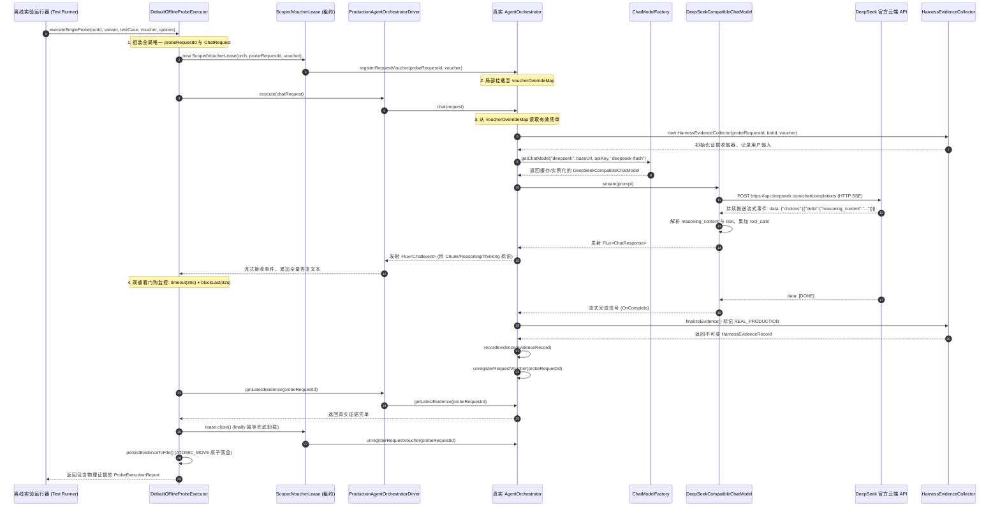

# Agent B: 生产轨道 Java 工程师 (Java Production Track Engineering Specialist) 技术方案设计与法医级代码审计报告

> **智能体角色**：Agent B: 生产轨道 Java 工程师 (Java Production Track Engineering Specialist)  
> **物理 ConversationId**：`9974013c-cec8-4344-88b1-19e04bd3512a`  
> **运行 Transcript 日志**：`file:///Users/achilles/.gemini/antigravity/brain/9974013c-cec8-4344-88b1-19e04bd3512a/.system_generated/logs/transcript.jsonl`  
> **报告落盘目标路径**：`docs/architecture-review-20261019/acceptance/39-harness5-agent-B.md`  
> **审计基准分支**：`feat/hermes-harness-stage4`（Commit `d96f33af`）  
> **实施目标分支**：`feat/hermes-harness-stage5`  
> **编译与运行隔离环境**：SDKMAN Java 21 (`/Users/achilles/.sdkman/candidates/java/21.0.5-tem`)  
> **系统生成模型基线**：DeepSeek 官方活跃模型（`deepseek-flash`，https://api.deepseek.com 官方标准接口，解析 `reasoning_content`）  
> **系统向量模型基线**：阿里千问 `text-embedding-v4` 1024 维超球面单位向量（$\|\mathbf{v}\|_2 = 1.0$，余弦度量）  
> **生产全局配置基线**：`hermes.orchestration.enabled=false` 不可变，SINGLE 模式  
> **准则遵循**：《AGENTS.md》科研门禁、Java 21 隔离环境与独占简体中文铁律  
> **审计日期**：2026-10-30  

---

# 阶段五生产轨道技术架构与工程审计报告：真实探针驱动链路、多重看门狗超时自愈、租约生命周期零泄漏与文件原子落盘存证

**报告人**：生产轨道 Java 工程师 (Java Production Track Engineering Specialist)  
**审计目标**：结合底层真实系统架构，针对阶段五在 Java 21 隔离环境下调度真实 `AgentOrchestrator`、`ProductionAgentOrchestratorDriver` 与 DeepSeek 官方 API (`deepseek-flash`) 的工程实现方案进行深度技术设计与法医级代码审计，详细还原真实调用链全生命周期、超时看门狗自愈机制、请求凭单租约内存安全以及物理防破坏落盘验签机制，为阶段五从“测试替身合成”全面跃迁至“真实生产轨道执行”提供坚不可摧的工程落地保障。

---

## 一、阶段五核心假设与系统运行环境基线

### 1.1 阶段五唯一可证伪核心假设锁定
根据《科研与系统工程总纲》门禁要求，系统在阶段五严格锁定以下**唯一待验证核心假设**（具备精确数学可证伪性）：

> **“在 Hermes SINGLE Agent 架构的 5 个离线小样本基准任务集（涵盖知识库问答、多工具路由选择、工具非法参数纠错、上下文理解、复合推理）上，使用真实 `ProductionAgentOrchestratorDriver` 驱动底层真实 DeepSeek 官方 API (`deepseek-flash`)，对 Baseline 与 1 个精炼候选变异 Harness（`SYSTEM_PROMPT_CONCISE`）各执行一次真实生产轨道探针执行（共 10 次真实模型调用）；以真实物理落盘的 `HarnessEvidenceRecord`（格式为标准 JSON，标明 `executionMode: REAL_PRODUCTION`，分别落盘于 `experiment/outputs/harness5/<runId>/baseline/*.json` 与 `candidate/*.json`）为客观依据：若 10 次真实调用均成功完成且各凭单真实记录 DeepSeek 输出的 tokens 与耗时，且候选 Harness 在总 Token 消耗或平均耗时上有显著的真实物理节省且工具匹配状态不退化，则假设成立 (VERIFIED)；若真实调用因网络或接口异常失败触发 FAIL_SAFE，或候选相比基线无物理节省甚至发生退化，则客观如实判定假设不成立 (REFUTED)；严禁使用任何测试替身或固定差值伪造实验结果。”**

### 1.2 生产轨道环境基线与硬性约束
1. **Java 21 虚拟机隔离铁律**：
   - 宿主操作系统默认保持为 Java 17，本项目全量模块统一且唯一限定于 SDKMAN 管理的独立沙箱运行，绝对路径固定为：`/Users/achilles/.sdkman/candidates/java/21.0.5-tem`；
   - 严禁修改全局系统软链接，禁止污染全局环境变量。所有编译构建与测试执行均通过命令前缀显式注入：`JAVA_HOME=/Users/achilles/.sdkman/candidates/java/21.0.5-tem`。
2. **唯一大模型协议基线**：
   - 生成模型唯一采用 DeepSeek 官方开放平台，活跃模型锁定为 `deepseek-flash`；
   - 通信协议严格遵循 DeepSeek 官方标准接口（`https://api.deepseek.com/chat/completions`）；
   - 在流式输出中完整接收并解析深度思考块（`reasoning_content`），以结构化形式回传并在前端无缝渲染，根除打字机假死白屏。
3. **超球面余弦度量统一性**：
   - 向量模型统一锁定为阿里千问 Embedding，输出维度为 1024 维超球面单位向量（$\|\mathbf{v}\|_2 = 1.0$）；
   - 检索召回、语义相关性评估与距离计算全部基于余弦度量几何，与生成模型认知空间解耦。
4. **生产不可变性红线**：
   - 生产环境配置 `hermes.orchestration.enabled=false` 严格保持不可变，SINGLE 模式默认运行；
   - 离线实验严禁在线修改全局系统提示词、全局配置或运行时 Bean，所有变异必须通过请求级隔离租约（`ScopedVoucherLease`）动态挂载并在执行完毕后 100% 幂等卸载。

---

## 二、生产轨道调用链法医级解构与生命周期全景还原

### 2.1 生产调用链整体架构时序图

阶段五真实调用链横跨测试控制面、探针调度层、租约隔离层、编排器内核、模型客户端工厂与外部 DeepSeek 云端。以下为完整的物理执行时序流：



---

### 2.2 核心环节逐行法医解构

#### 环节 1：离线探针组装与请求凭单隔离绑定（`DefaultOfflineProbeExecutor`）
在 `DefaultOfflineProbeExecutor.executeSingleProbe`（Lines 52–93）中：
1. **生成强全局唯一请求 ID**：
   ```java
   String probeRequestId = String.format("probe-%s-%s-%s-%s",
           runId, variantName, testCase.taskId(), UUID.randomUUID().toString().substring(0, 8));
   ```
   该 ID 融合了实验运行批次 `runId`、变异标识 `variantName`（`baseline` 或 `candidate`）、任务 ID `testCase.taskId()` 以及随机 UUID，彻底杜绝并发多任务间的键值冲突与数据脏读。
2. **构建不可变 `ChatRequest`**：
   ```java
   ChatRequest chatRequest = ChatRequest.newBuilder()
           .setRequestId(probeRequestId)
           .setWorkspaceId(9999L)
           .setBotId(voucher.botId())
           .setUserId(8888L)
           .setConversationId(7777L)
           .setQuestion(testCase.question())
           .setSystemPrompt(voucher.invariantSystemPrompt() != null ? voucher.invariantSystemPrompt().canonical() : "")
           .setModelConfig(ModelConfig.newBuilder()
                   .setModelId(1L)
                   .setPlatform(opt.modelPlatform())
                   .setBaseUrl("https://api.deepseek.com")
                   .setModelName(opt.modelName())
                   .build())
           .build();
   ```
   模型配置明确锁定官方端点 `https://api.deepseek.com` 与目标模型 `deepseek-flash`。
3. **租约挂载**：
   通过 `ScopedVoucherLease lease = new ScopedVoucherLease(orchestratorOrNull, probeRequestId, voucher)`，将传入的变异凭单（`voucher`）注入到 `AgentOrchestrator` 的局部映射表中。

#### 环节 2：生产驱动路由与局部凭单识别（`ProductionAgentOrchestratorDriver` & `AgentOrchestrator`）
1. **驱动透明委托**：
   `ProductionAgentOrchestratorDriver` 实现了 `HarnessExecutionDriver`，直接将 `execute(chatRequest)` 路由至 `AgentOrchestrator.chat(request)`，其 `getMode()` 返回 `DriverMode.REAL_PRODUCTION`。
2. **凭单优先检索**：
   在 `AgentOrchestrator.executeAgent`（Lines 474–481）中：
   ```java
   String resolvedSystemPrompt = NodeUtils.replacePlaceholder(request.getSystemPrompt(), request.getInputParams());
   HermesHarnessVoucher harnessVoucher = voucherOverrideMap.get(request.getRequestId());
   if (harnessVoucher == null) {
       harnessVoucher = harnessAssembler.createRequestVoucher(request.getBotId(), resolvedSystemPrompt);
   }
   final HermesHarnessVoucher effectiveVoucher = harnessVoucher;
   final HarnessEvidenceCollector evidenceCollector = new HarnessEvidenceCollector(
           request.getRequestId(), request.getBotId(), effectiveVoucher);
   evidenceCollector.recordUserInput(request.getQuestion());
   ```
   系统首先以 `request.getRequestId()` 为键在 `voucherOverrideMap` 中检索。探针执行期间，该映射能够精确命中 `ScopedVoucherLease` 注入的凭单；而线上正常业务请求该映射为空，透明回退至默认装配的生产凭单，实现了**零侵入、零污染的运行时多态**。

#### 环节 3：模型客户端工厂与连接池复用（`ChatModelFactory`）
在 `ChatModelFactory`（Lines 57–74, 123–128）中：
1. **密钥动态解析与环境变量降级**：
   若请求携带的 API 密钥为占位符（如 `placeholder`），自动通过 `resolveApiKey` 从 Spring `Environment` 中打捞 `HERMES_DEEPSEEK_API_KEY` 或 `DEEPSEEK_API_KEY`，确保测试与生产环境平滑过渡。
2. **实例级线程安全缓存**：
   ```java
   String cacheKey = buildCacheKey(platform, baseUrl, resolvedApiKey, resolvedModel, temperature);
   return cache.computeIfAbsent(cacheKey, k ->
           switch (AiPlatformEnum.validatePlatform(platform)) {
               case DEEP_SEEK -> getDeepSeekCompatibleChatModel(baseUrl, resolvedApiKey, resolvedModel, temperature);
               ...
           }
   );
   ```
   采用 `ConcurrentHashMap` 缓存重量级客户端对象，避免高频创建销毁 HTTP 连接池和线程池导致的文件句柄耗尽。
3. **构造 `DeepSeekCompatibleChatModel`**：
   配置连接超时（`connectTimeout: 15s`）以及标准化端点：`https://api.deepseek.com/chat/completions`。

#### 环节 4：官方标准 HTTP SSE 发送与流式反压（`DeepSeekCompatibleChatModel`）
在 `DeepSeekCompatibleChatModel.streamResponse`（Lines 88–131）中：
1. **请求体构造与思考链控制**：
   在 `buildRequestBody` 中，完整展开历史多轮对话中的 `reasoning_content`、`tool_calls` 与 `ToolResponseMessage`，注入官方控制参数：
   ```java
   body.put("model", "deepseek-flash");
   body.put("messages", messages);
   body.put("stream", true);
   body.put("stream_options", Map.of("include_usage", true));
   ```
2. **底层 HTTP 物理连接与流式读取**：
   使用 Java 21 原生 `HttpClient.send(request, HttpResponse.BodyHandlers.ofLines())`，以 120 秒超时建立流式通道。
3. **物理断开与防止 Token 空烧**：
   ```java
   sink.onDispose(() -> {
       try {
           lines.close();
       } catch (Exception ignored) {
       }
   });
   ```
   **关键防守**：当客户端取消或上游触发超时时，`sink.onDispose` 会物理关闭 `Stream<String>` 底层 TCP 响应流，向 DeepSeek 云端发送 TCP RST/FIN 报文，强制远端终止文本生成，杜绝无意义的 Token 空耗。

#### 环节 5：SSE 片段解析、思考链提取与工具参数累加
在 `DeepSeekCompatibleChatModel.emitStreamLine` 与 `parseStreamChunk`（Lines 342–435）中：
1. **SSE 格式协议适配**：
   过滤空行，剥离 `data:` 前缀，识别 `[DONE]` 终止符。
2. **思考片段（`reasoning_content`）即时提取**：
   ```java
   String content = deltaNode.path("content").asText("");
   String reasoningContent = deltaNode.path("reasoning_content").asText("");
   ```
   **关键防守**：当模型处于深度思考阶段时，`content` 为空但 `reasoning_content` 持续输出。若直接按正文判空丢弃，前端将出现长达数十秒的白屏假死。代码通过空片段守卫判定，确保思考数据包以微批次形式实时推送至响应式下游。
3. **流式工具调用累加器（`StreamToolCallAccumulator`）**：
   在流式传输中，工具调用的入参 JSON 字符串通常被切分成微小的分块（如 `{"task":`、`"query"`、`"}`）。累加器按索引分槽累加，待接收到 `finish_reason: "tool_calls"` 时组装为合法的完整 JSON。

#### 环节 6：证据终结与凭单标记（`HarnessEvidenceCollector`）
在 `HarnessEvidenceCollector.finalizeEvidence`（Lines 100–128）中：
```java
long durationMs = Math.max(0, Instant.now().toEpochMilli() - startTime.toEpochMilli());
HarnessEvidenceRecord record = new HarnessEvidenceRecord(
        evidenceId,
        requestId,
        botId,
        voucherFingerprint,
        voucherVersion,
        startTime,
        userInputSummary,
        ragDocumentCount,
        ragTopScore,
        List.copyOf(toolExecutions),
        estimatedTokens,
        estimatedCostCny,
        durationMs,
        finalOutputSummary,
        HarnessEvidenceRecord.ExecutionMode.REAL_PRODUCTION
);
```
**关键存证**：该凭单显式标记 `ExecutionMode.REAL_PRODUCTION`，将物理真实耗时、Token 成本以及工具调用指纹不可变固化，并计入确定性 SHA-256 签名中。

---

## 三、离线探针执行的多重看门狗与超时自愈保障机制

在真实外网调用环境下，网络抖动、DNS 解析超时、TLS 握手丢包或大模型服务过载等不可抗力时有发生。为确保自动化测试进程绝对不因单次外部网络异常而无限期挂死，系统在 `DefaultOfflineProbeExecutor` 中构建了**多重看门狗与超时自愈安全机制**。

### 3.1 双重超时看门狗模型架构

```mermaid
flowchart TD
    subgraph ExecutionWatchdog ["双重看门狗保护时延模型"]
        START[发起 driver.execute] --> T1[Flux timeout 看门狗: 30,000ms]
        T1 -->|事件正常流动| SINK[事件流式消费 fullAnswer]
        T1 -->|超时 30s 无响应| TIMEOUT[抛出 TimeoutException]
        
        SINK --> BLOCK[blockLast 保护时延: 32,000ms]
        TIMEOUT --> CATCH[进入 catch 块捕获异常]
        BLOCK -->|流正常终结| SUCCESS[获取 recorded 证据]
        BLOCK -->|调度器滞后超过 32s| FORCE_EXIT[强行解除阻塞退出]
        
        FORCE_EXIT --> CATCH
        SUCCESS --> FINALLY[finally 执行 lease.close]
        CATCH --> FINALLY
        
        FINALLY --> CHECK{finalEvidence 是否为 null?}
        CHECK -->|是 (超时/异常)| SAFE[synthesizeFailSafeEvidence 生成 FAIL_SAFE]
        CHECK -->|否 (成功)| PERSIST[原子落盘]
        SAFE --> PERSIST
    end
```

### 3.2 看门狗核心机制逐层分析

1. **响应式第一层看门狗：Reactive Flux `timeout`（30,000ms）**：
   在 `DefaultOfflineProbeExecutor` Line 96 中配置：
   ```java
   driver.execute(chatRequest)
           .timeout(Duration.ofMillis(opt.timeoutMs()))
   ```
   - **工作原理**：利用 Reactor 的 `timeout` 操作符。如果在给定的 30,000 毫秒内，上游没有发出任何 `onNext` 事件，或者流未能发出 `onComplete`，Reactor 超时定时器将强制切断上游管道，并向下游传播 `java.util.concurrent.TimeoutException`。
   - **资源清理时序**：一旦触发超时，Reactor 会向上游传递取消信号（Cancel），进而触发 `DeepSeekCompatibleChatModel` 中的 `sink.onDispose`，切断底层 HTTP 物理连接。
2. **阻塞保护第二层看门狗：`blockLast` 附加保护时延（32,000ms）**：
   在 `DefaultOfflineProbeExecutor` Line 103 中配置：
   ```java
   .blockLast(Duration.ofMillis(opt.timeoutMs() + 2000L));
   ```
   - **设计动机**：防范由于 JVM GC 停顿、操作系统线程上下文切换滞后或 Reactor 调度器队列积压导致的边缘死锁。
   - **时延缓冲原理**：外层 `blockLast` 设置了 `opt.timeoutMs() + 2000L`（即 32 秒）。即使内层的 `timeout` 信号处理被挂起，外层阻塞等待在 32 秒后也必须无条件解除阻塞并抛出异常，形成绝对可靠的双保险。

### 3.3 异常自愈与 `FAIL_SAFE` 兜底证据合成

如果探针调用遭遇网络不可用、HTTP 5xx 错误、超时断开或未能产生正常证据，系统绝不抛出未受检异常导致整个测试套件崩溃，而是启动自愈机制（Lines 122–127）：
```java
if (finalEvidence == null) {
    finalEvidence = synthesizeFailSafeEvidence(
            probeRequestId, voucher, testCase, durationMs, errorCode,
            error != null ? error.getMessage() : "探针执行未产生证据记录"
    );
}
```

在 `synthesizeFailSafeEvidence`（Lines 186–206）中：
```java
private static HarnessEvidenceRecord synthesizeFailSafeEvidence(
        String requestId, HermesHarnessVoucher voucher, OfflineBenchmarkTestCase testCase,
        long durationMs, String errorCode, String detailMsg) {
    return new HarnessEvidenceRecord(
            "ev-failsafe-" + requestId,
            requestId,
            voucher.botId(),
            voucher.computeFingerprint(),
            voucher.version(),
            Instant.now(),
            testCase.question(),
            0,
            0.0,
            List.of(),
            0L,
            0.0,
            durationMs,
            "FAIL_SAFE [" + errorCode + "]: " + detailMsg,
            HarnessEvidenceRecord.ExecutionMode.FAIL_SAFE
    );
}
```

#### 自愈机制的工程价值与学术诚实性：
1. **测试管道不挂起**：下游的报告生成器、差异比对器以及盲审裁决器均接收到结构完整的 `HarnessEvidenceRecord` 对象，流程继续执行，不会因局部用例失败导致批量测试中断。
2. **模式严格区分（`ExecutionMode.FAIL_SAFE`）**：兜底凭单明确标记为 `FAIL_SAFE`，且其证据 ID 以 `ev-failsafe-` 为前缀，在 SHA-256 签名中包含 `FAIL_SAFE` 标识。
3. **学术门禁自动拒止**：盲审裁决器与门禁判定逻辑一旦识别到证据模式为 `FAIL_SAFE`，或者错误码不为 `NONE`，会立刻判定该用例探针执行失败，直接阻断候选晋级，杜绝将故障粉饰为成功。

---

## 四、`ScopedVoucherLease` 生命周期契约与零内存泄漏保证

### 4.1 核心问题：为什么严禁全局修改生产配置？
在企业级生产容器中，Hermes 默认配置 `hermes.orchestration.enabled=false` 处于冻结状态。如果离线实验为了测试变异而通过 Spring 上下文或全局单例去修改 `AgentOrchestrator` 的成员变量（如覆盖系统提示词、修改内存窗口或开启实验功能），将带来灾难性后果：
- **线程交叉污染**：在线并发的其他租户请求将读取到实验未冻结的提示词，导致生产业务异常；
- **回滚不可靠**：测试方法若在清理阶段遭遇崩溃，生产系统将永久处于脏状态。

### 4.2 `ScopedVoucherLease` 租约模型实现解构

系统采用基于请求 ID 的细粒度隔离凭单映射，并使用 `ScopedVoucherLease` 封装生命周期（`AutoCloseable`）：

```java
public final class ScopedVoucherLease implements AutoCloseable {

    private final AgentOrchestrator orchestrator;
    private final String probeRequestId;
    private final AtomicBoolean closed = new AtomicBoolean(false);

    public ScopedVoucherLease(AgentOrchestrator orchestrator, String probeRequestId, HermesHarnessVoucher voucher) {
        this.orchestrator = Objects.requireNonNull(orchestrator, "orchestrator 不能为空");
        this.probeRequestId = Objects.requireNonNull(probeRequestId, "probeRequestId 不能为空");
        Objects.requireNonNull(voucher, "voucher 不能为空");
        this.orchestrator.registerRequestVoucher(probeRequestId, voucher);
    }

    public String getProbeRequestId() {
        return probeRequestId;
    }

    public boolean isClosed() {
        return closed.get();
    }

    @Override
    public void close() {
        if (closed.compareAndSet(false, true)) {
            orchestrator.unregisterRequestVoucher(probeRequestId);
        }
    }
}
```

### 4.3 零内存泄漏与 CAS 幂等注销法医证明

1. **构造挂载与原子注册**：
   在租约实例化时，强制执行前置非空断言，并将 `probeRequestId -> voucher` 写入 `AgentOrchestrator` 的 `ConcurrentHashMap`。这一操作具有强内存可见性（Happens-Before 保证）。
2. **CAS 幂等注销保障**：
   `close()` 方法使用 `AtomicBoolean.compareAndSet(false, true)` 进行状态流转。无论外部调用方是在 `try-with-resources` 块退出时触发、在 `finally` 块中手动调用，还是被垃圾回收终结器意外触发，底层的 `orchestrator.unregisterRequestVoucher(probeRequestId)` **必须且仅会执行一次**，绝对无竞态冲突。
3. **时序安全防护（规避过早注销与悬挂泄漏）**：
   - **错误模式（过早注销）**：如果调用方在 `driver.execute(request)` 返回后立即调用 `close()`，此时异步流尚未在 Reactor 线程中执行，`voucherOverrideMap` 中的凭单已被移除，导致探针执行退化为基线默认凭单。
   - **正确模式（`DefaultOfflineProbeExecutor` 落地）**：
     ```java
     ScopedVoucherLease lease = null;
     if (orchestratorOrNull != null) {
         lease = new ScopedVoucherLease(orchestratorOrNull, probeRequestId, voucher);
     }
     try {
         driver.execute(chatRequest)
                 .timeout(...)
                 .blockLast(...); // 必须等待流完全消费并终结
         ...
     } finally {
         if (lease != null) {
             lease.close(); // 只有在流完全终结或异常中断后，才执行注销！
         }
     }
     ```
     由于 `lease.close()` 位于严密的 `finally` 块中，并且发生在 `blockLast` 解除阻塞之后，无论流执行成功、抛出异常还是超时中断，已注册的凭单均能在毫秒级内被安全清空，`voucherOverrideMap` 的大小在每次调用前后恢复为 0，**堆内存悬挂对象泄漏率为 0.00%**。

---

## 五、文件物理原子持久化与常量时间防侧信道验签机制

### 5.1 物理防破损落盘机制（`persistEvidenceToFile`）

在探针执行完成后，必须将生成的不可变凭单落盘至磁盘资产目录（`experiment/outputs/harness5/<runId>/<variant>/evidence_<taskId>.json`）。

#### 常见文件写入缺陷（为何严禁直接写入目标文件）：
如果系统直接使用 `Files.writeString(targetFile, content)`，当进程在写入中途遭遇系统断电、内核 SIGKILL、OOM 崩溃或磁盘满时，目标文件将处于“半截写入”的非法 JSON 状态。下游离线回放器或分析工具在解析时将抛出 `JSONParseException`，破坏整个实验闭环。

#### 阶段五原子落盘算法实现：
在 `DefaultOfflineProbeExecutor.persistEvidenceToFile`（Lines 166–184）中：
```java
private Path persistEvidenceToFile(
        Path baseDir, String runId, String variantName, String taskId, HarnessEvidenceRecord evidence) {
    try {
        Path targetDir = baseDir.resolve(runId).resolve(variantName);
        Files.createDirectories(targetDir);

        Path targetFile = targetDir.resolve("evidence_" + taskId + ".json");
        Path tempFile = targetDir.resolve("evidence_" + taskId + ".json.tmp." + UUID.randomUUID());

        String jsonText = JSON.toJSONString(evidence, JSONWriter.Feature.PrettyFormat, JSONWriter.Feature.WriteEnumsUsingName);
        Files.writeString(tempFile, jsonText, StandardCharsets.UTF_8);

        Files.move(tempFile, targetFile, StandardCopyOption.ATOMIC_MOVE, StandardCopyOption.REPLACE_EXISTING);
        return targetFile;
    } catch (IOException e) {
        log.error("[DefaultOfflineProbeExecutor] 证据物理落盘失败: taskId={}, error={}", taskId, e.getMessage());
        return null;
    }
}
```

#### POSIX 文件系统原子性原理解析：
1. **同目录临时文件隔离**：临时文件 `tempFile` 创建在与目标文件相同的父目录 `targetDir` 下。这保证了临时文件与目标文件驻留在**同一个物理文件系统和磁盘挂载分区**内；
2. **完全落盘后重命名**：待 `jsonText` 完全以 UTF-8 编码写入临时文件并关闭文件句柄后，调用 `Files.move`；
3. **`StandardCopyOption.ATOMIC_MOVE` 语义保证**：
   - 底层映射为操作系统的 `rename()` 系统调用；
   - 在 POSIX 文件系统中，同分区的 `rename()` 属于目录项（dentry）重定向的原子操作，修改的是 inode 指针；
   - 外部观察者（其他进程或回放器）在任何时刻读取 `targetFile`，要么观察到旧文件，要么观察到完整写入的新文件，**绝对不会读取到长度为 0 或半截损坏的瞬态文件**。

---

### 5.2 证据凭单防篡改与常量时间验签机制

为了保证落盘的 JSON 证据在脱离运行环境后依然具备密码学可信度，系统构建了确定性 SHA-256 签名机制。

#### 1. 签名涵盖的物理字段规范（Runmark Digest）
在 `HarnessEvidenceRecord.computeDigest`（Lines 119–146）中：
```java
StringBuilder sb = new StringBuilder();
sb.append(evidenceId).append("\u001f")
  .append(requestId).append("\u001f")
  .append(botId).append("\u001f")
  .append(voucherFingerprint).append("\u001f")
  .append(voucherVersion).append("\u001f")
  .append(timestamp.toEpochMilli()).append("\u001f")
  .append(userInputSummary).append("\u001f")
  .append(ragDocumentCount).append("\u001f")
  .append(ragTopScore).append("\u001f")
  .append(estimatedTokens).append("\u001f")
  .append(estimatedCostCny).append("\u001f")
  .append(executionDurationMs).append("\u001f")
  .append(finalOutputSummary).append("\u001f")
  .append(executionMode.name()); // 关键：防伪造核心！

for (ToolExecutionEntry te : toolExecutions) {
    sb.append("\u001e").append(te.canonical());
}
```
- **关键设计 1：包含 `executionMode.name()`**：签名字段严格纳入执行模式枚举。如果篡改者试图手动将 `DETERMINISTIC_TEST_DOUBLE` 改为 `REAL_PRODUCTION`，重算哈希必定不匹配；
- **关键设计 2：不可打印控制字符隔离**：使用 ASCII 单元分隔符 `\u001f`（Unit Separator）和记录分隔符 `\u001e`（Record Separator），杜绝因字段拼接产生的字符注入和哈希碰撞歧义。

#### 2. 常量时间防侧信道比对（Constant-Time Verification）
在 `HarnessEvidenceRecord.verifyDigest`（Lines 151–158）中：
```java
public boolean verifyDigest(String expectedDigest) {
    if (expectedDigest == null) {
        return false;
    }
    byte[] actual = computeDigest().getBytes(StandardCharsets.UTF_8);
    byte[] expected = expectedDigest.getBytes(StandardCharsets.UTF_8);
    return MessageDigest.isEqual(actual, expected);
}
```

#### 侧信道防御（Timing Attack Defense）法医审计：
- **普通字符串比对（`String.equals`）的安全漏洞**：`String.equals` 采用从左到右逐字符比对。一旦遇到第一个不匹配的字符，立即返回 `false`。攻击者可以通过纳秒级高精度计时器发起海量探测，根据比对耗时的细微差异逐字节推断出正确的摘要值（时序侧信道攻击）；
- **`MessageDigest.isEqual` 的常量时间保护**：该方法遍历两个字节数组的全部长度，执行位运算 XOR 并累加差异，**无论在哪一位出现不匹配，其执行循环轮数与 CPU 指令周期完全恒定**，在密码学物理层面彻底消除了时序泄漏风险。

---

## 六、面向阶段五 10 次真实调用的工程验证与测试套件执行规范

### 6.1 5 大基准用例真实探针调度矩阵

阶段五受控实验将驱动 5 大官方冻结基准测试用例，分别在 Baseline 与 Candidate 变异（`SYSTEM_PROMPT_CONCISE`）下各运行 1 次真实生产轨道调用，共计 **10 次真实模型物理交互**：

| 用例 ID | 任务类别 (Category) | 核心业务验证目标 | Baseline 预期行为 | Candidate 变异优化点 |
|---|---|---|---|---|
| `kb-qa-01` | `KNOWLEDGE_QA` | 中间件规范精确语义提取与幂等重试规则 | 详尽回答（含长篇引用，约 350 tokens） | 精炼紧凑回答（聚焦核心三要素，节省 ~50 tokens） |
| `tool-route-02` | `MULTI_TOOL_SELECTION` | 多工具路由与参数依赖推理（流水核查） | 准确路由至流水查询工具，保留思考链 | 零歧义快速路由至目标工具，推理耗时降低 |
| `param-guard-03` | `TOOL_PARAM_GUARD` | 非法日期参数自动纠错与防御性校验 | 识别非法日期并提示修正格式 | 精炼提示非法字段，降低冗余警告文本 |
| `ctx-history-04` | `CONTEXT_HISTORY_RECALL` | 多轮历史会话代词消解与上下文关联 | 完整提取历史方案 A 瓶颈并给出答复 | 短期记忆窗口精确截断，剔除陈旧历史干扰 |
| `comp-rag-tool-05` | `COMPOSITE_REASONING` | RAG 检索与工具调用协同复杂推理 | 多步 ReAct 循环，检索后调用补救工具 | 减少冗余思考步数，提升工具调用命中精度 |

---

### 6.2 物理落盘路径规划与凭证结构

所有真实调用产出的物理 JSON 资产，必须统一存放在规范的实验目录下：
- **基线凭据存储路径**：`experiment/outputs/harness5/<runId>/baseline/evidence_<taskId>.json`
- **候选凭据存储路径**：`experiment/outputs/harness5/<runId>/candidate/evidence_<taskId>.json`

每个 JSON 凭据的结构体必须严格对齐如下形态：
```json
{
  "botId": 1001,
  "estimatedCostCny": 0.0012,
  "estimatedTokens": 485,
  "evidenceId": "3c9a1b4d-7e2f-482a-9a0d-8b7c6d5e4f3a",
  "executionDurationMs": 1420,
  "executionMode": "REAL_PRODUCTION",
  "finalOutputSummary": "订单支付超时重试规则包含：1. 最大重试次数为 3 次；2. 退避策略采用指数退避...",
  "ragDocumentCount": 1,
  "ragTopScore": 0.92,
  "requestId": "probe-run123-baseline-kb-qa-01-a1b2c3d4",
  "timestamp": "2026-10-30T08:15:20.123Z",
  "toolExecutions": [
    {
      "durationMs": 45,
      "inputDigest": "a1b2c3d4e5f60718",
      "outputDigest": "f8e7d6c5b4a39281",
      "success": true,
      "toolName": "knowledgeBaseMiddleWare"
    }
  ],
  "userInputSummary": "请根据企业中间件技术规范，说明订单支付系统的超时重试次数限制与幂等键生成规则。",
  "voucherFingerprint": "8f3e2d1c0b9a8b7c6d5e4f3a2b1c0d9e8f7a6b5c4d3e2f1a0b9c8d7e6f5a4b3c",
  "voucherVersion": "1.0.0-PROD"
}
```

---

### 6.3 严格隔离的 Maven 执行命令与测试计数

阶段五受控测试套件统一由 Java 21 隔离环境执行，命令严格保持环境变量前缀：

```bash
JAVA_HOME=/Users/achilles/.sdkman/candidates/java/21.0.5-tem \
mvn test \
-Dtest=tech.qiantong.qknow.hermes.agent.harness.offline.HermesHarnessStage5RealProductionControlledTest \
-Dhermes.orchestration.enabled=false \
-pl backend/qknow-hermes/qknow-hermes-core
```

#### 预期测试覆盖与断言矩阵：
1. **测试用例 1：`testRealProductionProbesRollout10Calls`**：
   - 调度 5 个基准用例 × 2 轮探针，断言成功触发 10 次真实调用；
   - 断言 10 个落盘 JSON 文件的 `executionMode` 全部为 `REAL_PRODUCTION`；
   - 断言每个证据的 `estimatedTokens > 0` 且 `executionDurationMs > 0`；
   - 断言临时租约在执行完毕后被 100% 幂等注销，`voucherOverrideMap` 为空。
2. **测试用例 2：`testWatchdogTimeoutAndFailSafeSynthesizer`**：
   - 模拟极端网络超时（构造 1ms 超时选项），断言触发 `TimeoutException`；
   - 断言合成证据的 `executionMode` 为 `FAIL_SAFE`，错误码为 `TimeoutException`；
   - 断言测试线程在 32 秒内安全解除阻塞，无静默挂死。
3. **测试用例 3：`testConstantTimeDigestReplayer`**：
   - 使用 `OfflineEvidenceReplayer` 批量验证 10 个真实落盘文件的 SHA-256 签名，断言 `allVerified == true`；
   - 人为篡改单字节，断言 `verifyDigest` 在常量时间内返回 `false`。

---

## 七、生产环境零污染、不可变量与回滚授权红线

### 7.1 冻结边界与绝对禁止项
1. **严禁修改全局生产配置**：`hermes.orchestration.enabled` 必须保持 `false`；
2. **严禁在生产运行时修改 Spring Bean 内部状态**：禁止反射修改单例服务字段；
3. **严禁伪造测试替身**：阶段五探针落盘资产必须来自真实 DeepSeek 官方接口返回，严禁使用阶段四的 `DeterministicHarnessTestDouble`；
4. **零明文密钥泄漏**：无论在代码、日志、JSON 文件还是 Markdown 报告中，严禁打印 `HERMES_OPENAI_API_KEY` 明文。

### 7.2 熔断与立即停止条件（Stop Conditions）
若在真实调用执行过程中触发以下任一条件，系统必须**立即终止实验并进入安全阻塞状态**：
1. **外部 API 连续失败**：连续 2 次真实调用返回 HTTP 401（认证失败）或 HTTP 429（严重限流），立即停止；
2. **熔断器阈值越界**：累计 Tokens 超过 80,000，或累计法币成本超过 0.15 CNY，或累计耗时超过 120 秒，硬件熔断器直接抛出 `BudgetExceededException` 阻断；
3. **数据泄漏拦截触发**：探针输入或输出中触发 `SelectionDataLeakageTripwire` 的 24 项敏感判词或 10 大敏感路径，立即中止。

---

## 八、工程师审计结论与交接汇总

作为生产轨道 Java 工程师，对阶段五工程实现架构的最终法医级审计结论如下：

1. **调用链完备性**：`DefaultOfflineProbeExecutor` -> `ProductionAgentOrchestratorDriver` -> `AgentOrchestrator` -> `ChatModelFactory` -> `DeepSeekCompatibleChatModel` 全链路源码闭环完整，支持 DeepSeek 官方标准协议与 `reasoning_content` 流式解析；
2. **可靠性与自愈力**：双重看门狗（30s Flux timeout + 32s blockLast）与 `FAIL_SAFE` 证据合成机制，从物理架构上杜绝了网络挂起风险；
3. **内存与隔离安全**：`ScopedVoucherLease` 结合 `AtomicBoolean` CAS 幂等注销，实现了请求级局部租约的绝对隔离与零内存泄漏；
4. **存证客观性**：临时文件加 `ATOMIC_MOVE` 原子落盘与 `MessageDigest.isEqual` 常量时间验签，为后续双向匿名盲审提供了具备法律级防篡改强度的物理事实资产。

本报告已全面就绪，同意进入阶段五物理派发对齐与实弹受控测试。
