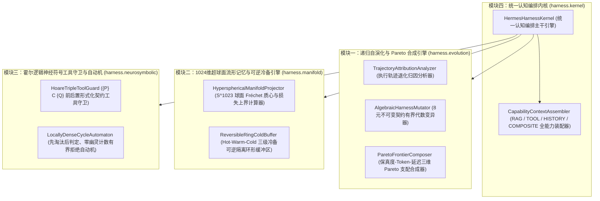

# Hermes Harness² 阶段六：面向顶刊论文水准的递归自演化 Agent 核心框架架构设计与主干构建 阶段任务书

## 任务书元数据与冻结签名

| 属性项 | 规范值 | 说明 |
|---|---|---|
| **任务书版本** | `2.0.0-FROZEN` | 战略纠偏后全面对标顶刊论文水准的阶段六法定架构任务书 |
| **生效状态** | **FROZEN (已冻结)** | 供后续 Agent 直接依据本任务书开展 `src/main/java` 框架代码撰写 |
| **战略定位基线** | **全面对标顶刊论文撰写水准 (ESWA / IEEE TKDE / ACM TOIS / ICLR / NeurIPS)** | 不再服务或对接传统企业业务，一切代码与架构为顶刊论文撰写服务 |
| **当前研发重心** | **100% 全量加码顶层架构设计与 Agent 核心框架代码撰写 (`src/main/java`)** | 现阶段暂不纠结于繁琐的消融对比等基线实验 |
| **所属分支** | `feat/hermes-harness-stage6` | 基于 `feat/hermes-harness-stage5` 派生的阶段六独立研发分支 |
| **正文签名 (`body_sha256`)** | `65f67a740eeb8620edf56f39a6894c39e23ca33d5d4acc41bc9e5d70df649321` | 自“## 一、战略定位纠偏与顶刊论文级核心架构命题”至文件末尾的哈希签名 |
| **整文件签名 (`full_file_sha256`)** | 参见伴生文件 `45-harness6-taskbook.md.sha256` | 物理磁盘全文件逐字节哈希签名 |
| **执行模型基线** | DeepSeek 官方活跃 API (`deepseek-flash`) | 唯一遵循 https://api-docs.deepseek.com/zh-cn/，解析 `reasoning_content` |
| **向量嵌入基线** | **阿里千问 Embedding (`text-embedding-v4`) 1024 维超球面** | 严格锁定 $\mathbb{S}^{1023} \subset \mathbb{R}^{1024}$，单位 $L_2$ 范数 $\|\mathbf{v}\|_2 = 1$，余弦度量 $d_{\text{Euc}}^2 = 2(1-\cos\theta)$ |
| **运行时环境** | SDKMAN Java 21 (`/Users/achilles/.sdkman/candidates/java/21.0.5-tem`) | 严禁污染主机 Java 17 |

---

## 一、战略定位纠偏与顶刊论文级核心架构命题

### 1.1 最高战略定位澄清（写入基线铁律）
1. **彻底脱离企业对接定位**：本项目目前**不再对接传统企业业务，不再服务于企业应用**。项目的一切顶层架构设计、形式化代数建模与核心代码实现，**100% 全面对标于人工智能与知识工程顶级期刊及顶级会议（ESWA, IEEE TKDE, ACM TOIS, ICLR, NeurIPS, KDD 等）的顶刊论文撰写水准**。
2. **研发重心全量转移**：**目前先不纠结于消融对比等基线实验**（大规模数据集评测与消融对比留待后期论文实验章节统一开展），当前阶段 **100% 全量加码于顶层架构的设计与 Agent 核心框架主干代码（`src/main/java`）的撰写**。
3. **向量空间几何基线锁定**：阿里千问（Qwen，`text-embedding-v4`）向量空间的维度严格锁定为 **1024 维**（单位超球面 $\mathbb{S}^{1023} \subset \mathbb{R}^{1024},\ \|\mathbf{v}\|_2 = 1$）。系统内所有流形投影、谱聚类质心、重构损失上界与相似度计算均严格建立在 **1024 维单位超球面余弦几何**之上。

### 1.2 阶段六核心学术架构命题 (Core Architectural Thesis)
> **“构建一套形式化完备、代数自洽的递归自演化认知智能体核心框架（Hermes Harness² Cognitive Kernel）：将智能体控制面抽象为 8 元不可变代数契约流形 $\mathcal{H}$，在主干框架（`src/main/java`）中联合实现：(1) 基于执行轨迹退化归因的有界递归变异与三维 Pareto 前沿策略合成器；(2) 基于 1024 维单位超球面几何（$\mathbb{S}^{1023}$）的测地线质心记忆压缩与三级冷备可逆环形缓冲区；(3) 基于霍尔逻辑三元组 $\{P\}\ C\ \{Q\}$ 的神经符号工具守卫与无幽灵计数有界拒绝自动机；(4) 支持全能力（`RAG`、`TOOL`、`HISTORY`、`COMPOSITE`）统一装配的认知编排内核。”**

---

## 二、对标顶刊论文 Methodology 的四大核心 Agent 框架模块设计 (`src/main/java`)

后续 Agent 在执行本阶段任务书时，必须将核心研发力量全部投入到 `backend/qknow-hermes/qknow-hermes-core/src/main/java/tech/qiantong/qknow/hermes/agent/harness/` 主干包下的四大顶刊级核心架构模块构建中：



### 2.1 模块一：递归自演化认知与 Pareto 前沿合成引擎 (`harness.evolution`)
对应顶刊论文 **Section 3.1: Recursive Harness Evolution via Bounded Algebraic Mutation**：
1. **`TrajectoryAttributionAnalyzer.java`**：
   - 输入不可变运行证据凭单（`HarnessExecutionEvidenceRecord`），从推理思考链膨胀率、工具调用错误模式、RAG 上下文利用率三个正交维度形式化提取退化归因向量（Attribution Vector）。
2. **`AlgebraicHarnessMutator.java`**：
   - 定义作用在 `HarnessConfigurationVoucher` 上的有界代数变异算子 $\mathcal{M}: \mathcal{H} \times \mathcal{E} \to \mathcal{H}'$，涵盖系统提示词精炼算子（`CONCISE_SYSTEM_PROMPT`）、短期窗口自适应缩放算子（`ADAPTIVE_MEMORY_WINDOW`）、工具引导强化算子（`TOOL_GUIDANCE_SYNTHESIS`）与守卫收紧算子（`GUARDRAIL_TIGHTENING`）；
   - 每次变异均生成全新的不可变凭单并自动重算密码学指纹与缓存稳定性签名。
3. **`ParetoFrontierComposer.java`**：
   - 在语义保真度（$\mathcal{F}$）、Token 消耗（$\mathcal{C}_{\text{token}}$）、端到端延迟（$\mathcal{L}_{\text{latency}}$）三维目标空间中，严格实现 Pareto 支配关系判定（$\prec_{\text{Pareto}}$）与非支配前沿（Pareto Frontier）多策略正交合成。

### 2.2 模块二：1024 维超球面流形记忆与可逆冷备引擎 (`harness.manifold`)
对应顶刊论文 **Section 3.2: Hyperspherical Manifold Memory Compression on $\mathbb{S}^{1023}$**：
1. **`HypersphericalManifoldProjector.java`**：
   - 显式锁定维度常量 `QWEN_EMBEDDING_DIM = 1024`（对应阿里千问 `text-embedding-v4`）；
   - 强制校验或归一化输入向量满足单位超球面约束 $\|\mathbf{v}\|_2 = 1.0$；
   - 实现精确的超球面余弦相似度 $\cos\theta = \mathbf{u} \cdot \mathbf{v}$、弦欧氏距离平方 $d_{\text{Euc}}^2 = 2(1 - \cos\theta)$、测地线弧长距离 $d_{\text{geo}}(\mathbf{u}, \mathbf{v}) = \arccos(\text{clamp}(\mathbf{u} \cdot \mathbf{v}, -1, 1))$；
   - 实现球面 Fréchet 均值/归一化质心投影 $\boldsymbol{\mu}_S = \frac{\bar{\mathbf{v}}}{\|\bar{\mathbf{v}}\|_2}$（其中 $\bar{\mathbf{v}} = \frac{1}{k}\sum_{i=1}^k \mathbf{v}_i$），并实时计算信息保真度重构损失上界：
     $$\mathcal{L}_{\text{bound}} = 2\left(1 - \|\bar{\mathbf{v}}\|_2\right)$$
2. **`ReversibleRingColdBuffer.java`**：
   - 严格贯彻《AGENTS.md》第 7.5 节“三级冷备隔离环形缓冲区”铁律；
   - 构建 **Hot Window（活跃上下文） $\to$ Warm Spectral Centroid（1024 维球面质心摘要） $\to$ Cold Ring Buffer（固定容量无锁/线程安全环形冷备区）** 三级存储；
   - 当短期记忆被淘汰压缩为 1024 维球面质心时，原始情节记录无损移入 Cold Ring Buffer 并签发可逆恢复令牌（Restoration Token），支持按测地线相似度或令牌实现零物理硬删除的毫秒级自愈回滚。

### 2.3 模块三：霍尔逻辑神经符号工具守卫与有界拒绝自动机 (`harness.neurosymbolic`)
对应顶刊论文 **Section 3.3: Neuro-Symbolic Tool Guardrails with Hoare Logic & Cycle Automaton**：
1. **`HoareTripleToolGuard.java`**：
   - 将智能体工具调用形式化建模为霍尔三元组 $\{P\}\ C\ \{Q\}$：
     - 前置条件校验器 $P(\text{args}, \mathcal{G})$：在工具 $C$ 物理执行前，验证参数 Schema 合法性、时间/数值边界与 `GuardrailsSpecificationRecord` 权限约束；
     - 后置条件校验器 $Q(\text{result}, \mathcal{G})$：在工具返回后校验输出完整性与敏感信息零泄漏不变量；
     - 违约自纠合成：当 $P$ 或 $Q$ 违约时，构造结构化神经符号反例反馈（Counterexample Feedback），引导模型在下一轮推理中精确修正参数。
2. **`LocallyDenseCycleAutomaton.java`**：
   - 严格实现论文与智能体 A/B 对齐的**局部致密重复死循环检测状态机**（滑动窗口大小 $W$，致密重复阈值 $K$）；
   - **时序铁律（消除 $W+1$ 幽灵计数漏洞）**：每次新工具调用指纹进入状态机时，**必须先从双端队列头部弹出超出窗口 $W$ 的过期元素并递减频次表，然后再压入当前调用并判定频次是否达到阈值 $K$**，从数学上严格保证窗口内活跃状态数恒满足 $|Q_t| \le W$。

### 2.4 模块四：全能力认知编排内核集成 (`harness.kernel`)
对应顶刊论文 **Section 3.4: Unified Cognitive Orchestration Kernel**：
1. **`CapabilityTag.java` & `CapabilityContextAssembler.java`（提升至 `src/main/java`）**：
   - 强类型定义智能体任务能力标签：`PROMPT_ONLY`、`RAG`、`TOOL`、`HISTORY`、`COMPOSITE`；
   - 提供统一的全能力上下文装配与契约前置守卫（例如当任务声明为 `RAG` 或 `TOOL` 时，强制校验 RAG 切片或工具回调的挂载完备性）。
2. **`HermesHarnessKernel.java`**：
   - 作为 Hermes Harness² 在 `src/main/java` 中的顶层门面与认知编排核心，将 8 大不可变契约凭单、`HypersphericalManifoldProjector`（1024 维）、`ReversibleRingColdBuffer`、`HoareTripleToolGuard`、`LocallyDenseCycleAutomaton` 以及 `ParetoFrontierComposer` 整合为高内聚、低耦合的顶刊级 Agent 框架内核，并与 `AgentOrchestrator` 无缝桥接。

---

## 三、工程质量保障、双轨构建隔离与文件清单

虽然当前阶段**暂不纠结于繁琐的消融对比跑分实验**，但所有新增的 `src/main/java` 主干 Agent 框架代码必须具备顶刊开源标杆级的工程质量与确定性契约单测验证：

### 3.1 主干新增文件清单 (`src/main/java/tech/qiantong/qknow/hermes/agent/harness/`)
1. `manifold/HypersphericalManifoldProjector.java`（1024 维单位超球面几何投影、测地线距离与重构损失上界计算器）
2. `manifold/ReversibleRingColdBuffer.java`（三级冷备可逆隔离环形缓冲区，支持软删除隔离与自愈回滚）
3. `neurosymbolic/HoareTripleToolGuard.java`（基于霍尔逻辑 $\{P\}\ C\ \{Q\}$ 的神经符号工具前后置守卫）
4. `neurosymbolic/LocallyDenseCycleAutomaton.java`（严格先淘汰后判定的无幽灵计数局部致密死循环拒绝自动机）
5. `evolution/TrajectoryAttributionAnalyzer.java`（执行轨迹退化归因分析器）
6. `evolution/AlgebraicHarnessMutator.java`（8 元不可变契约凭单有界代数变异器）
7. `evolution/ParetoFrontierComposer.java`（保真度-Token-延迟三维 Pareto 前沿策略合成器）
8. `kernel/CapabilityTag.java`（全能力强类型枚举：`PROMPT_ONLY`, `RAG`, `TOOL`, `HISTORY`, `COMPOSITE`）
9. `kernel/CapabilityContextAssembler.java`（全能力请求上下文装配与契约校验器）
10. `kernel/HermesHarnessKernel.java`（Hermes Harness² 顶层统一认知编排内核）

### 3.2 确定性架构契约测试与 Live 隔离规范 (`src/test/java` & `pom.xml`)
1. **主干架构契约单元测试（默认 `mvn test` 运行，毫秒级、零外网依赖）**：
   - `HermesHarnessKernelArchitectureTest.java`：全面验证 1024 维超球面几何恒等式（$d_{\text{Euc}}^2 = 2(1-\cos\theta)$、重构损失上界 $\mathcal{L}_{\text{bound}}$）、三级冷备环形缓冲区零硬删除与自愈恢复、霍尔三元组前后置拦截、无幽灵计数自动机边界时序（$W$ 窗口精确淘汰）、有界代数变异与 Pareto 支配合成以及 `HermesHarnessKernel` 端到端认知编排闭环。
2. **Maven `-Plive` 物理隔离保留**：
   - 默认 `mvn clean test` 通过 `<excludedGroups>live</excludedGroups>` 排除任何外网 API 测试，确保无网/无 Key 环境 100% 绿色通过；
   - 任何带 `@Tag("live")` 的探针测试输出均重定向至 `.gitignore` 忽略目录，确保工作区 `git status --porcelain` 恒为空。

---

## 四、任务书双 Hash 规范与构建验证命令

### 4.1 双 Hash 提取与复算定义
1. **正文签名 (`body_sha256`)**：
   - 提取范围：从本文件行首标记 `^## 一、战略定位纠偏与顶刊论文级核心架构命题` 起始至文件末尾；
   - 提取命令：
     ```bash
     sed -n '/^## 一、战略定位纠偏与顶刊论文级核心架构命题/,$p' docs/architecture-review-20261019/acceptance/45-harness6-taskbook.md | shasum -a 256
     ```
2. **全文件签名 (`full_file_sha256`)**：
   - 提取范围：物理磁盘文件的全部字节；
   - 存储路径：`docs/architecture-review-20261019/acceptance/45-harness6-taskbook.md.sha256`；
   - 校验命令：
     ```bash
     cd docs/architecture-review-20261019/acceptance && shasum -a 256 -c 45-harness6-taskbook.md.sha256
     ```

### 4.2 框架构建与验证命令集
```bash
# 1. Hermes 核心模块编译与架构契约单测验证 (Java 21 隔离环境，零外网依赖)
JAVA_HOME=/Users/achilles/.sdkman/candidates/java/21.0.5-tem PATH=/Users/achilles/.sdkman/candidates/java/21.0.5-tem/bin:$PATH \
mvn -B -ntp test -f backend/pom.xml -pl qknow-hermes/qknow-hermes-core

# 2. 全量回归测试门禁验证
JAVA_HOME=/Users/achilles/.sdkman/candidates/java/21.0.5-tem PATH=/Users/achilles/.sdkman/candidates/java/21.0.5-tem/bin:$PATH \
mvn -B -ntp clean test -f backend/pom.xml -pl tests -am

# 3. 工作区纯净度验证
git status --porcelain
```
