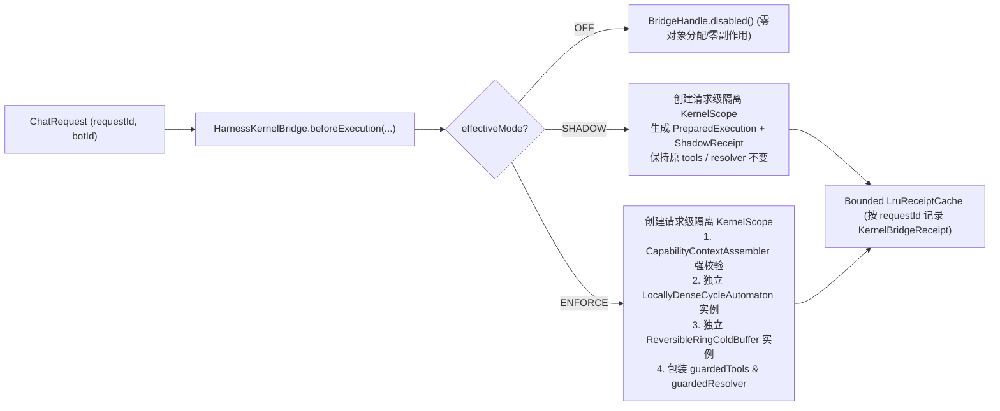

# Hermes Harness² 阶段七：Kernel 生产桥接（`HarnessKernelBridge`）与 Stage 6 语义收紧 架构设计书

> **设计版本**：`1.0.0-FINAL`（已完成 3 个独立子智能体法医审计与交叉辩论，正式汇入 `50-harness7-taskbook.md`）  
> **所属分支**：`feat/hermes-harness-stage6` $\to$ `feat/hermes-harness-stage7`  
> **核心原则**：默认关闭（`enabled=false, mode=OFF`）、`AgentOrchestrator` 公共签名 100% 不变、组件真实调用可证伪、单次请求级状态严格隔离、零外网默认门禁。

---

## 一、阶段 0：Stage 6 架构语义收紧设计（在 `feat/hermes-harness-stage6` 独立提交）

在切出 `feat/hermes-harness-stage7` 之前，必须先在 `feat/hermes-harness-stage6` 上以一个独立的 `fix(hermes)` 提交修复 Stage 6 验收指出的 4 项架构语义缺陷：

### 1.1 `HypersphericalManifoldProjector`：外在弦质心重命名与语义收紧
- **问题**：当前方法名为 `frechetMean(List<double[]> vectors)`，实际计算的是欧氏均值归一化投影 $\boldsymbol{\mu}_{\mathrm{ext}} = \bar{\mathbf{v}} / \|\bar{\mathbf{v}}\|_2$ 及平均平方弦距损失 $2(1 - \|\bar{\mathbf{v}}\|_2)$。
- **修正方案**：
  1. 将核心计算方法正式命名为 `extrinsicCentroid(List<double[]> vectors)`，并提供等价语义别名 `chordalCentroid(List<double[]> vectors)`；
  2. 保留 `@Deprecated(since = "stage7", forRemoval = false) public Centroid frechetMean(List<double[]> vectors)` 直接委托给 `extrinsicCentroid(vectors)`，并在 Javadoc 中明确声明：“此方法返回单位超球面 $\mathbb{S}^{1023}$ 上的外在弦质心（Extrinsic / Chordal Centroid），最小化平均平方弦距而非一般内蕴测地线 Fréchet 目标；请改用 `extrinsicCentroid` 或 `chordalCentroid`”；
  3. 新增辅助方法 `geodesicDistortionUpperBound(Centroid centroid, double maxGeodesicRadians)`：根据局部球冠最大测地线半径 $\theta_{\max} \in [0, \pi)$，利用不等式 $d_{\mathrm{geo}}^2 \le \frac{\pi^2}{4} d_{\mathrm{chord}}^2$ 计算外在弦损失对应的平均平方测地线失真上界；
  4. `ReversibleRingColdBuffer.warmCentroid()` 内部改为调用 `projector.extrinsicCentroid(...)`。

### 1.2 `ReversibleRingColdBuffer`：冷备档案上限（`maxArchiveCapacity`）与拒绝语义
- **问题**：`archive` 字段为无界 `LinkedHashMap<String, Stored<T>>`，只增不减。
- **修正方案**：
  1. 新增默认常量 `public static final int DEFAULT_MAX_ARCHIVE_CAPACITY = 256;`；
  2. 新增 5 参数主构造器：
     ```java
     public ReversibleRingColdBuffer(int hotCapacity, int warmCapacity, int coldCapacity,
                                     int maxArchiveCapacity, HypersphericalManifoldProjector projector)
     ```
     校验 `maxArchiveCapacity >= 1`；保留原 4 参数构造器并默认传入 `Math.max(coldCapacity * 4, DEFAULT_MAX_ARCHIVE_CAPACITY)`（或显式可测的默认上限）；
  3. 扩展 `Statistics` Record（保持向后兼容访问器的同时新增字段）：
     ```java
     public record Statistics(int hot, int warm, int cold, int archived,
                              int archivedCapacity, long softDeleted, long restored, long rejectedArchive) {}
     ```
  4. **溢出与软删除有界控制**：
     - 当 `add(Episode<T>)` 导致 `cold.size() > coldCapacity` 时，弹出 `cold` 最老条目并尝试放入 `archive`：若 `archive.size() < maxArchiveCapacity`，则正常存入 `archive`；若 `archive.size() >= maxArchiveCapacity`，则**拒绝写入 `archive`**，递增 `rejectedArchive++`（保证 `archive.size() <= maxArchiveCapacity` 恒成立）；
     - 新增 `public synchronized boolean canArchive()` 预检方法（供 `HermesHarnessKernel.prepare()` 调用）；
     - 当调用 `softDelete(RestorationToken)` 时，若 `archive.size() >= maxArchiveCapacity`，拒绝转入 `archive`（保留原条目在 `cold` 中不丢失或返回明确 `false` 并递增 `rejectedArchive++`，严禁静默硬删除也严禁突破 `maxArchiveCapacity`）。

### 1.3 `HoareTripleToolGuard`：真实读取并强制执行 `GuardrailsSpecificationRecord`
- **问题**：`verifyBefore` 只对 `guardrails` 做了 `null` 检查，未校验 `maxCycleSteps`、`loopThreshold`、`maxTokenBudget`、`maxCostCny`。
- **修正方案**：
  1. 扩展 `Violation` 枚举：
     ```java
     public enum Violation {
         MISSING_CONTRACT, PERMISSION, SCHEMA, BOUNDARY,
         GUARDRAIL_STEP_LIMIT, GUARDRAIL_LOOP_THRESHOLD, GUARDRAIL_TOKEN_BUDGET, GUARDRAIL_COST_BUDGET,
         RESULT_INTEGRITY, SENSITIVE_OUTPUT
     }
     ```
  2. 新增运行期状态 Record：
     ```java
     public record ExecutionState(int currentStep, int loopFrequency, long estimatedTokens, double estimatedCostCny) {
         public static ExecutionState initial() {
             return new ExecutionState(1, 1, 0L, 0.0D);
         }
     }
     ```
  3. 新增带 `ExecutionState` 的 `verifyBefore` 重载，并让原 4 参数 `verifyBefore` 传入从 `arguments` 中提取（若包含 `_step` / `_loopFrequency` / `_estimatedTokens` / `_estimatedCostCny` 元数据）或默认的 `ExecutionState`：
     - 若 `state.currentStep() > guardrails.maxCycleSteps()` $\to$ 返回 `Decision.reject(Violation.GUARDRAIL_STEP_LIMIT, ...)`；
     - 若 `state.loopFrequency() >= guardrails.loopThreshold()` $\to$ 返回 `Decision.reject(Violation.GUARDRAIL_LOOP_THRESHOLD, ...)`；
     - 若 `state.estimatedTokens() > guardrails.maxTokenBudget()` $\to$ 返回 `Decision.reject(Violation.GUARDRAIL_TOKEN_BUDGET, ...)`；
     - 若 `state.estimatedCostCny() > guardrails.maxCostCny()` $\to$ 返回 `Decision.reject(Violation.GUARDRAIL_COST_BUDGET, ...)`；
     - 随后继续执行 `contract.permittedTools()`、`requiredArguments()` 与 `boundary()` 校验。

### 1.4 `HermesHarnessKernel`：从单纯门面升级为真实组件编排内核
- **问题**：`prepare()` 与 `execute()` 没有实际调用 `toolGuard`、`cycleAutomaton`、`coldBuffer`、`attributionAnalyzer`、`mutator`、`paretoComposer`。
- **修正方案**：
  1. 在 `PreparedExecution` 中增加 `boolean coldBufferReady` 与 `ReversibleRingColdBuffer.Statistics coldBufferStats`（或保持兼容构造器），在 `prepare(...)` 中：
     - 调用 `capabilityAssembler.assemble(tag, ragContexts, tools, history)`；
     - 将 `history` 中的历史消息摘要作为轻量预检状态或检查 `coldBuffer.statistics()`；
     - 调用 `harnessAssembler.assembleSystemPrompt(...)`；
  2. 新增真实工具调用编排方法 `invokeTool(...)` 与 `wrapToolCallbacks(...)`：
     - 在工具调用前，**先调用 `cycleAutomaton.inspect(toolName, canonicalArgs)`** 获取当前窗口内的局部致密重复频次 `inspection.frequency()` 与 `inspection.rejected()`；
     - **再调用 `toolGuard.verifyBefore(toolName, argsMap, voucher.guardrails(), contract, executionState)`**（将步数、自动机 `frequency`、累计 Token/成本传入 `HoareTripleToolGuard`）；
     - 若自动机判定 `rejected` 或 `toolGuard.verifyBefore` 拒绝，则**不执行底层工具**，记录失败工具条目并返回结构化反例提示（或按策略抛出 `GuardrailViolationException`）；
     - 工具执行后，**调用 `toolGuard.verifyAfter(result, contract)`** 校验输出完整性与敏感片段；
  3. 在 `execute(PreparedExecution, Function<KernelExecutionContext, T>)`（同时保留原 `execute(PreparedExecution, Function<PreparedExecution, T>)` 重载并在内部创建 `KernelExecutionContext` 触发钩子）：
     - 提供 `KernelExecutionContext`，内含已由 `toolGuard` + `cycleAutomaton` 包装好的 `guardedToolCallbacks()`、单次执行步数计数器与 `recordAndEvaluateTrajectory(...)` 方法（真实串联 `attributionAnalyzer.analyze(...)` $\to$ `mutator.mutate(...)` $\to$ `paretoComposer.frontier(...)`）。

---

## 二、阶段 1 & 阶段 4：`HarnessKernelBridge` 生产桥接架构设计

### 2.1 配置契约与三态模式枚举 (`KernelBridgeMode`)

新增配置属性与模式定义（位于 `tech.qiantong.qknow.hermes.agent.harness.kernel`）：
- `hermes.harness.kernel.enabled`：布尔值，**全局默认 `false`**；
- `hermes.harness.kernel.mode`：枚举 `OFF | SHADOW | ENFORCE`，**全局默认 `OFF`**。

有效模式解析规则（`resolveEffectiveMode()`）：
1. 若 `enabled == false` 或 `mode == OFF`，有效模式恒为 **`OFF`**；
2. 若 `enabled == true` 且 `mode == SHADOW`，有效模式为 **`SHADOW`**；
3. 若 `enabled == true` 且 `mode == ENFORCE`，有效模式为 **`ENFORCE`**。

| 桥接模式 | 是否校验 `CapabilityContext` | 是否替换 `systemPrompt` | 是否包装 `ToolCallback` (`HoareGuard` + `CycleAutomaton`) | 异常/违约行为 | 对 `AgentOrchestrator` 实际执行的影响 |
|---|---|---|---|---|---|
| **`OFF` (默认)** | 否 | 否 | 否 | 不触发 | **100% 零影响**，直接短路返回，与未接入前逐行等价 |
| **`SHADOW` (影子)** | 是（捕获异常仅记录） | 否（仅计算比对指纹） | 否（仅旁路记录预备凭单与能力标签） | Fail-Open（记录日志与影子凭单，回退原路径） | **不改变实际提示词、不改变实际工具调用**，仅生成 `KernelBridgeReceipt` 供观测 |
| **`ENFORCE` (强制)** | 是（缺少必需载荷立即 Fail-Close） | 是（采用 Kernel 装配的受控 SystemPrompt） | 是（所有工具与 Resolver 均由请求级 `HoareGuard` + `CycleAutomaton` 包装） | **Fail-Close**（能力缺失或护栏违约立即阻断并返回结构化错误/反例） | 真实由 `HermesHarnessKernel` 接管能力校验、工具前后置霍尔守卫与局部致密循环拦截 |

### 2.2 请求级状态隔离（Request-Scoped Isolation）—— 杜绝跨请求污染



**核心隔离铁律**：
- `LocallyDenseCycleAutomaton` 与 `ReversibleRingColdBuffer` **绝不允许作为多线程共享的可变单例在请求间混用**；
- 在 `SHADOW` 或 `ENFORCE` 模式下，每次 `HarnessKernelBridge.openScope(...)` 必须根据当前请求的 `HermesHarnessVoucher`（读取 `guardrails().maxCycleSteps()`、`guardrails().loopThreshold()`、`memoryContext().shortTermWindowSize()`）实例化**该请求专属（Request-Scoped）**的 `LocallyDenseCycleAutomaton` 与 `ReversibleRingColdBuffer`（或通过 `HermesHarnessKernel.newRequestSession(voucher)` 创建）；
- 请求 A 中的工具重复调用计数或冷备淘汰，**100% 不会泄漏或污染请求 B**。

### 2.3 `AgentOrchestrator` 无侵入接入点设计

1. **公共签名 100% 不变**：
   - `AgentOrchestrator` 的所有既有构造器、`chat(ChatRequest, FluxSink<ChatEvent>)`、`getLatestEvidence(String)` 等公共方法签名保持**零修改**；
   - 新增可选 Setter 注入（与 `setHarnessAssembler` 完全同构）：
     ```java
     private HarnessKernelBridge harnessKernelBridge = HarnessKernelBridge.disabledInstance();

     @org.springframework.beans.factory.annotation.Autowired(required = false)
     public void setHarnessKernelBridge(HarnessKernelBridge harnessKernelBridge) {
         if (harnessKernelBridge != null) {
             this.harnessKernelBridge = harnessKernelBridge;
         }
     }

     public HarnessKernelBridge getHarnessKernelBridge() {
         return this.harnessKernelBridge;
     }
     ```
2. **在 `AgentOrchestrator` 中的精确切入位置（行 571 `planAndSolve` 之前）与 3 项法医级细节修正**：
   - **细节 1（JSON 字符串解析 `CapabilityTag`）**：`ChatRequest.getInputParams()` 与 `getParameters()` 类型均为 `String`（JSON 字符串，而非 `Map`）。`HarnessKernelBridge.resolveCapabilityTag(...)` 必须使用项目现有的 `com.alibaba.fastjson2.JSONObject.parseObject` 安全解析 `"harness.capabilityTag"` 或 `"capabilityTag"`；若未显式声明，则按请求实际携带的 `effectiveRagContexts`、可用工具集（`tools` + `resolver`）与有效历史消息自动推断（`COMPOSITE / RAG / TOOL / HISTORY / PROMPT_ONLY`）；
   - **细节 2（双源历史消息对齐）**：当 `request.getHistoryList()` 为空但 `MemoryManager` 短期记忆已加载历史 `List<Message>` 时，将非空短期记忆映射为轻量 `List<ChatMessage>` 传入 `CapabilityContextAssembler`，避免合法的短期记忆多轮对话在 `HISTORY` 标签下被误判为空；
   - **细节 3（位于 `planAndSolve` 之前切入）**：必须将 `ReActCycleGuard` 包装与 `harnessKernelBridge.bridgeExecution(...)` 置于 `if (planAndSolve)`（行 571）**之前**，确保无论是否启用 `planAndSolve`，`ENFORCE` 模式的 Fail-Close 阻断（记录 `ExecutionMode.FAIL_SAFE` 证据并发送 `ErrorEvent`，大模型调用次数为 `0`）与 `HoareTripleToolGuard` + `LocallyDenseCycleAutomaton` 工具包装均 100% 生效；
   - 当 `harnessKernelBridge.isOff()`（默认 `true`）时，不执行任何额外逻辑，100% 走原有代码；
   - 在 `SHADOW` 模式下：调用 `harnessKernelBridge.bridgeExecution(...)` 旁路记录 `KernelBridgeReceipt`（包含 `requestId`、`mode`、`capabilityTag`、`kernelFingerprint`、`shadowPreparedSuccess`），若发生异常仅 `log.warn` 并继续原有流程，绝不替换 `systemPrompt` 或拦截工具；
   - 在 `ENFORCE` 模式下：若 `CapabilityContextAssembler` 校验失败（`failClosed == true`），**立即在 `planAndSolve` 之前 Fail-Close**（通过 `HarnessEvidenceCollector` 12 参数重载写入 `ExecutionMode.FAIL_SAFE` 证据并向 `emitter` 发送 `ErrorEvent` 终止，绝不调用外部大模型）；若校验通过，使用请求级隔离 `ExecutionSession` 包装 `tools` 与 `resolver`，并在 `finally` 中汇总轨迹演化结果。

---

## 三、全量测试计数口径统一说明

针对 Stage 6 验收第 5 点指出的“全量测试计数 2116 vs (1942 + 133)”差异：
- 经核查，`mvn -B -ntp -f backend/pom.xml -pl tests -am clean test` 共构建 43 个模块，其中大部分业务模块无测试或仅含少量测试，主要测试集中在 `qknow-tests`（1942 个）、`qknow-hermes-core`（133 个）及 `qknow-ai` / `qknow-module-*` 等子模块；而根目录下未参与 `-pl tests -am` 子图构建的 `qknow-server/target/surefire-reports` 残留了历史旧运行文件。
- **阶段七统一统计口径铁律**：
  在阶段七验证与报告中，必须分别单独列出：
  1. `qknow-hermes-core` 模块精确测试数（`Tests run / Failures / Errors / Skipped`）；
  2. `qknow-tests` 模块精确测试数（`Tests run / Failures / Errors / Skipped`）；
  3. 本次 `-pl tests -am` Reactor 实际执行的各模块 Surefire 汇总表（仅统计本次构建生成的文件，排除未参与 reactor 的历史目录）。
