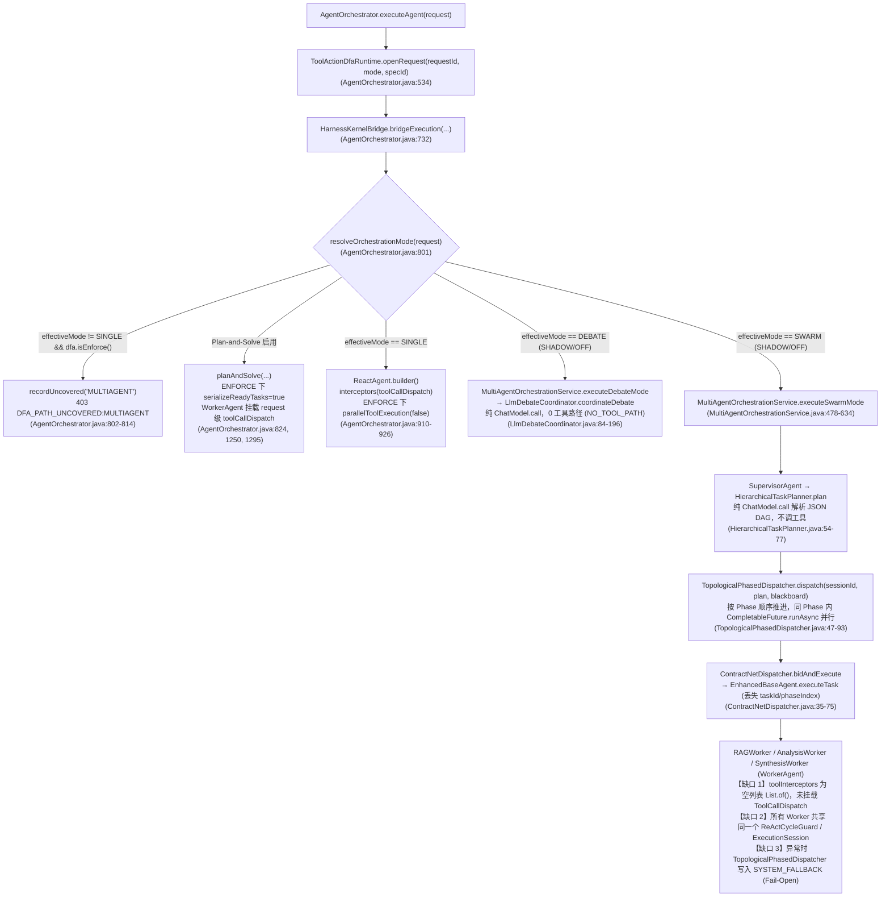
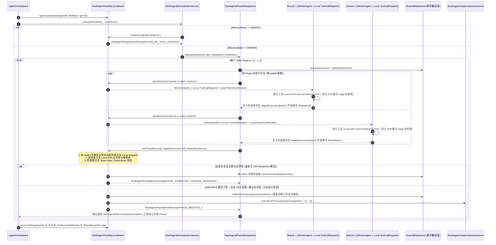

# 88 - Stage 21 研究与架构计划任务书：多智能体并行工具协调（Multi-Agent Tool Coordination）

> **DEFERRED / NOT IMPLEMENTATION BASELINE**：本计划已延期，不授权 Stage 21 实施。Stage 21 当前唯一规划基线见 `91-harness21-cognitive-core-research-plan.md` 的 Stage 21A 范围；不得按本文的并行分支、Barrier Join、Saga 补偿或黑板回滚方案开工。本文仅作为历史研究记录保留。

- **文档编号**：`88-harness21-research-plan.md`
- **所属阶段**：Stage 21（Multi-Agent Tool Coordination）
- **前置基线**：Stage 20 CLOSED（实现提交 `7f817a69`，验收提交 `0330868c`）
- **当前性质**：**纯研究、形式化架构设计与决策完备（Decision-Complete）计划文档**（零源码修改、零真实 API 调用、默认保持 `OFF`）
- **多智能体物理派发存证（`AGENTS.md` §2.7）**：
  - **[智能体 A：Stage 21 多智能体工具协调与形式化并发自动机调研员](conversation://73d1649a-d2e8-447c-811a-f7039afe5540)**（Transcript：[`73d1649a.../transcript.jsonl`](file:///Users/achilles/.gemini/antigravity/brain/73d1649a-d2e8-447c-811a-f7039afe5540/.system_generated/logs/transcript.jsonl)）
  - **[智能体 B：Stage 22 有界异步认知流水线与并发取消/背压调研员](conversation://f6fc941c-d685-40b8-9175-3255b235b7d5)**（Transcript：[`f6fc941c.../transcript.jsonl`](file:///Users/achilles/.gemini/antigravity/brain/f6fc941c-d685-40b8-9175-3255b235b7d5/.system_generated/logs/transcript.jsonl)）
  - **[智能体 C：Stage 23 统一 Harness Runtime 与全生命周期收敛架构师](conversation://4b623e01-44f5-44ab-914c-a74cedd295b5)**（Transcript：[`4b623e01.../transcript.jsonl`](file:///Users/achilles/.gemini/antigravity/brain/4b623e01-44f5-44ab-914c-a74cedd295b5/.system_generated/logs/transcript.jsonl)）

> [!IMPORTANT]
> **本阶段唯一待验证与规划核心命题**：
> 在多 Agent（特别是 `SWARM` 拓扑分层 DAG）并行发起工具调用时，如何通过 **“分支级局部自动机（Per-Branch Local DFA）+ 阶段栅栏确定性归约协调器（Phase Barrier Join Coordinator）+ 黑板冷备快照回滚与 Saga LIFO 逆序补偿”**，保证每个 Agent 分支的局部工具状态合法，并在阶段汇合点（Barrier Join）保持全局一致性，同时彻底规避全局乘积自动机（Global Product Automaton）的 $|S|^K$ 指数状态爆炸与跨线程 CAS 抢占冲突。

---

## A. 当前多 Agent 工具路径图与只读代码法医审计

### A.1 当前多 Agent 与单 Agent 工具执行全路径拓扑图



### A.2 十大必答审计问题逐一裁决（严格区分：事实 / 推断 / 未验证 / 已否决）

#### 1. SWARM 中哪些 Agent 真正调用工具？
- **【事实】仅 `WorkerAgent`（`RAGWorker`、`AnalysisWorker`、`SynthesisWorker`）真正调用工具**：
  - **`WorkerAgent`（真正调用工具）**：在 [`MultiAgentOrchestrationService.java`](file:///Users/achilles/Documents/许子祺/Agent/backend/qknow-hermes/qknow-hermes-core/src/main/java/tech/qiantong/qknow/hermes/agent/orchestration/MultiAgentOrchestrationService.java#L516-L517) 与 [`L759-L804`](file:///Users/achilles/Documents/许子祺/Agent/backend/qknow-hermes/qknow-hermes-core/src/main/java/tech/qiantong/qknow/hermes/agent/orchestration/MultiAgentOrchestrationService.java#L759-L804) 中，`createRequestScopedSwarmWorkers(...)` 创建最多 3 个角色级 `WorkerAgent` 实例，传入按角色白名单过滤后的 `roleScopedTools` 与 `roleScopedResolver`。在 [`WorkerAgent.java`](file:///Users/achilles/Documents/许子祺/Agent/backend/qknow-hermes/qknow-hermes-core/src/main/java/tech/qiantong/qknow/hermes/agent/WorkerAgent.java#L131-L136) 与 [`L204-L240`](file:///Users/achilles/Documents/许子祺/Agent/backend/qknow-hermes/qknow-hermes-core/src/main/java/tech/qiantong/qknow/hermes/agent/WorkerAgent.java#L204-L240) 中，`WorkerAgent.chat(...)` 调用 `createReactAgent(activeTools)` 构建 Alibaba `ReactAgent` 并执行 `.tools(activeTools).resolver(resolver)`，这是 SWARM 路径中唯一真正触发 `ToolCallback` 执行的组件。
  - **`SupervisorAgent`（不调用工具）**：虽然 [`SupervisorAgent.java`](file:///Users/achilles/Documents/许子祺/Agent/backend/qknow-hermes/qknow-hermes-core/src/main/java/tech/qiantong/qknow/hermes/agent/SupervisorAgent.java#L38-L85) 构造器接收了 `List<ToolCallback> tools` 字段，但在全文 1–319 行中该字段**从未被任何方法读取或绑定到 `ChatModel`/`ReactAgent`**；`SupervisorAgent` 仅在计划为空时调用 `chatModel.call(new Prompt(...))`（第 237–240 行）以及在 `aggregateResults`（第 259、314 行）调用无工具 `chatModel.call(new Prompt(messages))`。
  - **`HierarchicalTaskPlanner`（不调用工具）**：在 [`HierarchicalTaskPlanner.java`](file:///Users/achilles/Documents/许子祺/Agent/backend/qknow-hermes/qknow-hermes-core/src/main/java/tech/qiantong/qknow/hermes/agent/dag/HierarchicalTaskPlanner.java#L54-L77) 中，`plan(String userQuery)` 仅构造纯文本 `SystemMessage` + `UserMessage` 调用 `chatModel.call(chatPrompt)`，零工具挂载。
  - **`EvaluatorOptimizerGovernor`（不调用工具）**：在 `MultiAgentOrchestrationService.java:519-529` 中默认传 `null`；即便注入 `DualLoopEvaluatorOptimizerEngine`，其 `evaluate()` 与 `optimize()` 也仅执行纯文本 `chatModel.call` 与正则规则自愈，无任何工具路径。

#### 2. 每个 Agent 是否有独立 request/session 身份？
- **【事实】当前不存在 `(requestId, phaseIndex, taskId, workerName)` 分支级独立工具会话身份，且在 `ContractNetDispatcher -> EnhancedBaseAgent` 处发生上下文传递断裂**：
  - 在 [`MultiAgentOrchestrationService.java`](file:///Users/achilles/Documents/许子祺/Agent/backend/qknow-hermes/qknow-hermes-core/src/main/java/tech/qiantong/qknow/hermes/agent/orchestration/MultiAgentOrchestrationService.java#L489-L491) 中，整场 SWARM 共享单一请求级 `sessionId = StrUtil.isNotBlank(request.getRequestId()) ? request.getRequestId() : UUID.randomUUID().toString()`。
  - 在 [`TopologicalPhasedDispatcher.java`](file:///Users/achilles/Documents/许子祺/Agent/backend/qknow-hermes/qknow-hermes-core/src/main/java/tech/qiantong/qknow/hermes/agent/dag/TopologicalPhasedDispatcher.java#L113) 中，调度器调用 `contractNetDispatcher.bidAndExecute(sessionId, task, contextPayload.toString())`；而在 [`ContractNetDispatcher.java`](file:///Users/achilles/Documents/许子祺/Agent/backend/qknow-hermes/qknow-hermes-core/src/main/java/tech/qiantong/qknow/hermes/agent/bidding/ContractNetDispatcher.java#L74) 中仅调用 `selectedWorker.executeTask(task.objective(), contextPayload)`。
  - **关键断裂事实**：`EnhancedBaseAgent.executeTask` 内部新建了一个仅包含 `contextPayload` 的 `HashMap`，**完全丢弃了 `sessionId`、`phaseIndex`、`task.taskId()`**！更严重的是，若同一 Phase 内有两个并行任务同时竞标命中同一个 `WorkerAgent`（如两个检索子任务同时命中 `RAGWorker`），两个线程会并发进入同一个 `WorkerAgent` 实例，底层工具回调根本无法区分当前工具调用属于哪个 `taskId` 分支。

#### 3. 当前 DFA ENFORCE 为什么在 SWARM fail-close？
- **【事实】三重结构性原因导致 Stage 20 必须在入口处 fail-close**：
  1. **拦截器未向 SWARM Worker 接线**：[`AgentOrchestrator.java`](file:///Users/achilles/Documents/许子祺/Agent/backend/qknow-hermes/qknow-hermes-core/src/main/java/tech/qiantong/qknow/hermes/agent/AgentOrchestrator.java#L883-L892) 的 `multiAgentOrchestrationService.executeIfEnabled(...)` 未接收 `ToolCallDispatch` 参数；`MultiAgentOrchestrationService.createRequestScopedSwarmWorkers(...)` 调用 `WorkerAgent` 的 7 参数构造器（[`WorkerAgent.java`](file:///Users/achilles/Documents/许子祺/Agent/backend/qknow-hermes/qknow-hermes-core/src/main/java/tech/qiantong/qknow/hermes/agent/WorkerAgent.java#L61-L67)），其 `toolInterceptors` 为空列表 `List.of()`。若不在 [`AgentOrchestrator.java`](file:///Users/achilles/Documents/许子祺/Agent/backend/qknow-hermes/qknow-hermes-core/src/main/java/tech/qiantong/qknow/hermes/agent/AgentOrchestrator.java#L801-L814) 处 fail-close，SWARM 中的所有工具调用会 100% 绕过 DFA 守卫。
  2. **单会话顺序状态机无法承载 Phase 内多线程并行工具调用**：[`TopologicalPhasedDispatcher.java`](file:///Users/achilles/Documents/许子祺/Agent/backend/qknow-hermes/qknow-hermes-core/src/main/java/tech/qiantong/qknow/hermes/agent/dag/TopologicalPhasedDispatcher.java#L65-L79) 对同一 Phase 内的多个 `DagTaskNode` 使用 `CompletableFuture.runAsync(..., AGENT_TASK_EXECUTOR)` 并行调度，与单一顺序 `ToolActionDfaSession` 冲突。
  3. **入口判断条件将 `DEBATE` 与 `SWARM` 一刀切合并拦截**：第 803 行使用 `orchestrationMode.effectiveMode() != OrchestrationMode.ORCHESTRATION_MODE_SINGLE`，导致连完全无工具调用的 `DEBATE` 模式也被一并 `403 DFA_PATH_UNCOVERED:MULTIAGENT` 拒绝。

#### 4. 多个 Agent 是否共享同一个 `ToolCallDispatch` / `ReActCycleGuard` / `HarnessEvidenceCollector` / `HermesHarnessKernel.ExecutionSession`？直接共享同一个 `ToolActionDfaSession` 会发生什么？
- **【事实】当前共享现状与并发污染缺陷**：
  1. **`ToolCallDispatch`**：当前未传入 `MultiAgentOrchestrationService`，各 SWARM Worker 均未挂载。
  2. **`ReActCycleGuard`（跨 Worker 共享同一实例，存在假阳性熔断缺陷）**：在 [`AgentOrchestrator.java`](file:///Users/achilles/Documents/许子祺/Agent/backend/qknow-hermes/qknow-hermes-core/src/main/java/tech/qiantong/qknow/hermes/agent/AgentOrchestrator.java#L862-L890) 中，单次请求只创建一个 `ReActCycleGuard` 并包装进 `guardedTools` / `guardedResolver` 传给所有 SWARM Worker。当 `Worker 1` 调用工具 `T(args)`、并行的 `Worker 2` 紧接着调用相同的 `T(args)` 时，共享的 `ReActStrictWindowCycleGuard` 会发现 `callFingerprints.getLast().equals(fp)`，**将两个不同 Worker 的合法并行调用误判为“连续重复调用完全相同参数”，直接触发假阳性熔断**！
  3. **`HermesHarnessKernel.ExecutionSession`（Kernel ENFORCE 下跨 Worker 共享同一 `synchronized` 实例）**：在 [`HermesHarnessKernel.java`](file:///Users/achilles/Documents/许子祺/Agent/backend/qknow-hermes/qknow-hermes-core/src/main/java/tech/qiantong/qknow/hermes/agent/harness/kernel/HermesHarnessKernel.java#L141) 中，`invokeTool` 是 `synchronized` 方法且共享单一 `sessionCycles` 窗口，在并行 Worker 下既会造成跨 Worker 锁争用与虚拟线程 Pinning，又会引发跨 Worker 环路误判。
  4. **`HarnessEvidenceCollector`**：跨 Worker 共享同一 `CopyOnWriteArrayList`，线程安全但缺失分支归属与确定性逻辑序号。
- **【事实 + 推断】若多个并行 Worker 直接共享同一个 `ToolActionDfaSession`，将必然触发 4 类并发故障**：
  1. **Check-Then-Act 窗口抢占导致 `DFA_STALE_COMPLETION`**：在 [`ToolCallDispatch.java`](file:///Users/achilles/Documents/许子祺/Agent/backend/qknow-hermes/qknow-hermes-core/src/main/java/tech/qiantong/qknow/hermes/agent/harness/neurosymbolic/toolaction/ToolCallDispatch.java#L100-L137) 中，`guard.check(toolName)` 读取 `fromState = S0` 后释放锁去执行耗时数百毫秒的 `handler.call(request)`；在此期间若另一并行 Worker 完成工具调用并将 `currentState` 推进到 `S1`，则第一个 Worker 执行完物理工具后调用 `guard.commitSuccess(identity, S0, toolName)`（[`ToolActionDfaSession.java`](file:///Users/achilles/Documents/许子祺/Agent/backend/qknow-hermes/qknow-hermes-core/src/main/java/tech/qiantong/qknow/hermes/agent/harness/neurosymbolic/toolaction/ToolActionDfaSession.java#L98)）必然因 `!currentState.equals(expectedFrom)` 返回 `false`，造成物理工具已执行但状态机转移丢失的 `DFA_STALE_COMPLETION`！
  2. **跨 Worker 状态游标串扰**：Worker 1 执行 `read` 将共享状态推进到 `READ`，导致尚未执行 `read` 的 Worker 2 可以直接越权调用 `write`（安全漏放），或者 Worker 1 进入终态 `DONE` 导致 Worker 2 的合法 `read` 被拒绝（误杀）。
  3. **`toolCallId` 碰撞触发假 `DFA_IDENTITY_CONFLICT`**：两个独立 Worker 的 LLM 调用常在各自第 1 轮生成相同的局部 `toolCallId`（如 `"call_0"` 或 `"call_1"`）。共享同一 `ToolActionDfaSession.invocations` 表时，第二个 Worker 调不同工具会立即触发 [`ToolActionDfaSession.java`](file:///Users/achilles/Documents/许子祺/Agent/backend/qknow-hermes/qknow-hermes-core/src/main/java/tech/qiantong/qknow/hermes/agent/harness/neurosymbolic/toolaction/ToolActionDfaSession.java#L63-L66) 的 `ReservationStatus.CONFLICT`（`DFA_IDENTITY_CONFLICT`）。
  4. **线程调度非确定性**：同一组并行工具调用因网络抖动先后顺序不同，会产生完全不同的状态轨迹与回执顺序。

#### 5. 是否存在全局顺序状态机假设？
- **【事实】存在**：
  - [`ToolActionDfaSessionRegistry.java`](file:///Users/achilles/Documents/许子祺/Agent/backend/qknow-hermes/qknow-hermes-core/src/main/java/tech/qiantong/qknow/hermes/agent/harness/neurosymbolic/toolaction/ToolActionDfaSessionRegistry.java#L28-L41) 以单一 `requestId` 为键，同一 `requestId` 二次调用 `open()` 直接返回 `"REQUEST_ALREADY_ACTIVE"`；
  - [`ToolActionDfaSession.java`](file:///Users/achilles/Documents/许子祺/Agent/backend/qknow-hermes/qknow-hermes-core/src/main/java/tech/qiantong/qknow/hermes/agent/harness/neurosymbolic/toolaction/ToolActionDfaSession.java#L32) 仅维护单一标量游标 `ToolActionDfaState currentState`；
  - Stage 20 为了迁就这一假设，在 [`AgentOrchestrator.java`](file:///Users/achilles/Documents/许子祺/Agent/backend/qknow-hermes/qknow-hermes-core/src/main/java/tech/qiantong/qknow/hermes/agent/AgentOrchestrator.java#L1250-L1265) 中把 `Plan-and-Solve` 的同层 `ready` 任务在 `ENFORCE` 下强制退化为 `for` 循环串行执行。

#### 6. DEBATE 是否真的无工具路径？
- **【事实】100% 证实 `DEBATE` 为纯文本无工具路径（`NO_TOOL_PATH`）**：
  - [`MultiAgentOrchestrationService.java`](file:///Users/achilles/Documents/许子祺/Agent/backend/qknow-hermes/qknow-hermes-core/src/main/java/tech/qiantong/qknow/hermes/agent/orchestration/MultiAgentOrchestrationService.java#L636-L662) 的 `executeDebateMode` 不接收任何 `ToolCallback` 或 `ToolCallbackResolver`；
  - [`LlmDebateCoordinator.java`](file:///Users/achilles/Documents/许子祺/Agent/backend/qknow-hermes/qknow-hermes-core/src/main/java/tech/qiantong/qknow/hermes/agent/LlmDebateCoordinator.java#L84-L226) 全文无任何工具引用，仅通过 `chatModel.call(new Prompt(messages))` 依次执行 Proposer $\to$ Critic $\to$ Refine $\to$ Judge。因此 Stage 21 中 `DEBATE` 在 `ENFORCE` 下无需 fail-close，只需记录零工具验证凭单即可安全放行。

#### 7. MCP direct helper 是否绕过 `ToolInterceptor`？
- **【事实】直接调用 `McpToolAdapter.executeTool` 或 `McpClient.callTool` 会绕过 `ReactAgent` 的 `ToolInterceptor`；但通过 `McpToolAdapter.createMcpToolCallback` 注册为 `FunctionToolCallback` 并挂载到 `ReactAgent` 的标准 MCP 工具不会绕过**：
  - [`McpToolAdapter.java`](file:///Users/achilles/Documents/许子祺/Agent/backend/qknow-hermes/qknow-hermes-core/src/main/java/tech/qiantong/qknow/hermes/tool/mcp/McpToolAdapter.java#L373-L433) 的 `executeTool(String toolCodeOrName, Map<String, Object> arguments)` 直接调用 `McpSchemaValidator.validate` $\to$ `circuitBreaker.executeWithIsolation` $\to$ `client.callTool(toolName, args)`，不经过 Alibaba `ReactAgent` 的 `ToolInterceptor` 链。
  - **主干核查事实**：当前 `AgentOrchestrator`、`MultiAgentOrchestrationService`、`WorkerAgent` 均未调用 `McpToolAdapter.executeTool`（主干统一通过 `FunctionToolCallback` 走 `ReactAgent`）。但为防止任何插件或直接调用旁路绕过 DFA，Stage 21 需在 `McpToolAdapter.executeTool` 入口织入可选的 `DirectMcpDfaGate`（当线程绑定了活跃 `ENFORCE` 会话但未经过 `ToolCallDispatch` 时显式拦截或走同一 `ToolCallDispatch` 校验）。

#### 8. 并行分支失败后如何回滚？
- **【事实】当前存在三大回滚缺陷**：
  1. [`TopologicalPhasedDispatcher.java`](file:///Users/achilles/Documents/许子祺/Agent/backend/qknow-hermes/qknow-hermes-core/src/main/java/tech/qiantong/qknow/hermes/agent/dag/TopologicalPhasedDispatcher.java#L71-L76) 在 `exceptionally` 中无条件执行 `blackboard.commitFact(task.taskId(), "【执行降级】...", "SYSTEM_FALLBACK")`（Fail-Open），且 [`WorkerAgent.java`](file:///Users/achilles/Documents/许子祺/Agent/backend/qknow-hermes/qknow-hermes-core/src/main/java/tech/qiantong/qknow/hermes/agent/WorkerAgent.java#L138-L145) 捕获异常后返回 `"执行失败: ..."` 普通字符串，导致 `TopologicalPhasedDispatcher` 将失败文本当作成功事实写入 `SharedBlackboard` 并继续推进下一 Phase！
  2. [`SharedBlackboard.java`](file:///Users/achilles/Documents/许子祺/Agent/backend/qknow-hermes/qknow-hermes-core/src/main/java/tech/qiantong/qknow/hermes/agent/blackboard/SharedBlackboard.java#L20-L105) 仅有单调递增 `globalVersion`，缺少阶段水位线回滚 `rollbackToVersion(long targetVersion)` 与环形冷备隔离区。
  3. [`McpSagasCompensationGovernor.java`](file:///Users/achilles/Documents/许子祺/Agent/backend/qknow-hermes/qknow-hermes-core/src/main/java/tech/qiantong/qknow/hermes/tool/mcp/sagas/McpSagasCompensationGovernor.java#L87-L173) 虽已实现完备的 `executeLIFOCompensation` 逆序补偿，但从未与 `TopologicalPhasedDispatcher` 或 `ToolCallDispatch` 接线。

#### 9. 哪些路径可以安全复用现有 DFA？
- **【事实】以下 4 条路径可直接 100% 复用现有 Stage 20 单 Agent DFA**：
  1. `ORCHESTRATION_MODE_SINGLE` 下的 ReAct 流式主路径（[`AgentOrchestrator.java`](file:///Users/achilles/Documents/许子祺/Agent/backend/qknow-hermes/qknow-hermes-core/src/main/java/tech/qiantong/qknow/hermes/agent/AgentOrchestrator.java#L910-L926)）；
  2. `ORCHESTRATION_MODE_SINGLE` 下的 `Plan-and-Solve` 初始与恢复路径（[`AgentOrchestrator.java`](file:///Users/achilles/Documents/许子祺/Agent/backend/qknow-hermes/qknow-hermes-core/src/main/java/tech/qiantong/qknow/hermes/agent/AgentOrchestrator.java#L1245-L1357)）；
  3. `KernelBridgeMode.ENFORCE` 下的单 Agent C1 路径（[`AgentOrchestrator.java`](file:///Users/achilles/Documents/许子祺/Agent/backend/qknow-hermes/qknow-hermes-core/src/main/java/tech/qiantong/qknow/hermes/agent/AgentOrchestrator.java#L737-L769)）；
  4. `ORCHESTRATION_MODE_DEBATE` 纯文本辩论路径（零工具路径，仅需新增 `PHASE_NO_TOOL_VERIFIED` 审计凭单即可放行）。

#### 10. 哪些路径必须新建协调层？
- **【事实】以下 3 条路径必须接入新建的 `MultiAgentToolDfaCoordinator` 协调层**：
  1. `ORCHESTRATION_MODE_SWARM` 的分层 DAG 并行 Worker 执行路径（`MultiAgentOrchestrationService` $\to$ `SupervisorAgent` $\to$ `TopologicalPhasedDispatcher` $\to$ `ContractNetDispatcher` $\to$ `WorkerAgent`）；
  2. `TopologicalPhasedDispatcher` 每个 Phase 结束处的 `CompletableFuture.allOf` 汇合栅栏（Phase Barrier Join、跨分支冲突检测、黑板暂存提交/回滚与 Saga LIFO 补偿）；
  3. `McpToolAdapter.executeTool` 的 direct helper 旁路门禁。

---

## B. 全量工具执行路径覆盖矩阵（Stage 20 基线 vs. Stage 21 目标）

| 路径编号 | 执行路径名称 | 核心入口类与行号 | Stage 20 `SHADOW` | Stage 20 `ENFORCE` | Stage 21 `SHADOW` | Stage 21 `ENFORCE` | Stage 21 协调机制 |
|---|---|---|---|---|---|---|---|
| **P1** | 单 Agent ReAct (`tools`) | `AgentOrchestrator.java:910-926` | `COVERED` | `COVERED` (串行工具) | `COVERED` | `COVERED` | 复用 Stage 20 `ToolCallDispatch` |
| **P2** | 单 Agent ReAct (`resolver`) | `AgentOrchestrator.java:869, 913` | `COVERED` | `COVERED` (串行工具) | `COVERED` | `COVERED` | 复用 Stage 20 `ToolCallDispatch` |
| **P3** | 单 Agent + Kernel Bridge `ENFORCE` | `AgentOrchestrator.java:737, 865` | `COVERED` | `COVERED` (C1 双层) | `COVERED` | `COVERED` | 外层 `ToolInterceptor` + 内层 `KernelBridge` |
| **P4** | Plan-and-Solve 初始执行 | `AgentOrchestrator.java:1245-1311` | `COVERED` | `COVERED` (`serializeReadyTasks`) | `COVERED` | `COVERED` | 复用 Stage 20（或可选挂载 Phase Coordinator） |
| **P5** | Plan-and-Solve 失败重规划恢复 | `AgentOrchestrator.java:1341-1357` | `COVERED` | `COVERED` | `COVERED` | `COVERED` | 复用同一请求级 `ToolCallDispatch` |
| **P6** | Multi-Agent `DEBATE` 辩论模式 | `LlmDebateCoordinator.java:84-196` | `UNCOVERED` | **403 Fail-Close 误杀** | `NO_TOOL_PATH` | **`NO_TOOL_PATH` 驗證放行** | `MultiAgentToolDfaCoordinator` 零工具断言凭单 |
| **P7** | Multi-Agent `SWARM` Supervisor / Planner / Evaluator | `SupervisorAgent.java:211-318`<br/>`HierarchicalTaskPlanner.java:54` | `UNCOVERED` | **403 Fail-Close** | `NO_TOOL_PATH` | **`NO_TOOL_PATH` 驗證放行** | 构造器剥离闲置 `tools` 引用，纯 LLM 规划/聚合 |
| **P8** | Multi-Agent `SWARM` 并行 `WorkerAgent` (DAG Phase) | `TopologicalPhasedDispatcher.java:47-121`<br/>`WorkerAgent.java:108-146` | `UNCOVERED` | **403 Fail-Close** | **`COVERED` (Per-Branch + Barrier)** | **`COVERED` (Per-Branch + Barrier Join + Rollback)** | 分支独立 `ToolCallDispatch` + Phase Barrier 归约 + 黑板冷备回滚 + Saga 补偿 |
| **P9** | MCP 工具经 `ReactAgent` (`FunctionToolCallback`) | `McpToolAdapter.java:445-506` | `COVERED` (仅单 Agent) | `COVERED` (仅单 Agent) | `COVERED` (单/多 Agent) | `COVERED` (单/多 Agent) | 经 `WorkerAgent` 的分支 `ToolCallDispatch` 拦截 |
| **P10** | MCP Direct Helper (`McpToolAdapter.executeTool`) | `McpToolAdapter.java:373-433` | `UNCOVERED` | `UNCOVERED` (若直接调用) | `COVERED` (入口守卫) | `COVERED` / 未授权上下文 Fail-Close | `McpToolAdapter.executeTool` 入口绑定 `DirectMcpDfaGate` |

---

## C. 外部方案对比与结构化 Research Ledger

### C.1 外部多 Agent 框架与并发自动机理论对比矩阵

| 框架 / 理论体系 | 并行工具调用与状态隔离机制 | 汇合点（Join / Merge）全局一致性策略 | 失败恢复与补偿机制 | 本项目适用性裁决（可直接复用 / 需要改造 / 应拒绝 / 仅作为概念参考） |
|---|---|---|---|---|
| **LangGraph (`Pregel` / `Send` / `BinaryOperatorAggregate`)** | 基于 BSP（Bulk Synchronous Parallel）超步（Superstep）模型；每个并行分支在超步内读取上一超步只读快照，独立执行工具并产出局部 Channel Delta。 | 超步 Barrier 处通过确定性二元归约算子（Reducer）合并各分支状态更新；无 Reducer 的同名键并发写直接抛 `InvalidUpdateError`。 | 支持 Superstep 级 `Checkpointer` 状态回滚，但无内置外部工具副作用 LIFO 补偿。 | **【需要改造】**：其 **BSP 超步隔离 + Barrier 确定性归约算子 + 并发写冲突检测** 与本项目的 `PhasedExecutionPlan` 天然同构！改造为 `MultiAgentToolDfaCoordinator.joinPhaseBarrier` 即可避免全局乘积自动机。 |
| **SagaLLM (`arXiv:2503.11951v3`)** | 将多 Agent 规划中的子任务建模为带前置/后置不变式校验的局部 Saga 子事务（Sub-transaction）。 | 独立协调器在阶段汇合点校验 Intra-Agent 与 Inter-Agent 约束一致性。 | 维护显式 Compensation Log，任一分支校验失败时由协调器按 LIFO 逆序调用补偿工具。 | **【需要改造】**：将其“阶段独立校验 + LIFO 逆序补偿”改造为确定性神经符号协调器（不引入额外 Validation LLM），直接联动本项目已有的 `McpSagasCompensationGovernor`。 |
| **LLMCompiler (`ICML 2024, arXiv:2312.04511v3`)** | 将工具调用解析为带占位符依赖的 DAG，前驱就绪后由 `Task Fetching Unit` 并行派发至独立 `Executor`。 | 在依赖边汇合处将上游输出確定性替换入下游参数，完成隐式 Join。 | 仅支持重规划，无神经符号 DFA 守卫与事务回滚。 | **【仅作为概念参考】**：证明了保持 DAG 同层并行执行对延迟加速（最高 3.74x）的必要性，故严禁在 Stage 21 将 SWARM 退化为全局串行。 |
| **AutoGen (`arXiv:2308.08155v2`) / AgentScope (`arXiv:2402.14034v2`)** | 工具绑定在独立角色 Agent / Actor 上，内部对话历史与局部状态按 Agent 隔离。 | 通过 `GroupChatManager` 或 `MsgHub` 在消息层聚合文本输出，无工具级形式化 DFA。 | 依赖模型看到错误文本后自发重试或显式禁用 `parallel_tool_calls`。 | **【仅作为概念参考】**：印证了按角色隔离工具集与局部会话的必要性，但其缺乏形式化 DFA 状态机与 Barrier 冲突检测。 |
| **OpenAI Swarm (`openai/swarm`)** | 单线程 `while` 循环串行 Handoff，所有 Agent 共享扁平 `context_variables` 可变字典。 | 同一时刻仅 1 个活跃 Agent，直接 `context_variables.update(...)` 后写覆盖。 | 无并发、无 DFA、无回滚。 | **【应拒绝】**：无真正并行能力，且共享扁平字典在并发下必然发生竞态覆盖。 |
| **全局乘积自动机 ($\mathcal{A}_1 \otimes \dots \otimes \mathcal{A}_K$)** | 将 $K$ 个并行 Agent 的局部 DFA 做笛卡尔积合成单一全局状态机。 | 任意时刻维护全局联合状态向量 $(q_1, \dots, q_K)$。 | 局部违规即全局停机，但无内置副作用回滚。 | **【应拒绝】**：状态空间 $|S|^K$ 指数爆炸，直接突破 Stage 20 `MAX_STATES = 64` 铁律，且并发工具调用窗口内必然发生 CAS Stale 冲突。 |

### C.2 结构化 Research Ledger（严格遵循 `AGENTS.md` §2.3 14 字段规范）

#### 条目 1：`S21-SAGALLM-01`
```text
id: S21-SAGALLM-01
sourceType: paper
titleOrRepository: SagaLLM: Context Management, Validation, and Transaction Guarantees for Multi-Agent LLM Planning
authorsOrMaintainer: Edward Y. Chang, Longling Geng
venueAndYear: arXiv (v3, 2025) / VLDB Workshop & CoRR 2025
doiOrArxiv: arXiv:2503.11951v3
url: https://arxiv.org/html/2503.11951v3
commitOrTag: N/A
license: CC BY 4.0
filesOrSectionsRead: Abstract, Section 2.1-2.3 (Transaction Management & Multi-Agent Limitations), Section 3.1-3.2 (Transactional Integrity & Independent Validation Requirements), Section 4.2-4.5 (Two-Phase Workflow, Transaction Flow, Compensation and Recovery Mechanisms)
verificationStatus: VERIFIED
relevantFinding: 证明了独立或松散耦合的多 Agent 系统在并发/长程工具规划中必然面临自校验失效与部分执行脏状态问题；提出将多 Agent 工作流拆分为带依赖追踪的局部子事务，由独立验证协调器在阶段边界执行 Intra-Agent 与 Inter-Agent 约束校验，并在校验失败时触发逆序（LIFO）补偿流程。
projectApplicability: 直接支撑本项目 Stage 21 在 TopologicalPhasedDispatcher 的 Phase Barrier 处引入独立协调裁决（Local DFA 终态校验 + 跨分支读写冲突检测），并在 ENFORCE 失败时衔接 McpSagasCompensationGovernor 执行 LIFO 逆向补偿与 SharedBlackboard 版本回滚。
limitations: 原文依赖额外的 Validation LLM Agent 生成与执行补偿代码，会显著增加 Token 成本与延迟；本项目严禁引入 LLM 动态生成 DFA 或补偿逻辑，必须改造为确定性、零 Token 开销的神经符号状态机协调器与预注册幂等补偿算子。
```

#### 条目 2：`S21-LLMCOMPILER-02`
```text
id: S21-LLMCOMPILER-02
sourceType: paper
titleOrRepository: An LLM Compiler for Parallel Function Calling
authorsOrMaintainer: Sehoon Kim, Suhong Moon, Ryan Tabrizi, Nicholas Lee, Michael W. Mahoney, Kurt Keutzer, Amir Gholami
venueAndYear: ICML 2024 (Proceedings of the 41st International Conference on Machine Learning)
doiOrArxiv: arXiv:2312.04511v3
url: https://arxiv.org/html/2312.04511v3
commitOrTag: N/A
license: CC BY 4.0
filesOrSectionsRead: Abstract, Section 1 (Introduction), Section 2.2 (Plan and Solve Strategy), Section 3.1 (Function Calling Planner), Section 3.2 (Task Fetching Unit), Section 3.3 (Executor), Section 5.1-5.2 (Parallel Function Calling Results)
verificationStatus: VERIFIED
relevantFinding: 提出将多工具调用分解为显式依赖 DAG，当且仅当前置依赖任务全部完成并将输出替换占位符后，Task Fetching Unit 才解锁并并行派发当前就绪任务至独立 Executor，在 HotpotQA 与 ParallelQA 上相比顺序 ReAct 获得最高 3.74x 延迟加速与 6.73x 成本下降。
projectApplicability: 证明了在多智能体编排中保持同层无依赖任务（Phase Ready Tasks）真正并行执行的必要性——若像 Stage 20 Plan-and-Solve 那样将所有任务强制退化为全局串行，将丧失 SWARM 的核心并行延迟收益。因此 Stage 21 必须支持同 Phase 内多个 WorkerAgent 并行执行工具，同时通过 Per-Branch Local DFA 保障安全性。
limitations: LLMCompiler 仅解决依赖解锁与占位符替换，完全没有形式化工具转移 DFA 守卫、幂等重放保护与并发写冲突检测。
```

#### 条目 3：`S21-LANGGRAPH-03`
```text
id: S21-LANGGRAPH-03
sourceType: production-implementation
titleOrRepository: langchain-ai/langgraph
authorsOrMaintainer: LangChain, Inc.
venueAndYear: 2024-2026
doiOrArxiv: N/A
url: https://github.com/langchain-ai/langgraph
commitOrTag: 302a4d4caf7fa90d78efa4e9f0636a6d72d24ac8
license: MIT
filesOrSectionsRead: libs/langgraph/langgraph/channels/binop.py (BinaryOperatorAggregate, _get_overwrite, _operators_equal), LICENSE
verificationStatus: VERIFIED
relevantFinding: LangGraph 采用 Pregel BSP 超步模型处理多节点并行：每个并行分支在超步内相互隔离执行，超步结束时通过 Channel 的 BinaryOperatorAggregate 二元归约算子在同步栅栏（Barrier）处按确定性顺序聚合状态；若多个并行分支在同一超步内对非聚合 Channel 并发写入，则显式抛出 InvalidUpdateError 拒绝合并。
projectApplicability: 直接启发 Stage 21 的 Phase Barrier Join 设计：每个 DAG Phase 对应一个 BSP Superstep，Phase 内各并行 Worker 拥有隔离的 BranchToolActionDfaSession 与暂存输出；在 Phase Barrier 处通过确定性二元归约算子合并状态，并对同一 Phase 内多个分支并发调用互斥写工具（Write-Write / Read-Write Hazard）显式判定冲突。
limitations: LangGraph 是 Python 运行时，且其 BinaryOperatorAggregate 作用于通用字典/列表状态而非确定性有限自动机（DFA）状态；本项目需在 Java 21 中针对 ToolActionDfaState 与 SharedBlackboard 定义强类型代数归约契约。
```

#### 条目 4：`S21-AUTOGEN-04`
```text
id: S21-AUTOGEN-04
sourceType: paper
titleOrRepository: AutoGen: Enabling Next-Gen LLM Applications via Multi-Agent Conversation
authorsOrMaintainer: Qingyun Wu, Gagan Bansal, Jieyu Zhang, Yiran Wu, Beibin Li, Erkang Zhu, Li Jiang, Xiaoyun Zhang, Shaokun Zhang, Jiale Liu, Ahmed Hassan Awadallah, Ryen W. White, Doug Burger, Chi Wang
venueAndYear: COLM 2024 / arXiv (2023)
doiOrArxiv: arXiv:2308.08155v2
url: https://arxiv.org/abs/2308.08155v2
commitOrTag: N/A
license: CC BY 4.0
filesOrSectionsRead: Abstract, Metadata & Multi-Agent Conversation Programming Model
verificationStatus: VERIFIED
relevantFinding: 将多智能体交互抽象为可定制的 ConversableAgent 对话与局部工具执行组合，工具注册与执行上下文绑定在特定角色 Agent 上，再通过协调会话汇总结果。
projectApplicability: 印证了本项目中 RAGWorker、AnalysisWorker、SynthesisWorker 按角色能力隔离工具白名单（Role-Scoped Tool Whitelist）与局部会话的合理性。
limitations: 基于自由对话轮转的控制流缺乏确定性拓扑阶段栅栏（Phase Barrier）与神经符号 DFA 状态机约束，不能直接提供 Stage 21 所需的并发形式化安全证明。
```

#### 条目 5：`S21-OPENAISWARM-05`
```text
id: S21-OPENAISWARM-05
sourceType: official-code
titleOrRepository: openai/swarm
authorsOrMaintainer: OpenAI
venueAndYear: 2024-2026
doiOrArxiv: N/A
url: https://github.com/openai/swarm
commitOrTag: 6af0b4caf37dca4526dfd98e9fbd8ce36e7eeb22
license: MIT
filesOrSectionsRead: swarm/core.py (Swarm.get_chat_completion, Swarm.handle_function_result, Swarm.handle_tool_calls, Swarm.run)
verificationStatus: VERIFIED
relevantFinding: 真实源码核验表明，OpenAI Swarm 在 swarm/core.py 的 run() 与 handle_tool_calls() 中仅是单线程 while 循环：每次只有一个 active_agent，顺序遍历 message.tool_calls 执行 Python 函数，并通过 context_variables.update(partial_response.context_variables) 直接覆盖共享字典，通过返回 Agent 对象切换 active_agent。
projectApplicability: 作为反面基线（已否决方案）：证明了简单共享可变字典（context_variables）与串行 Handoff 既无法支持本项目的 DAG 并行拓扑调度（TopologicalPhasedDispatcher），也无法防止并发工具调用下的状态覆盖与竞态。
limitations: 无并发调度、无 DFA 状态守卫、无幂等缓存、无失败回滚机制，严禁模仿其扁平共享可变上下文设计。
```

#### 条目 6：`S21-DEEPINFER-06`
```text
id: S21-DEEPINFER-06
sourceType: production-implementation
titleOrRepository: deepseek-ai/DeepInfer
authorsOrMaintainer: DeepSeek-AI
venueAndYear: N/A
doiOrArxiv: N/A
url: https://github.com/deepseek-ai/DeepInfer
commitOrTag: a679bb86ce36e883a98a97733492b686e5b9a08e
license: Apache-2.0
filesOrSectionsRead: 继承并复核 Stage 20 审计记录（85-harness20-audit.md §五）：deepinfer/structure_output/matcher.py（状态/接受/rollback）、deepinfer/structure_output/compiler.py（不可变编译产物与可变运行态分离）
verificationStatus: VERIFIED
relevantFinding: 将静态编译的不可变自动机规范（Compiled Grammar/Spec）与每个并发执行流独立的运行时状态机（Matcher State with Rollback）严格解耦，使得多个并发流可以零锁争用地共享同一份静态 Spec，同时各自推进并支持局部回滚。
projectApplicability: 直接支撑 Stage 21 的核心架构决策：全局只读共享同一个已批准的不可变 ToolActionDfaSpec，但为 SWARM 中的每一个并行任务分支实例化轻量级、无跨线程争用的 BranchToolActionDfaSession，并在 Phase Barrier 处支持状态快照回滚。
limitations: DeepInfer 面向 Token 级语法约束而非多 Agent 工具副作用协调；跨分支工具冲突检测与 Saga 补偿必须由 Hermes 自行实现。
```

---

## D. 候选架构方案严密对比与定理证明

### D.1 定理 1：全局乘积自动机（方案 B）的 $|S|^K$ 状态爆炸界与并发 CAS 抢占死锁定理

**【定义 1：单分支局部工具确定性有限自动机（Local Tool Action DFA）】**
设静态批准的工具自动机规约为不可变七元组：
$$\mathcal{A}_{\text{local}} = (S, \Sigma, s_0, F, \delta, \text{specId}, \text{fp})$$
其中 $S$ 为有限状态集（[`ToolActionDfaSpec.MAX_STATES = 64`](file:///Users/achilles/Documents/许子祺/Agent/backend/qknow-hermes/qknow-hermes-core/src/main/java/tech/qiantong/qknow/hermes/agent/harness/neurosymbolic/toolaction/ToolActionDfaSpec.java#L17)），$\Sigma$ 为受控工具动作集，$s_0 \in S$ 为初始状态，$F \subseteq S$ 为接受状态集，$\delta: S \times \Sigma \rightharpoonup S$ 为偏确定性转移函数。

**【定理 1（Global Product Automaton 状态爆炸与 CAS 抢占失效定理）】**
设单个 DAG Phase $p$ 中有 $K$ 个并行 Worker 分支 $(w_1, \dots, w_K)$ 并发执行，每个分支 $k \in \{1, \dots, K\}$ 受局部规约 $\mathcal{A}_k = (S_k, \Sigma_k, s_{0,k}, F_k, \delta_k)$ 约束，其中 $|S_k| = m \ge 2$，平均有效出度为 $d$。
1. **状态与转移空间指数爆炸界**：
   若构造全局异步交错乘积自动机 $\mathcal{A}_{\text{prod}} = \bigotimes_{k=1}^{K} \mathcal{A}_k$，其联合状态空间与转移边数分别为：
   $$|S_{\text{prod}}| = \prod_{k=1}^{K} |S_k| = m^K, \quad |\Delta_{\text{prod}}| = K \cdot d \cdot m^K$$
   - 当 $K = 3$（`DEFAULT_MAX_SWARM_WORKERS = 3`）、$m = 5$ 时，$|S_{\text{prod}}| = 5^3 = 125 > 64$，直接突破 `ToolActionDfaSpec.MAX_STATES = 64` 硬上限，抛出 `IllegalArgumentException`；
   - 当 $K = 6$（`HierarchicalTaskPlanner` 最大子任务数）、$m = 8$ 时，$|S_{\text{prod}}| = 8^6 = 262,144$，不可构造。
2. **两阶段 `check` / `commitSuccess` 窗口下的必然 CAS 失败**：
   每个物理工具调用 $e_k$ 占据耗时窗口 $[t_{\text{check}}(e_k), t_{\text{commit}}(e_k)]$（$10\text{ms} \sim 5000\text{ms}$）。若 $K$ 个并行分支共享单一全局状态变量 $q_{\text{global}} \in S_{\text{prod}}$ 并执行 `ToolActionDfaSession.commitSuccess` 的乐观 CAS 校验（`currentState.equals(expectedFrom)`），只要任意两分支的工具执行窗口重叠：
   $$[t_{\text{check}}(e_i), t_{\text{commit}}(e_i)] \cap [t_{\text{check}}(e_j), t_{\text{commit}}(e_j)] \neq \emptyset$$
   先完成分支必然改变 $q_{\text{global}}$，导致后完成的 $(K-1)$ 个分支以 **100% 概率**触发 `DFA_STALE_COMPLETION`！$\blacksquare$

### D.2 候选方案全维度对比表

| 比较维度 | Baseline（Stage 20 现状：MultiAgent ENFORCE 直接 Fail-Close） | 方案 A（推荐：Per-Branch Local DFA + Phase Barrier Join Coordinator + Saga/Blackboard Rollback） | 方案 B（已否决：Global Product DFA $\bigotimes_{k=1}^K \mathcal{A}_k$） | 方案 C（已否决：共享顺序 DFA + 强制串行化或并行 Fail-Close） |
|---|---|---|---|---|
| **1. 正确性** | 单 Agent 正确；但 MultiAgent（含无工具的 DEBATE）在 ENFORCE 下全部 403 不可用。 | **完备**：分支内由 Local DFA 保证工具顺序与幂等；Phase 汇合点由 Barrier Join 算子保证跨分支无冲突与全局一致性；DEBATE 零工具验证通过。 | 受限于 $|S|^K \le 64$ 无法表达常规规约，且并发窗口内 CAS Stale 必现。 | 破坏分支独立语义：Worker 1 的状态游标会错误解锁或阻塞 Worker 2 的工具调用，且 `toolCallId` 碰撞。 |
| **2. 并发安全** | 无多 Agent 并发 DFA | **极高（无跨分支锁争用）**：每个 `(requestId, phaseIndex, taskId, workerName)` 独占 Local Session 与 Local `ReActCycleGuard`。 | 差：全局锁争用与 CAS 抢占冲突。 | 差：跨 Worker 状态交错污染。 |
| **3. 状态空间复杂度** | $O(|S|)$ | **$O(K \cdot |S|)$ 线性有界**：共享唯一只读 `ToolActionDfaSpec`，仅维护 $K \le 6$ 个轻量 `ToolActionDfaSession`。 | **$O(|S|^K)$ 指数爆炸**。 | $O(|S|)$ |
| **4. 失败回滚能力** | 无（`TopologicalPhasedDispatcher` 写 `SYSTEM_FALLBACK` 脏数据） | **完备**：Stage-Before-Commit 暂存 + `SharedBlackboard` 环形冷备版本回滚 + `McpSagasCompensationGovernor` LIFO 逆序补偿。 | 无内置副作用回滚。 | 无阶段级原子回滚。 |
| **5. 可测试性与可证伪性** | 仅能断言 403 | **极高**：分支级 `ToolActionDfaReceipt` + 阶段级 `MultiAgentPhaseBarrierReceipt` 按 `taskId` 字典序确定性生成，支持 100% 可复现单测。 | 低：交错顺序依赖线程调度器，非确定性抖动。 | 中。 |
| **6. 延迟与成本影响** | ENFORCE 下不可用 | **0 额外 Token、最优并行延迟**：Phase 内各 Worker 完全并行执行工具，Barrier Join 仅耗时 `< 0.2ms` 纯内存归约。 | 乘积构造与锁开销高。 | 将并行 DAG 退化为串行，延迟放大 $K$ 倍，极易触发 15s 超时。 |
| **7. 与 Stage 20 兼容性** | N/A | **100% 兼容**：默认 `OFF` 不变，`ToolActionDfaSpec` / `ToolActionDfaSession` 冻结契约零破坏，单 Agent 路径零改动。 | 破坏 `MAX_STATES=64` 契约。 | 需侵入修改调度器并发语义。 |
| **8. 裁决结论** | 待演进基线 | **【唯一推荐方案】** | **【已否决】** | **【已否决】** |

---

## E. 推荐架构（方案 A：Per-Branch Local DFA + Phase Barrier Join Coordinator）

### E.1 推荐架构全局协作流图



---

## F. 状态机与数据契约（Formal Modeling & Java 21 Data Contracts）

### F.1 多智能体分层并发自动机系统形式化定义

对于单次请求 $r$，给定经 `HierarchicalTaskPlanner`（Kahn 算法）生成的分层执行计划 $\mathcal{P} = \langle \Phi_0, \Phi_1, \dots, \Phi_{L-1} \rangle$，其中第 $p$ 阶段包含 $K_p = |\Phi_p|$ 个无相互依赖的并行任务节点 $\Phi_p = \{\tau_{p,1}, \dots, \tau_{p,K_p}\}$。
定义多智能体协调自动机系统为八元组：
$$\mathcal{M}_{\text{coord}} = \left( \mathcal{A}_{\text{spec}}, \; \mathcal{P}, \; \{\mathcal{S}_{p,i}\}_{p,i}, \; \{\mathcal{G}_{p,i}\}_{p,i}, \; \mathcal{E}, \; \bigsqcup_{\text{barrier}}, \; \mathcal{B}, \; \mathcal{C}_{\text{saga}} \right)$$

1. **分支局部自动机会话 $\mathcal{S}_{p,i}$ 与无干扰引理（Theorem 2: Branch Non-Interference Lemma）**：
   每个任务分支 $\tau_{p,i}$ 绑定唯一确定性复合身份键：
   $$\text{branchKey}(r, p, i, w) = \texttt{r.requestId} \;\Vert\; \texttt{":p"} \;\Vert\; p \;\Vert\; \texttt{":t:"} \;\Vert\; \tau_{p,i}.\text{taskId} \;\Vert\; \texttt{":w:"} \;\Vert\; w.\text{name}$$
   并在 `ToolActionDfaSessionRegistry` 中独占一个 `ToolActionDfaSession` $\mathcal{S}_{p,i}$ 及独立的任务级 `ReActCycleGuard` $\mathcal{G}_{p,i}$。
   **引理证明**：由于在 Phase $p$ 内，$\mathcal{S}_{p,i}$ 仅接收分支 $\tau_{p,i}$ 的工具调用（且在 `ENFORCE` 下该分支的 `WorkerAgent` 强制 `serialToolExecution = true`），故对任意 $i \neq j$，分支 $j$ 的任何操作均不读写 $\mathcal{S}_{p,i}$ 的 `currentState` 或 `invocations` 表。因此跨分支 `DFA_STALE_COMPLETION`、跨分支 `DFA_IDENTITY_CONFLICT` 与跨分支 `ReActCycleGuard` 假阳性熔断的发生概率恒为 $0$。$\blacksquare$

2. **资源效应与跨分支冲突检测代数（Resource Effect & Hazard Algebra）**：
   每个工具调用映射为资源效应 $\epsilon(a, \text{args}) = (\text{kind}, \text{resourceKey}) \in \{\texttt{PURE\_READ}, \texttt{IDEMPOTENT\_WRITE}, \texttt{MUTATING\_WRITE}\} \times \mathcal{R}$：
   - 查询类工具（`knowledgeQuery`, `knowledgeBase*`, `weatherQuery`, `webSearch`, `*.read*`, `*.get*`, `*.list*`, `*.query*`）归为 $\texttt{PURE\_READ}$；
   - 其余状态变更工具归为 $\texttt{MUTATING\_WRITE}$（资源键由 `toolName + ":" + canonicalResourceTarget` 构成，缺省取 `toolName`）。
   - 阶段 $p$ 的**跨分支无冲突谓词**定义为：
     $$\text{ConflictFree}(\Phi_p) \iff \forall 1 \le i < j \le K_p: \quad (W_{p,i} \cap W_{p,j} = \emptyset) \;\land\; (W_{p,i} \cap R_{p,j} = \emptyset) \;\land\; (R_{p,i} \cap W_{p,j} = \emptyset)$$

3. **Phase Barrier 确定性归约算子 $\bigsqcup_{\text{barrier}}$**：
   按 $\text{taskId}_{p,i}$ 的 UTF-8 字典序排序为 $(\psi_{p,(1)}, \dots, \psi_{p,(K_p)})$，保证归约结果与线程完成时序 100% 无关：
   $$\bigsqcup_{i=1}^{K_p} \psi_{p,i} = \begin{cases}
   \texttt{COMMIT}\left( \bigoplus_{k=1}^{K_p} (\text{taskId}_{p,(k)} \mapsto \text{output}_{p,(k)}), \;\; \bigcup_{k=1}^{K_p} \mathcal{L}_{p,(k)}^{\text{receipts}} \right) & \text{if } \left(\bigwedge_{k=1}^{K_p} \text{Valid}_{\text{local}}(\psi_{p,(k)})\right) \land \text{ConflictFree}(\Phi_p) \\[8pt]
   \texttt{ABORT\_AND\_COMPENSATE}\left( \text{reason}, \;\; v_{\text{phaseStart}}, \;\; \text{reverse}\left(\bigoplus_{k=1}^{K_p} \mathcal{C}_{p,(k)}\right) \right) & \text{otherwise (in ENFORCE mode)}
   \end{cases}$$

### F.2 Java 21 核心数据结构（Record）与接口草案

```java
package tech.qiantong.qknow.hermes.agent.harness.neurosymbolic.toolaction;

import java.util.List;
import java.util.Objects;
import java.util.Set;

/**
 * 分支级工具协调唯一身份（纯 Java 21 Record 不可变对象）
 */
public record MultiAgentBranchIdentity(
        String requestId,
        String orchestrationSessionId,
        int phaseIndex,
        String taskId,
        String workerName
) implements Comparable<MultiAgentBranchIdentity> {

    public MultiAgentBranchIdentity {
        Objects.requireNonNull(requestId, "requestId");
        Objects.requireNonNull(orchestrationSessionId, "orchestrationSessionId");
        Objects.requireNonNull(taskId, "taskId");
        Objects.requireNonNull(workerName, "workerName");
        if (requestId.isBlank() || taskId.isBlank() || workerName.isBlank()) {
            throw new IllegalArgumentException("Branch identity fields must not be blank");
        }
        if (phaseIndex < 0) {
            throw new IllegalArgumentException("phaseIndex must be non-negative");
        }
    }

    /** 生成在 ToolActionDfaSessionRegistry 中唯一注册的分支级键 */
    public String scopedRegistryKey() {
        return requestId + ":p" + phaseIndex + ":t:" + taskId + ":w:" + workerName;
    }

    @Override
    public int compareTo(MultiAgentBranchIdentity other) {
        int c = Integer.compare(this.phaseIndex, other.phaseIndex);
        if (c != 0) return c;
        c = this.taskId.compareTo(other.taskId);
        if (c != 0) return c;
        return this.workerName.compareTo(other.workerName);
    }
}

/**
 * 阶段汇合（Phase Barrier Join）决策状态枚举
 */
public enum PhaseBarrierDecisionStatus {
    /** 阶段内所有分支局部 DFA 合法且无跨分支资源冲突，已提交至 SharedBlackboard */
    PHASE_COMMITTED,
    /** 零工具调用路径（如 DEBATE 或纯推理阶段），验证通过 */
    PHASE_NO_TOOL_VERIFIED,
    /** SHADOW 模式下观测到局部违规或冲突，仅记录证据，不阻断提交 */
    PHASE_SHADOW_OBSERVED_VIOLATION,
    /** ENFORCE 模式下因局部 DFA 拒绝或未达接受态而阻断阶段并触发回滚补偿 */
    PHASE_ABORTED_LOCAL_DFA_VIOLATION,
    /** ENFORCE 模式下因同一阶段跨分支写-写/读-写冲突而阻断阶段并触发回滚补偿 */
    PHASE_ABORTED_CROSS_BRANCH_CONFLICT,
    /** ENFORCE 模式下因分支执行超时或异常失败而阻断阶段并触发回滚补偿 */
    PHASE_ABORTED_BRANCH_EXECUTION_FAILURE
}

/**
 * 单个并行分支在到达 Phase Barrier 时的不可变执行摘要
 */
public record BranchExecutionSummary(
        MultiAgentBranchIdentity branchIdentity,
        String initialState,
        String finalState,
        boolean acceptingAtEnd,
        int toolCallCount,
        int blockedCallCount,
        boolean executionSucceeded,
        Set<String> readResources,
        Set<String> writtenResources,
        String stagedBlackboardOutput,
        List<ToolActionDfaReceipt> branchReceipts
) {
    public BranchExecutionSummary {
        Objects.requireNonNull(branchIdentity, "branchIdentity");
        initialState = initialState == null ? "" : initialState;
        finalState = finalState == null ? "" : finalState;
        readResources = readResources == null ? Set.of() : Set.copyOf(readResources);
        writtenResources = writtenResources == null ? Set.of() : Set.copyOf(writtenResources);
        stagedBlackboardOutput = stagedBlackboardOutput == null ? "" : stagedBlackboardOutput;
        branchReceipts = branchReceipts == null ? List.of() : List.copyOf(branchReceipts);
    }
}

/**
 * 阶段汇合（Phase Barrier）不可变审计凭单
 */
public record MultiAgentPhaseBarrierReceipt(
        String requestId,
        int phaseIndex,
        ToolActionDfaMode mode,
        PhaseBarrierDecisionStatus status,
        String failureCode,
        long blackboardVersionBefore,
        long blackboardVersionAfter,
        boolean blackboardRolledBack,
        boolean sagaCompensationTriggered,
        int compensatedStepCount,
        List<String> conflictingResources,
        List<BranchExecutionSummary> branchSummaries
) {
    public MultiAgentPhaseBarrierReceipt {
        Objects.requireNonNull(requestId, "requestId");
        Objects.requireNonNull(mode, "mode");
        Objects.requireNonNull(status, "status");
        failureCode = failureCode == null ? "" : failureCode;
        conflictingResources = conflictingResources == null ? List.of() : List.copyOf(conflictingResources);
        branchSummaries = branchSummaries == null ? List.of() : List.copyOf(branchSummaries);
    }
}
```

---

## G. Join / Merge / Rollback 规则

1. **规则 1：先暂存后汇合提交（Stage-Before-Commit Rule）**
   - 在 `TopologicalPhasedDispatcher.executeSingleTask` 中，当协调器启用时，各并行分支产出首先写入阶段级并发暂存映射 `ConcurrentHashMap<String, StagedTaskOutcome> stagedOutcomes`，**严禁在分支线程内直接调用 `blackboard.commitFact(...)` 提前暴露未验明合法性的半成品状态**。
   - 仅当 `CompletableFuture.allOf` 栅栏完成且 `MultiAgentToolDfaCoordinator.joinPhaseBarrier(...)` 裁决通过后，才按 `taskId` 字典序一次性写入 `SharedBlackboard`。
2. **规则 2：确定性字典序归约（Lexicographical Deterministic Merge Rule）**
   - 所有分支的 `ToolActionDfaReceipt` 汇总、跨分支读写集冲突扫描、`SharedBlackboard` 写入顺序及 Saga 补偿日志入栈顺序，一律按 `(phaseIndex, taskId, workerName)` 字典序排序后执行，彻底消除多线程调度乱序带来的结果漂移。
3. **规则 3：跨分支资源冲突判定（Cross-Branch Hazard Rule）**
   - 同一 Phase 内的多个分支并发执行 `PURE_READ` 工具（如 `knowledgeQuery`）完全无冲突放行；
   - 若同一 Phase 内两个不同分支对同一 `resourceKey` 发生 `Write-Write` 或 `Read-Write` 交集：
     - 在 `SHADOW` 模式下记录 `PHASE_SHADOW_OBSERVED_VIOLATION` 与 `conflictingResources` 列表，不阻断执行；
     - 在 `ENFORCE` 模式下立即判定为 `PHASE_ABORTED_CROSS_BRANCH_CONFLICT`，阻断当前及后续 Phase 并触发回滚。
4. **规则 4：带三级冷备隔离的 `SharedBlackboard` 版本回滚（Cold-Buffered Blackboard Rollback Rule）**
   - 严格遵循 `AGENTS.md` 第七条第 5 款（环形冷备可逆隔离铁律，严禁不可逆物理硬删除）：在 `SharedBlackboard` 中新增 `rollbackToVersion(long targetVersion)` 与容量有界的环形冷备缓冲区 `coldArchiveBuffer`（容量 256）。回滚时将所有 `version > targetVersion` 的条目迁入冷备缓冲区并恢复历史版本映射与 `globalVersion` 水位。
5. **规则 5：Saga LIFO 逆序补偿闭环（Saga LIFO Compensation Rule）**
   - 正向写工具在分支内成功完成时，向 `McpSagasCompensationGovernor` 注册 `(runtimeId = requestId + ":p" + phaseIndex, stepId = taskId + "#" + toolCallId, toolName, compensatingToolName, compensatingParams)`；
   - 当 Phase Barrier 在 `ENFORCE` 下触发 Abort 时，自动调用 `sagaGovernor.executeLIFOCompensation(requestId + ":p" + phaseIndex, compensationHandlers)`，按严格后进先出（LIFO）顺序回滚外部副作用，并将 `compensatedStepCount` 写入 `MultiAgentPhaseBarrierReceipt`。

---

## H. 与 Stage 20 的兼容策略

1. **Stage 20 冻结核心类零破坏**：
   - `ToolActionDfaSpec`（保持 `MAX_STATES = 64`、`MAX_TRANSITIONS = 256`、SHA-256 指纹计算）、`ToolActionDfaState`、`ToolActionDfaTransition`、`ToolActionDfaGuard`、`ToolActionDfaReceipt` 的字段与签名保持 100% 兼容。
2. **默认 `OFF` 零行为变更**：
   - `hermes.tool-action-dfa.mode` 默认仍为 `OFF`；当 `mode == OFF` 时，不启用 `MultiAgentToolDfaCoordinator` 强制门禁，保持现有行为不变。
3. **单 Agent 路径 100% 保持原样**：
   - `ORCHESTRATION_MODE_SINGLE`（含 ReAct、Plan-and-Solve、Kernel Bridge C1）完全复用 Stage 20 原有 `toolCallDispatch`，现有 Stage 20 全部单元测试零修改通过。
4. **演进 `AgentOrchestrator.java:801-814` 的多 Agent 门禁行为**：
   - 移除原本对 `orchestrationMode != SINGLE` 无条件返回 `403 DFA_PATH_UNCOVERED:MULTIAGENT` 的粗粒度硬编码；
   - 当 `mode != OFF` 且进入 `MultiAgentOrchestrationService` 时：
     - 若 `spec` 未找到或会话池满（`!toolCallDispatch.isAvailable()`），在 `ENFORCE` 下仍在入口处 fail-close；
     - 若 `spec` 有效且已批准：
       - `DEBATE` 模式通过 `MultiAgentToolDfaCoordinator` 验证零工具调用并生成 `PHASE_NO_TOOL_VERIFIED` 凭单，正常返回辩论答案；
       - `SWARM` 模式通过 `MultiAgentToolDfaCoordinator` 为每个 `(phaseIndex, taskId, workerName)` 分支挂载独立 `ToolCallDispatch`，所有分支级 `ToolActionDfaReceipt` 在请求结束时统一汇总写入 `latestToolActionDfaReceipts`。

---

## I. 实现阶段拆分（Checkpoints 21A / 21B / 21C）

| 阶段切片 | 核心交付目标 | 涉及新增/修改文件（供后续实现 Agent 执行） |
|---|---|---|
| **Checkpoint 21A：<br/>分支身份打通 + Per-Branch Local DFA + DEBATE 零工具放行** | 1. 新增 `MultiAgentBranchIdentity`、`BranchExecutionSummary`、`MultiAgentPhaseBarrierReceipt`、`MultiAgentToolDfaCoordinator`；<br/>2. 打通 `ContractNetDispatcher` $\to$ `EnhancedBaseAgent` $\to$ `WorkerAgent` 的 `(sessionId, phaseIndex, taskId, workerName)` 上下文传递；<br/>3. 为 SWARM `WorkerAgent` 挂载分支独立 `ToolCallDispatch` 与独立 `ReActCycleGuard`；<br/>4. 打通 `DEBATE` 的 `PHASE_NO_TOOL_VERIFIED` 放行路径。 | - 新增：`MultiAgentBranchIdentity.java`<br/>- 新增：`PhaseBarrierDecisionStatus.java`<br/>- 新增：`BranchExecutionSummary.java`<br/>- 新增：`MultiAgentPhaseBarrierReceipt.java`<br/>- 新增：`MultiAgentToolDfaCoordinator.java`<br/>- 演进：`EnhancedBaseAgent.java`, `ContractNetDispatcher.java`, `WorkerAgent.java`, `MultiAgentOrchestrationService.java`, `AgentOrchestrator.java` |
| **Checkpoint 21B：<br/>Phase Barrier Join 归约 + 跨分支冲突检测** | 1. 演进 `TopologicalPhasedDispatcher`：引入阶段暂存区与 `joinPhaseBarrier` 汇合门禁；<br/>2. 实现跨分支 `Write-Write` / `Read-Write` 资源冲突检测与字典序归约；<br/>3. 在 `ENFORCE` 模式下阻断局部违规或冲突阶段，禁止 `SYSTEM_FALLBACK` 混入黑板。 | - 演进：`TopologicalPhasedDispatcher.java`<br/>- 演进：`SupervisorAgent.java`<br/>- 演进：`MultiAgentToolDfaCoordinator.java` |
| **Checkpoint 21C：<br/>黑板环形冷备回滚 + Saga LIFO 补偿 + Direct MCP 门禁** | 1. 在 `SharedBlackboard` 中实现 `rollbackToVersion(long)` 与环形冷备隔离缓冲区；<br/>2. 在 `MultiAgentToolDfaCoordinator` Abort 分支接线 `McpSagasCompensationGovernor.executeLIFOCompensation`；<br/>3. 在 `McpToolAdapter.executeTool` 入口增加 `DirectMcpDfaGate` 守卫。 | - 演进：`SharedBlackboard.java`<br/>- 演进：`MultiAgentToolDfaCoordinator.java`<br/>- 演进：`McpToolAdapter.java` |

---

## J. 测试矩阵（100% 离线确定性单元测试，零真实 API 调用）

| 测试编号 | 测试类名称 | 覆盖场景 | 预期确定性断言 |
|---|---|---|---|
| **T21-01** | `MultiAgentBranchDfaIsolationTest` | 同一 Phase 内 3 个并行 `WorkerAgent` 并发执行各自合法的 `read -> write` 工具序列，且故意使用相同的 `toolCallId="call_1"` | 1) 每个分支拥有独立 `sessionId`；<br/>2) `0` 次 `DFA_STALE_COMPLETION`、`0` 次 `DFA_IDENTITY_CONFLICT`；<br/>3) 最终 `ToolActionDfaReceipt` 列表严格按 `(phaseIndex, taskId)` 字典序排列。 |
| **T21-02** | `MultiAgentBranchDfaEnforceRejectTest` | Phase 0 中 `task-1` 合法调用 `fixture.read`，并行 `task-2` 直接越权调用 `fixture.write` | 1) `ENFORCE` 下 `task-2` 的 `fixture.write` 物理调用次数为 `0`；<br/>2) Phase 0 Barrier 状态为 `PHASE_ABORTED_LOCAL_DFA_VIOLATION`；<br/>3) Phase 1 下游任务调用次数为 `0`，黑板不包含 `"SYSTEM_FALLBACK"`。 |
| **T21-03** | `MultiAgentCrossBranchHazardTest` | 同一 Phase 内两个并行分支各自符合局部 DFA，但同时对同一资源键调用写工具 `fixture.write(key="doc-1")` | 1) 局部 DFA 检查通过，但 Phase Barrier 检出 Write-Write 冲突；<br/>2) `ENFORCE` 下返回 `PHASE_ABORTED_CROSS_BRANCH_CONFLICT`；<br/>3) 并发调用只读工具 `knowledgeQuery` 则 100% 无冲突放行。 |
| **T21-04** | `MultiAgentBlackboardRollbackAndSagaTest` | Phase 0 已提交版本 `v1`；Phase 1 中 `task-2a` 成功执行写工具并登记补偿动作，并行 `task-2b` 触发 DFA `ENFORCE` 拒绝 | 1) `SharedBlackboard` 版本与活跃事实表回滚至 Phase 0 的 `v1` 快照；<br/>2) 被回滚的 Phase 1 暂存/脏条目可从环形冷备区审计查询（零物理硬删除）；<br/>3) `McpSagasCompensationGovernor` 按 LIFO 逆序执行 `task-2a` 的补偿函数，`compensatedStepCount == 1`。 |
| **T21-05** | `MultiAgentReActCycleGuardIsolationTest` | 两个并行 Worker 同时各调用 1 次相同参数的 `knowledgeQuery({"q":"spec"})` | 1) 分支级 `ReActCycleGuard` 互不干扰，不触发跨 Worker `Consecutive Duplicate Check` 假阳性熔断；<br/>2) 单个 Worker 内部连续重复调用仍正常熔断。 |
| **T21-06** | `MultiAgentDebateDfaCompatibilityTest` | 在 `ToolActionDfaMode.ENFORCE` 下执行 `ORCHESTRATION_MODE_DEBATE` | 1) 不再返回 `403 DFA_PATH_UNCOVERED:MULTIAGENT`；<br/>2) 辩论正常产出结果，且生成 `PHASE_NO_TOOL_VERIFIED` 阶段凭单。 |
| **T21-07** | `MultiAgentShadowModeObservationTest` | 在 `ToolActionDfaMode.SHADOW` 下运行包含局部 DFA 违规与跨分支写冲突的 SWARM 请求 | 1) 工具物理执行不阻断，SWARM 正常返回聚合答案；<br/>2) `MultiAgentPhaseBarrierReceipt` 准确记录 `PHASE_SHADOW_OBSERVED_VIOLATION` 与冲突资源列表。 |
| **T21-08** | `McpDirectHelperDfaGateTest` | 在活跃 `ENFORCE` 上下文中直接调用 `McpToolAdapter.executeTool` | 1) 经过 `DirectMcpDfaGate` 校验；<br/>2) 非法转移被拒绝并记录回执，消除 direct helper 旁路。 |

---

## K. 风险、禁止事项与未验证/未知项

### K.1 严禁事项（Prohibitions）
1. **严禁构造全局乘积自动机（Global Product DFA）**：禁止将多个 Worker 的状态空间做笛卡尔积合成为单张大图。
2. **严禁跨并行 Worker 共享单一可变 `ToolActionDfaSession` 或单一 `ReActCycleGuard`**：必须按 `(requestId, phaseIndex, taskId, workerName)` 隔离。
3. **严禁在 `ENFORCE` 模式下将 `DFA_VIOLATION` 静默吞没为 `"SYSTEM_FALLBACK"` 文本写入黑板**：安全违规必须在 Phase Barrier 处显式阻断并回滚。
4. **严禁在 `SharedBlackboard` 回滚时直接物理硬删除历史条目**：必须移入有界环形冷备隔离缓冲区。
5. **严禁改变 `ToolActionDfaMode.OFF` 的默认配置或调用真实外部 DeepSeek API 跑测试**。

### K.2 风险与仍存在的未知 / 未验证项（Unverified & Open Boundaries）
1. **【未验证】细粒度外部工具资源键（Resource Key Extraction）通用性**：
   - 当两个并行分支调用同一个写工具（如 `mcp.github.update_file`）但操作的是不同文件（`path="a.md"` vs. `path="b.md"`）时，若仅以 `toolName` 作为粗粒度资源键会产生保守假阳性冲突；若提取 `(toolName, primaryResourceKey)` 则需工具声明资源键提取器或默认采用 `(toolName, canonicalArgsDigest)`。在 Checkpoint 21B 中需通过单元测试验证“同工具同目标冲突拦截、同工具异目标可配置放行/保守拦截”策略。
2. **【未验证】`ToolCallDispatch.close()` 超时与异常 Reservation 收口**：
   - 分支级 `ToolCallDispatch.closeAndSnapshot()` 在 Phase Barrier 处调用时，若某个慢工具线程被取消后尚未退出，`ToolCallDispatch.close()` 当前无超时 `wait()` 会阻塞 Phase Barrier。该问题与 Stage 22（虚拟线程 Pinning 消除）及 Stage 23（统一 `close(Duration drainTimeout)` 与 `abortReservation`）正交耦合，将在 Stage 23 计划中统一定义有界 Drain 契约。

---

## L. 准入 / 拒绝决定（Gate Decision）

- **裁决结果**：**APPROVED FOR IMPLEMENTATION（准予在计划审核通过后，按 Checkpoint 21A $\to$ 21B $\to$ 21C 顺序进入实现）**。
- **准入理由**：
  1. 已完整查清 Stage 20 在 `SWARM` / `DEBATE` / `MCP Direct Helper` 上的真实代码边界与精确行号；
  2. 已从数学上证明方案 B（Global Product DFA）的 $|S|^K$ 爆炸与 CAS 抢占死锁，并完成方案 A（Per-Branch Local DFA + Phase Barrier Join Coordinator + Cold-Buffered Blackboard Rollback + Saga LIFO Compensation）的形式化建模与 Java 21 强类型契约设计；
  3. 100% 兼容 Stage 20 既有契约，默认保持 `OFF`，测试矩阵全部可由离线确定性单测验证。
