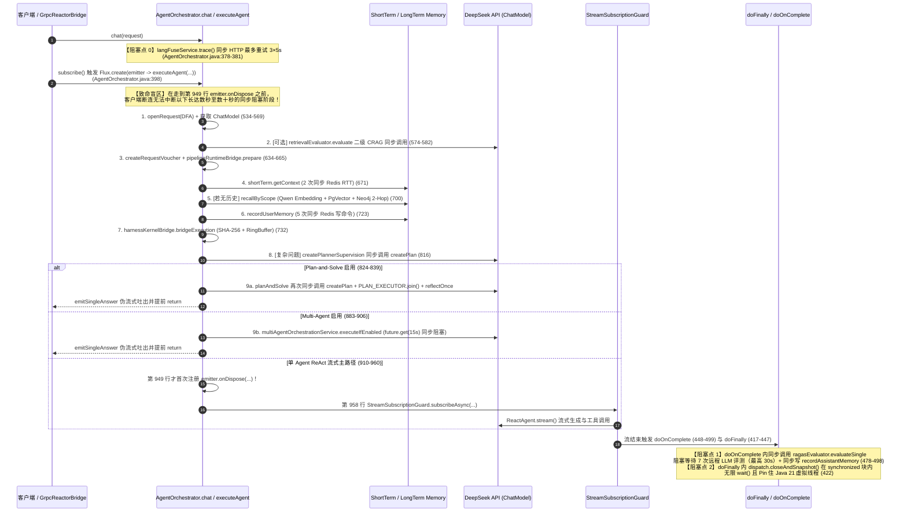

# 89 - Stage 22 研究与架构计划任务书：有界异步认知流水线（Async Cognitive Pipeline）

> **DEFERRED / NOT IMPLEMENTATION BASELINE**：本计划已延期，不授权 Stage 22 实施。Stage 22 当前唯一规划基线见 `92-harness22-experience-evolution-research-plan.md` 的 Stage 22A 范围；不得按本文异步流水线、并发取消/背压或调度器设计开工。本文仅作为历史研究记录保留。

- **文档编号**：`89-harness22-research-plan.md`
- **所属阶段**：Stage 22（Async Cognitive Pipeline）
- **前置基线**：Stage 20 CLOSED（`0330868c`）+ Stage 21 计划文档完成（[`88-harness21-research-plan.md`](file:///Users/achilles/Documents/许子祺/Agent/docs/architecture-review-20261019/acceptance/88-harness21-research-plan.md)）
- **当前性质**：**纯研究、形式化架构设计与决策完备（Decision-Complete）计划文档**（零源码修改、零真实 API 调用、不引入本地模型或投机解码、保持 Java 21）
- **多智能体物理派发存证（`AGENTS.md` §2.7）**：
  - **[智能体 A：Stage 21 多智能体工具协调与形式化并发自动机调研员](conversation://73d1649a-d2e8-447c-811a-f7039afe5540)**（Transcript：[`73d1649a.../transcript.jsonl`](file:///Users/achilles/.gemini/antigravity/brain/73d1649a-d2e8-447c-811a-f7039afe5540/.system_generated/logs/transcript.jsonl)）
  - **[智能体 B：Stage 22 有界异步认知流水线与并发取消/背压调研员](conversation://f6fc941c-d685-40b8-9175-3255b235b7d5)**（Transcript：[`f6fc941c.../transcript.jsonl`](file:///Users/achilles/.gemini/antigravity/brain/f6fc941c-d685-40b8-9175-3255b235b7d5/.system_generated/logs/transcript.jsonl)）
  - **[智能体 C：Stage 23 统一 Harness Runtime 与全生命周期收敛架构师](conversation://4b623e01-44f5-44ab-914c-a74cedd295b5)**（Transcript：[`4b623e01.../transcript.jsonl`](file:///Users/achilles/.gemini/antigravity/brain/4b623e01-44f5-44ab-914c-a74cedd295b5/.system_generated/logs/transcript.jsonl)）

> [!IMPORTANT]
> **本阶段唯一待验证与规划核心命题**：
> 在完全不改变 DeepSeek 远程 API 调用语义、不引入本地小模型或投机解码（Speculative Decoding）、不引入 CUDA/C++/PyTorch 的前提下，如何通过 **“Prep 结构化有界并行 + 全生命周期级联取消令牌（CancellationToken）+ 虚拟线程 Pinning 根除 + 确定性序号证据定稿 + Post 有界非阻塞旁路卸载”**，消除可避免的串行 I/O 等待、修复前置阶段断连无法取消的算力泄漏盲区，并严格保持请求级状态与 SHA-256 证据顺序 100% 确定性一致。

---

## A. 当前执行时序与只读代码法医审计

### A.1 当前 `AgentOrchestrator.chat()` 全链路同步阻塞时序图



### A.2 九大必答审计问题逐一裁决（严格区分：事实 / 推断 / 未验证 / 已否决）

#### 1. 哪些阶段可以重叠（Overlap）？
- **【事实】Prep 阶段与 Post 阶段存在明确可重叠/可剥离的非因果 I/O，但必须严守短期记忆“先读后写”因果序**：
  - **入口阻塞消除**：[`AgentOrchestrator.java`](file:///Users/achilles/Documents/许子祺/Agent/backend/qknow-hermes/qknow-hermes-core/src/main/java/tech/qiantong/qknow/hermes/agent/AgentOrchestrator.java#L378-L381) 的 `langFuseService.trace()` 同步发送 HTTP 仅为了拿 `traceId`，但 `LangFuseTracingService.java:108` 本身就在本地生成了 `UUID.randomUUID()`。改为本地生成 `traceId` 并异步入队上报，入口阻塞立降为 `0ms`。
  - **Prep 阶段内部可并行重叠项**：
    - `createRequestVoucher` 与 `pipelineRuntimeBridge.prepare`（第 634–665 行）是微秒级纯内存计算，决定 `shortTermWindow` 与 `effectiveLongTermRecallTopK`，应先同步执行（`< 0.2ms`）。
    - **关键因果约束（【事实】）**：`shortTerm.getContext(sessionId, shortTermWindow)`（第 671 行，耗时约 `1~2ms`）**必须 happens-before** `recordUserMemory(request)`（第 723 行，向同一 Redis List 执行 `rightPush`）！若两者并发执行，`getContext` 会把刚刚写入的当前轮 `question` 当作历史消息读出，与第 777 行 `new UserMessage(finalUserPrompt)` 叠加，导致**当前用户问题在 Prompt 中重复出现两次**！
    - 但一旦 `shortTerm.getContext` 返回后，以下 3 项 I/O 完全互不依赖，可立即在有界虚拟线程作用域内**并行重叠执行**：
      1) **Task-Prep-A**：`recordUserMemory(request)`（5 次 Redis 写命令，第 723 行）；
      2) **Task-Prep-B**：`retrievalEvaluator.evaluate(...)`（二级 CRAG 评估，第 574–582 行）；
      3) **Task-Prep-C**：当短期历史为空时执行的 `memoryManager.recallByScope(...)`（千问 1024 维向量化 + PgVector + Neo4j 2-Hop 图扩散，第 700 行）。
  - **消除重复规划调用（【事实】）**：当 `planSolveConfig.isEnabled()` 为 `true` 且问题为复杂问题时，第 816 行 `createPlannerSupervision` 调用了一次 `createPlan`，紧接着第 824 行进入 `planAndSolve` 在第 1214 行又对完全相同的问题调用了一次 `createPlan`！当 `planSolveConfig.isEnabled()` 时直接跳过第 816 行的冗余 `createPlannerSupervision`，可立即节省 1 次完整非流式 DeepSeek API 调用。
  - **Post 阶段非关键副作用与流终结信号解耦（【事实】）**：在 [`AgentOrchestrator.java`](file:///Users/achilles/Documents/许子祺/Agent/backend/qknow-hermes/qknow-hermes-core/src/main/java/tech/qiantong/qknow/hermes/agent/AgentOrchestrator.java#L448-L499) 的 `doOnComplete` 中，`ragasEvaluator.evaluateSingle(...)`（同步阻塞等待最多 30s 的 7 次 LLM 评判）与 `recordAssistantMemory`（5 次 Redis 写 I/O）直接卡在流完成回调链上。将这两项卸载至有界异步后置池（同时将 `HarnessEvidenceRecord`、`ToolActionDfaReceipt`、`KernelBridgeReceipt` 的纯内存快照定稿保留在流完成前的同步微秒级路径），即可在不破坏任何契约单测可见性的前提下消除最高 30 秒的尾延迟。

#### 2. 工具调用能否与模型调用异步？
- **【事实】跨轮次 ReAct（Thought $\to$ Action $\to$ Observation $\to$ Next Thought）严格因果依赖，绝不可异步重叠**：
  - 下一轮 DeepSeek API 请求必须携带上一轮所有 `tool_call_id` 对应的 `ToolResponseMessage`，否则 DeepSeek API 直接拒绝请求（HTTP 400）。
- **【事实】单轮次内多工具调用（Intra-Turn Multi-Tool Calls）受 DFA 模式严格约束**：
  - 在 `ToolActionDfaMode.ENFORCE` 或 `KernelBridgeMode.ENFORCE` 下，单 Agent 必须保持 `parallelToolExecution(false)` 串行执行（因为 `ToolActionDfaSession` 与 `HermesHarnessKernel.ExecutionSession` 具有单步状态转移因果依赖）；
  - 在 `ToolActionDfaMode.OFF`（或 Stage 21 的跨 Worker 分支并行）下，独立工具调用可并行执行，但必须通过预分配逻辑序号保证证据归并顺序确定性。

#### 3. 证据顺序是否依赖同步顺序？并发下如何保证确定性序列号？
- **【事实】当前 `HarnessEvidenceRecord.computeDigest()` 高度依赖 `toolExecutions` 的同步完成顺序**：
  - 在 `HarnessEvidenceRecord.java:183-185` 中，SHA-256 摘要按 `toolExecutions` 列表顺序拼接每个 `ToolExecutionEntry.canonical()`。
  - 在 [`HarnessEvidenceCollector.java`](file:///Users/achilles/Documents/许子祺/Agent/backend/qknow-hermes/qknow-hermes-core/src/main/java/tech/qiantong/qknow/hermes/agent/harness/HarnessEvidenceCollector.java#L39-L95) 中，`toolExecutions` 按工具**执行完成**的先后顺序追加。一旦多个工具或并行 Worker 并发执行，I/O 抖动会导致 `toolExecutions` 顺序漂移，进而导致相同输入产出的 SHA-256 Runmark 签名非确定性变化！
- **【设计裁决】预分配单调逻辑序列号（Pre-Allocated Logical Sequence Number）**：
  - 在 `HarnessEvidenceCollector` 中引入 `AtomicInteger logicalSeq = new AtomicInteger(0)`；
  - 每次工具调用在派发前（Pre-Dispatch）分配确定性序号 `int seq = collector.nextSequence()`，完成时记录 `(seq, entry)`，并在 `finalizeEvidence()` 中按 `seq` 升序重排后再计算 SHA-256 摘要，100% 消除并发完成乱序导致的签名漂移。

#### 4. 取消时哪些任务必须终止？为什么当前 `StreamSubscriptionGuard` 管不到前置阶段？
- **【事实】`StreamSubscriptionGuard` 的双重盲区**：
  1. [`AgentOrchestrator.java`](file:///Users/achilles/Documents/许子祺/Agent/backend/qknow-hermes/qknow-hermes-core/src/main/java/tech/qiantong/qknow/hermes/agent/AgentOrchestrator.java#L949-L958) 直到第 949 行才注册 `emitter.onDispose(...)`，第 958 行才调用 `StreamSubscriptionGuard.subscribeAsync(...)`。
  2. 在第 531–948 行（Prep、二级 CRAG、记忆召回、`createPlannerSupervision`、`planAndSolve`、`MultiAgent`）执行期间，若客户端断连，`FluxCreate` 的 `emitter.isCancelled()` 虽变为 `true`，但 **Reactor 不会向正在执行 `executeAgent` 的线程发送 `Thread.interrupt()`**，且此时 `onDispose` 尚未注册！结果服务端线程继续在后台空跑完整场 `planAndSolve` 或 `SWARM`，造成严重的 Token 与算力泄漏。
- **【事实】取消时必须立即终止（Must-Abort）的任务清单**：
  1. Prep 阶段所有在途虚拟线程子任务（二级 CRAG、长期记忆检索）；
  2. `createPlannerSupervision` 与 `planAndSolve` 主循环及其提交到 `PLAN_EXECUTOR` 的所有子任务 `Future`；
  3. `MultiAgentOrchestrationService` 的 `OrchestrationCallTracker.cancelAll()` 与编排 `Future.cancel(true)`；
  4. `ReactAgent` 流式订阅句柄（关闭 DeepSeek HTTP 流）；
  5. **跳过** Post 阶段的 `ragasEvaluator.evaluateSingle` 与 `recordAssistantMemory`（严禁将取消时的半截残缺回答写入 Redis 短期记忆污染后续对话）。

#### 5. 是否存在状态跨线程共享？
- **【事实】逐项核查结果**：
  - `UsageCapturingChatModel`（`synchronized (totals)`）与 `HarnessEvidenceCollector`（`volatile` + `CopyOnWriteArrayList`）跨线程共享安全；
  - **发现数据竞争漏洞（【事实】）**：[`HermesHarnessKernel.java`](file:///Users/achilles/Documents/许子祺/Agent/backend/qknow-hermes/qknow-hermes-core/src/main/java/tech/qiantong/qknow/hermes/agent/harness/kernel/HermesHarnessKernel.java#L114-L141) 中，`ExecutionSession.invokeTool` 和 `evaluateTrajectory` 虽加了 `synchronized`，但 `prepare()`（第 117 行，写入非线程安全的 `ReversibleRingColdBuffer`）、`coldBufferSnapshot()`（第 114 行，在 `doFinally` 线程被 `completeExecution` 调用）与 `cycleState()`（第 115 行）**均未加锁**，存在跨线程无锁数据竞争！

#### 6. 哪些地方会阻塞或 Pin 住 Java 21 虚拟线程？
- **【事实】查明 2 处确凿的 Java 21 虚拟线程 Pinning 点与 3 处固定平台线程池饥饿点**：
  1. **严重 Pinning 点 1**：[`HermesHarnessKernel.java`](file:///Users/achilles/Documents/许子祺/Agent/backend/qknow-hermes/qknow-hermes-core/src/main/java/tech/qiantong/qknow/hermes/agent/harness/kernel/HermesHarnessKernel.java#L141-L166) 的 `ExecutionSession.invokeTool` 是 `synchronized` 方法，且在第 157 行持锁期间直接调用 `output = rawToolInvoker.get()`（执行外部 HTTP/MCP/DB 阻塞 I/O），在 Java 21 下 100% 将虚拟线程 Pin 在 OS Carrier Thread 上！
  2. **严重 Pinning 点 2**：[`ToolCallDispatch.java`](file:///Users/achilles/Documents/许子祺/Agent/backend/qknow-hermes/qknow-hermes-core/src/main/java/tech/qiantong/qknow/hermes/agent/harness/neurosymbolic/toolaction/ToolCallDispatch.java#L286-L327) 的 `close()` 在 `synchronized (lifecycleMonitor)` 块内调用 `lifecycleMonitor.wait()`，持监视器锁挂起必然触发虚拟线程 Pinning。
  3. **固定 4 线程平台池阻塞饥饿点**：`AgentOrchestrator.PLAN_EXECUTOR`（4 线程）、`MultiAgentOrchestrationService.ORCHESTRATION_EXECUTOR`（4 线程）、`RagasEvaluator.SAMPLE_EXECUTOR / METRIC_EXECUTOR`（4 线程）均为固定平台线程池并在内部执行 `future.get()/join()` 同步阻塞等待。

#### 7. 是否会出现无界队列？
- **【事实】查明 4 处无界队列/缓冲区风险**：
  1. `AgentOrchestrator.chat()` 第 398 行 `Flux.create(...)` 默认使用 `OverflowStrategy.BUFFER`（底层为 `Queues.unbounded()`）；
  2. `PLAN_EXECUTOR`、`ORCHESTRATION_EXECUTOR`、`SAMPLE_EXECUTOR`、`METRIC_EXECUTOR` 使用 `Executors.newFixedThreadPool(4)`，底层全部是容量为 `Integer.MAX_VALUE` 的无界 `LinkedBlockingQueue`；
  3. `SharedBlackboard.traceLogs`（`SharedBlackboard.java:25`）为无界 `ArrayList`，且 `eventSink`（`onBackpressureBuffer(1024)`）在无订阅者时只入不出；
  4. `KbConversationController.java:123` 使用无参 `Sinks.many().multicast().onBackpressureBuffer()`（默认无界队列）。

#### 8. 是否需要结构化并发？
- **【事实 + 裁决】采用基于 Java 21 正式版虚拟线程 + `Semaphore` 有界门控 + `CognitivePipelineCancellationToken` 的同构有界结构化并发（不依赖 Preview API `StructuredTaskScope`）**：
  - `StructuredTaskScope` 在 JDK 21 中属于 `@PreviewFeature`，且强制要求 `open/fork/join/close` 位于同一线程词法块内，无法跨越 `Flux` 的异步流生命周期；
  - 复用项目内已验证的 `Executors.newVirtualThreadPerTaskExecutor()` + `Semaphore` + 请求级 `CognitivePipelineCancellationToken`（在 `Flux.create` 第一行绑定 `emitter.onDispose`），即可同时管理 Prep 阶段扇出匯合与跨阶段级联取消。

#### 9. 哪些路径不能异步化？
- **【事实】以下 6 条路径具有严格因果与安全不变式，绝对禁止异步化**：
  1. 安全门禁前置裁决（`ToolCallDispatch` / `PipelineRuntimeBridge` / `HarnessKernelBridge` 的 `failClosed` 拦截必须在任何外部副作用前同步完成）；
  2. 短期记忆“先读（`getContext`）后写（`recordUserMemory`）”因果序；
  3. 跨轮次 ReAct（Thought $\to$ Action $\to$ Observation）循环；
  4. `ENFORCE` 模式下的单分支工具 DFA 转移与环路守卫校验；
  5. 同一 `FluxSink<ChatEvent>` 的事件串行发射（Reactive Streams Rule 1.3）；
  6. 流完成信号（`DoneSignal` / `onComplete`）发出前的 `HarnessEvidenceRecord`、`ToolActionDfaReceipt`、`KernelBridgeReceipt` 同步内存快照定稿（保障测试与调用方的 Read-Your-Writes 立即可见性）。

---

## B. 可重叠阶段与延迟阿姆达尔定律（Amdahl's Law）分析

### B.1 阶段可重叠性判定表

| 阶段与操作 | 当前执行方式 | 是否可重叠/异步化 | 重构后执行方式与因果边界 |
|---|---|---|---|
| **0. `langFuseService.trace()`** | `chat()` 入口同步 HTTP 重试（`50~5000ms`） | **可异步化** | 本地生成 UUID `traceId` 立即可用，HTTP 请求入有界队列 `ArrayBlockingQueue(2048)` 异步发送 |
| **1. Voucher 与 Pipeline `prepare`** | `Flux.create` 内同步计算（`< 0.2ms`） | **不可异步（前置门禁）** | 保持同步前置，決定 `failClosed` 与记忆窗口参数 |
| **2. 短期记忆读取 `shortTerm.getContext`** | 同步 Redis 读（`1~3ms`） | **必须先于 `recordUserMemory`** | 同步读取，读取完成后立即解锁后续并行阶段 |
| **3. 用户记忆写入 `recordUserMemory`** | 同步 5 次 Redis 写（`3~10ms`） | **可与 4、5 并行重叠** | 在 `getContext` 返回后，作为 `Task-Prep-A` 在有界虚拟线程中并行执行 |
| **4. 二级 CRAG `retrievalEvaluator`** | 同步 LLM 评估（`400~1500ms`） | **可与 3、5 并行重叠** | 作为 `Task-Prep-B` 在有界虚拟线程中并行执行 |
| **5. 长期记忆召回 `recallByScope`** | 同步 Embedding + PgVector + Neo4j（`30~150ms`） | **可与 3、4 并行重叠** | 当短期记忆为空时，作为 `Task-Prep-C` 在有界虚拟线程中并行执行 |
| **6. `createPlannerSupervision` 与 `planAndSolve`** | 两者串联，导致对同一问题调用 2 次 `createPlan` | **消除冗余调用** | 当 `planSolveConfig.isEnabled()` 时跳过前置重复的 `createPlannerSupervision` |
| **7. 证据与收据定稿 (`finalizeEvidence` / `closeAndSnapshot`)** | 在 `doFinally` 中执行（`< 0.5ms`，但受慢工具阻塞） | **必须同步完成于 `onComplete` 前** | 有界 Drain 后在发往下游 `onComplete` 前同步定稿写入 LRU 表，保证立即可见 |
| **8. `ragasEvaluator.evaluateSingle` 与 `recordAssistantMemory`** | 在 `doOnComplete` 同步阻塞（最高 `30,000ms`） | **可剥离至有界异步 Post 旁路** | 投递至有界 `PostCompletionOffloader`（取消时不投递；Ragas 队列满时 Fail-Open 跳过） |

### B.2 端到端延迟削减形式化上界（Theorem 22.1）

在保持 DeepSeek 远程 API 流式生成耗时 $T_{\text{llm\_stream}}$ 不变的前提下，客户端感知首字延迟 $\text{TTFE}$ 与流完成总延迟 $\text{TTC}$ 从串行求和收敛为并行上确界与零阻塞后置：

$$\text{TTFE}_{\text{stage22}} = T_{\text{voucher}} + T_{\text{short\_read}} + \max\Big(T_{\text{crag2}}, \; T_{\text{long\_recall}}, \; T_{\text{mem\_write}}\Big) + T_{\text{kernel}} + T_{\text{llm\_first\_token}}$$

$$\Delta \text{TTC} = \text{TTC}_{\text{baseline}} - \text{TTC}_{\text{stage22}} = T_{\text{trace}} + \left(\sum_{i \in \{3,4,5\}} T_i - \max_{i \in \{3,4,5\}} T_i\right) + \mathbb{I}_{\text{planSolve}} \cdot T_{\text{dup\_plan}} + T_{\text{ragas}} + T_{\text{mem\_assistant}}$$

> [!NOTE]
> **诚实收益边界声明**：当未开启二级 CRAG、短期记忆已命中且未开启 Ragas 在线评测时，端到端耗时由远程 DeepSeek API 首字时间與流式吐字时间主导，Stage 22 的延迟收益主要体现在消除 Redis 写等待与入口 Trace 阻塞（毫秒至数十毫秒级），核心收益在于 **全链路毫秒级取消止损、消除虚拟线程 Pinning 与有界背压防 OOM**；当开启二级 CRAG、长期记忆召回或 Ragas 评测时，可消除数百毫秒至最高 30 秒的串行阻塞等待。绝不夸大声称对远程 API 本身实现“3–5 倍加速”。

---

## C. 外部方案调研与结构化 Research Ledger

### C.1 结构化 Research Ledger（严格遵循 `AGENTS.md` §2.3 14 字段规范）

#### 条目 1：`RL-S22-01`（OpenJDK 21 Virtual Threads Pinning 机制）
```text
id: RL-S22-01
sourceType: official-code
titleOrRepository: OpenJDK 21 Virtual Threads (JEP 444) / jdk21u
authorsOrMaintainer: Ron Pressler, Alan Bateman (Oracle / OpenJDK Loom Project)
venueAndYear: OpenJDK JDK 21 LTS (JEP 444), 2023
doiOrArxiv: N/A
url: https://openjdk.org/jeps/444
commitOrTag: jdk-21.0.5-ga
license: GPL-2.0-with-classpath-exception
filesOrSectionsRead: JEP 444 Specification & local JDK 21 source (/Users/achilles/.sdkman/candidates/java/21.0.5-tem/lib/src.zip -> java.base/java/lang/VirtualThread.java lines 580-710 park/parkOnCarrierThread)
verificationStatus: VERIFIED
relevantFinding: VirtualThread 在 park() 或 Object.wait() 时若栈帧持有原生监视器锁（synchronized），yieldContinuation() 会失败并转入 PINNED / TIMED_PINNED 状态，直接阻塞底层 OS Carrier Thread。替换为 ReentrantLock 与 Condition.awaitNanos() 可使虚拟线程完全卸载（Unmount）。
projectApplicability: 直接指导修复 HermesHarnessKernel.ExecutionSession.invokeTool（synchronized 包裹 rawToolInvoker.get()）与 ToolCallDispatch.close()（synchronized 内 lifecycleMonitor.wait()）两处严重 Pinning 缺陷。
limitations: N/A
```

#### 条目 2：`RL-S22-02`（OpenJDK 21 Structured Concurrency 边界）
```text
id: RL-S22-02
sourceType: official-code
titleOrRepository: OpenJDK 21 Structured Concurrency (JEP 453) / jdk21u
authorsOrMaintainer: Ron Pressler, Alan Bateman (Oracle / OpenJDK)
venueAndYear: OpenJDK JDK 21 (JEP 453 Preview), 2023
doiOrArxiv: N/A
url: https://openjdk.org/jeps/453
commitOrTag: jdk-21.0.5-ga
license: GPL-2.0-with-classpath-exception
filesOrSectionsRead: java.base/java/util/concurrent/StructuredTaskScope.java (lines 1-140 class contract, @PreviewFeature annotation, ThreadFlock owner thread confinement)
verificationStatus: VERIFIED
relevantFinding: StructuredTaskScope 在 JDK 21 中属于 Preview API，且强制要求 open/fork/join/close 必须在同一个 Owner 线程词法作用域内完成，无法跨越响应式 Flux 的异步订阅与回调线程生命周期。
projectApplicability: 决定本项目采用标准 Java 21 正式 API（Executors.newVirtualThreadPerTaskExecutor() + Semaphore + CognitivePipelineCancellationToken）构建跨 Prep/LLM/Post 阶段的同构有界结构化作用域，零 Preview API 风险。
limitations: N/A
```

#### 条目 3：`RL-S22-03`（Reactive Streams JVM 1.0.4 串行信号与取消规范）
```text
id: RL-S22-03
sourceType: official-doc
titleOrRepository: Reactive Streams Specification for the JVM (v1.0.4)
authorsOrMaintainer: Reactive Streams Special Interest Group
venueAndYear: Reactive Streams Specification v1.0.4, 2022
doiOrArxiv: N/A
url: https://raw.githubusercontent.com/reactive-streams/reactive-streams-jvm/v1.0.4/README.md
commitOrTag: v1.0.4
license: CC0-1.0
filesOrSectionsRead: Publisher Rules 1.1, 1.3 (non-overlapping serial signaling), 1.7 (terminal state), 1.8 (cancellation propagation)
verificationStatus: VERIFIED
relevantFinding: Rule 1.3 要求发往 Subscriber 的 onNext/onError/onComplete 严格串行不重叠；Rule 1.8 要求收到 cancel 后最终停止发送信号并释放资源。
projectApplicability: 约束 AgentOrchestrator 在 Flux.create 首行注册 onDispose 取消令牌，保证证据定稿 happens-before onComplete 信号，并将耗时 Post 任务剥离至流终结后的独立有界旁路。
limitations: N/A
```

#### 条目 4：`RL-S22-04`（LLMCompiler 并行编排延迟模型）
```text
id: RL-S22-04
sourceType: paper
titleOrRepository: An LLM Compiler for Parallel Function Calling
authorsOrMaintainer: Sehoon Kim et al.
venueAndYear: ICML 2024
doiOrArxiv: arXiv:2312.04511v3
url: https://arxiv.org/html/2312.04511v3
commitOrTag: N/A
license: CC BY 4.0
filesOrSectionsRead: Section 3, Appendix E.1 (Parallel Speedup Modeling, Equations 1 & 2)
verificationStatus: VERIFIED
relevantFinding: 给出了串行编排耗时求和（\sum T_i）与依赖感知并行编排耗时取最大（\max T_i）的解析延迟边界，并指出非模型调用的串行编排与后置评估开销受阿姆达尔定律约束。
projectApplicability: 支撑 Stage 22 将 Prep 阶段独立 I/O 从 \sum T_i 压缩为 \max T_i，并将 Post 阶段评估从同步关键路径剥离。
limitations: 不采用其特定提示词流式语法解析器，仅复用其 DAG 层内并行延迟模型。
```

---

## D. 候选架构方案对比矩阵（Candidates A / B / C / D）

| 比较维度 | 方案 A：保持同步，仅把局部 Ragas 丢入 `CompletableFuture.runAsync` | **方案 B（推荐）：Prep/LLM/Post 三阶段有界认知流水线 + 请求级级联取消令牌 + 虚拟线程 Pinning 消除 + 有界 Post 旁路** | 方案 C：引入重型事件驱动 / Actor 异步编排框架（Akka / Disruptor 全量重写） | 方案 D：保持现状（Baseline） |
|---|---|---|---|---|
| **1. 正确性** | **中**：未修复前置取消盲区、未修复 `ExecutionSession` 无锁竞争与并发证据顺序漂移 | **极高**：严守短期记忆先读后写因果序、Reactive Rule 1.3 串行发射、确定性证据序号排序与 `onComplete` 前证据同步可见性 | **低**：全异步 Actor 极易导致 `chat().blockLast()` 返回时 `getLatestEvidence` 尚未落位而引发测试竞态失败 | **中**：存在 `ExecutionSession.prepare` 无锁竞争、前置断连空跑、多工具并发证据哈希漂移 |
| **2. 可证伪性** | 中 | **极高**：每个契约（取消中断时间 `< 50ms`、0 Pinning、有界队列拒绝、SHA-256 顺序不变性）均可由确定性单测直接证伪 | 低 | 高（对照基线） |
| **3. 延迟收益** | 仅改善开启 Ragas 时的尾延迟 | **全面消除可避免串行等待**：消除入口 `trace` 阻塞、Prep I/O 并行重叠、消除重复 `createPlan`、剥离 Post Ragas/Memory 尾延迟 | 理论延迟低，但 Actor 邮箱调度引入额外复杂度 | 差 |
| **4. 实现复杂度** | 低，但留下无界队列与取消漏洞 | **适中（约 250~300 行高内聚代码）**：完全位于 `qknow-hermes-core` 内部 | **极高（> 2000 行破坏性重写）** | 零 |
| **5. 取消传播能力** | **差**：Prep / PlanAndSolve / MultiAgent 阶段断连仍无法取消 | **完备**：`Flux.create` 第一行注册 `CognitivePipelineCancellationToken`，毫秒级中断 Prep、Plan、MultiAgent 与 ReAct 流 | 复杂 | **差**：`subscribeAsync` 之前完全无取消感知 |
| **6. 状态与证据一致性** | 无改进 | **100% 确定性**：预分配逻辑序列号 + `onComplete` 前同步内存定稿 | 易出现最终一致性延迟竞态 | 并发下顺序漂移 |
| **7. 依赖变化** | 零 | **零新增外部依赖**（纯 Java 21 `java.util.concurrent` + Project Reactor 既有库） | 需引入新框架 | 零 |
| **8. 回滚风险与生产影响** | CommonPool 饥饿与无界队列 OOM 风险 | **极低回滚风险**：支持配置开关一键回退，根除虚拟线程 Pinning 与无界队列 OOM | 极高回滚风险 | 高负载下易因 Pinning 与同步 Ragas 拖垮吞吐量 |

---

## E. 推荐架构（方案 B）与有界队列 / 背压 / 取消契约

### E.1 三阶段有界异步认知流水线架构图

```mermaid
flowchart LR
    subgraph S0["Stage 0: 零阻塞入口与取消锚点"]
        T0["本地生成 UUID traceId<br/>异步入队上报 LangFuse"] --> C0["Flux.create 首行创建<br/>CognitivePipelineCancellationToken<br/>立即绑定 emitter.onDispose"]
    end

    subgraph S1["Stage 1: 有界结构化 Prep 阶段"]
        P1["同步前置门禁 (<0.2ms)<br/>DFA open + Voucher + Pipeline.prepare"] --> P2["同步读短期记忆 (~1ms)<br/>shortTerm.getContext<br/>(保障先读后写因果序)"]
        P2 --> FanOut{"BoundedCognitiveTaskScope<br/>(VirtualThread + Semaphore(64))"}
        FanOut --> PA["Task-Prep-A: recordUserMemory"]
        FanOut --> PB["Task-Prep-B: 二级 CRAG evaluate"]
        FanOut --> PC["Task-Prep-C: recallByScope (若无短期历史)"]
        PA & PB & PC --> JoinPrep["结构化 Join (deadline 5s)<br/>+ KernelBridge.bridgeExecution (ReentrantLock)"]
    end

    subgraph S2["Stage 2: 可取消 LLM 与工具执行阶段"]
        JoinPrep --> Route{"执行路由 (复用单次 Plan)"}
        Route -- "Plan-and-Solve" --> PS["有界 PLAN_EXECUTOR<br/>绑定 CancellationToken 级联取消"]
        Route -- "Multi-Agent" --> MA["SWARM / DEBATE<br/>联动 OrchestrationCallTracker.cancelAll<br/>+ Stage 21 MultiAgentToolDfaCoordinator"]
        Route -- "Single ReAct" --> RA["StreamSubscriptionGuard<br/>+ ReentrantLock 零 Pinning 工具守卫<br/>+ 预分配逻辑序号 seq"]
    end

    subgraph S3["Stage 3: 同步凭单定稿 + 有界非阻塞 Post 旁路"]
        PS & MA & RA --> Fin["【同步微秒级定稿 (happens-before onComplete)】<br/>1. ToolCallDispatch.close(drainTimeout) (Condition.awaitNanos)<br/>2. KernelBridge.completeExecution<br/>3. EvidenceCollector 按 seq 排序并 finalizeEvidence"]
        Fin --> EmitDone["emitter.next(DoneSignal) + emitter.complete()"]
        Fin -. "仅当 !cancelled 时异步投递" .-> Offload["PostCompletionOffloader (有界双队列)<br/>1. MemoryWriteQueue (ArrayBlockingQueue 512)<br/>2. RagasEvalQueue (ArrayBlockingQueue 64 + Semaphore 2, 满则 Fail-Open)"]
    end

    S0 --> S1
```



### E.2 有界队列、背压与取消契约表

| 并发 / 缓冲组件 | 容量与并发上限契约 | 满载背压 / 拒绝策略 | 取消信号（`onDispose` / Timeout）响应契约 |
|---|---|---|---|
| **Prep 结构化扇出器 (`BoundedCognitiveTaskScope`)** | 全局 `Semaphore(64, true)` + 单请求最多 3 个虚拟线程子任务 + 超时 `5000ms` | 信号量等待超时后降级为当前线程顺序执行或跳过可选增强（二级 CRAG / 长期召回） | 立即对 3 个子任务调用 `Future.cancel(true)` 并中断虚拟线程，耗时 `< 5ms` |
| **`PLAN_EXECUTOR` (Plan-and-Solve)** | 替换无界 `newFixedThreadPool(4)` 为有界虚拟线程执行器 + `ACTIVE_PLAN_TASKS(4)` + `LLM_CALL_SEMAPHORE(8)` | 容量门满时快速返回受控降级，回退至单 Agent ReAct | `CancellationToken` 遍历所有未完成 `PlanTask` Future 调用 `cancel(true)` 并中断在途 Worker |
| **`ORCHESTRATION_EXECUTOR` (Multi-Agent)** | 有界队列 `ArrayBlockingQueue(32)` + `Semaphore(4)` | 队列满时触发 `CallerRuns` 或快速回退 `SINGLE` 模式 | `CancellationToken.onCancel` 自动触发 `OrchestrationCallTracker.cancelAll()` 与 `future.cancel(true)` |
| **Post 阶段记忆与追踪队列 (`MemoryWriteQueue`)** | `ArrayBlockingQueue(512)` + 虚拟线程消费 + `Semaphore(16)` | 队列满时回退为当前线程同步执行 `recordAssistantMemory`（确保对话记忆不丢失） | 若请求在完成前已取消（`cancelled == true`），**严禁入队**，防止半截脏回答写入 Redis |
| **Post 阶段在线评测队列 (`RagasEvalQueue`)** | `ArrayBlockingQueue(64)` + `Semaphore(2)` | 队列满时按 **`Fail-Open`** 丢弃评测任务并递增 `postRagasDroppedCount` 指标，绝不阻塞主对话流 | 若请求已取消，**严禁入队**，节省 7 次无效 LLM 评判调用 |
| **`SharedBlackboard` 缓冲与日志** | `traceLogs` 改为有界环形缓冲区（上限 256 条）；`eventSink` 仅在 `currentSubscriberCount() > 0` 时发射 | 环形淘汰最旧日志，杜绝无订阅者时的队列积压与内存泄漏 | 随请求结束自动释放 |

---

## F. 状态与证据一致性契约（State & Evidence Consistency）

### F.1 Java 21 核心类与接口草案

```java
package tech.qiantong.qknow.hermes.agent.pipeline;

import java.time.Instant;
import java.util.List;
import java.util.Objects;
import java.util.Set;
import java.util.concurrent.ConcurrentHashMap;
import java.util.concurrent.CopyOnWriteArrayList;
import java.util.concurrent.Future;
import java.util.concurrent.atomic.AtomicBoolean;
import java.util.concurrent.atomic.AtomicReference;

/**
 * 异步认知流水线阶段状态枚举
 */
public enum CognitivePipelineStage {
    CREATED,
    PREP_RUNNING,
    PLAN_OR_MULTIAGENT_RUNNING,
    REACT_STREAMING,
    EVIDENCE_FINALIZING,
    POST_OFFLOADING,
    COMPLETED,
    CANCELLED,
    FAILED
}

/**
 * 请求级全生命周期级联取消令牌（贯穿 Prep / PlanAndSolve / MultiAgent / ReAct / Post）
 */
public final class CognitivePipelineCancellationToken {
    private final String requestId;
    private final AtomicBoolean cancelled = new AtomicBoolean(false);
    private final AtomicReference<String> cancelReason = new AtomicReference<>("");
    private final AtomicReference<CognitivePipelineStage> currentStage =
            new AtomicReference<>(CognitivePipelineStage.CREATED);
    private final Set<Thread> activeThreads = ConcurrentHashMap.newKeySet();
    private final List<Future<?>> activeFutures = new CopyOnWriteArrayList<>();
    private final List<Runnable> cancelCallbacks = new CopyOnWriteArrayList<>();

    public CognitivePipelineCancellationToken(String requestId) {
        this.requestId = Objects.requireNonNullElse(requestId, "anonymous");
    }

    public void advanceStage(CognitivePipelineStage nextStage) {
        if (!cancelled.get()) {
            currentStage.set(Objects.requireNonNull(nextStage));
        }
    }

    public CognitivePipelineStage currentStage() { return currentStage.get(); }
    public boolean isCancelled() { return cancelled.get() || Thread.currentThread().isInterrupted(); }
    public String cancelReason() { return cancelReason.get(); }

    public void registerThread(Thread thread) {
        if (thread != null) {
            activeThreads.add(thread);
            if (cancelled.get()) {
                thread.interrupt();
            }
        }
    }

    public void unregisterThread(Thread thread) {
        if (thread != null) {
            activeThreads.remove(thread);
        }
    }

    public <T> Future<T> registerFuture(Future<T> future) {
        if (future != null) {
            activeFutures.add(future);
            if (cancelled.get()) {
                future.cancel(true);
            }
        }
        return future;
    }

    public void onCancel(Runnable callback) {
        if (callback != null) {
            cancelCallbacks.add(callback);
            if (cancelled.get()) {
                callback.run();
            }
        }
    }

    public boolean cancel(String reason) {
        if (!cancelled.compareAndSet(false, true)) {
            return false;
        }
        cancelReason.set(reason != null ? reason : "CANCELLED");
        currentStage.set(CognitivePipelineStage.CANCELLED);
        for (Future<?> f : activeFutures) {
            if (!f.isDone()) {
                try { f.cancel(true); } catch (Exception ignored) {}
            }
        }
        Thread caller = Thread.currentThread();
        for (Thread t : activeThreads) {
            if (t != caller) {
                try { t.interrupt(); } catch (Exception ignored) {}
            }
        }
        for (Runnable cb : cancelCallbacks) {
            try { cb.run(); } catch (Exception ignored) {}
        }
        return true;
    }
}

/**
 * 异步认知流水线执行审计凭单 (Java 21 Record)
 */
public record CognitivePipelineReceipt(
        String requestId,
        CognitivePipelineStage terminalStage,
        boolean prepParallelized,
        long prepDurationMs,
        long llmDurationMs,
        long evidenceFinalizeDurationUs,
        boolean postOffloadedAsync,
        boolean postRagasDroppedByBackpressure,
        boolean cancelled,
        String cancelStage,
        String cancelReason,
        int interruptedTaskCount,
        Instant timestamp
) {}
```

### F.2 状态与证据一致性三项形式化保证

1. **工具证据全序确定性（Deterministic Sequence Ordering）**：
   - `HarnessEvidenceCollector` 新增 `allocateToolSequence()`（基于 `AtomicInteger` 单调递增）与带序号记录槽位 `IndexedToolExecution(int sequence, ToolExecutionEntry entry)`；
   - `finalizeEvidence()` 在构造不可变 `HarnessEvidenceRecord` 前按 `sequence` 升序稳定排序，保证无论异步工具谁先返回，`toolExecutions` 顺序与 `computeDigest()` SHA-256 签名 **100% 确定性唯一**。
2. **流完成前同步凭单可见性（Synchronous Finalization Before `onComplete`）**：
   - `ToolCallDispatch.closeAndSnapshot()`、`HarnessKernelBridge.completeExecution()`、`HarnessEvidenceCollector.finalizeEvidence()` 必须在发射 `emitter.complete()` **之前**（以及在 `doFinally` 幂等兜底中）同步执行完毕；
   - 满足 JMM happens-before 链：$\text{write}(\text{latestEvidenceMap}) \prec_{\text{hb}} \text{emitter.complete()} \prec_{\text{hb}} \text{Subscriber.onComplete()}$，确保所有既有单测在流结束后立即调用 `getLatestEvidence(requestId)` 零竞态命中。
3. **虚拟线程零 Pinning 锁升级契约**：
   - `HermesHarnessKernel.ExecutionSession`：将 `synchronized` 替换为 `ReentrantLock sessionLock`，补齐 `prepare()`、`coldBufferSnapshot()`、`cycleState()` 的锁保护，且在 `invokeTool` 中仅在 `verifyBefore` 与 `verifyAfter` 期间持有 `sessionLock`，调用 `rawToolInvoker.get()` 期间释放 `sessionLock`（若需串行工具执行则使用外层独立的 `ReentrantLock serialToolLock`）；
   - `ToolCallDispatch`：将 `Object lifecycleMonitor` + `synchronized` + `wait()/notifyAll()` 替换为 `ReentrantLock lifecycleLock` + `Condition drainCondition`（`awaitNanos()/signalAll()`）。

---

## G. 测试与观测矩阵（100% 离线确定性验证，零真实 API）

| 测试编号 | 测试类名称 | 验证场景 | 预期确定性判据 |
|---|---|---|---|
| **T22-01** | `CognitivePipelinePrepCancelTest` | 模拟二级 CRAG 或 `createPlan` 阻塞 `2000ms`，客户端在 `80ms` 时调用 `Disposable.dispose()` | 1) 在途阻塞线程在 `< 50ms` 内被中断退出；<br/>2) 后续 `executePlanTasks` 与 `ReactAgent` 调用次数为 `0`；<br/>3) `ACTIVE_REACT_RUNS` 与 `LLM_CALL_SEMAPHORE` 许可 100% 归还。 |
| **T22-02** | `CognitivePipelinePrepCausalityAndOverlapTest` | 验证 `shortTerm.getContext` 完成后，`recordUserMemory`、`retrievalEvaluator`、`recallByScope` 并行执行 | 1) 传给模型的 `messages` 中当前轮 `question` 仅出现 `1` 次（无先写后读双写污染）；<br/>2) 3 个各耗时 `120ms` 的模拟 I/O 并行总耗时 `< 180ms`（显著小于串行 `360ms`）。 |
| **T22-03** | `CognitivePipelinePostOffloadTest` | 注入耗时 `3000ms` 的模拟 `RagasEvaluator`，调用 `orchestrator.chat(req).blockLast()` | 1) `blockLast()` 在 `< 100ms` 内完成返回（不被 Ragas 阻塞）；<br/>2) 返回瞬间 `getLatestEvidence(reqId)` 与 `getLatestToolActionDfaReceipts(reqId)` 立即可读且非空；<br/>3) 当请求被取消时，`RagasEvaluator` 与 `recordAssistantMemory` 调用次数严格为 `0`。 |
| **T22-04** | `VirtualThreadZeroPinningContractTest` | 在 Java 21 虚拟线程中并发调用 `ExecutionSession.invokeTool`（含 `200ms` 慢工具）与 `ToolCallDispatch.close(Duration)` | 1) 使用 `ReentrantLock` / `Condition` 正常 Unmount；<br/>2) JFR `jdk.VirtualThreadPinned` 事件计数为 `0`。 |
| **T22-05** | `DeterministicEvidenceOrderConcurrencyTest` | 3 个工具按序号 `1, 2, 3` 派发，但按耗时 `150ms, 50ms, 10ms` 逆序完成，重复 20 次 | 20 次生成的 `HarnessEvidenceRecord.toolExecutions()` 列表顺序与 `computeDigest()` SHA-256 哈希值 100% 恒等。 |
| **T22-06** | `PostBackpressureFailOpenTest` | 将 `RagasEvalQueue` 塞满后继续发起对话请求 | 满载的 Ragas 评测任务按 `Fail-Open` 安全丢弃并累加 `postRagasDroppedByBackpressure` 计数，主对话流 `100%` 正常完成无异常。 |

---

## H. 与 Stage 21 / Stage 23 的依赖与协同关系

1. **与 Stage 21（Multi-Agent Tool Coordination）的协同**：
   - Stage 22 的 `CognitivePipelineCancellationToken` 直接向下传递给 Stage 21 的 `TopologicalPhasedDispatcher` 与 `MultiAgentToolDfaCoordinator`；当客户端取消请求时，正在执行 किसी DAG Phase 的所有并行 `WorkerAgent` 分支立即收到中断信号并在 Phase Barrier 处干净收口。
   - Stage 22 的 `ToolCallDispatch` `ReentrantLock + Condition` 无 Pinning 改造直接惠及 Stage 21 的所有分支级 `ToolCallDispatch`。
2. **与 Stage 23（Unified Harness Runtime）的协同**：
   - Stage 22 的 `CognitivePipelineCancellationToken`、同步凭单定稿动作与异步 `PostCompletionOffloader` 将在 Stage 23 中统一挂载到请求级 `HarnessExecutionScope` 的生命周期钩子中，由 `HarnessExecutionScope.close()` 统一驱动有界排空与证据落盘。

---

## I. 风险、禁止事项与未验证项

### I.1 严禁事项（Prohibitions）
1. **严禁引入本地模型、投机解码（Speculative Decoding）、logits 校验或 CUDA/C++/PyTorch 依赖**。
2. **严禁夸大声称对远程 DeepSeek API 推理延迟实现“3–5 倍加速”**。
3. **严禁把 `shortTerm.getContext` 与 `recordUserMemory` 并发执行**（必须先读后写）。
4. **严禁把 `HarnessEvidenceCollector.finalizeEvidence()`、`ToolCallDispatch.closeAndSnapshot()` 放到流完成之后的异步线程中**（必须在 `onComplete` 之前同步完成以保证立即可见性）。
5. **严禁在 `synchronized` 块内执行外部工具 I/O 或 `Object.wait()`**。

### I.2 仍存在的未验证项（Unverified Items）
1. **【未验证】Alibaba `ReactAgent.stream()` 内部线程池切换与 `ScopedValue` 传播**：
   - Alibaba Spring AI Graph 的 `ReactAgent.stream()` 内部使用 Reactor `Flux` 算子链，跨算子阶段时线程可能切换。因此请求级状态（如 `ToolCallDispatch`、`HarnessEvidenceCollector`、`CancellationToken`）**必须通过显式对象引用或闭包捕获传递，禁止依赖隐式 `ThreadLocal`**。这一点将在实施单测中强制验证。

---

## J. 准入 / 拒绝决定（Gate Decision）

- **裁决结果**：**APPROVED FOR IMPLEMENTATION（准予在 Stage 21 之后按序进入实施）**。
- **准入理由**：
  1. 完整锁定了当前 `AgentOrchestrator` 的同步阻塞点、前置取消盲区、4 处无界队列与 2 处 Java 21 虚拟线程 Pinning 缺陷；
  2. 方案 B 完全使用标准 Java 21 并发原语（`VirtualThread`、`Semaphore`、`ArrayBlockingQueue`、`ReentrantLock`、`Condition`），零新增外部依赖，严格保持因果序与证据哈希确定性。
