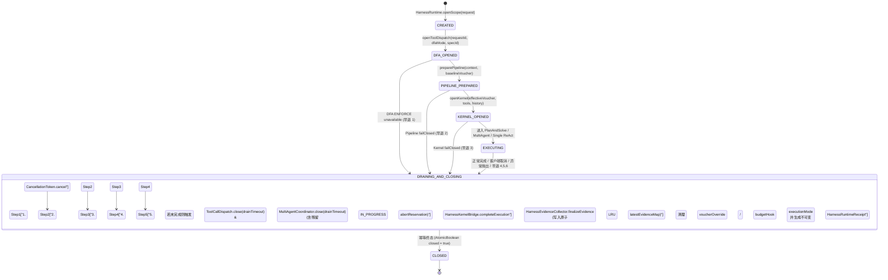
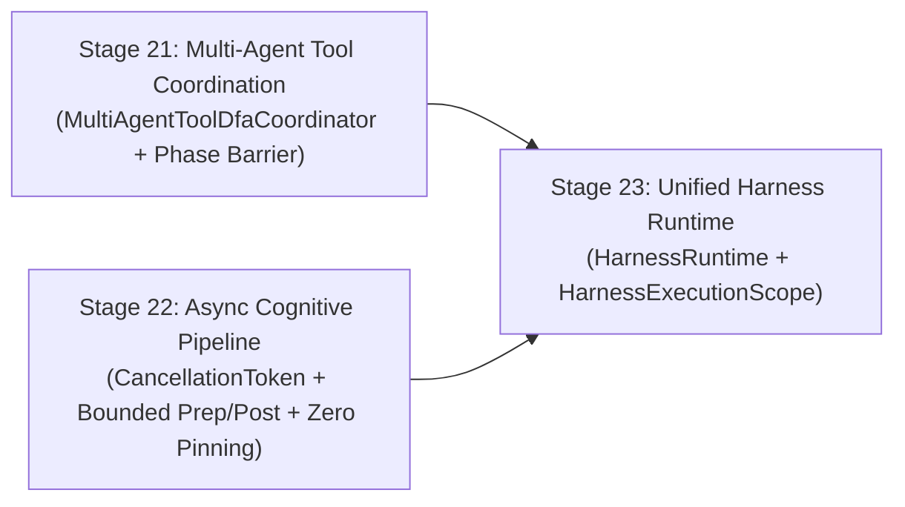

# 90 - Stage 23 研究与架构计划任务书：统一 Harness 运行时（Unified Harness Runtime）

> **DEFERRED / NOT IMPLEMENTATION BASELINE**：本计划已延期，不授权 Stage 23 实施。Stage 23 当前唯一规划基线见 `93-harness23-reasoning-evaluation-research-plan.md` 的 Stage 23A 范围；不得按本文统一运行时改造开工。本文仅作为历史研究记录保留。

- **文档编号**：`90-harness23-research-plan.md`
- **所属阶段**：Stage 23（Unified Harness Runtime）
- **前置基线**：Stage 20 CLOSED（`0330868c`）+ Stage 21 计划文档（[`88-harness21-research-plan.md`](file:///Users/achilles/Documents/许子祺/Agent/docs/architecture-review-20261019/acceptance/88-harness21-research-plan.md)）+ Stage 22 计划文档（[`89-harness22-research-plan.md`](file:///Users/achilles/Documents/许子祺/Agent/docs/architecture-review-20261019/acceptance/89-harness22-research-plan.md)）
- **当前性质**：**纯研究、形式化架构设计与决策完备（Decision-Complete）计划文档**（零源码修改、零真实 API 调用、默认保持 `OFF`）
- **多智能体物理派发存证（`AGENTS.md` §2.7）**：
  - **[智能体 A：Stage 21 多智能体工具协调与形式化并发自动机调研员](conversation://73d1649a-d2e8-447c-811a-f7039afe5540)**（Transcript：[`73d1649a.../transcript.jsonl`](file:///Users/achilles/.gemini/antigravity/brain/73d1649a-d2e8-447c-811a-f7039afe5540/.system_generated/logs/transcript.jsonl)）
  - **[智能体 B：Stage 22 有界异步认知流水线与并发取消/背压调研员](conversation://f6fc941c-d685-40b8-9175-3255b235b7d5)**（Transcript：[`f6fc941c.../transcript.jsonl`](file:///Users/achilles/.gemini/antigravity/brain/f6fc941c-d685-40b8-9175-3255b235b7d5/.system_generated/logs/transcript.jsonl)）
  - **[智能体 C-1：Stage 23 统一 Harness Runtime 29 容器全量盘点审计员](conversation://10efa03a-f06a-4dd8-ad2c-4bc41b80f3eb)**（Transcript：[`10efa03a.../transcript.jsonl`](file:///Users/achilles/.gemini/antigravity/brain/10efa03a-f06a-4dd8-ad2c-4bc41b80f3eb/.system_generated/logs/transcript.jsonl)）
  - **[智能体 C-2：Stage 23 统一 Harness Runtime 生命周期与有界排空架构师](conversation://4b623e01-44f5-44ab-914c-a74cedd295b5)**（Transcript：[`4b623e01.../transcript.jsonl`](file:///Users/achilles/.gemini/antigravity/brain/4b623e01-44f5-44ab-914c-a74cedd295b5/.system_generated/logs/transcript.jsonl)）

> [!IMPORTANT]
> **本阶段唯一待验证与规划核心命题**：
> 在不新增算法、不推翻重构既有高内聚子模块的前提下，如何将散落在 `AgentOrchestrator`、`PipelineRuntimeBridge`（Stage 19）、`ToolActionDfaRuntime` / `ToolCallDispatch`（Stage 20）、`MultiAgentToolDfaCoordinator`（Stage 21）、`CognitivePipelineCancellationToken`（Stage 22）及 `HarnessKernelBridge` 中的 **15 类运行时状态容器、6+ 条不一致的早退关闭分支、无超时 `close()` 阻塞与异常 `Reservation` 泄漏**，收敛为一个统一、可解释、带超时有界排空（Bounded Drain）且可一键回滚的 **`HarnessRuntime` + `HarnessExecutionScope`** 架构。

---

## A. 全量运行时状态图与只读代码法医审计

### A.1 当前散落的 15 类运行时状态容器拓扑图

```mermaid
flowchart TB
    subgraph L1_Profile["1. Profile / Spec 静态与准静态层 (跨会话共享)"]
        P_Reg["HarnessProfileRegistry<br/>(ConcurrentHashMap, ACTIVE/DEPRECATED/RETIRED)"]
        P_Dfa["ToolActionDfaRegistry<br/>(Approved ToolActionDfaSpec, MAX_STATES=64)"]
        P_Mode["全局模式配置<br/>PipelineRuntimeMode / KernelBridgeMode / ToolActionDfaMode"]
    end

    subgraph L2_Session["2. Session 会话绑定层 (跨多轮对话 TTL)"]
        S_Bind["HarnessSessionBinder.bindings<br/>(LinkedHashMap 1024, TTL 30m, ReentrantLock)<br/>Key: (sessionId, capabilityTag, domain)"]
        S_Sup["SupervisorAgent 会话缓存<br/>sessionQualityReceipts / sessionBlackboardSnapshots (BoundedTtlMap)"]
    end

    subgraph L3_Request["3. Request 单次请求层 (散落在 5 个组件中的 10 个容器)"]
        R_Orch["AgentOrchestrator 5 个 Map:<br/>1. latestEvidenceMap (size>100 clear!)<br/>2. latestToolActionDfaReceipts (size>100 clear!)<br/>3. voucherOverrideMap<br/>4. budgetHookMap<br/>5. requestExecutionModes"]
        R_Pipe["PipelineRuntimeBridge.receipts<br/>(LinkedHashMap 256, synchronized)"]
        R_Kern["HarnessKernelBridge.receiptsByRequestId (LinkedHashMap 256)<br/>+ HermesHarnessKernel.ExecutionSession"]
        R_Dfa["ToolActionDfaSessionRegistry.active (LinkedHashMap 1024)<br/>+ ToolCallDispatch (close 无超时!)"]
        R_MA["MultiAgentOrchestrationService 3 个 BoundedTtlMap:<br/>orchestrationReceipts / lastSwarmBlackboard / lastDebateReceipt"]
    end

    subgraph L4_Agent["4. Agent / Branch 分支层 (单次请求内并行分支)"]
        A_Branch["Stage 21 MultiAgentToolDfaCoordinator<br/>BranchHandle (requestId:p:t:w) + Local ReActCycleGuard"]
        A_Loop["SwarmLoopGuard + SharedBlackboard"]
    end

    subgraph L5_Tool["5. Tool Invocation 工具原子调用层"]
        T_Res["ToolActionDfaSession.invocations<br/>(ToolCallIdentity -> IN_PROGRESS / COMPLETED)<br/>【漏洞】Error 穿透时永久卡在 IN_PROGRESS!"]
        T_Count["ToolCallDispatch.inFlightDispatches<br/>+ HarnessKernelBridge.Counters"]
    end

    L1_Profile --> L2_Session --> L3_Request --> L4_Agent --> L5_Tool
```



### A.2 十大必答审计问题逐一裁决（严格区分：事实 / 推断 / 未验证 / 已否决）

#### 1. 当前有几种运行时状态？
- **【事实】经全仓只读盘点，当前共有 15 种独立运行时状态容器/会话句柄**：
  1. [`AgentOrchestrator.java`](file:///Users/achilles/Documents/许子祺/Agent/backend/qknow-hermes/qknow-hermes-core/src/main/java/tech/qiantong/qknow/hermes/agent/AgentOrchestrator.java#L168-L176) 内的 5 个 `ConcurrentHashMap`：`latestEvidenceMap`、`latestToolActionDfaReceipts`、`voucherOverrideMap`、`budgetHookMap`、`requestExecutionModes`；
  2. [`PipelineRuntimeBridge.java`](file:///Users/achilles/Documents/许子祺/Agent/backend/qknow-hermes/qknow-hermes-core/src/main/java/tech/qiantong/qknow/hermes/agent/harness/ppc/pipeline/runtime/PipelineRuntimeBridge.java#L27) 的 `receipts`（容量 256 `LinkedHashMap`）；
  3. [`HarnessSessionBinder.java`](file:///Users/achilles/Documents/许子祺/Agent/backend/qknow-hermes/qknow-hermes-core/src/main/java/tech/qiantong/qknow/hermes/agent/harness/ppc/pipeline/runtime/HarnessSessionBinder.java#L19) 的 `bindings`（容量 1024，TTL 30m `LinkedHashMap` + `ReentrantLock`）；
  4. [`HarnessKernelBridge.java`](file:///Users/achilles/Documents/许子祺/Agent/backend/qknow-hermes/qknow-hermes-core/src/main/java/tech/qiantong/qknow/hermes/agent/harness/kernel/HarnessKernelBridge.java#L102) 的 `receiptsByRequestId`（容量 256 `LinkedHashMap`）；
  5. [`HermesHarnessKernel.java`](file:///Users/achilles/Documents/许子祺/Agent/backend/qknow-hermes/qknow-hermes-core/src/main/java/tech/qiantong/qknow/hermes/agent/harness/kernel/HermesHarnessKernel.java#L92-L111) 的 `ExecutionSession`（内含 `sessionBuffer`、`sessionCycles`、`toolExecutions`、`stepIndex`）；
  6. [`ToolActionDfaSessionRegistry.java`](file:///Users/achilles/Documents/许子祺/Agent/backend/qknow-hermes/qknow-hermes-core/src/main/java/tech/qiantong/qknow/hermes/agent/harness/neurosymbolic/toolaction/ToolActionDfaSessionRegistry.java#L15) 的 `active`（容量 1024 `LinkedHashMap`）及 `ToolActionDfaSession`（`currentState`、`invocations`、`receipts`）；
  7. [`ToolCallDispatch.java`](file:///Users/achilles/Documents/许子祺/Agent/backend/qknow-hermes/qknow-hermes-core/src/main/java/tech/qiantong/qknow/hermes/agent/harness/neurosymbolic/toolaction/ToolCallDispatch.java#L21-L32) 实例级状态（`lifecycle`、`inFlightDispatches`、`localReceipts`）；
  8. [`HarnessEvidenceCollector.java`](file:///Users/achilles/Documents/许子祺/Agent/backend/qknow-hermes/qknow-hermes-core/src/main/java/tech/qiantong/qknow/hermes/agent/harness/HarnessEvidenceCollector.java#L29-L48) 请求级证据收集器與 `UsageCapturingChatModel.Totals`；
  9. [`MultiAgentOrchestrationService.java`](file:///Users/achilles/Documents/许子祺/Agent/backend/qknow-hermes/qknow-hermes-core/src/main/java/tech/qiantong/qknow/hermes/agent/orchestration/MultiAgentOrchestrationService.java#L75-L85) 的 3 个 `BoundedTtlMap`（`orchestrationReceipts`、`lastSwarmBlackboardByRequest`、`lastDebateReceiptByRequest`）；
  10. [`SupervisorAgent.java`](file:///Users/achilles/Documents/许子祺/Agent/backend/qknow-hermes/qknow-hermes-core/src/main/java/tech/qiantong/qknow/hermes/agent/SupervisorAgent.java#L47-L56) 的 2 个 `BoundedTtlMap`（`sessionQualityReceipts`、`sessionBlackboardSnapshots`）与 `SwarmLoopGuard`。

#### 2. 哪些状态属于 `request` / `session` / `agent` / `tool` / `profile` 五级？
- **【事实】完整五级归属见 §B 状态归属矩阵**。核心边界是：`HarnessProfileRegistry` 与 `ToolActionDfaRegistry` 属于 **Profile 级**；`HarnessSessionBinder` 属于 **Session 级（跨多轮请求 30m TTL）**；`PipelineRuntimeBridge.Selection`、`HarnessKernelBridge.BridgeExecutionHandle`、`ToolCallDispatch`、`HarnessEvidenceCollector` 属于 **Request 级**；Stage 21 的 `BranchHandle` 与 `ReActCycleGuard` 属于 **Agent/Branch 级**；`ToolActionDfaSession.Invocation`（Reservation）属于 **Tool 级**。

#### 3. 哪些状态重复？
- **【事实】查明 6 处状态重复、死状态与多轨不一致**：
  1. **工具拦截记录三轨分裂与漏记漏洞**：
     - `HarnessEvidenceCollector.toolExecutions`、`HermesHarnessKernel.ExecutionSession.toolExecutions`、`ToolActionDfaSession.receipts` 各自独立记录同一次工具调用；
     - **漏记漏洞（【事实】）**：当 `ToolCallDispatch` 在 `ENFORCE` 模式下于外层 `ToolInterceptor` 前置拒绝（如 `DFA_TRANSITION_NOT_FOUND`）时，调用不进入内层 `ToolCallback`，导致 `HarnessEvidenceCollector.toolExecutions` 完全未记录该次拦截，最终 `HarnessEvidenceRecord.guardBlocked == false` 而 `ToolActionDfaReceipt.blocked == true`，两份证据直接矛盾！
  2. **能力标签（`CapabilityTag`）双轨分类不一致**：
     - `HarnessRoutingContext.fromRequest`（`HarnessRoutingContext.java:14-39`，Stage 19 Pipeline 使用，注：`CapabilityProfileRouter` 在源码中真实类名为 `HarnessRouter.java`）过滤了 `knowledgeQuery` / `knowledgeBase*` 且只看 `request.getHistoryList()`；
     - `HarnessKernelBridge.resolveCapabilityTag`（`HarnessKernelBridge.java:224-258`，Stage 17 Kernel 使用）优先读 `inputParams["capabilityTag"]`，且传入包含 `knowledgeBase*` 的工具集与 `effectiveHistory`，导致同一纯 RAG 请求在 Pipeline 中被判为 `RAG`，而在 Kernel 中被判为 `COMPOSITE`！
  3. **环路守卫三轨并存与参数规范化不一致**：
     - `ReActCycleGuard`（`ReActStrictWindowCycleGuard.java:87-98`）使用 Fastjson2 `MapSortField` 排序键并支持 `A->B->A->B` 二元交错检测；
     - `HermesHarnessKernel.ExecutionSession.sessionCycles`（`LocallyDenseCycleAutomaton.java:41`）在 `HarnessKernelBridge.java:332` 传入的是未按键排序的原始 `toolInput`，且无二元交错检测；
     - `SwarmLoopGuard` 维护会话调用链深度与语义指纹。
  4. **Token 计量与 `finalizeEvidence` 清零冲突**：
     - 在 `AgentOrchestrator.java:833, 900`（Plan-and-Solve / Multi-Agent）显式调用 `evidenceCollector.recordCostAndTokens(pt + ct, ...)`，但因第 660 行设置了 `evidenceCollector.setUsageSupplier(meteredModel::snapshot)`，当 `usageKnown == false` 时，`HarnessEvidenceCollector.finalizeEvidence`（`HarnessEvidenceCollector.java:143-144`）会忽略 `estimatedTokens` 强制返回 `0L`！
  5. **内核顶层死状态与 Supervisor 瞬态 Map 浪费**：
     - `HermesHarnessKernel.java:63-65` 顶层构造的 `coldBuffer` 与 `cycleAutomaton` 从未被 `openSession` 读写（每次 `openSession` 均新建 `sessionBuffer` 与 `sessionCycles`）；
     - `MultiAgentOrchestrationService.executeSwarmMode`（第 519 行）每次请求都 `new SupervisorAgent`，其内部的 `sessionQualityReceipts` 与 `sessionBlackboardSnapshots` 随请求结束直接被 GC 丢弃。
  6. **凭单与指纹多处重复**：`AgentOrchestrator.voucherOverrideMap`、`PipelineRuntimeBridge.Receipt`、`HarnessKernelBridge.ExecutionReceipt`、`HarnessEvidenceCollector` 各自独立持有和计算 `voucherFingerprint`。

#### 4. 哪些关闭路径不统一？
- **【事实】`AgentOrchestrator.chat` 与 `executeAgent` 共有 9 条终止/返回分支，清理动作与事件触发极不统一**：
  1. **分支 1（第 536 行，DFA ENFORCE unavailable 403 早退）**：**未清理 `voucherOverrideMap`（泄漏！）**，未创建 `evidenceCollector`（**无 `HarnessEvidenceRecord`**），且因调用了 `emitter.complete()` 竟错误触发了 `doOnComplete` 计费与指标回调！
  2. **分支 2（第 564 行，缺少模型配置抛 `IllegalArgumentException` 进入 L403 `catch`）**：**未清理 `voucherOverrideMap`（泄漏！）**，**无 `HarnessEvidenceRecord`**，且 L415 `emitter.complete()` 错误触发 `doOnComplete`！
  3. **分支 3（第 643 行，`pipelineSelection.failClosed()` 403 早退）**：手工清理 `voucherOverrideMap` 并记录 `FAIL_SAFE` Evidence，但 L653 `emitter.complete()` 错误触发 `doOnComplete`。
  4. **分支 4（第 741 行，`kernelHandle.failClosed()` 403 早退）**：手工记录 Evidence，随后 `doFinally` L441 再次调用 `completeExecution`。
  5. **分支 5（第 802 行，MultiAgent DFA ENFORCE 403 早退）**：手工记录 `FAIL_SAFE` Evidence 并清理 `voucherOverrideMap`。
  6. **分支 6（第 826 行，`planAndSolve` 成功早退）**：手工记录 Evidence，但若 `usageKnown==false` 则 Token 被 `finalizeEvidence` 清零。
  7. **分支 7（第 893 行，`MultiAgent` 成功早退）**：手工记录 Evidence，同样受 `finalizeEvidence` 清零影响。
  8. **分支 8（第 930 行，`ACTIVE_REACT_RUNS` 容量门禁饱和抛 `IllegalStateException`）**：**未清理 `voucherOverrideMap`（泄漏！）**，**无 `HarnessEvidenceRecord`**！
  9. **分支 9（第 957 行，ReAct 异步流 `SignalType.CANCEL` 取消分支）**：`unregisterRequestVoucher` 仅写在 `onError`（L1038/1046）和 `onComplete`（L1071）中，**未写在 `doFinally` 中**！当客户端取消流（`CANCEL`）时，**`voucherOverrideMap` 永久泄漏，且 `HarnessEvidenceCollector.finalizeEvidence` 从未调用，`latestEvidenceMap` 永久缺失该取消请求的记录**！

#### 5. 哪些异常会泄漏？
- **【事实】查明 3 处确凿的异常/资源泄漏缺陷**：
  1. **`ToolCallDispatch.interceptCall` 捕获范围过窄导致 Reservation 永久卡死在 `IN_PROGRESS`（[`ToolCallDispatch.java`](file:///Users/achilles/Documents/许子祺/Agent/backend/qknow-hermes/qknow-hermes-core/src/main/java/tech/qiantong/qknow/hermes/agent/harness/neurosymbolic/toolaction/ToolCallDispatch.java#L95-L144)）**：
     - 第 95 行调用 `session.reserve(identity, toolName, request.arguments())` 将该 `identity` 状态置为 `IN_PROGRESS`（`response == null`）；
     - 第 117 行仅捕获 `catch (RuntimeException exception)`！
     - 一旦 `handler.call(request)` 抛出 `Error`（如 `AssertionError`、`OutOfMemoryError`、`NoClassDefFoundError`、`StackOverflowError`）或 Sneaky Throw 受检异常，执行流直接跳到第 143 行 `finally { endDispatch(); }`，**完全跳过了 `session.complete(identity, ...)`**！结果该 `identity` 在 `ToolActionDfaSession.invocations` 中永久停留在 `IN_PROGRESS` 状态，后续同 `toolCallId` 重试 100% 触发 `DFA_DUPLICATE_IN_PROGRESS` 死锁！
  2. **`ToolCallDispatch.close()` 无超时无限 `wait()` 导致线程永久挂起（[`ToolCallDispatch.java`](file:///Users/achilles/Documents/许子祺/Agent/backend/qknow-hermes/qknow-hermes-core/src/main/java/tech/qiantong/qknow/hermes/agent/harness/neurosymbolic/toolaction/ToolCallDispatch.java#L286-L327)）**：
     - 第 295 行与第 308 行在 `synchronized (lifecycleMonitor)` 中执行无参 `lifecycleMonitor.wait()`。若某个外部工具挂起未返回，`doFinally` 中的 `dispatch.closeAndSnapshot()` 将**永久挂起调用线程**！
  3. **`AgentOrchestrator` 的非原子 `size() > 100 -> clear()` 并发证据抹除泄漏（[`AgentOrchestrator.java`](file:///Users/achilles/Documents/许子祺/Agent/backend/qknow-hermes/qknow-hermes-core/src/main/java/tech/qiantong/qknow/hermes/agent/AgentOrchestrator.java#L425-L428) 与 [`L1904-L1907`](file:///Users/achilles/Documents/许子祺/Agent/backend/qknow-hermes/qknow-hermes-core/src/main/java/tech/qiantong/qknow/hermes/agent/AgentOrchestrator.java#L1904-L1907)）**：
     - `if (latestEvidenceMap.size() > 100) { latestEvidenceMap.clear(); }` 与 `if (latestToolActionDfaReceipts.size() > 100) { latestToolActionDfaReceipts.clear(); }` 不仅存在并发 Check-Then-Act 竞态，而且一旦达到 101 条会**瞬间清空全部 100 条在途或刚完成的请求收据**，导致并发测试或审计查询读到 `null`！

#### 6. 哪些路径没有证据？
- **【事实】以下 3 条早退/异常路径缺失完整证据或收据不一致**：
  1. `AgentOrchestrator.java:536`（DFA ENFORCE unavailable 早退）：有 `ToolActionDfaReceipt`（通过 `doFinally` 写入），但**缺失 `HarnessEvidenceRecord`**（`getLatestEvidence(requestId)` 返回 `null`）！
  2. `AgentOrchestrator.java:643`（`PipelineRuntimeBridge` ENFORCE `failClosed` 早退）：有 `PipelineRuntimeBridge.Receipt`，但**缺失 `HarnessEvidenceRecord`**（`getLatestEvidence(requestId)` 返回 `null`）！
  3. `ToolCallDispatch.interceptCall` 抛出 `Error` 崩溃路径：缺失该次调用的 `ToolActionDfaReceipt` 且 Reservation 卡死。

#### 7. 哪些能力默认 OFF？
- **【事实】所有 Harness 治理能力默认均为 `OFF`（Opt-in）**：
  - Stage 19 `PipelineRuntimeBridge`：`hermes.harness.pipeline.enabled=false`，`mode=OFF`；
  - `HarnessKernelBridge`：`hermes.harness.kernel.enabled=false`，`mode=OFF`；
  - Stage 20/21 `ToolActionDfaRuntime`：`hermes.tool-action-dfa.mode=OFF`；
  - Stage 23 统一 `HarnessRuntime` 也将严格保持默认 `OFF`（或自动跟随子模块激活状态，当所有子模块均为 `OFF` 时为零开销直通模式）。

#### 8. 哪些组合互斥？
- **【事实】当前互斥与优先级规则**：
  1. **`PipelineRuntimeBridge` 与 `HarnessKernelBridge` 同时开启时的硬编码互斥**（[`PipelineRuntimeBridge.java`](file:///Users/achilles/Documents/许子祺/Agent/backend/qknow-hermes/qknow-hermes-core/src/main/java/tech/qiantong/qknow/hermes/agent/harness/ppc/pipeline/runtime/PipelineRuntimeBridge.java#L74-L76)）：
     `if (kernelBridgeActive) { throw new IllegalStateException("Kernel bridge and pipeline runtime cannot run together"); }`。在 Stage 19 契约中，这是为了防止两个模块同时重写 `systemPrompt` 与 `HermesHarnessVoucher`。在 Stage 23 中，保持该默认互斥契约不变以 100% 兼容 Stage 19 单测，同时在 `HarnessRuntime` 中显式记录互斥裁决原因。
  2. **编排模式三选一互斥**：同一请求在 `Plan-and-Solve`、`Multi-Agent (SWARM / DEBATE)`、`Single ReAct` 之间按确定性优先级择一执行（`Plan-and-Solve` 优先于 `Multi-Agent`，`Multi-Agent` 优先于 `Single ReAct`）。

#### 9. 哪些需要统一生命周期？
- **【事实 + 裁决】所有 Request 级与 Agent/Tool 级临时资源的“打开 $\to$ 挂载 $\to$ 异常兜底 $\to$ 有界排空 $\to$ 逆序关闭 $\to$ 证据定稿”必须纳入统一的请求级 `HarnessExecutionScope`**（详见 §E、§F）。

#### 10. 哪些应保持独立？
- **【事实 + 裁决】以下 4 类组件必须保持职责独立，严禁塞入巨石类**：
  1. `HarnessProfileRegistry`、`CapabilityProfileRouter` 与 `HarnessSessionBinder`（跨请求 Session 级 30m TTL 绑定器）；
  2. `ToolActionDfaSpec`、`ToolActionDfaGuard` 与 `ToolActionDfaSession` 的纯自动机转移逻辑；
  3. `HermesHarnessKernel` 内部的 `HoareTripleToolGuard`、`LocallyDenseCycleAutomaton` 与 `ReversibleRingColdBuffer`；
  4. `MultiAgentOrchestrationService`、`SupervisorAgent`、`TopologicalPhasedDispatcher`、`LlmDebateCoordinator` 的多智能体业务编排逻辑。

---

## B. 五级状态归属矩阵（State Ownership Matrix）

| 状态层级 | 状态/容器名称 | 当前所在类 | 生命周期跨度 | 并发与容量策略 | Stage 23 归属裁决 |
|---|---|---|---|---|---|
| **1. Profile 级** | `HarnessProfileRegistry` | `HarnessProfileRegistry` | 应用进程级 | `ConcurrentHashMap` | **保持独立**（只读路由源） |
| **1. Profile 级** | `ToolActionDfaRegistry` | `ToolActionDfaRegistry` | 应用进程级 | 不可变 `Map<String, ToolActionDfaSpec>` | **保持独立**（只读 DFA 规约源） |
| **2. Session 级** | `HarnessSessionBinder.bindings` | `HarnessSessionBinder` | 跨请求会话级（TTL 30m） | `ReentrantLock` + `LinkedHashMap(1024)` | **保持独立**（由 `PipelineRuntimeBridge` 调用） |
| **2. Session 级** | `sessionQualityReceipts` / `sessionBlackboardSnapshots` | `SupervisorAgent` | 跨请求会话级（TTL 30m） | `BoundedTtlMap(256)` | **保持独立** |
| **3. Request 级** | `voucherOverrideMap` / `budgetHookMap` / `requestExecutionModes` | `AgentOrchestrator` | 单次请求执行期 | `ConcurrentHashMap` | **收敛进 `HarnessExecutionScope.close()` 自动清理** |
| **3. Request 级** | `PipelineRuntimeBridge.Selection` & `Receipt` | `PipelineRuntimeBridge` | 单次请求执行期 + LRU 256 | `synchronized LinkedHashMap(256)` | **挂载至 `HarnessExecutionScope` 并汇总至 `HarnessRuntimeReceipt`** |
| **3. Request 级** | `HarnessKernelBridge.BridgeExecutionHandle` & `ExecutionReceipt` | `HarnessKernelBridge` | 单次请求执行期 + LRU 256 | `synchronized LinkedHashMap(256)` | **挂载至 `HarnessExecutionScope`，在 `close()` 中统一调用 `completeExecution`** |
| **3. Request 级** | `ToolCallDispatch` & `ToolActionDfaSession` | `ToolActionDfaRuntime` | 单次请求执行期 | `ToolActionDfaSessionRegistry(1024)` | **挂载至 `HarnessExecutionScope`，在 `close()` 中执行有界 `close(drainTimeout)`** |
| **3. Request 级** | `CognitivePipelineCancellationToken` (Stage 22) | `AgentOrchestrator` | 单次请求执行期 | 原子状态 + 线程/Future 集合 | **作为 `HarnessExecutionScope` 的核心取消原语** |
| **3. Request 级** | `HarnessEvidenceCollector` & `latestEvidenceMap` | `AgentOrchestrator` | 单次请求执行期 + 历史缓存 | **当前缺陷**：`size()>100` 非原子 `clear()` | **挂载至 `HarnessExecutionScope`（保障全部早退路径 100% 产出 Evidence），缓存升级为原子 LRU `BoundedTtlMap(256)`** |
| **4. Agent / Branch 级** | `MultiAgentToolDfaCoordinator` (Stage 21) | `MultiAgentOrchestrationService` | 单次请求内多 Agent 阶段 | `ConcurrentHashMap` 分支表 | **挂载至 `HarnessExecutionScope`，关闭时汇总全部分支 DFA 收据** |
| **5. Tool 级** | `ToolActionDfaSession.Invocation` (Reservation) | `ToolActionDfaSession` | 单次工具调用期 $\to$ 请求结束 | `ReentrantLock` + `LinkedHashMap` | **在 `ToolCallDispatch` 的 `catch(Throwable)` / `finally` 中通过 `abortReservation` 强制收口** |

---

## C. 重复与冲突消解清单

1. **消解早退路径无 `HarnessEvidenceRecord` 的盲区**：
   - 将 `HarnessEvidenceCollector` 的创建前移至 `HarnessExecutionScope` 打开时刻（早于 DFA ENFORCE 检查、Pipeline `prepare` 检查、Kernel `bridgeExecution` 检查）；
   - 当第 536 行（DFA unavailable）或第 643 行（Pipeline fail-close）提前退出时，`HarnessExecutionScope.close()` 自动将 `failClosed` 原因写入 `HarnessEvidenceCollector` 并定稿存入 `latestEvidenceMap`，实现 **100% 请求路径皆有 `HarnessEvidenceRecord`**！
2. **消解 `size() > 100 -> clear()` 并发抹除冲突**：
   - 将 `AgentOrchestrator` 中的 `latestEvidenceMap` 与 `latestToolActionDfaReceipts` 统一替换为线程安全、按最老条目逐个淘汰的 `BoundedTtlMap`（或带 `ReentrantLock` 的固定容量 `LinkedHashMap`，容量 256），彻底废除粗暴的 `.clear()`。
3. **消解 `ToolCallDispatch`、`HarnessKernelBridge`、`HarnessEvidenceCollector` 的收据孤岛**：
   - 保留各模块原有的 `getLatestReceipt(requestId)` / `getLatestToolActionDfaReceipts(requestId)` / `getLatestEvidence(requestId)` 方法签名 **100% 不变**（确保 Stage 18–22 全部存量测试零修改通过），同时由 `HarnessRuntime` 在 `HarnessExecutionScope.close()` 时生成一张聚合了全链路指纹与子收据引用的不可变总凭单 **`HarnessRuntimeReceipt`**。

---

## D. 候选架构对比（Candidates A / B / C / D）

| 比较维度 | 方案 A：保持模块分离，仅在 `AgentOrchestrator` 手工补 `finally` | 方案 B：新建巨石 `HarnessRuntime` 吞并所有子模块内部实现 | **方案 B+C（推荐）：非侵入式 `HarnessRuntime` 门面 + 请求级 `HarnessExecutionScope` (`AutoCloseable`) + 独立子状态机挂载** | 方案 D：保持现状（Baseline） |
|---|---|---|---|---|
| **1. 正确性与防泄漏** | **中**：6+ 处提前 `return` 仍依赖人工维护，易在后续迭代中再次漏调清理 | **中**：巨石重构极易引入新的锁顺序死锁 | **极高**：通过单一生命周期作用域 `HarnessExecutionScope` 配合幂等 `close()`，100% 覆盖同步早退、异步流 `doFinally` 与未捕获 `Throwable` | **低**：存在 `close()` 无限等待、`Error` 卡死 `IN_PROGRESS`、早退无 Evidence 等实证缺陷 |
| **2. 状态复杂度** | 散乱（15 处容器无统一视图） | 过度耦合（违反单一职责） | **清晰分层**：五级状态各司其职，Request 级生命周期由 `HarnessExecutionScope` 唯一统管 | 散乱 |
| **3. 关闭与取消** | 局部修补 | 集中但沉重 | **完备**：严格逆序（LIFO）执行 `CancellationToken.cancel` $\to$ `ToolCallDispatch.close(drainTimeout)` $\to$ `MultiAgentCoordinator.close` $\to$ `KernelBridge.completeExecution` $\to$ `EvidenceCollector.finalizeEvidence` $\to$ `cleanupOverrides` | 不统一 |
| **4. 兼容性** | 高 | **极差**（破坏 Stage 19/20 存量单测） | **100% 兼容**：所有既有类、方法签名、默认 `OFF` 行为与 Stage 18–22 存量单测零破坏 | 高 |
| **5. 可测试性** | 中 | 低 | **极高**：`HarnessExecutionScope` 可脱离 `AgentOrchestrator` 独立对全部 6 种退出路径做确定性状态机单测 | 低 |
| **6. 迁移成本** | 低 | 极高 | **低-中（分 3 个正交 Phase 平滑演进）** | 零 |
| **7. 回滚风险** | 低 | 极高 | **极低（模块化增量挂载，无破坏性重写）** | 零 |
| **8. 生产影响** | 局部改善 | 风险高 | **彻底根除慢工具死锁、异常预留泄漏与早退证据缺失** | 存在挂起与泄漏隐患 |

---

## E. 推荐架构（`HarnessRuntime` + `HarnessExecutionScope` 统一运行时）

### E.1 推荐架构组件关系与请求级生命周期状态机



---

## F. 生命周期 / 关闭 / 取消契约（Lifecycle, Bounded Drain & Abort Contracts）

### F.1 契约 1：`ToolCallDispatch.close(Duration drainTimeout)` 有界排空状态机（跨智能体 B & C 联合裁决）
1. **锁与条件变量升级（消除虚拟线程 Pinning）**：
   - 将 [`ToolCallDispatch.java`](file:///Users/achilles/Documents/许子祺/Agent/backend/qknow-hermes/qknow-hermes-core/src/main/java/tech/qiantong/qknow/hermes/agent/harness/neurosymbolic/toolaction/ToolCallDispatch.java#L21) 中的 `private final Object lifecycleMonitor = new Object();` 替换为：
     ```java
     private final ReentrantLock lifecycleLock = new ReentrantLock();
     private final Condition drainCondition = lifecycleLock.newCondition();
     ```
2. **有界排空状态转移（消除无限 `wait()` 挂起）**：
   - 状态枚举保持 `OPEN -> CLOSING -> CLOSED`，新增 `private volatile boolean drainTimedOut = false;` 与默认超时常量 `public static final Duration DEFAULT_DRAIN_TIMEOUT = Duration.ofSeconds(5);`。
   - 新增 `public boolean close(Duration drainTimeout)`（无参 `close()` 默认调用 `close(DEFAULT_DRAIN_TIMEOUT)`）：
     - 将状态置为 `CLOSING`（拒绝任何新的 `beginDispatch()`，新进入的调用立即收到 `DFA_SESSION_CLOSING`）；
     - 使用单调时钟 `long deadlineNanos = System.nanoTime() + Math.max(0L, drainTimeout.toNanos());`；
     - 当 `inFlightDispatches > 0` 时，循环计算 `long remainingNanos = deadlineNanos - System.nanoTime();`：
       - 若 `remainingNanos <= 0L`，标记 `drainTimedOut = true` 并跳出等待循环（**绝不无限挂起**）；
       - 否则调用 `drainCondition.awaitNanos(remainingNanos)`（支持虚拟线程 Unmount）；
     - 若 `drainTimedOut == true`，在 `session` 中强制中止所有仍处于 `IN_PROGRESS` 的预留项，并追加一条 `failureCode = "DFA_DISPATCH_DRAIN_TIMEOUT"` 的诊断 `ToolActionDfaReceipt`；
     - 在 `finally` 中调用 `sessions.close(session)`，将状态置为 `CLOSED` 并调用 `drainCondition.signalAll()`。

### F.2 契约 2：`ToolActionDfaSession.abortReservation` 异常收口契约（修复 `Error` / `Throwable` 泄漏）
1. 在 [`ToolActionDfaSession.java`](file:///Users/achilles/Documents/许子祺/Agent/backend/qknow-hermes/qknow-hermes-core/src/main/java/tech/qiantong/qknow/hermes/agent/harness/neurosymbolic/toolaction/ToolActionDfaSession.java) 中新增：
   ```java
   public synchronized void abortReservation(ToolCallIdentity identity,
                                             ToolCallResponse failureResponse,
                                             ToolActionDfaReceipt failureReceipt) {
       Invocation existing = invocations.get(identity);
       if (existing != null && existing.response == null) {
           existing.response = Objects.requireNonNull(failureResponse, "failureResponse");
           existing.receipt = Objects.requireNonNull(failureReceipt, "failureReceipt");
           receipts.add(failureReceipt);
       }
   }
   ```
2. 在 [`ToolCallDispatch.java`](file:///Users/achilles/Documents/许子祺/Agent/backend/qknow-hermes/qknow-hermes-core/src/main/java/tech/qiantong/qknow/hermes/agent/harness/neurosymbolic/toolaction/ToolCallDispatch.java#L112-L144) 的 `interceptCall` 中：
   - 将 `catch (RuntimeException exception)` 之后的保护升级为外层 `try ... catch (Throwable unhandled)`（覆盖 `Error` 与任何穿透异常）：一旦在 `session.complete(identity, ...)` 之前发生未捕获 `Throwable`，立即调用 `session.abortReservation(identity, failureResponse, crashReceipt)`，随后原样重新抛出 `unhandled`，**100% 保证没有任何代码路径能让 `Invocation` 在离开 `interceptCall` 后仍停留在 `IN_PROGRESS`**！

### F.3 契约 3：`HarnessExecutionScope` 幂等 LIFO 收口契约
```java
package tech.qiantong.qknow.hermes.agent.harness.runtime;

import java.time.Duration;
import java.time.Instant;
import java.util.List;
import java.util.Optional;
import java.util.concurrent.atomic.AtomicBoolean;
import tech.qiantong.qknow.hermes.agent.harness.HarnessEvidenceRecord;
import tech.qiantong.qknow.hermes.agent.harness.kernel.HarnessKernelBridge;
import tech.qiantong.qknow.hermes.agent.harness.neurosymbolic.toolaction.MultiAgentPhaseBarrierReceipt;
import tech.qiantong.qknow.hermes.agent.harness.neurosymbolic.toolaction.ToolActionDfaReceipt;
import tech.qiantong.qknow.hermes.agent.harness.ppc.pipeline.runtime.PipelineRuntimeBridge;
import tech.qiantong.qknow.hermes.agent.pipeline.CognitivePipelineReceipt;

/**
 * 统一 Harness Runtime 单次请求全链路不可变审计总凭单 (Java 21 Record)
 */
public record HarnessRuntimeReceipt(
        String requestId,
        String sessionId,
        String terminalPhase,
        boolean failClosed,
        String failureCode,
        String baselineVoucherFingerprint,
        String effectiveVoucherFingerprint,
        Optional<PipelineRuntimeBridge.Receipt> pipelineReceipt,
        Optional<HarnessKernelBridge.ExecutionReceipt> kernelReceipt,
        List<ToolActionDfaReceipt> dfaReceipts,
        List<MultiAgentPhaseBarrierReceipt> multiAgentBarrierReceipts,
        Optional<CognitivePipelineReceipt> cognitivePipelineReceipt,
        boolean dfaDrainTimedOut,
        String evidenceId,
        long durationMs,
        Instant completedAt
) {}
```
- `HarnessExecutionScope.close()` 通过 `AtomicBoolean closed = new AtomicBoolean(false)` 保证**严格幂等**：
  - 在同步早退分支（第 536、643、741、802、826、893 行）中，调用 `scope.failClose(code)` 或 `scope.completeEarly()` 会立即触发 `scope.close()`；
  - 在异步 `ReactAgent.stream()` 分支中，流结束前的同步定稿回调与 `doFinally` 兜底回调均调用同一个 `scope.close()`（二次调用直接 no-op 返回已生成的 `HarnessRuntimeReceipt`）。

---

## G. 证据与观测收敛契约（Evidence & Observability）

1. **100% 早退路径证据覆盖**：
   - 修复前：第 536 行（DFA unavailable）与第 643 行（Pipeline failClosed）提前返回时，`getLatestEvidence(requestId)` 为 `null`；
   - 修复后：`HarnessExecutionScope` 在构造时即初始化 `HarnessEvidenceCollector`，任何早退分支调用 `scope.close()` 均会生成带 `guardTriggered = true` 与对应 `failureCode` 的 `HarnessEvidenceRecord` 并存入 `latestEvidenceMap`。
2. **原子 LRU 容量控制（消除 `clear()` 抖动）**：
   - `latestEvidenceMap`、`latestToolActionDfaReceipts`、`latestRuntimeReceipts` 全部采用线程安全 LRU 有界映射（默认容量 `256`），满容时仅淘汰最老的 1 条记录，绝不清空整个 Map。

---

## H. 配置与默认值契约（保持默认 OFF）

| 配置属性名 | 默认值 | 行为说明 |
|---|---|---|
| `hermes.harness.pipeline.enabled` / `mode` | `false` / `OFF` | Stage 19 Pipeline Runtime，保持默认 `OFF` |
| `hermes.harness.kernel.enabled` / `mode` | `false` / `OFF` | Kernel Bridge，保持默认 `OFF` |
| `hermes.tool-action-dfa.mode` | `OFF` | Stage 20/21 Tool Action DFA，保持默认 `OFF` |
| `hermes.harness.runtime.drain-timeout-ms` | `5000` | Stage 23 `ToolCallDispatch.close(Duration)` 默认有界排空超时（5000ms） |
| `hermes.harness.runtime.receipt-cache-size` | `256` | Stage 23 统一 LRU 收据与证据缓存容量 |

---

## I. 渐进迁移顺序（Phased Migration Order）

严禁一次性推翻重写所有模块，必须按以下 **3 个小步可验证切片** 顺序演进：

1. **Slice 23A（底层 `ToolActionDfaSession` 与 `ToolCallDispatch` 止血加固）**：
   - 在 `ToolActionDfaSession` 中新增 `abortReservation(...)`；
   - 在 `ToolCallDispatch` 中将 `synchronized (lifecycleMonitor)` 升级为 `ReentrantLock` + `Condition`，实现 `close(Duration drainTimeout)` 有界排空与 `catch (Throwable)` 预留兜底收口；
   - 运行 Stage 20/21 全部单测 + 新增有界排空与 `Error` 注入单测。
2. **Slice 23B（新增 `HarnessRuntime` 与 `HarnessExecutionScope` 核心包）**：
   - 在 `tech.qiantong.qknow.hermes.agent.harness.runtime` 包下新增 `HarnessRuntimeReceipt`、`HarnessExecutionScope`、`HarnessRuntime`；
   - 通过纯内存契约单测验证 `HarnessExecutionScope` 在全部 6 种退出路径下的 LIFO 幂等收口顺序。
3. **Slice 23C（`AgentOrchestrator` 早退收拢与 LRU 证据缓存替换）**：
   - 将 `AgentOrchestrator` 的 `latestEvidenceMap` 与 `latestToolActionDfaReceipts` 升级为容量 256 的原子 LRU 映射（移除 `size() > 100 -> clear()`）；
   - 用 `HarnessExecutionScope` 统一收拢 `executeAgent` 的 6 处早退分支与 `doFinally` 块，并暴露 `getLatestRuntimeReceipt(String requestId)`。

---

## J. 与 Stage 21 / Stage 22 的依赖关系



- **对 Stage 21 的收敛**：Stage 21 的 `MultiAgentToolDfaCoordinator` 作为多 Agent 分支子状态机挂载在 `HarnessExecutionScope` 上；当 `scope.close()` 执行时，自动关闭并汇总所有分支的 `ToolActionDfaReceipt` 与 `MultiAgentPhaseBarrierReceipt`。
- **对 Stage 22 的收敛**：Stage 22 的 `CognitivePipelineCancellationToken` 与 `ToolCallDispatch` 的 `ReentrantLock + Condition` 改造直接成为 `HarnessExecutionScope.close(Duration drainTimeout)` 的底层支撑；当 `scope.close()` 因早退或取消被调用时，自动触发 `cancellationToken.cancel(...)` 并在同步定稿后决定是否向 `PostCompletionOffloader` 投递后置任务。

---

## K. 测试矩阵（100% 离线确定性验证，零真实 API）

| 测试编号 | 测试类名称 | 验证场景 | 预期确定性判据 |
|---|---|---|---|
| **T23-01** | `ToolCallDispatchBoundedDrainTimeoutTest` | 模拟在途工具调用挂起 `10s`，调用 `dispatch.close(Duration.ofMillis(80))` | 1) `close()` 在 `< 150ms` 内准时返回 `false`（表示超时未排空），绝不永久挂起；<br/>2) 快照收据中包含 `failureCode = "DFA_DISPATCH_DRAIN_TIMEOUT"`；<br/>3) 挂起工具的 `IN_PROGRESS` 预留被安全中止。 |
| **T23-02** | `ToolCallDispatchThrowableReservationCleanupTest` | 模拟 `handler.call(request)` 抛出 `AssertionError` 或自定义 `Error` | 1) 异常原样向外抛出；<br/>2) `ToolActionDfaSession` 中该 `toolCallId` 不再处于 `IN_PROGRESS`，而是记录了 `TOOL_EXECUTION_THROWABLE` 失败收据；<br/>3) 后续使用新或相同 ID 调用不会卡死。 |
| **T23-03** | `HarnessExecutionScopeSixExitPathsTest` | 依次触发：1) DFA unavailable 早退、2) Pipeline failClosed 早退、3) Kernel failClosed 早退、4) MultiAgent 早退、5) PlanAndSolve 早退、6) ReAct 正常/异常流结束 | 1) 全部 6 条路径 100% 生成非空的 `HarnessEvidenceRecord` 与 `HarnessRuntimeReceipt`；<br/>2) `voucherOverrideMap`、`budgetHookMap`、`requestExecutionModes` 在全部 6 条路径结束后残留条目数为 `0`；<br/>3) 重复调用 `scope.close()` 幂等无副作用。 |
| **T23-04** | `OrchestratorLruReceiptEvictionTest` | 连续写入 `300` 条不同 `requestId` 的 Evidence 与 DFA Receipt | 1) 缓存大小稳定保持在 `256`（最新 `256` 条 100% 可读，仅最老 `44` 条被淘汰）；<br/>2) 绝不发生满 100 条瞬间清空全部在途记录的现象。 |
| **T23-05** | `HarnessRuntimeDefaultOffAndCompatibilityTest` | 在默认配置（全 `OFF`）及各子模块单独 `SHADOW` / `ENFORCE` 下运行存量契约测试集 | Stage 18、19、20、21、22 全部存量测试 100% 绿灯通过。 |

---

## L. 风险、禁止事项与历史遗留说明

### L.1 严禁事项（Prohibitions）
1. **严禁一次性推翻重写 `PipelineRuntimeBridge`、`HarnessKernelBridge`、`ToolActionDfaRuntime`**：必须保持子模块高内聚，通过 `HarnessExecutionScope` 组合挂载。
2. **严禁改变任何现有能力的默认 `OFF` 状态**。
3. **严禁在 `close()` 中保留无超时的 `Object.wait()`**。
4. **严禁声称生产直接可用或隐藏未覆盖路径**。

### L.2 历史遗留与未解决项诚实披露（Open & Unverified Items）
1. **【未验证】`proto/clean` 历史编译顺序根因**：
   - 在早期阶段中，`qknow-hermes-proto` 在执行全量 `mvn clean` 后若未先执行 `protobuf:compile` / `test-compile`，单跑子模块测试偶发找不到生成类。其根因属于 Maven Protobuf 插件生命周期绑定范畴，不在 Stage 23 运行时状态机范围内，保持诚实标记为 `UNVERIFIED_BUILD_LIFECYCLE_ISSUE`。
2. **【架构边界】跨 JVM 实例的分布式 Session / DFA 状态共享**：
   - 当前 `HarnessSessionBinder`、`ToolActionDfaSessionRegistry` 与 `HarnessRuntime` 均为单 JVM 进程内有界内存实现（符合当前顶刊论文算法框架与单机确定性验证定位），未接入 Redis 分布式锁或跨节点状态同步，特此明确边界。

---

## M. 准入 / 拒绝决定（Gate Decision）

- **裁决结果**：**APPROVED FOR IMPLEMENTATION（准予在 Stage 21、Stage 22 实施验证完成后，按 Slice 23A $\to$ 23B $\to$ 23C 顺序进入实施）**。
- **准入理由**：
  1. 已完整盘点全部 15 类运行时状态容器并建立五级状态归属矩阵；
  2. 锁定了 `ToolCallDispatch.close()` 无限 `wait()`、`interceptCall` 对 `Error` 漏调 `complete` 导致 `IN_PROGRESS` 卡死、`AgentOrchestrator` 6 处早退清理不一致以及 `size()>100 -> clear()` 并发抹除等全部真实代码缺陷；
  3. 推荐的 `HarnessRuntime` + `HarnessExecutionScope` 架构具备严密的 LIFO 幂等状态机契约，零外部依赖、默认 `OFF`、100% 兼容既有模块。
