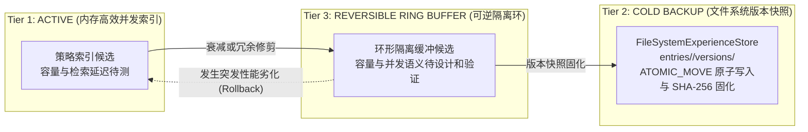
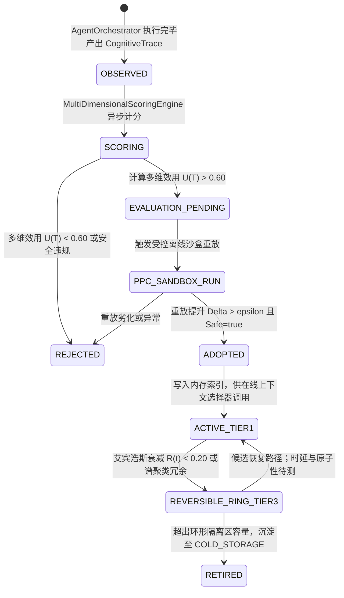

# Hermes Agent 阶段二十二研究与架构规划任务书：Experience Evolution (策略级经验进化闭环)

> **规划状态：ROADMAP / Stage 22A ONLY**。执行顺序调整为 Stage 21A → Stage 23A → Stage 22A。本文 §4–§5 的 UCB、向量门控、衰减、自动淘汰和三级冷备均是待评测的后续候选，不是 Stage 22A 实施基线，也不构成已验证的最优策略。

**当前报告性质**：研究记录与候选架构路线图；本文公式、设计参数和代码蓝图不代表决策完备，也不构成实施授权。
**前置基线**：Stage 20 CLOSED；88/89/90 旧计划为 DEFERRED；候选顺序为 Stage 21A → Stage 23A → Stage 22A，扩展阶段另行冻结。
**执行纪律**：只读审计、零源码修改、零真实 API 调用、默认保持 `OFF`、无模型权重训练依赖。

**Stage 22A 最小范围草案**：复用现有经验检索路径；定义可审阅的策略模板；由人工选择或确定性规则选择候选。保持 Domain 隔离，只允许已采纳经验参与正向策略候选；不接生产，不自动更新策略，不引入新 embedding/API。Stage 23A 的 trace 与小规模金标评测尚未完成前，不启用自适应参数或宣称跨任务效果。

**未标定参数声明**：本文出现的 `0.45/0.20/0.20/0.15` 评分权重、`0.72` 余弦门槛、UCB 探索系数、`0.20` 退休阈值、艾宾浩斯半衰期/强化公式、容量 `100`、冗余阈值 `0.96` 及三级冷备容量，全部是**初始启发式/讨论占位，待评测校准**。没有 Stage 23A 数据前，不得称为 baseline、经验事实、定理或验收门槛；Stage 22A 不实现这些机制。

---

## 一、必须只读审计的代码路径法医审计与十大核心问题裁决

本次调研对项目现有经验子系统与调度核心进行了逐行法医级代码审计，覆盖以下路径：
1. `ExperienceLibrary.java` 与 `DefaultExperienceLibrary.java`
2. `ExperienceEntry.java`
3. `ExperienceDomain.java`
4. `ExperienceDisposition.java`
5. `EvidenceReference.java`
6. `FileSystemExperienceStore.java` 与 `ExperienceStore.java`
7. `ExperienceRecall.java`
8. `ExperienceGuidedProposer.java` 与 `ExperienceGuidedProposal.java`
9. `AgentOrchestrator.java` 与 `HarnessProposalSelector.java`
10. Stage 21 规划之 `CognitiveTrace` 与 `HierarchicalTraceSpan` 结构

### 十大核心问题法医审计与严格判定
（全项结论严格区分：**事实 (Fact)** / **推断 (Inference)** / **未验证 (Unverified)** / **已否决 (Rejected)**）

#### 1. 当前经验条目记录什么？
- **【事实 (Fact)】**：`ExperienceEntry`（纯 Java 21 Record，`ExperienceEntry.java:6-23`）固化了 16 个强类型字段：
  - `entryId`：安全标识（正则 `[A-Za-z0-9][A-Za-z0-9._-]*`，防路径穿越与注入）；
  - `domain`：所属三元组业务域 `ExperienceDomain(botId, knowledgeBaseId, taskCategory)`；
  - `cue`：触发线索/任务特征文本（长度 $\ge 5$）；
  - `lesson`：经验教训/反思沉淀（长度 $\ge 10$）；
  - `evidenceSummary`：人类可读的证据摘要；
  - `evidenceRef`：强类型不可变证据引用 `EvidenceReference(evidenceId, requestId, evidenceSha256, executionMode)`；
  - `confidence`：浮点置信度标量 $[0.0, 1.0]$；
  - `sourceRunId`：产出该条目的源执行 Run ID；
  - `harnessFingerprint`：关联 Harness 运行时环境的 SHA-256 拓扑指纹（严格 64 位十六进制字符）；
  - `disposition`：处置状态枚举 `ExperienceDisposition`（`ADOPTED`, `OBSERVED`, `REJECTED`, `INVALID_FIXTURE`）；
  - `failureObserved`：布尔值，是否观察到失败；
  - `attributionStatus`：归因状态枚举 `AttributionStatus`（`NOT_APPLICABLE`, `UNRESOLVED`, `FIXTURE_CONFIRMED`, `AGENT_CONFIRMED`）；
  - `version`：单调递增版本号（从 1 开始）；
  - `retired`：布尔值，是否已软退休；
  - `retirementReason`：退休原因描述；
  - `createdAt`：物理时间戳。
- **【事实 (Fact)】**：现有 `ExperienceLeakageGuard`（`ExperienceLeakageGuard.java:19-49`）会拒绝包含已登记 QREL/GRADER 标记的条目；这只能证明对这些已知标记的拦截，不能推出不存在其他泄漏路径或“零评测集泄漏”。

#### 2. 经验如何被检索？
- **【事实 (Fact)】**：在 `DefaultExperienceLibrary.recallForProposer(domain, queryCue, maxResults)`（第 17–37 行）中：
  - 若 `domain.isUnscopedReplay()`，直接返回空匹配集合；
  - 过滤掉软退休条目（`isSoftRetired`：`retired == true`、`confidence < 0.20`、状态为 `INVALID_FIXTURE` 或 `REJECTED`）；
  - 过滤掉观察到失败的条目（`!entry.failureObserved()`）；
  - **检索算法**：仅使用粗粒度的简单子串包含 `entry.cue().toLowerCase(Locale.ROOT).contains(queryCue.toLowerCase(Locale.ROOT))`；
  - **排序策略**：先按 `confidence` 降序，再按 `entryId` 升序截取 `maxResults` 条。
- **【事实 (Fact)】**：当前实现**完全缺乏语义向量匹配**，未接入阿里千问 1024 维超球面单位向量空间的余弦相似度检索，无法处理语义等价变异、跨句型重述或多维上下文特征。

#### 3. 经验如何影响下一次执行？
- **【事实 (Fact)】**：当前仅在受控离线 Harness 测试与 PPC 探针中发挥作用（`ExperienceGuidedProposer.java:33-42` 与 `TaskLevelRecursivePpc.java:78-84`）：
  - `ExperienceGuidedProposer` 召回处于 `ADOPTED` 状态且未退休的经验；
  - 通过比对内部 `provenance` 表，校验凭单的 `botId` 与 `harnessFingerprint` 是否完全匹配；
  - 将匹配条目映射为 `Suggestion(entryId, operator, pipeline)`，再封装为 `ExperienceGuidedProposal`；
  - 在 `TaskLevelRecursivePpc` 中作为下一轮算子变异（如 `CONCISE_SYSTEM_PROMPT` 或 `ADAPTIVE_MEMORY_WINDOW`）的输入候选。
- **【事实 (Fact)】**：在生产主路径 `AgentOrchestrator.java`（全文 1419 行）中，**完全没有导入或引用 `ExperienceLibrary`**！当前的真实 Agent 执行主流程零经验感知，无法动态调整在线计划模板、工具选择策略或反思规则。

#### 4. 是否存在策略选择器？
- **【事实 (Fact)】**：离线 Harness 层存在一个极度简化的标量选择器 `HarnessProposalSelector.java`（第 11–23 行），仅在离线 CandidateProbes 中依据 `candidate.score().quality() > current.quality()` 且 `score.safe()` 贪心挑选最高分候选。
- **【事实 (Fact)】**：在在线 Agent 运行时层面，**完全不存在策略选择器**。`AgentOrchestrator` 仅通过静态的 `resolveOrchestrationMode` 读取入参配置，在 `SINGLE`、`DEBATE`、`SWARM`、`PLAN_AND_SOLVE` 之间做静态分支分流，零自适应策略演化能力。

#### 5. 是否有淘汰/回滚机制？
- **【事实 (Fact)】**：在 `DefaultExperienceLibrary.retire` 与 `FileSystemExperienceStore` 中，支持对单个条目标记软退休（`retired=true`），版本号递增，并在文件系统目录 `entries/<entryId>/versions/<version>` 中存储历史快照副本。
- **【事实 (Fact)】**：当前**没有任何自动遗忘/淘汰模型**（无 Ebbinghaus 遗忘曲线衰减，无超球面余弦特征空间的谱聚类冗余修剪）；
- **【事实 (Fact)】**：**缺乏策略级的全域版本快照回滚机制**，没有三级冷备可逆隔离环形缓冲区。一旦策略集出现跨任务效能劣化，无法做到秒级无损原子回滚。

#### 6. 成功/失败信号从哪里来？
- **【事实 (Fact)】**：离线 PPC 中，信号来自外部注入的模拟探针 `Probe.evaluate(task, voucher)` 返回的 `Score(quality, safe)`。
- **【事实 (Fact)】**：在线运行时中，信号碎片化散落在不同组件：
  - `AgentOrchestrator` 的 `ExecutionResult.success()`（布尔标量）；
  - `ReActCycleGuard` 触发的震荡与死循环熔断异常；
  - `ToolCallReceipt` / `ToolActionDfaRuntime` 中的工具非法状态与异常堆栈；
  - `TraceExecutionReceipt` 中的 `totalTokens`、`rootDurationUs` 与 `errorCount`；
  - `EvaluatorOptimizerGovernor` 中的评测反馈。
- **【推断 (Inference)】**：这些异构信号目前**没有统一收敛为结构化多维效用评估事件**，缺乏包含“任务完成度、计划执行保真度、反思修正效果、工具选择精准度、Token/时延代价”的多维评分模型。

#### 7. 经验是否会跨任务污染？
- **【事实 (Fact)】**：物理租户层面具备强隔离。`ExperienceDomain` 绑定了 `(botId, knowledgeBaseId, taskCategory)`，并在文件系统路径 `bot_<id>__kb_<id>__cat_<category>` 做了严格物理目录沙盒隔离；同时 `ExperienceLeakageGuard` 拦截标准答案泄露。
- **【推断 (Inference)】**：但在语义与泛化层面存在严重风险。同一 `taskCategory` 下若任务复杂度跨度极大，仅凭粗暴子串匹配会导致不适用的微观操作被错误召回并强行注入，产生**“负迁移（Negative Transfer）”与“策略过拟合”**。缺乏超球面特征空间上的领域门控（Task Domain Gating）。

#### 8. 哪些经验可以自动复用？
- **【事实 (Fact)】**：现有代码严格限制仅 `disposition == ExperienceDisposition.ADOPTED`、`!entry.failureObserved()` 且 `harnessFingerprint` 匹配的条目可被建议。
- **【推断 (Inference)】**：在 Stage 22 架构设计中，**仅有经过离线受控沙盒/影子评测通过、多维综合效用超过准入阈值 $\tau_{adopt}$ 的只读策略模板（Plan Template）、工具组合子集（Tool Whitelist Subset）与反思先验规则，才允许在同 Domain 内被策略选择器自动复用**。任何单次在线任务产出的未经验证情景条目（`OBSERVED` 状态），严禁直接在线自动生效。

#### 9. 哪些必须人工批准？
- **【推断 (Inference)】**：以下高风险操作必须强制接入既有的 `HumanInTheLoopApprovalController`（HITL 零阻塞挂起、常量时间 SHA-256 令牌验签）：
  1. 涉及系统修改、高危外部 API 调用的工具权限子集变更；
  2. 智能体核心 Prompt 模板的主干语义大改；
  3. 跨 Domain（跨 Workspace/Bot/KB）的经验强制迁移；
  4. 绕过离线评测门禁、强制将 `OBSERVED` 经验直接晋升为 `ADOPTED`；
  5. 策略发生全域性能突降时的全局版本强制回滚（Rollback）。

#### 10. 最小进化闭环应放在哪一层？
- **【已否决 (Rejected)】**：绝不能放在底层模型权重训练层（本项目彻底封存 GPU/本地模型微调，唯一接入 DeepSeek API 官方规约）；
- **【已否决 (Rejected)】**：绝不能放在代码生成/自修改源码层（禁止运行时自动覆写 Java 源码）；
- **【已否决 (Rejected)】**：绝不能放在每一步微观 Step 的在线无状态 Bandit 探索层（极高方差、不可控、不可重现、时延剧增）；
- **【阶段范围裁决】**：旧稿提出的策略管理层双环闭环仅是 Stage 22B 研究候选，不是 Stage 22A 的架构决策。
  - Stage 22A 仅评估只读经验检索、可审阅策略模板和人工/确定性规则选择；调用点及现有接口须实施前按源码复核。
  - Stage 22A 不新增 `OBSERVED`、不生成策略晋升流程、不写入 `ADOPTED`，也不接入 UCB 或余弦门控。

---

## 二、学术与工业界深度调研与 Research Ledger

严格按照 `AGENTS.md` §2.3 规范，建立全部 14 个必填字段的结构化 Research Ledger：

### Research Ledger Entry 1: Case-Based Reasoning (CBR 4R Cycle)
```text
id: RL-2026-CBR-001
sourceType: paper
titleOrRepository: Case-Based Reasoning: Foundational Issues, Methodological Variations, and System Approaches
authorsOrMaintainer: Agnar Aamodt, Enric Plaza
venueAndYear: AI Communications, 1994
doiOrArxiv: 10.3233/AIC-1994-7104
url: https://content.iospress.com/articles/ai-communications/aic7-1-04
commitOrTag: N/A
license: Academic Proprietary
filesOrSectionsRead: Section 2 (The Case-Based Reasoning Cycle: Retrieve, Reuse, Revise, Retain), Section 3 (Foundational Issues & Knowledge Structures)
verificationStatus: VERIFIED
relevantFinding: 经典 CBR 确立了智能系统解决新问题的 4R 循环体系：1. Retrieve（根据目标检索相似案例）；2. Reuse（将既有解映射并适配至新场景）；3. Revise（对提议解进行模拟/真实评测与纠偏修补）；4. Retain（将验证成功的经验沉淀存入案例库）。案例必须由结构化问题上下文、适配解与验证结果构成。
projectApplicability: 直接指导本项目策略进化闭环的顶层设计：将 Agent 执行分解为“策略检索 (Retrieve) → 计划与工具适配 (Reuse) → 运行与反思修复 (Revise) → 经验沉淀与晋升 (Retain)”四阶段。
limitations: 经典 1994 年 CBR 依赖符号知识库与手工特征距离度量，缺乏现代高维语义嵌入（Embedding）表征与 LLM 自然语言反思能力，需结合千问 1024 维超球面余弦度量改造。
```

### Research Ledger Entry 2: ExpeL (Non-Parametric Experiential Learning)
```text
id: RL-2026-EXPEL-002
sourceType: paper
titleOrRepository: ExpeL: LLM Agents Are Experiential Learners
authorsOrMaintainer: Andrew Zhao, Daniel Huang, Quentin Xu, Matthieu Lin, Yong-Jin Liu, Gao Huang
venueAndYear: AAAI 2024 (Oral)
doiOrArxiv: arXiv:2308.10144 / 10.1609/aaai.v38i17.29936
url: https://arxiv.org/abs/2308.10144
commitOrTag: N/A
license: Apache-2.0 (Official Code: https://github.com/LeapLabTHU/ExpeL)
filesOrSectionsRead: Section 3 (The ExpeL Framework: Experience Gathering, Insight Extraction, Recall), Section 4 (Empirical Evaluation on ALFWorld & WebShop), Section 5 (Cross-Task Transfer)
verificationStatus: VERIFIED
relevantFinding: 证明了基于黑盒商业 API（如 GPT-4）的 LLM Agent 可以通过“非参数化经验积累（Non-parametric Experience Accumulation）”实现持续自进化，彻底颠覆传统模型微调。其核心是在试错轨迹中通过成对对比（成功 vs 失败）提炼出自然语言形式的高阶规则（Insights），并在推理时根据语义相似度召回并拼入 Prompt，在 ALFWorld 和 HotpotQA 上显著超越 ReAct 和单轮 Reflexion。
projectApplicability: 可作为未来非参数策略模板研究的参考；本项目的 `lesson`、`cue` 尚未证明等价于 ExpeL 的 Insights，Stage 22A 不自动提炼或注入经验。
limitations: ExpeL 与本项目在任务、模型、经验写入和评测条件上不同。其经验库设计不能证明本项目现有存储/LeakageGuard 足以覆盖多租户隔离或全部泄漏路径。
```

### Research Ledger Entry 3: Reflexion (Verbal Reinforcement Learning)
```text
id: RL-2026-REFLEX-003
sourceType: paper
titleOrRepository: Reflexion: Language Agents with Verbal Reinforcement Learning
authorsOrMaintainer: Noah Shinn, Federico Cassano, Ashwin Gopinath, Karthik Narasimhan, Shunyu Yao
venueAndYear: NeurIPS 2023
doiOrArxiv: arXiv:2303.11366
url: https://arxiv.org/abs/2303.11366
commitOrTag: N/A
license: MIT (Official Code: https://github.com/noahshinn/reflexion)
filesOrSectionsRead: Section 2 (Reflexion Architecture: Actor, Evaluator, Self-Reflection), Section 3 (Short-term and Long-term Episodic Memory Buffer), Section 4 (HumanEval Coding Experiments)
verificationStatus: VERIFIED
relevantFinding: 提出以语言反馈（Verbal Feedback）替代传统强化学习数值标量奖励机制。由 Evaluator 提供多维诊断信号，Self-Reflection 模块基于失败轨迹生成针对性的归因分析和纠偏指令，存储于情节记忆缓冲区中作为后续尝试的条件前置。在 HumanEval 上实现 91% 的 pass@1。
projectApplicability: 为本项目多维评分模型与反思规则沉淀提供理论基础。本阶段将反思产出的自我修正提示提炼为不可变的 `ReflectionRule`，并注入策略模板中。
limitations: Reflexion 主要关注单任务多轮试错（Intra-task Reflection），跨任务经验迁移（Inter-task Transfer）机制较弱；在真实复杂企业场景中若缺乏循环阻断器，易陷入反思死循环。本项目已通过 `ReActCycleGuard` 和 Stage 22 双环离线受控验证予以弥补。
```

### Research Ledger Entry 4: Contextual Bandits & LinUCB (Strategy Selection)
```text
id: RL-2026-LINUCB-004
sourceType: paper
titleOrRepository: A Contextual-Bandit Approach to Personalized News Article Recommendation
authorsOrMaintainer: Lihong Li, Wei Chu, John Langford, Robert E. Schapire
venueAndYear: WWW 2010 (WWW Test of Time Award 2023)
doiOrArxiv: 10.1145/1772690.1772758 / arXiv:1003.0146
url: https://arxiv.org/abs/1003.0146
commitOrTag: N/A
license: Academic Proprietary
filesOrSectionsRead: Section 3 (Contextual Multi-Armed Bandits Formulation), Section 3.1 (LinUCB Algorithm with Disjoint Linear Models), Section 4 (Offline Evaluation Methodology)
verificationStatus: VERIFIED
relevantFinding: 提出了在特征上下文（Context）输入下的在线策略选择算法 LinUCB。在每个时间步，算法根据上下文向量 $x_{t,a}$ 计算臂 $a$ 的收益期望上界：$p_{t,a} = x_{t,a}^\top \hat{\theta}_a + \alpha \sqrt{x_{t,a}^\top A_a^{-1} x_{t,a}}$，完美平衡探索与利用（Exploration vs. Exploitation），且证明了利用离线随机日志进行非偏差评测（Offline Replay Evaluation）的统计有效性。
projectApplicability: 用于本项目在同 Domain 下多策略模板的在线自适应路由选择。通过千问 1024 维特征作为上下文，利用 UCB 上界评估策略模板的预期综合得分，避免陷入次优策略；同时其离线重放评测思想为本项目的 PPC 受控评测提供了严密数理基础。
limitations: 传统 LinUCB 假设收益函数在特征空间上严格线性，且在线矩阵求逆 $A^{-1}$ 在高维（1024 维）实时计算时有显著开销。本项目在在线路径采用基于余弦相似度投影与标量置信区间的轻量级 Contextual-UCB 简化模型，矩阵分解置于离线外环。
```

### Research Ledger Entry 5: Multi-Armed Bandit & Finite-Time Regret Bounds
```text
id: RL-2026-UCB-005
sourceType: paper
titleOrRepository: Finite-time Analysis of the Multiarmed Bandit Problem
authorsOrMaintainer: Peter Auer, Nicolò Cesa-Bianchi, Paul Fischer
venueAndYear: Machine Learning, 2002
doiOrArxiv: 10.1023/A:1013689704352
url: https://link.springer.com/article/10.1023/A:1013689704352
commitOrTag: N/A
license: Academic Proprietary
filesOrSectionsRead: Section 2 (The UCB1 Policy), Theorem 1 (Logarithmic Regret Bound for Bounded Support Rewards)
verificationStatus: VERIFIED
relevantFinding: 证明了确定性索引策略 UCB1 在有限时间内具有对数阶累积遗憾界（$O(\log N)$），对任意有界支撑集 $[0, 1]$ 的奖励分布均成立。为不依赖先验参数分布的自适应决策提供了数学收敛性保证。
projectApplicability: 仅作为理解有限臂 bandit 理论的参考；不能据此推出本项目策略选择器的收敛或效果保证。
limitations: 该界依赖论文定义的奖励与采样假设；标准 UCB1 无状态、无上下文。项目的候选策略、奖励、任务分布和反馈独立性均未验证，不能直接外推，也不要求与余弦相似度组合。
```

---

## 三、候选方案全方位对比与裁决矩阵

针对“如何构建策略级经验自进化闭环”，对以下 6 种候选方案进行严格评审：

- **方案 A**：仅存储经验，不自动使用（当前 Stage 10 现状）
- **方案 B**：经验检索 + 人工审批选择（极度保守 HITL 全流程介入）
- **方案 C**：经验检索 + 规则评分 + 在线直接自动选择（单环实时在线修改策略）
- **方案 D**：离线策略进化 + 运行时白名单选择（后续研究候选；非 Stage 22A 实施方案）
- **方案 E**：细粒度步级在线 Bandit / 强化选择（在 Agent 每个内部 ToolCall 步实时更新网络或协方差矩阵）
- **方案 F**：不引入进化（永久维持静态 Prompt 与硬编码编排）

### 方案多维对比矩阵

> 本矩阵是设计阶段的风险/机制梳理，不是实测比较。此前使用的“极高、极优、秒级、低风险、理论收敛”等评价没有本项目数据支撑，均不作为事实或方案排名。

| 评估维度 | 方案 A (仅存不用) | 方案 B (人工选择) | 方案 C (在线直选) | 方案 D (后续候选: 离线进化+白名单) | 方案 E (步级在线Bandit) | 方案 F (不引入) |
| :--- | :--- | :--- | :--- | :--- | :--- | :--- |
| **1. 正确性验证** | 保持现有行为；效果待测 | 可设置人工/规则审阅；效果待测 | 尚未实现；风险待测 | 尚未实现；不能宣称已验证 | 尚未实现；风险待测 | 保持静态行为 |
| **2. 可解释与可审计性**| 依赖现有日志能力 | 依赖审阅记录设计 | 需额外记录选择理由 | 需额外记录演化与选择证据 | 需额外记录在线更新 | 依赖现有日志能力 |
| **3. 污染与过拟合风险**| 仍须检查现有隔离 | 需定义审阅边界 | 需验证在线污染风险 | 需验证沙盒、隔离和晋升门禁 | 需验证在线更新风险 | 不引入新增机制 |
| **4. 回滚与恢复** | 按现有实现核验 | 需定义撤销流程 | 需设计并验证 | 冷备/回滚尚未实现或验证 | 需定义状态恢复 | 按现有实现核验 |
| **5. 数据与冷启动需求**| 依赖现有经验条目 | 需可审阅的经验与模板 | 需明确初始化规则 | 需额外评测及晋升证据 | 需足够在线观测 | 不新增数据需求 |
| **6. 计算与延迟成本**| 待测 | 人工参与成本待测 | 待测 | 离线/在线成本待测 | 在线更新成本待测 | 现有基线待测 |
| **7. 与 Stage 21 兼容性**| 接口待核验 | 接口待核验 | 尚未设计 | 仅为后续接口候选 | 尚未设计 | 保持当前接口 |
| **8. 可证伪性** | 可作为对照，需定义指标 | 可按预注册规则验证 | 需先定义实验 | 需单独任务书与验证协议 | 需单独任务书与验证协议 | 可作为对照，需定义指标 |

### Stage 22A 范围裁决（未授权实施）
1. Stage 22A 的最小候选仅包括：复用现有经验检索、定义可审阅的策略模板、通过人工或确定性规则选择；不得自动进化、自动晋升或写入新的 ADOPTED 经验。
2. 方案 A/F 作为现状与对照保留，不以“缺乏进化”作为拒绝理由。方案 C、D、E 暂不采纳为实施设计；其风险和收益均需后续独立验证，不能把风险推测写成已观测故障。
3. CBR、ExpeL、UCB、余弦门控、遗忘/淘汰、冷备环均属于后续候选研究。Stage 22A 不实现这些机制，不使用未标定权重、阈值、衰减或容量参数，也不声称其具有收敛、最优或高可用保证。

---

## 四、扩展数学模型候选（Stage 22B；Stage 22A 不实施）

### 4.1 经验条目（Observation）与策略条目（Strategy）的严格代数分离

在形式化定义中，必须将“单次具体运行的历史观测”与“提炼后的可执行策略”做数学上的显式解耦：

- **经验条目空间 $\mathcal{H}_{obs}$**：
  单次具体执行的经验实例定义为一个 6 元组：
  $$\mathcal{E}_{obs} = \langle \text{Id}, \mathcal{D}_{task}, \mathbf{c}_{emb}, \mathcal{T}_{trace}, \mathcal{R}_{verdict}, \mathbf{s}_{score} \rangle$$
  其中 $\mathcal{D}_{task}$ 为所属 Domain，$\mathbf{c}_{emb} \in \mathbb{S}^{1023}$ 为输入 Query 的单位归一化特征，$\mathcal{T}_{trace}$ 为 `CognitiveTrace` 完整执行链路，$\mathcal{R}_{verdict}$ 为执行处置（默认 `OBSERVED`），$\mathbf{s}_{score}$ 为多维评分向量。
- **策略条目空间 $\mathcal{H}_{pol}$**：
  可被调度器激活的策略条目定义为一个 7 元组：
  $$\mathcal{S}_{pol} = \langle \text{StrategyId}, \mathcal{D}_{task}, \mathbf{c}_{centroid}, \mathcal{P}_{dag}, \mathcal{T}_{whitelist}, \mathcal{M}_{reflect}, \mathbf{\Theta}_{stat} \rangle$$
  - $\mathbf{c}_{centroid} \in \mathbb{S}^{1023}$：策略适用语义在超球面上的聚类质心（Centroid）；
  - $\mathcal{P}_{dag}$：抽象后的高阶有向无环计划模板（Plan Template DAG），解耦具体实体入参，仅保留算子与推理逻辑结构；
  - $\mathcal{T}_{whitelist}$：建议激活的最小必要工具白名单子集（Minimal Tool Subset），收敛搜索空间；
  - $\mathcal{M}_{reflect}$：针对该类任务沉淀的元认知反思规则先验（如特定陷阱防御、正则补丁规则）；
  - $\mathbf{\Theta}_{stat} = \langle N, \bar{U}, S_{retention}, \text{ver} \rangle$：策略的历史选择统计、平均效用、记忆保留强度与版本号。

### 4.2 多维综合效用评分模型 (Multi-Dimensional Scoring Model)

对单次运行产出的执行轨迹 $\mathcal{T}_{trace}$，定义多维评分向量 $\mathbf{S} = [S_{succ}, S_{plan}, S_{refl}, S_{tool}, C_{tok}, T_{lat}]^\top$。

定义综合效用标量函数 $U(\mathcal{T}_{trace}) \in [-1.0, 1.0]$：
$$U(\mathcal{T}_{trace}) = w_1 S_{succ} + w_2 S_{plan} + w_3 S_{refl} + w_4 S_{tool} - \lambda_1 \tilde{C}_{tok} - \lambda_2 \tilde{T}_{lat}$$

**形式化约束与判决分量定义**：
1. **任务最终达成率 $S_{succ} \in \{0.0, 1.0\}$**：
   $$S_{succ} = \begin{cases} 1.0, & \text{若通过目标断言且无未捕获致命异常} \\ 0.0, & \text{其他} \end{cases}$$
2. **计划执行保真度 $S_{plan} \in [0.0, 1.0]$**：
   设计划总节点数为 $K$，成功执行节点数为 $K_{ok}$，因依赖破损或死锁跳过数为 $K_{fail}$：
   $$S_{plan} = \frac{K_{ok}}{K} \cdot \mathbb{I}(\text{DAG无死锁与环})$$
3. **反思自愈有效性 $S_{refl} \in [0.0, 1.0]$**：
   若无反思触发，设为 $1.0$；若触发反思 $M$ 次且最终自愈成功，设为 $\frac{1}{1 + \ln(1 + M)}$；若触发 `ReActCycleGuard` 震荡熔断，强制判定为 $0.0$。
4. **工具调用精准度 $S_{tool} \in [0.0, 1.0]$**：
   设工具总调用次数为 $T_{total}$，合法且有效返回被下游采纳的次数为 $T_{valid}$：
   $$S_{tool} = \frac{T_{valid}}{T_{total}} \cdot \mathbb{I}(\text{DFA未发生越权拦截})$$
5. **归一化资源惩罚项 $\tilde{C}_{tok}, \tilde{T}_{lat} \in [0.0, 1.0]$**：
   $$\tilde{C}_{tok} = \min\left(1.0, \frac{\text{TokenUsed}}{\text{TokenBudget}}\right), \quad \tilde{T}_{lat} = \min\left(1.0, \frac{\text{DurationUs}}{\text{TimeoutUs}}\right)$$
6. **未校准的权重占位（不是公理或经验最优值）**：
   $$\sum_{i=1}^4 w_i = 1.0, \quad w_1=0.45, w_2=0.20, w_3=0.20, w_4=0.15; \quad \lambda_1=0.10, \lambda_2=0.05$$

   以上数值仅用于表达候选评分形式，尚无数据支持其权重或惩罚系数；不进入 Stage 22A 实现。

### 4.3 阿里千问 1024 维超球面检索与任务领域门控 (Hyperspherical Retrieval & Gating)

本系统向量空间严格锁定为阿里千问 `text-embedding-v4` 的 1024 维超球面空间：
$$\mathbb{S}^{1023} = \{ \mathbf{v} \in \mathbb{R}^{1024} \mid \|\mathbf{v}\|_2 = 1.0 \}$$

#### 4.3.1 余弦度量恒等律与快速内积
对任意输入特征向量 $\mathbf{q} \in \mathbb{S}^{1023}$ 与候选策略质心 $\mathbf{c}_i \in \mathbb{S}^{1023}$，其在超球面上的测地角距离与余弦相似度满足内积恒等式：
$$\cos\theta(\mathbf{q}, \mathbf{c}_i) = \mathbf{q} \cdot \mathbf{c}_i = \sum_{k=1}^{1024} q_k c_{i,k}$$
欧氏距离与余弦距离严格保持代数映射：$d_{Euc}^2(\mathbf{q}, \mathbf{c}_i) = 2(1 - \mathbf{q} \cdot \mathbf{c}_i)$。

#### 4.3.2 双重领域门控（Dual Domain Gating Rule）
候选策略 $\mathcal{S}_i$ 必须同时通过以下两道门禁，否则拒绝召回：
1. **物理租户硬隔离门禁**：
   $$\text{Domain}(\mathbf{q}) == \text{Domain}(\mathcal{S}_i) \iff \text{botId}(\mathbf{q}) == \text{botId}(\mathcal{S}_i) \land \text{kbId}(\mathbf{q}) == \text{kbId}(\mathcal{S}_i) \land \text{cat}(\mathbf{q}) == \text{cat}(\mathcal{S}_i)$$
2. **待标定的超球面余弦语义门禁（Stage 22A 不实现）**：
   $$\cos\theta(\mathbf{q}, \mathbf{c}_i) \ge \gamma_{gate} \quad (\text{默认阈值 } \gamma_{gate} = 0.72)$$
   `0.72` 目前没有本项目校准数据。阈值的可行范围、误召回/漏召回代价与回退规则须由后续评测确定；此处只记录候选形式，不得据此启用语义门控。

#### 4.3.3 上下文 Bandit 策略选择器 (Contextual-UCB Policy Selector)
对通过门控的所有候选策略集合 $\mathcal{A}_{\mathbf{q}}$，策略选择器基于 UCB 原则计算各候选的综合决策得分：
$$\text{Score}(\mathcal{S}_i \mid \mathbf{q}) = \bar{U}_i + \alpha \cdot (\mathbf{q} \cdot \mathbf{c}_i) + \beta \sqrt{\frac{2 \ln(1 + \sum_{j} N_j)}{1 + N_i}}$$
其中 $\bar{U}_i$ 为策略的历史平均效用；$\alpha=0.35$、$\beta=0.20$ 仅为未经标定的示例参数。此 UCB 公式在 Stage 22A 中不实现，也不据此声称收益或 regret 界适用于本项目。

### 4.4 经验淘汰修剪与三级冷备可逆隔离环形缓冲区

> 本节为后续候选研究，不属于 Stage 22A。本文中的半衰期、复用强化、`0.20` 退休阈值、容量 `100`、余弦冗余阈值 `0.96` 和三级冷备容量均未标定；在数据与恢复契约冻结前，不实现自动退休、物理淘汰或环形缓冲机制。

#### 4.4.1 动态遗忘与冗余修剪模型
1. **艾宾浩斯强化衰减模型**：
   策略的保留置信度 $R_i(t)$ 随时间物理流逝呈指数衰减，但衰减半衰期随有效复用频次强化：
   $$R_i(t) = R_0 \cdot \exp\left( - \frac{\Delta t}{S_i} \right), \quad S_i = S_{base} \cdot (1 + \ln(1 + N_{adopted}))$$
   当 $R_i(t) < \tau_{retire} = 0.20$ 时，触发自动软退休（Soft Retirement）。
2. **超球面谱聚类/余弦冗余修剪**：
   当某 Domain 内的活跃策略条目数超过上限容量 $K_{max} = 100$ 时，计算条目间质心余弦相似度矩阵。若存在 $\mathcal{S}_a, \mathcal{S}_b$ 满足 $\mathbf{c}_a \cdot \mathbf{c}_b > 0.96$（高度近义冗余），系统自动保留综合效用更优者，将次优者移出活跃集。

#### 4.4.2 三级冷备可逆隔离环形缓冲区 (Three-Tier Reversible Ring Buffer)
候选结构示意如下；槽位容量、持久化原子性、恢复复杂度和时延均未实现或测量，不构成高可用或回滚保证：



- **Tier 1 (ACTIVE)**：活跃策略索引候选，容量、并发与查询延迟待评估；
- **Tier 2 (COLD BACKUP)**：文件版本快照候选，写入原子性、保留策略和校验恢复流程待验证；
- **Tier 3 (REVERSIBLE RING BUFFER)**：可逆隔离候选，容量、覆盖语义、回滚完整性与复杂度均未确定；不承诺 $O(1)$ 或原子全量恢复。

---

## 五、后续路线图（非 Stage 22A 实施蓝图）

> 下述包结构、代码落点和接口草案只用于记录未来候选，不能作为当前实现清单。Stage 22A 仅按本报告开头的最小范围另行冻结契约。

### 5.1 模块与包结构规划
所有新增与升级核心代码均落入 `backend/qknow-hermes/qknow-hermes-core/src/main/java/tech/qiantong/qknow/hermes/agent/`，绝不跨越架构边界：

```text
tech.qiantong.qknow.hermes.agent.harness.experience/
├── ExperienceLibrary.java                  [契约升级：增加向量检索与策略演化接口]
├── DefaultExperienceLibrary.java           [实现升级：支持 1024 维超球面检索与环形冷备]
├── ExperienceEntry.java                     [情景实例不可变 Record，保持既有契约]
├── StrategyPolicy.java                      [新增：抽象策略模板不可变 Record]
├── MultiDimensionalScoringEngine.java       [新增：多维评分聚合计算引擎]
├── HypersphericalCosineRetriever.java       [新增：千问 1024 维超球面向量检索算子]
├── ThreeTierReversibleRingBuffer.java       [新增：三级冷备可逆隔离环形缓冲区]
├── ExperienceLeakageGuard.java              [既有加固：增加策略签名与 QREL 拦截断言]
└── FileSystemExperienceStore.java           [既有加固：支持策略与经验双模原子存储]

tech.qiantong.qknow.hermes.agent.evolution/
├── StrategyEvolutionCoordinator.java        [新增：离线外环演化与 PPC 桥接协调器]
├── ContextualBanditStrategySelector.java    [新增：在线内环上下文策略选择器]
└── dto/
    ├── EvolutionCandidateVoucher.java       [新增：演化候选密码学凭单]
    └── CognitiveEvolutionReceipt.java       [新增：自进化周期密码学生成终决凭单]
```

### 5.2 核心 Java 21 Record 与接口定义草案

#### 5.2.1 抽象策略模板不可变 Record (`StrategyPolicy.java`)
```java
package tech.qiantong.qknow.hermes.agent.harness.experience;

import java.nio.charset.StandardCharsets;
import java.security.MessageDigest;
import java.security.NoSuchAlgorithmException;
import java.time.Instant;
import java.util.List;
import java.util.Objects;
import java.util.Set;

/**
 * 抽象认知策略模板不可变对象 (StrategyPolicy)
 * 严格满足 Java 21 Record 约束与千问 1024 维超球面基线
 */
public record StrategyPolicy(
        String strategyId,
        ExperienceDomain domain,
        float[] centroidEmbedding1024,
        String planTemplateDagJson,
        Set<String> recommendedTools,
        List<String> metaReflectionRules,
        double averageUtility,
        int usageCount,
        int version,
        boolean retired,
        String retirementReason,
        Instant lastUpdated,
        String sha256Signature
) {
    public StrategyPolicy {
        Objects.requireNonNull(strategyId, "strategyId 不能为空");
        Objects.requireNonNull(domain, "domain 不能为空");
        if (centroidEmbedding1024 == null || centroidEmbedding1024.length != 1024) {
            throw new IllegalArgumentException("必须严格满足阿里千问 1024 维超球面向量");
        }
        Objects.requireNonNull(planTemplateDagJson, "planTemplateDagJson 不能为空");
        recommendedTools = Set.copyOf(recommendedTools);
        metaReflectionRules = List.copyOf(metaReflectionRules);
        Objects.requireNonNull(sha256Signature, "sha256Signature 不能为空");
    }

    public static String computeSignature(String id, String domainSlug, int ver, double utility) {
        try {
            MessageDigest md = MessageDigest.getInstance("SHA-256");
            String payload = id + "|" + domainSlug + "|" + ver + "|" + utility;
            byte[] hash = md.digest(payload.getBytes(StandardCharsets.UTF_8));
            StringBuilder sb = new StringBuilder();
            for (byte b : hash) {
                sb.append(String.format("%02x", b));
            }
            return sb.toString();
        } catch (NoSuchAlgorithmException e) {
            throw new IllegalStateException("SHA-256 不可用", e);
        }
    }
}
```

#### 5.2.2 演化状态机流转图 (Evolution State Machine)


---

## 六、Stage 22B 接口概念（不是 Stage 22A 契约）

Stage 22 策略自进化与 Stage 21 认知内核（Cognitive Core v1）之间通过只读、强类型契约严格交互，零紧耦合：

### 6.1 输入契约：`CognitiveTrace`
Stage 21 执行完毕后，向 Stage 22 广播标准不可变的 `CognitiveTrace` 实体：
```java
public record CognitiveTrace(
        String traceId,
        String requestId,
        ExperienceDomain domain,
        float[] queryEmbedding1024,
        String promptTemplateUsed,
        List<String> plannedDagNodes,
        List<ToolExecutionSpan> executedTools,
        List<ReflectionTurnSpan> reflectionTurns,
        boolean finalSuccess,
        int tokenConsumption,
        long executionDurationUs,
        long completionTimestampMs
) {}
```

### 6.2 输出契约：`PolicySelectionDecision`
在 Stage 21 的 `AgentOrchestrator` 准备初始化任务前，调用 Stage 22 的策略选择器：
```java
public record PolicySelectionDecision(
        String selectedStrategyId,
        boolean isBaselineFallback,
        String resolvedPlanDagJson,
        Set<String> activeToolWhitelist,
        List<String> injectedReflectionRules,
        double expectedUtilityScore,
        String authorizationDigest
) {}
```
未召回策略时采用 baseline fallback 是待设计、待验证的候选行为；即使回退到 baseline，也不代表零风险。Stage 22A 的具体失败与回退语义须在独立实施契约中定义和测试。

---

## 七、Stage 22B 测试候选（不是 Stage 22A 验收项）

为验证上述核心架构契约与状态机流转的严密自洽，设计以下测试套件：
- `tech.qiantong.qknow.hermes.agent.harness.experience.StrategyPolicyContractTest`
- `tech.qiantong.qknow.hermes.agent.harness.experience.HypersphericalCosineRetrieverTest`
- `tech.qiantong.qknow.hermes.agent.harness.experience.ThreeTierReversibleRingBufferTest`
- `tech.qiantong.qknow.hermes.agent.evolution.ContextualBanditStrategySelectorTest`

执行命令（显式锁定 Java 21 SDKMAN 隔离环境，严禁污染宿主 Java 17）：
```bash
JAVA_HOME=/Users/achilles/.sdkman/candidates/java/21.0.5-tem \
PATH=/Users/achilles/.sdkman/candidates/java/21.0.5-tem/bin:$PATH \
mvn clean test-compile -pl backend/qknow-hermes/qknow-hermes-core
```

---

## 八、总结与准入边界

1. **Stage 22A 候选范围**：仅考虑复用现有经验检索、定义可审阅策略模板，并由人工或确定性规则选择；具体接口须在后续任务书中按源码复核。
2. **正向经验边界**：只读使用既有、符合当前召回约束的经验；Stage 22A 不提炼、不晋升、不新增 `ADOPTED`，也不把 `OBSERVED` 或失败经验转换为正向规则。
3. **评分与淘汰**：本报告中的权重、阈值、UCB、遗忘、余弦修剪和冷备容量均为未标定候选；Stage 22A 不实现这些机制，不能声称效果、最优性或恢复时限。
4. **接口边界**：本文 §4–§7 的扩展公式、运行时选择器、回滚环和相关类型均属 Stage 22B 研究草案，不是当前可实施契约。
5. **评测依赖**：Stage 22A 排在 Stage 21A 与 Stage 23A 之后；其选择规则应由可用 trace、任务 rubric 和隔离约束支撑。
6. **准入裁决**：本文不授权源码实施。Stage 22A 仍须在前置阶段完成后另行冻结任务书并取得授权；Stage 22B 另行评审。

请指示后续落地排期！

</SYSTEM_MESSAGE>
