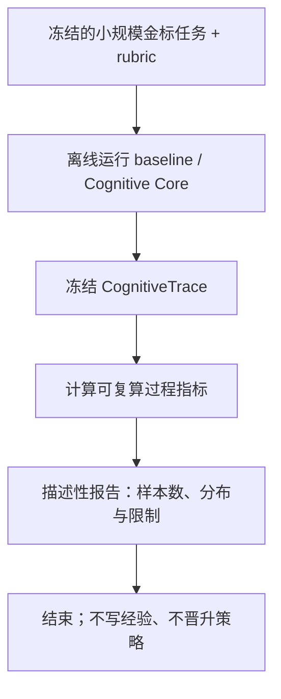
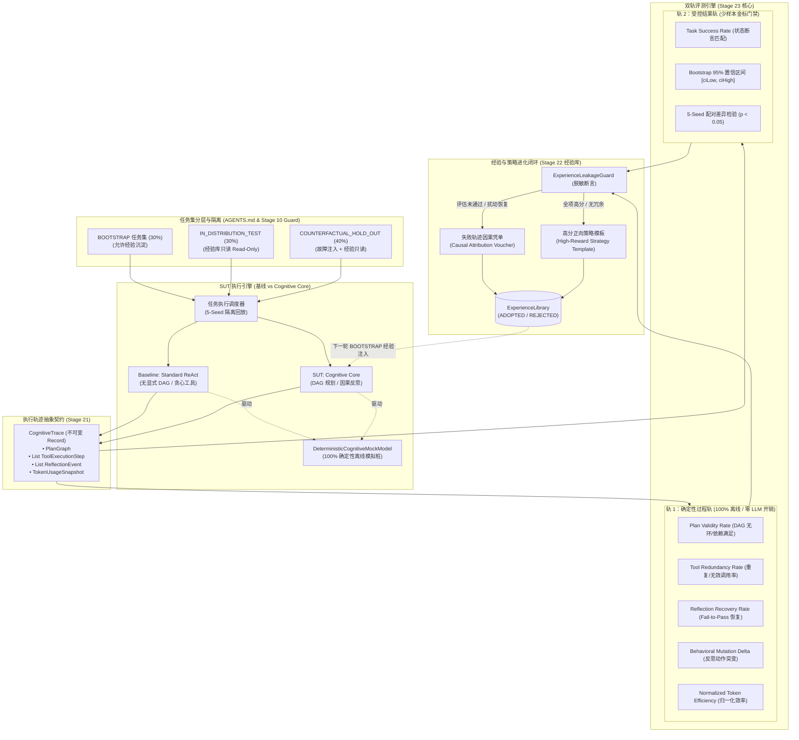
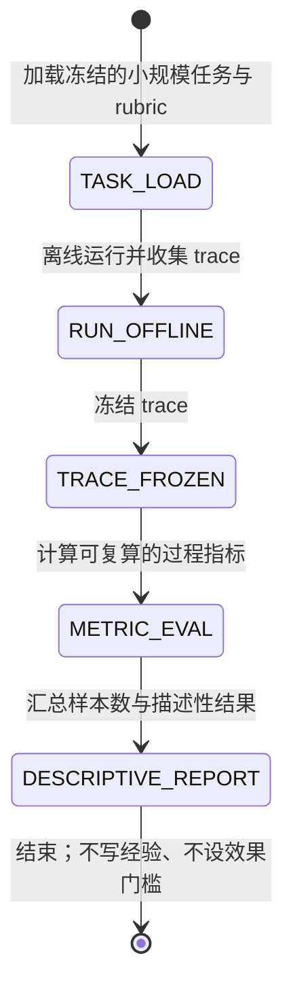

# Hermes Agent 阶段二十三研究与架构规划报告：Reasoning Evaluation & Evolution Loop

> **规划状态：ROADMAP / Stage 23A ONLY**。Stage 23A 排在 Stage 21A 之后、Stage 22A 之前，只建立最小过程评测基线。确定性 mock 只能验证 runner、trace、指标计算和故障注入流程，不证明真实模型推理能力或 Stage 21 的真实效果。本文中的目标阈值、大任务集、显著性检验和经验回写均为后续路线图，需另行冻结。

**Stage 23A 最小范围草案**：定义 `CognitiveTrace` 与过程指标；冻结一个小规模金标任务集及可重复 rubric；记录 baseline，报告描述性结果。Stage 23A 不做策略演化、不写 ADOPTED、不运行真实 API、不宣称统计显著或泛化提升。所有 baseline 当前为待测，目标阈值须在测量协议确定后预注册。

- **报告编号**：`STAGE-23-RESEARCH-AND-ARCHITECTURE-PLAN`
- **执行角色**：Hermes Agent 阶段二十三研究与架构规划员（Reasoning Evaluation）
- **规划基线**：Stage 20 CLOSED；88/89/90 旧计划为 DEFERRED；候选顺序为 Stage 21A → Stage 23A → Stage 22A，扩展项须另行冻结。
- **约束铁律贯彻**：只读审计、零源码修改、零分支创建、零生产默认开启、零真实 API 大规模刷分；严格区分事实（Fact）、推断（Inference）、未验证（Unverified）、已否决（Rejected）。

---

## 一、必须只读审计的代码路径与十大核心问题裁决

### 1.1 只读审计路径全景溯源

经过对以下代码路径的静态法医级审计取证：
1. `backend/tests/src/test/java/tech/qiantong/qknow/rag/eval/`（`RagBenchmarkReport.java`, `RagEvaluationDataset.java`, `RagEvaluationDatasetLoader.java`）；
2. `backend/qknow-hermes/qknow-hermes-core/src/test/resources/harness12/benchmark.json`（Stage 12 HAC-1 合成基准）；
3. `backend/qknow-hermes/qknow-hermes-core/src/main/java/tech/qiantong/qknow/hermes/eval/`（`EvaluationReport.java`, `EvaluationDataset.java`, `EvaluationStatus.java`, `MetricScores.java`, `RagasEvaluator.java`, `ClaimFaithfulnessEvaluator.java`）；
4. `backend/qknow-module-kmc/qknow-module-kmc-biz/src/main/java/.../rag/CragRetrievalEvaluation.java`；
5. `backend/qknow-hermes/qknow-hermes-core/src/main/java/.../agent/harness/experience/`（`ExperienceEntry.java`, `ExperienceLibrary.java`, `ExperienceLeakageGuard.java`）；
6. `backend/qknow-hermes/qknow-hermes-core/src/main/java/.../agent/harness/UsageCapturingChatModel.java` 与测试模拟桩。

---

### 1.2 十大核心必答问题逐一裁决

#### 问题 1：当前有没有推理评测？
- **【事实 (Fact)】：当前系统完全没有衡量多步推理、逻辑规划与反思能力的评测体系。**
- **证据支持**：
  - `qknow-hermes-core/src/main/java/.../eval/` 下现存的评估器（`RagasEvaluator`, `ClaimFaithfulnessEvaluator`）其输入仅为 `EvaluationDataset.EvalItem`（仅含 `query`, `expectedAnswer`, `groundTruthContexts`），属于针对单轮 RAG 检索回答忠实度/相关度的打分工具；
  - `RagBenchmarkReport` 评估的是文本分块的向量与关键词检索召回（Recall/NDCG）；
  - `harness12/benchmark.json`（HAC-1）仅检查 Harness 算子配置名称（如 `CONCISE_SYSTEM_PROMPT`, `ADAPTIVE_MEMORY_WINDOW`）是否满足 voucher，oracle 仅比对算子标签，不运行任何真实或模拟推理过程；
  - 探针模块（`DaemonProbeDispatcher`）测试的是 MCTS/PRM 算法骨架本身的纯数学计算（使用合成的向量和预设模板），并未形成可证伪、端到端的 Agent 任务求解评测。

#### 问题 2：现有 benchmark 衡量什么？
- **【事实 (Fact)】：现有 benchmark 仅衡量三类能力**：
  1. **RAG 检索质量**：分块召回率、重排 NDCG、上下文精确度（Context Precision）、回答忠实度（Faithfulness）；
  2. **Harness² 控制流算子变异与选择**：Stage 12 HAC-1 衡量的是控制流管道在面对不同任务类型标签时，能否有界地组合并采纳算子；
  3. **系统契约与安全防御**：如 Phase 133 混沌与 gRPC 连通性、APFS 路径防穿越、零时序泄漏、DFA 状态机有界性拦截。

#### 问题 3：哪些指标是安全指标，不是推理指标？
- **【事实 (Fact)】：以下指标属于安全、防御或生命周期控制指标，绝不能冒充推理能力**：
  - `negative_rejection`：上下文中无答案时拒绝回答（防幻觉/越权注入）；
  - `noise_sensitivity`：面对不相关文本时的抗干扰度（抗对抗样本注入）；
  - `DFA State Validity`：工具调用是否违背局部自动机状态转换规则（如只读阶段禁止调用写操作）；
  - `ExperienceLeakageGuard` 检查项：是否包含 `GRADER_MARKERS` 与 `QREL_MARKERS`（防止凭据与答案泄漏）；
  - `ReActCycleGuard / step <= 10`：硬性步数截断与重复调用循环检测（防死循环资源耗尽）。
- **【推断 (Inference)】**：真正的推理指标必须度量“认知分解、依赖满足、工具按需精准调用、扰动自愈恢复与有界目标达成”。

#### 问题 4：如何构造多步任务？
- **【推断 (Inference)】：多步任务必须脱离单轮 Prompt 模式，基于“因果依赖图（Causal Dependency DAG）”与“有状态环境模拟桩（Stateful Mock Environment）”构造**：
  - **族 1：多跳工具依赖推理（MultiHopToolTasks）**：例如先调 `lookup_account(name)` 获取 `accountId`，再调 `fetch_ledger(accountId)`，最后调 `compute_reconciliation`，后序输入显式依赖前序输出；
  - **族 2：形式化约束排程（ConstraintSchedulingTasks）**：带有拓扑前置条件与资源锁定的任务调度，要求 Agent 输出无环可行的执行序列；
  - **族 3：反事实与多步推导（CounterfactualMathTasks）**：设定反常数规则或修改前置假设，验证 Agent 是否真正按规则推演而非依靠 LLM 预训练记忆背题；
  - **族 4：环境扰动与动态自愈（PerturbationRecoveryTasks）**：在第 $k$ 步确定性注入瞬时故障（如 429 限流、字段格式漂移、资源锁定），检验反思与重规划能力。

#### 问题 5：如何判定计划质量？
- **【推断 (Inference)】：严禁依赖容易产生主观幻觉的 LLM-as-a-judge，必须基于形式化结构与前置后置条件判定**：
  1. **计划结构有效性（Plan Structural Validity, $PVR$）**：计划分解是否为严格的有向无环图（DAG），是否无环路、无孤立悬挂节点；
  2. **输入依赖完备性（Dependency Soundness）**：步骤 $S_i$ 所需的全部输入参数，是否由初始任务输入或前序步骤 $S_j (j < i)$ 的输出完全覆盖；
  3. **最小性与冗余度（Plan Minimality & Redundancy Ratio）**：步骤是否全为达成目标所必需，是否存在与目标正交的冗余动作；
  4. **可执行性（Executability）**：计划中的每个动作与工具调用是否均落在当前环境的合法能力集与白名单内。

#### 问题 6：如何判定反思有效？
- **【推断 (Inference)】：反思绝不能是口头道歉（“对不起我重新做”），必须具备“因果归因准确性”与“动作变异恢复力”**：
  1. **因果归因准确性（Fault Attribution Accuracy）**：反思产生的归因必须精准命中真实的错误源（如参数缺失、前置条件不满足、API 超时），与注入的 Ground Truth 故障标签相匹配；
  2. **行为突变差异度（Behavioral Mutation Delta, $BMD$）**：反思后发起的下一次动作 $A_{t+1}$ 必须与失败动作 $A_t$ 存在实质参数或策略差异，严禁同参重试；
  3. **扰动恢复率（Reflection Recovery Rate, $RRR$）**：在遇到故障注入后，Agent 能否在指定有界步数（如 $\le 2$ 轮反思）内重新回到有效路径并达成最终目标。

#### 问题 7：如何对比 baseline 与 Cognitive Core？
- **【推断 (Inference)】：严格设立两类清晰的对照片（Baseline），在同等离线测试集与相同预算约束下进行配对检验**：
  - **Baseline 1 (Standard ReAct)**：无显式 DAG 任务规划、单步贪心触发工具、遇错仅做原语重试；
  - **Baseline 2 (Naive Plan-and-Solve)**：一次性生成线性步骤，中间遇错直接中断或退化为直接回答；
  - **后续统计研究占位**：曾提出 5 个固定种子和 5000 次 Bootstrap；样本量、抽样单位与检验假设尚未论证，不能视为 Stage 23A 方案或统计保证。置信区间/显著性方案留待 Stage 23B 按任务集和样本设计另行预注册。

#### 问题 8：如何避免数据泄漏？
- **Stage 23A 契约**：只使用冻结的小规模任务与 rubric，不写入经验库；报告不得包含仅供评分器使用的 gold 字段。
- 30/30/40 切分、经验库读写分层和动态同构重命名均是 Stage 23B 候选，不是现存资产或 23A 前置条件。

#### 问题 9：如何复用 fake model 做确定性测试？
- **【已审计能力与待实现方案】**：既有测试可使用 Mock/Fake；以下专用 mock 是规划候选，不是现有生产组件：
  - 设计 **`DeterministicCognitiveMockModel`**：
    - 针对离线多步任务集中的标准 Prompt 输入，返回预设的结构化思考链（Reasoning CoT）、DAG 计划 JSON 或工具调用参数；
    - 支持受控的**故障注入探针（Fault Injection Probe）**：可在第 $k$ 步确定性地模拟网络异常、参数类型错误或空数据；
    - 默认离线运行并输出固定响应是设计目标；耗时、可重复性与无外网行为须由实现后的测试验证，不预先承诺毫秒级或绝对确定。

#### 问题 10：哪些指标需要真实模型，哪些不需要？
- **【范围说明】**：Stage 23A 的过程评测可由 trace 与规则离线计算；Fake/mock 仅验证流程，不代表真实模型推理效果。
  - 若任务与 trace 支持，可报告计划结构合法性（$PVR$）、工具冗余调用率（$TRR$）及 rubric 判定的任务结果；
  - 反思恢复率（$RRR$）和行为突变差异度（$BMD$）需要预设扰动/恢复事件，未具备这些观测时记为不适用，不补造数值；
  - 归一化 Token 效率（$NTE$）需有可比的配对基线和统一计量口径，Stage 23A 不把它作为单轨迹分数或效果门槛。
    - 行为突变差异度（$BMD$）；
    - 步数与 Token 归一化消耗效率（$NTE$）；
    - 状态机有界收敛与终止证明。
  - **需要真实模型（金标少样本严格门禁，占比 < 15%）**：
    - 开放式自然语言目标最终对齐度（Goal Alignment）；
    - 开放领域复杂反思洞察力（Reflection Insight Quality）；
    - 真实 API 边界下的端到端真实任务成功率（Real-world End-to-End Success Rate）。
    - 真实模型评测强制施加并发与 Token 熔断上限，严禁日常大规模高频执行。

---

## 二、学术与工业界调研（严格遵守 AGENTS.md §2.3 Research Ledger 14 字段）

### 2.1 Research Ledger

```text
id: RL-23-001
sourceType: paper
titleOrRepository: AgentBench: Evaluating LLMs as Agents
authorsOrMaintainer: Xiao Liu, Hao Yu, Hanchen Zhang, Yifan Xu, Xuanyu Lei, Hanyu Lai, Yu Gu, Hanghang Ding, Kai Shen, Ning Ding, Zhengxiao Du, Zhilin Yang, Jie Tang
venueAndYear: ICLR 2024
doiOrArxiv: arXiv:2308.03688
url: https://arxiv.org/abs/2308.03688
commitOrTag: N/A
license: Apache-2.0
filesOrSectionsRead: Sections 1-4, Section 5 (Error Analysis), Appendix B (Environment Protocol)
verificationStatus: VERIFIED
relevantFinding: Agent 在多步长程规划中极易发生错误级联（Error Propagation），且面临陷入相同动作重复调用的死循环困境；评测必须通过多轮环境交互、区分 Thought/Action 与环境 Observation，跟踪完整的执行轨迹（Trajectory）。
projectApplicability: 为 Stage 23 确定了不能只看单轮答案、必须采集多步 CognitiveTrace 的原则，并直接支撑了行为突变差异度（BMD）与工具冗余率（TRR）指标的设计。
limitations: AgentBench 覆盖环境过宽（OS, Web, DB, Puzzle），环境搭建复杂，本项目当前阶段应聚焦轻量有状态离线 Mock 环境，避免引入繁重容器依赖。
```

```text
id: RL-23-002
sourceType: paper
titleOrRepository: PlanBench: An Extensible Benchmark for Evaluating Large Language Models on Planning
authorsOrMaintainer: Karthik Valmeekam, Matthew Marquez, Alberto Olmo, Sarath Sreedharan, Subbarao Kambhampati
venueAndYear: NeurIPS 2022 / 2023
doiOrArxiv: arXiv:2206.10498
url: https://arxiv.org/abs/2206.10498
commitOrTag: N/A
license: MIT
filesOrSectionsRead: Section 2 (Formulation), Section 3 (Benchmark Suite), Section 4 (Evaluation Methodology)
verificationStatus: VERIFIED
relevantFinding: 揭示了 LLM 常常在常识任务中凭借记忆走捷径，在严谨形式化规划中严重失败；提出了基于自动化规划（PDDL）的形式化验证机制，用确定性验证器检查 Plan Generation, Plan Verification, Replanning 与 Executability。
projectApplicability: 本项目判定“计划质量”的形式化基石：完全舍弃模糊的 LLM 打分，采用确定性 DAG 结构分析、依赖覆盖与前置/后置条件自动机来计算计划有效性率（PVR）。
limitations: PlanBench 完全依赖经典的 PDDL 规划域与求解器（VAL），本项目不需要引入完整的 PDDL 编译器，应将其形式化校验思想下沉为 Java 21 Record 驱动的有向无环图结构验证器。
```

```text
id: RL-23-003
sourceType: paper
titleOrRepository: Reflexion: Language Agents with Verbal Reinforcement Learning
authorsOrMaintainer: Noah Shinn, Federico Cassano, Ashwin Gopinath, Karthik Narasimhan, Shunyu Yao
venueAndYear: NeurIPS 2023
doiOrArxiv: arXiv:2303.11366
url: https://arxiv.org/abs/2303.11366
commitOrTag: N/A
license: MIT
filesOrSectionsRead: Section 2 (Reflexion Architecture), Section 3 (Evaluation on Reasoning and Decision-Making), Section 4
verificationStatus: VERIFIED
relevantFinding: 提出了 Actor + Evaluator + Self-Reflector 三位一体机制，通过短程反思与分层情节记忆（Memory Buffer）实现纯文本反馈闭环学习，无需任何模型参数微调即可大幅提升多步推理成功率。
projectApplicability: 直接指导了 Stage 23 与 Stage 22 的闭环设计：评测器（Evaluator）产生的失败样本结构化凭单，作为 Self-Reflector 的归因输入，沉淀为经验库中的负经验或修正模板。
limitations: Reflexion 原文在遇到失败时多次调用昂贵的 GPT-4 进行自我批评，容易产生自圆其说的虚假反思，本项目必须配合确定性故障注入（Perturbation）进行客观验证。
```

```text
id: RL-23-004
sourceType: paper
titleOrRepository: Let's Verify Step by Step
authorsOrMaintainer: Hunter Lightman, Vineet Kosaraju, Yura Burda, Harri Edwards, Bowen Baker, Teddy Lee, Jan Leike, John Schulman, Ilya Sutskever, Karl Cobbe
venueAndYear: ICLR 2024
doiOrArxiv: arXiv:2305.20050
url: https://arxiv.org/abs/2305.20050
commitOrTag: N/A
license: N/A
filesOrSectionsRead: Section 1 (Introduction), Section 2 (Methods: PRM vs ORM), Section 3 (Results on MATH)
verificationStatus: VERIFIED
relevantFinding: 论证了过程级监督（Process Supervision / PRM）对多步复杂推理的有效性大幅碾压结果级监督（Outcome Supervision / ORM）；结果级评价会奖励“推理过程错误但巧合蒙对”的欺骗性样本。
projectApplicability: 可参考过程监督与结果监督的区分；该研究不证明分层双轨是本项目的唯一正确范式。Stage 23A 仅报告可复算过程指标和描述性任务结果。
limitations: 原文训练了专用 PRM 模型，数据与训练条件不同。本项目不据此声称过程指标能预测任务成功，也不把其结论外推为 Stage 23A 的效果证明。
```

```text
id: RL-23-005
sourceType: paper
titleOrRepository: SWE-bench: Can Language Models Resolve Real-World GitHub Issues?
authorsOrMaintainer: Carlos E. Jimenez, John Yang, Alexander Wettig, Shunyu Yao, Kexin Pei, Ofir Press, Karthik Narasimhan
venueAndYear: ICLR 2024
doiOrArxiv: arXiv:2310.06770
url: https://arxiv.org/abs/2310.06770
commitOrTag: N/A
license: MIT
filesOrSectionsRead: Section 2 (Dataset Construction), Section 3 (Task & Evaluation: Fail-to-Pass), Section 5
verificationStatus: VERIFIED
relevantFinding: 确立了以“Fail-to-Pass”客观测试用例状态翻转作为 Agent 任务完成判定黄金标准的评测哲学，彻底摆脱主观评分；强调环境沙箱隔离与严格重放。
projectApplicability: 可为未来含故障注入的恢复评测提供参考；Stage 23A 不要求故障注入或反思恢复指标。
limitations: SWE-bench 的运行成本不能外推为本项目需求。Stage 23A 选择小规模离线任务，但耗时、资源目标和依赖边界须在实际测试后确定。
```

```text
id: RL-23-006
sourceType: paper
titleOrRepository: GAIA: A Benchmark for General AI Assistants
authorsOrMaintainer: Grégoire Mialon, Clémentine Fourrier, Craig Swift, Thomas Wolf, Yann LeCun, Thomas Scialom
venueAndYear: ICLR 2024
doiOrArxiv: arXiv:2311.12983
url: https://arxiv.org/abs/2311.12983
commitOrTag: N/A
license: CC-BY-4.0
filesOrSectionsRead: Section 1-3, Section 4 (Design Principles: Factuality & Multi-modality)
verificationStatus: VERIFIED
relevantFinding: 提出了客观、事实性、多模态、可核验的 Agent 基准设计原则：题目答案简短确定、无需主观评估，同时要求模型必须综合调用多步工具。
projectApplicability: 可参考使用明确答案或状态断言的任务设计；本项目的任务/rubric 是否具备同等确定性、以及裁判耗时，仍须验证。
limitations: GAIA 任务包含大量真实网页浏览与多模态文件解析，本项目离线评测需将外部依赖收敛至内部有状态 Mock 工具集。
```

---

## 三、候选评测架构深度比较

以下是设计选项梳理，不是实测排名。Stage 23A 只选择小规模离线 trace/过程评测；其他方案未被全面否决，其效果、成本和风险均待验证。

| 评估维度 | 方案 A：只看最终答案 (Outcome-Only) | 方案 B：最终答案 + 计划 (Outcome + Plan) | 方案 C：全维度混合大流水线 (Trace Monolith) | 方案 D：小规模离线过程评测 (Stage 23A 范围) | 方案 E：在线 Shadow 评测 (Online Shadow) |
|---|---|---|---|---|---|
| **可复现性** | 待按 rubric 验证 | 待按任务协议验证 | 复杂度与复现性待验证 | 固定输入可做离线复算；重复性待测试 | 不属于 Stage 23A，未评估 |
| **单次评估成本** | 取决于裁判方式，待测 | 取决于裁判方式，待测 | 依赖项与成本待测 | 不调用真实 API；本地耗时/资源待测 | 不属于 Stage 23A，未评估 |
| **是否可证伪** | 取决于 rubric 设计 | 取决于过程字段与 rubric | 需先拆分可归因指标 | 用冻结任务、rubric 与可复算指标描述，不作总体效果结论 | 当前不纳入；需另立协议 |
| **与 Stage 21/22 接口** | 仅结果输入候选 | 结果与计划输入候选 | trace 输入候选，耦合待评估 | 只读消费实际可用的 trace，不写经验 | 当前不纳入 |
| **是否需真实 API** | 由评分实现决定 | 由评分实现决定 | 由评分实现决定 | 不需要；fake/mock 只验证流程 | 当前不纳入 |
| **数据泄漏风险** | 需设计 rubric 隔离 | 需设计 rubric 隔离 | 需设计并验证隔离 | 不写经验；仍须测试报告与 gold 字段隔离 | 当前不纳入 |
| **裁决结论** | 非 Stage 23A 范围 | 非 Stage 23A 范围 | 非 Stage 23A 范围 | 当前规划范围；尚未实施或验证 | 非 Stage 23A 范围 |

### 3.1 Stage 23A 范围说明
- Outcome-only、Outcome + Plan、Trace Monolith 与 Online Shadow 均不属于本阶段；这不是对其普遍有效性的否决。
- Stage 23A 不做生产 shadow、不调用真实 API、不写经验。真实运行效果、生产风险和不同评测架构的成本需由独立协议验证。

---

## 四、Stage 23A 最小评测与后续路线图

> Stage 23A 仅实现小规模、可复核的离线过程评测，并对 baseline 作描述性报告；不设通过门槛、不运行统计显著性检验、不接入 Stage 22 写入。原双轨演化方案仅作为 Stage 23B 候选路线图。

### 4.1 Stage 23A：小规模描述性评测

固定少量可人工复核的金标任务与 rubric。Fake/mock 只验证 trace 收集、指标计算和报告复算流程；baseline 结果待测，样本结果只作描述性汇总，不据此推断真实模型能力、泛化或统计显著性。



### 4.1B Stage 23B：双轨演化候选（非实施基线）

以下架构仅供后续研究参考，不属于 Stage 23A。

### 4.1.1 分层双轨架构候选（Stage 23B）



---

### 4.2 核心指标数学定义与收敛判据

> 本节给出的数值仅是未验证的研究占位，不是 Stage 23A 的验收门槛。尤其 `TRR ≤ 0.10`、`RRR ≥ 0.80`、baseline `RRR ≤ 0.20`、反思步数 `K ≤ 2`、5-seed/5000 次 bootstrap 和 `p < 0.05` 均待任务集、样本量与统计方案标定；Stage 23A 只实现可复算指标并报告实际值/样本数，不据此下效果结论。

Stage 23A 只汇总任务与 trace 中实际可观测的 PVR/TRR/任务 rubric 结果。没有预设扰动与恢复轨迹时，RRR/BMD 记为不适用；NTE 仅可在配对汇总层按冻结口径计算。以下其余公式是后续候选定义，不构成 23A 门槛。

1. **计划有效性率 (Plan Validity Rate, $PVR$)**：
   $$\text{PVR} = \mathbb{I}\Big(\text{isAcyclic}(\mathcal{G}_{\text{plan}}) \land \forall v \in \mathcal{V}, \text{Preconditions}(v) \subseteq \bigcup_{u \in \text{Ancestors}(v)} \text{Outputs}(u) \cup \mathcal{X}_{\text{init}}\Big)$$
   - 取值范围：$\{0, 1\}$；是否作为执行硬门禁由运行时契约决定。Stage 23A 只报告样本中的实测分布，不要求 baseline 达到 $1.0$，也不由该指标单独推出总体效果。

2. **工具冗余调用率 (Tool Redundancy Rate, $TRR$)**：
   设执行序列中包含 $M$ 次工具调用 $\mathcal{A} = [a_1, a_2, \dots, a_M]$，其中对最终目标状态无信息增益（或参数与前序调用完全相同）的调用集合为 $\mathcal{A}_{\text{redundant}}$：
   $$\text{TRR} = \frac{|\mathcal{A}_{\text{redundant}}|}{M}$$
   - 研究占位：$\text{TRR} \le 0.10$；未校准，不作为 Stage 23A 门槛。

3. **行为突变差异度 (Behavioral Mutation Delta, $BMD$)**：
   设在第 $t$ 步工具调用失败后触发反思，反思后产生的下一步动作为 $a_{t+1}$：
   $$\text{BMD}(a_t, a_{t+1}) = 1.0 - \text{JaccardSimilarity}(\text{Args}(a_t), \text{Args}(a_{t+1})) \cdot \mathbb{I}(\text{Name}(a_t) = \text{Name}(a_{t+1}))$$
   - 判据：若 $\text{Name}(a_t) = \text{Name}(a_{t+1})$ 且参数完全一致，则 $\text{BMD} = 0$，判定为“无效死循环复读”，反思直接判负。

4. **反思恢复率 (Reflection Recovery Rate, $RRR$)**：
   在注入扰动或工具失败后，Agent 在有界步数 $K \le 2$ 内修正状态并达成最终任务目标的比例：
   $$\text{RRR} = \frac{\sum_{i=1}^{N_{\text{perturbed}}} \mathbb{I}(\text{TaskSuccess}_i \land \text{StepsSincePerturbation}_i \le 2)}{N_{\text{perturbed}}}$$
   - 研究占位：曾提出 $\text{RRR} \ge 0.80$ 与 baseline $\le 0.20$；二者未测量、未标定，不是理论必然，也不是 Stage 23A 门槛。

5. **归一化 Token 消耗效率 (Normalized Token Efficiency, $NTE$)**：
   $$\text{NTE} = \frac{\text{Tokens}_{\text{Baseline}}}{\text{Tokens}_{\text{CognitiveCore}}} \cdot \text{TSR}_{\text{CognitiveCore}}$$
   - 衡量在取得成功的前提下，认知规划对长程无效上下文的压缩比。

6. **Bootstrap 统计显著性（95% 置信区间）**：
   - 对 5 个种子下的配对表现差值 $\Delta = \text{TSR}_{\text{CogCore}} - \text{TSR}_{\text{Baseline}}$ 执行 5000 次有放回重抽样，得到分布直方图，取 2.5% 与 97.5% 分位数作为 $[ciLow, ciHigh]$；
   - **Stage 23B 待预注册候选判据**：曾提出 $ciLow > 0$ 且配对检验 $p < 0.05$；检验选择、样本独立性、效应量与多重比较策略尚未冻结，不作为 Stage 23A 准入标准。

---

### 4.3 后续任务集构建路线图与防泄漏隔离（非 Stage 23A 规模要求）

> Stage 23A 使用小规模、固定、可人工复核的金标任务集；本文后续的 30/30/40 切分、100 题规模和多任务族扩展均延期至 Stage 23B，不得作为 Stage 23A 前置条件或已建立资产。

任务集在 `src/test/resources/reasoning_eval/` 下以 JSON/JSONL 持久化：
- **`BOOTSTRAP`（30 题）**：基础多跳工具链与简单排程，用于初始化验证与策略适配；
- **`IN_DISTRIBUTION_TEST`（30 题）**：同类结构但实体不同的任务，评测期间**经验库强制只读**；
- **`COUNTERFACTUAL_HOLD_OUT`（40 题）**：
  - 20 题注入反事实条件（如数学常数变更、业务反向规则）；
  - 20 题注入动态扰动（在第 2 步工具调用时注入：`TOOL_TIMEOUT_429`, `ARGUMENT_SCHEMA_DRIFT`, `RESOURCE_NOT_FOUND`）。

**防泄漏铁律**：
1. 经验沉淀管道在每次写入前调用 `ExperienceLeakageGuard.assertSafeEntry(entry)`；
2. 题目中的 Ground Truth 断言只存在于 Evaluator 内部，SUT 运行时只接收任务的 `objective`，绝不暴露预期答案；
3. 测试运行时禁止向 `tech.qiantong.qknow.hermes.agent.harness.experience.FileSystemExperienceStore` 的正式命名空间写入数据，全部写入单测专用的临时 `@TempDir` 沙箱，并在测试销毁时验证无污染。

---

### 4.4 与 Stage 21 (Cognitive Core) 和 Stage 22 (Experience Evolution) 的闭环集成

- **与 Stage 21 的接口**：
  - Stage 23A 消费不可变的 `CognitiveTrace`，具体字段按 Stage 21A 最终契约对齐；不要求 DAG、自动恢复或特定 Token 字段超出实际可观测范围。
  - 评测器只读取 trace 并产出报告，不改变执行状态。
- **与 Stage 22 的边界**：
  - Stage 23A 不生成、不写入 `OBSERVED`、负经验或 `ADOPTED` 条目，也不触发策略晋升。
  - 任何经验提炼、归因或回写只能作为 Stage 23B 候选，须另行设计来源、审阅、隔离和授权契约；本报告不定义自动写入规则。

---

## 五、类、接口、状态机与测试矩阵架构草案

### 5.1 核心类与不可变 Record 设计草案（规划落在 `tech.qiantong.qknow.hermes.eval.reasoning`）

> 以下 Record 是接口草案，不是 Stage 21A 已冻结的数据契约。实施前须对齐 Stage 21A 的实际 trace 字段；没有被执行路径观测到的字段不得由评测器推断或补造。

```java
package tech.qiantong.qknow.hermes.eval.reasoning;

import java.time.Instant;
import java.util.List;
import java.util.Map;
import java.util.Objects;
import java.util.Set;

/**
 * Stage 21 必须对齐提供的执行轨迹不可变凭单
 */
public record CognitiveTrace(
        String traceId,
        String taskId,
        String objective,
        PlanGraph planGraph,
        List<ToolExecutionStep> toolSteps,
        List<ReflectionEvent> reflectionEvents,
        TraceUsageSnapshot usageSnapshot,
        ExecutionTerminationStatus terminationStatus,
        Instant startTime,
        Instant endTime
) {
    public CognitiveTrace {
        Objects.requireNonNull(traceId, "traceId");
        Objects.requireNonNull(taskId, "taskId");
        Objects.requireNonNull(objective, "objective");
        Objects.requireNonNull(planGraph, "planGraph");
        toolSteps = List.copyOf(toolSteps);
        reflectionEvents = List.copyOf(reflectionEvents);
        Objects.requireNonNull(usageSnapshot, "usageSnapshot");
        Objects.requireNonNull(terminationStatus, "terminationStatus");
    }

    public record PlanGraph(
            List<PlanNode> nodes,
            List<PlanEdge> edges
    ) {
        public PlanGraph {
            nodes = List.copyOf(nodes);
            edges = List.copyOf(edges);
        }
    }

    public record PlanNode(String nodeId, String description, String expectedTool, Set<String> requiredInputs) {}
    public record PlanEdge(String sourceNodeId, String targetNodeId) {}

    public record ToolExecutionStep(
            int stepIndex,
            String nodeId,
            String toolName,
            Map<String, Object> arguments,
            String observation,
            boolean success,
            String errorCode
    ) {}

    public record ReflectionEvent(
            int stepIndex,
            String triggeringFailure,
            String causalAttribution,
            String revisedAction,
            boolean successfulRecovery
    ) {}

    public record TraceUsageSnapshot(
            int promptTokens,
            int generationTokens,
            int cachedPromptTokens,
            int totalTokens,
            long executionDurationMs
    ) {}

    public enum ExecutionTerminationStatus {
        SUCCESS,
        BUDGET_EXHAUSTED,
        DFA_VIOLATION,
        UNRECOVERABLE_TOOL_FAILURE,
        MAX_TURNS_EXCEEDED
    }
}
```

```java
package tech.qiantong.qknow.hermes.eval.reasoning;

import java.util.Map;
import java.util.Objects;

/**
 * 单条轨迹的描述性过程指标；不包含通过门槛。
 */
public record ProcessMetricScores(
        double planValidityRate,
        double toolRedundancyRate
) {
    public ProcessMetricScores {
        if (planValidityRate < 0.0 || planValidityRate > 1.0) throw new IllegalArgumentException("pvr in [0,1]");
        if (toolRedundancyRate < 0.0 || toolRedundancyRate > 1.0) throw new IllegalArgumentException("trr in [0,1]");
    }
}
```

```java
package tech.qiantong.qknow.hermes.eval.reasoning;

import java.util.List;
import java.util.Map;

/**
 * 离线过程评估接口；fake/mock 只验证评估流程，不证明真实模型效果。
 */
public interface DeterministicReasoningEvaluator {

    /**
     * 对单次执行轨迹进行过程级确定性审计
     */
    ProcessMetricScores evaluateTrace(CognitiveTrace trace, ReasoningTaskSpec taskSpec);

    /**
     * 批量聚合描述性结果；不计算置信区间、显著性或通过/失败门槛。
     */
    ReasoningEvaluationReport evaluateSuite(
            List<CognitiveTrace> baselineTraces,
            List<CognitiveTrace> cognitiveCoreTraces,
            Map<String, ReasoningTaskSpec> taskSpecs
    );
}
```

---

### 5.2 状态机与评测生命周期流转图



---

### 5.3 严格测试矩阵（Test Matrix）草案

| 测试用例类名 | 验证目标 | 输入与模拟环境 | 预期判定断言 |
|---|---|---|---|
| `PlanGraphValidityContractTest` | 验证 $PVR$ 校验器能精确识别死循环、悬挂前置条件与无环有效计划 | 构造带环 DAG、缺少输入步骤的 DAG、合法 DAG 三种合成用例 | 有效图 $PVR=1.0$；有环图与缺依赖图精确抛出 `INVALID_PLAN` 并给出节点 ID |
| `ToolRedundancyEvaluatorTest` | 验证 $TRR$ 指标对重复调用、无贡献调用的统计精度 | 传入包含 3 次完全相同参数工具调用的合成轨迹 | 精确计算 $TRR = 3/N$，命中冗余列表 |
| `RubricOutcomeRecalculationTest` | 验证任务结果由冻结 rubric 可独立复算 | 使用固定任务、rubric 和脱敏 trace | 同一输入得到相同的逐题结果；不推断模型总体效果 |
| `DeterministicCognitiveMockModelTest` | 验证 fake/mock 离线响应可重复 | 传入预设任务 Prompt 与固定响应配置 | 输出匹配固定响应；测试确认未调用网络，不预设耗时上限 |
| `EvaluationReportIsolationTest` | 验证报告不泄露 rubric 答案或写入经验库 | 使用带内部 gold 标记的合成任务和 trace | 报告只含允许的描述性字段；经验存储保持未修改 |
| `DescriptiveSuiteAggregationTest` | 验证小规模评测报告聚合 | 输入固定的合成 trace 与任务规格 | 样本数、计数和描述性汇总可复算；不输出 CI、显著性或门槛判定 |

---

## 六、实施拆分与准入裁决汇报（六项返回结论）

### 1. 推荐评测架构
- **Stage 23A 仅采纳最小离线过程评测**：以 fake/mock 驱动可重复流程，验证 trace 完整性、过程指标计算和 rubric 复算；此结果仅证明评测实现可运行。
- **Stage 23B 候选路线**：再讨论受控结果轨、对照组、统计检验与多任务集；须以实测 baseline、预注册协议和独立授权为前提。

### 2. 核心指标
- **Stage 23A 可报告项**：可从已冻结 trace/rubric 复算的计划结构合法性（$PVR$）、工具冗余调用率（$TRR$）和逐题任务结果，只作描述性统计。
- **后续候选项**：$RRR$、$BMD$ 需预设扰动与恢复事件；$NTE$ 需配对计量协议。未满足条件时标记不适用。Bootstrap 区间、显著性检验与任何效果门槛留待 Stage 23B 预注册。

### 3. 任务集设计
- Stage 23A 使用固定的小规模金标任务集；题目数、任务分层与 rubric 在实施任务书中冻结，baseline 当前待测。
- 30/30/40 切分、扩展任务族与故障注入属于 Stage 23B 候选路线，不是 23A 范围或已有资产。

### 4. 与 Stage 21/22 的闭环
- **对齐 Stage 21**：无侵入消费 Stage 21 的不可变 `CognitiveTrace` 凭单；
- **Stage 22 边界**：Stage 23A 不回写失败轨迹、不沉淀策略模板、不创建 `ADOPTED`；经验演化只能在 Stage 23B 独立契约和授权后讨论。

### 5. 实施拆分建议
- **Stage 23A：最小过程评测**（定义 `CognitiveTrace`、过程指标记录和小规模金标任务；确定性 mock 仅验证执行与评测流程，baseline 待测，结果描述性报告）；
- **Stage 23B：扩展评测与演化研究**（更大任务集、对照组、统计检验、经验回写或真实模型路径；每项须有独立任务书与授权，不由 23A 自动放行）。

### 6. 是否允许进入实现
- **【准入裁决】：Stage 23A 的规划范围收敛；本文不授权源码实施或 Stage 23B。**
- **理由**：
  1. Stage 23A 的范围是 trace、过程指标、小规模金标和描述性 baseline；
  2. Fake/Mock 只证明流程与指标实现可复现，不构成真实 Agent 推理能力证据；
  3. 统计推断、扩展任务集和经验回写均留待独立的 Stage 23B 契约；
  4. Stage 23A 的实现须在文档冻结后另行获得授权。

请父智能体审阅裁定！
</SYSTEM_MESSAGE>
